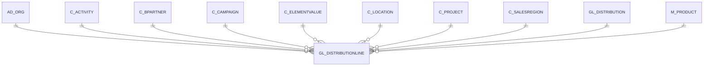

# GL_DISTRIBUTIONLINE

Area [GL](../../data-model/gl/index.md) · class **business** (proposed) · read from database `idempiere-db` (owner `ADEMPIERE`) · 2 row(s) when profiled

Application model: `org.compiere.model.X_GL_DistributionLine`, access level 2 - Client.

## Columns

| column | type | key | not null | business name | references (code) | nulls | distinct |
|---|---|---|---|---|---|---|---|
| `GL_DISTRIBUTIONLINE_ID` | NUMBER(10,0) | PK | yes | GL Distribution Line |  | 0 | 2 |
| `AD_CLIENT_ID` | NUMBER(10,0) |  | yes | Tenant |  | 0 | 1 |
| `AD_ORG_ID` | NUMBER(10,0) |  | yes | Organization |  | 0 | 1 |
| `ISACTIVE` | CHAR(1) |  | yes | Active |  | 0 | 1 |
| `CREATED` | DATE |  | yes | Created |  | 0 | 2 |
| `CREATEDBY` | NUMBER(10,0) |  | yes | Created By |  | 0 | 1 |
| `UPDATED` | DATE |  | yes | Updated |  | 0 | 2 |
| `UPDATEDBY` | NUMBER(10,0) |  | yes | Updated By |  | 0 | 1 |
| `GL_DISTRIBUTION_ID` | NUMBER(10,0) |  | yes | GL Distribution | [GL_DISTRIBUTION](../../data-model/gl/gl_distribution.md) | 0 | 1 |
| `LINE` | NUMBER(10,0) |  | yes | Line No |  | 0 | 2 |
| `PERCENT` | NUMBER |  | yes | Percent |  | 0 | 2 |
| `DESCRIPTION` | VARCHAR2(255 CHAR) |  |  | Description |  | 0 | 2 |
| `OVERWRITEORG` | CHAR(1) |  | yes | Overwrite Organization |  | 0 | 1 |
| `ORG_ID` | NUMBER(10,0) |  |  | Organization |  | 0 | 2 |
| `OVERWRITEACCT` | CHAR(1) |  | yes | Overwrite Account |  | 0 | 1 |
| `ACCOUNT_ID` | NUMBER(10,0) |  |  | Account |  | 2 | 0 |
| `OVERWRITEPRODUCT` | CHAR(1) |  | yes | Overwrite Product |  | 0 | 1 |
| `M_PRODUCT_ID` | NUMBER(10,0) |  |  | Product | [M_PRODUCT](../../data-model/m/m_product.md) | 2 | 0 |
| `OVERWRITEBPARTNER` | CHAR(1) |  | yes | Overwrite Bus.Partner |  | 0 | 1 |
| `C_BPARTNER_ID` | NUMBER(10,0) |  |  | Business Partner | [C_BPARTNER](../../data-model/c/c_bpartner.md) | 2 | 0 |
| `OVERWRITEPROJECT` | CHAR(1) |  | yes | Overwrite Project |  | 0 | 1 |
| `C_PROJECT_ID` | NUMBER(10,0) |  |  | Project | [C_PROJECT](../../data-model/c/c_project.md) | 2 | 0 |
| `OVERWRITECAMPAIGN` | CHAR(1) |  | yes | Overwrite Campaign |  | 0 | 1 |
| `C_CAMPAIGN_ID` | NUMBER(10,0) |  |  | Campaign | [C_CAMPAIGN](../../data-model/c/c_campaign.md) | 2 | 0 |
| `OVERWRITEACTIVITY` | CHAR(1) |  | yes | Overwrite Activity |  | 0 | 1 |
| `C_ACTIVITY_ID` | NUMBER(10,0) |  |  | Activity | [C_ACTIVITY](../../data-model/c/c_activity.md) | 2 | 0 |
| `OVERWRITESALESREGION` | CHAR(1) |  | yes | Overwrite Sales Region |  | 0 | 1 |
| `C_SALESREGION_ID` | NUMBER(10,0) |  |  | Sales Region | [C_SALESREGION](../../data-model/c/c_salesregion.md) | 2 | 0 |
| `OVERWRITEORGTRX` | CHAR(1) |  | yes | Overwrite Trx Organization |  | 0 | 1 |
| `AD_ORGTRX_ID` | NUMBER(10,0) |  |  | Trx Organization |  | 2 | 0 |
| `OVERWRITELOCTO` | CHAR(1) |  | yes | Overwrite Location To |  | 0 | 1 |
| `C_LOCTO_ID` | NUMBER(10,0) |  |  | Location To | [C_LOCATION](../../data-model/c/c_location.md) | 2 | 0 |
| `OVERWRITELOCFROM` | CHAR(1) |  | yes | Overwrite Location From |  | 0 | 1 |
| `C_LOCFROM_ID` | NUMBER(10,0) |  |  | Location From | [C_LOCATION](../../data-model/c/c_location.md) | 2 | 0 |
| `OVERWRITEUSER1` | CHAR(1) |  | yes | Overwrite User1 |  | 0 | 1 |
| `USER1_ID` | NUMBER(10,0) |  |  | User Element List 1 | [C_ELEMENTVALUE](../../data-model/c/c_elementvalue.md) | 2 | 0 |
| `OVERWRITEUSER2` | CHAR(1) |  | yes | Overwrite User2 |  | 0 | 1 |
| `USER2_ID` | NUMBER(10,0) |  |  | User Element List 2 | [C_ELEMENTVALUE](../../data-model/c/c_elementvalue.md) | 2 | 0 |
| `GL_DISTRIBUTIONLINE_UU` | VARCHAR2(36 CHAR) |  |  | GL_DistributionLine_UU |  | 0 | 2 |

*references (code)* is the table the application model's code says a column points to; *Foreign keys* below are the constraints the database declares. Counts come from the profile; no value is ever shown.

## Check constraints

| name | expression |
|---|---|
| `SYS_C0021429` | `OverwriteBPartner in ('Y','N')` |
| `SYS_C0021430` | `IsActive in ('Y','N')` |
| `SYS_C0021431` | `OverwriteActivity in ('Y','N')` |
| `SYS_C0021433` | `OverwriteLocTo in ('Y','N')` |
| `SYS_C0021434` | `OverwriteUser2 in ('Y','N')` |
| `SYS_C0021435` | `OverwriteAcct in ('Y','N')` |
| `SYS_C0021436` | `OverwriteCampaign in ('Y','N')` |
| `SYS_C0021437` | `OverwriteLocFrom in ('Y','N')` |
| `SYS_C0021438` | `OverwriteSalesRegion in ('Y','N')` |
| `SYS_C0021439` | `OverwriteProject in ('Y','N')` |
| `SYS_C0021440` | `OverwriteOrgTrx in ('Y','N')` |
| `SYS_C0021442` | `OverwriteUser1 in ('Y','N')` |
| `SYS_C0021443` | `OverwriteOrg in ('Y','N')` |
| `SYS_C0021444` | `OverwriteProduct in ('Y','N')` |

## Foreign keys

**References**

| table | columns | on delete |
|---|---|---|
| [AD_ORG](../../data-model/ad/ad_org.md) | GL_DISTRIBUTIONLINE.ORG_ID → AD_ORG.AD_ORG_ID | NO ACTION |
| [C_ACTIVITY](../../data-model/c/c_activity.md) | GL_DISTRIBUTIONLINE.C_ACTIVITY_ID → C_ACTIVITY.C_ACTIVITY_ID | NO ACTION |
| [C_BPARTNER](../../data-model/c/c_bpartner.md) | GL_DISTRIBUTIONLINE.C_BPARTNER_ID → C_BPARTNER.C_BPARTNER_ID | NO ACTION |
| [C_CAMPAIGN](../../data-model/c/c_campaign.md) | GL_DISTRIBUTIONLINE.C_CAMPAIGN_ID → C_CAMPAIGN.C_CAMPAIGN_ID | NO ACTION |
| [C_ELEMENTVALUE](../../data-model/c/c_elementvalue.md) | GL_DISTRIBUTIONLINE.ACCOUNT_ID → C_ELEMENTVALUE.C_ELEMENTVALUE_ID | NO ACTION |
| [C_LOCATION](../../data-model/c/c_location.md) | GL_DISTRIBUTIONLINE.C_LOCFROM_ID → C_LOCATION.C_LOCATION_ID | NO ACTION |
| [C_PROJECT](../../data-model/c/c_project.md) | GL_DISTRIBUTIONLINE.C_PROJECT_ID → C_PROJECT.C_PROJECT_ID | NO ACTION |
| [C_SALESREGION](../../data-model/c/c_salesregion.md) | GL_DISTRIBUTIONLINE.C_SALESREGION_ID → C_SALESREGION.C_SALESREGION_ID | NO ACTION |
| [GL_DISTRIBUTION](../../data-model/gl/gl_distribution.md) | GL_DISTRIBUTIONLINE.GL_DISTRIBUTION_ID → GL_DISTRIBUTION.GL_DISTRIBUTION_ID | CASCADE |
| [M_PRODUCT](../../data-model/m/m_product.md) | GL_DISTRIBUTIONLINE.M_PRODUCT_ID → M_PRODUCT.M_PRODUCT_ID | NO ACTION |

**Referenced by**

_None._

## Write behaviour

- updates: **po_only**
- deletes: **deleted_by_users, deleted_by_cascade**
- change log: **recorded**
- evidence: 2 citation(s)

## Schema history

80 change(s); the latest:

| applied | release | operation | column | tickets |
|---|---|---|---|---|
| 2024-05-14T13:59 | iD13 | `add_column` | OverwriteEmployee | IDEMPIERE-5598 |
| 2024-05-14T13:59 | iD13 | `add_constraint` |  | IDEMPIERE-5598 |
| 2024-05-14T13:59 | iD13 | `add_column` | OverwriteDepartment | IDEMPIERE-5598 |
| 2024-05-14T13:59 | iD13 | `add_column` | M_AttributeSetInstance_ID | IDEMPIERE-5598 |
| 2024-05-14T13:59 | iD13 | `add_column` | A_Asset_ID | IDEMPIERE-5598 |
| 2024-05-14T13:59 | iD13 | `add_column` | OverwriteAttributeSetInstance | IDEMPIERE-5598 |
| 2024-05-14T13:59 | iD13 | `add_column` | M_Warehouse_ID | IDEMPIERE-5598 |
| 2024-05-14T13:59 | iD13 | `add_column` | C_Department_ID | IDEMPIERE-5598 |
| 2024-05-14T13:59 | iD13 | `add_constraint` |  | IDEMPIERE-5598 |
| 2024-05-14T13:59 | iD13 | `add_column` | OverwriteWarehouse | IDEMPIERE-5598 |
| 2024-05-14T13:59 | iD13 | `add_column` | OverwriteCharge | IDEMPIERE-5598 |
| 2024-05-14T13:59 | iD13 | `add_column` | OverwriteAsset | IDEMPIERE-5598 |
| 2024-05-14T13:59 | iD13 | `add_column` | OverwriteEmployee | IDEMPIERE-5598 |
| 2024-05-14T13:59 | iD13 | `add_column` | OverwriteAsset | IDEMPIERE-5598 |
| 2024-05-14T13:59 | iD13 | `add_constraint` |  | IDEMPIERE-5598 |

## Open conflicts

| type | attribute | explanation |
|---|---|---|
| `model_column_missing` | `columns.A_Asset_ID` | unexplained |
| `model_column_missing` | `columns.C_Charge_ID` | unexplained |
| `model_column_missing` | `columns.C_CostCenter_ID` | unexplained |
| `model_column_missing` | `columns.C_Department_ID` | unexplained |
| `model_column_missing` | `columns.C_Employee_ID` | unexplained |
| `model_column_missing` | `columns.M_AttributeSetInstance_ID` | unexplained |
| `model_column_missing` | `columns.M_Warehouse_ID` | unexplained |
| `model_column_missing` | `columns.OverwriteAsset` | unexplained |
| `model_column_missing` | `columns.OverwriteAttributeSetInstance` | unexplained |
| `model_column_missing` | `columns.OverwriteCharge` | unexplained |
| `model_column_missing` | `columns.OverwriteCostCenter` | unexplained |
| `model_column_missing` | `columns.OverwriteDepartment` | unexplained |
| `model_column_missing` | `columns.OverwriteEmployee` | unexplained |
| `model_column_missing` | `columns.OverwriteWarehouse` | unexplained |

## Notes

<!-- ekos:manual id="table.gl_distributionline.notes" -->
_Business notes about this table._
<!-- /ekos:manual -->
