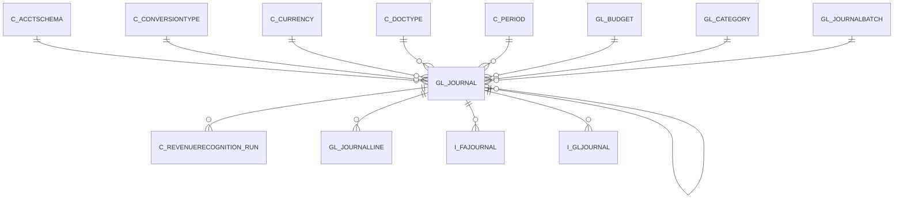

# GL_JOURNAL

Area [GL](../../data-model/gl/index.md) · class **business** (proposed) · read from database `idempiere-db` (owner `ADEMPIERE`) · 2 row(s) when profiled

Application model: `org.compiere.model.X_GL_Journal`, access level 1 - Org.

## Columns

| column | type | key | not null | business name | references (code) | nulls | distinct |
|---|---|---|---|---|---|---|---|
| `GL_JOURNAL_ID` | NUMBER(10,0) | PK | yes | Journal |  | 0 | 2 |
| `AD_CLIENT_ID` | NUMBER(10,0) |  | yes | Tenant |  | 0 | 1 |
| `AD_ORG_ID` | NUMBER(10,0) |  | yes | Organization |  | 0 | 1 |
| `ISACTIVE` | CHAR(1) |  | yes | Active |  | 0 | 1 |
| `CREATED` | DATE |  | yes | Created |  | 0 | 2 |
| `CREATEDBY` | NUMBER(10,0) |  | yes | Created By |  | 0 | 1 |
| `UPDATED` | DATE |  | yes | Updated |  | 0 | 2 |
| `UPDATEDBY` | NUMBER(10,0) |  | yes | Updated By |  | 0 | 2 |
| `C_ACCTSCHEMA_ID` | NUMBER(10,0) |  | yes | Accounting Schema | [C_ACCTSCHEMA](../../data-model/c/c_acctschema.md) | 0 | 2 |
| `C_DOCTYPE_ID` | NUMBER(10,0) |  | yes | Document Type | [C_DOCTYPE](../../data-model/c/c_doctype.md) | 0 | 1 |
| `DOCUMENTNO` | VARCHAR2(30 CHAR) |  | yes | Document No |  | 0 | 2 |
| `DOCSTATUS` | CHAR(2) |  | yes | Document Status |  | 0 | 1 |
| `DOCACTION` | CHAR(2) |  | yes | Document Action |  | 0 | 2 |
| `ISAPPROVED` | CHAR(1) |  | yes | Approved |  | 0 | 1 |
| `ISPRINTED` | CHAR(1) |  | yes | Printed |  | 0 | 1 |
| `DESCRIPTION` | VARCHAR2(255 CHAR) |  | yes | Description |  | 0 | 1 |
| `POSTINGTYPE` | CHAR(1) |  | yes | Posting Type |  | 0 | 1 |
| `GL_BUDGET_ID` | NUMBER(10,0) |  |  | Budget | [GL_BUDGET](../../data-model/gl/gl_budget.md) | 2 | 0 |
| `GL_CATEGORY_ID` | NUMBER(10,0) |  | yes | GL Category | [GL_CATEGORY](../../data-model/gl/gl_category.md) | 0 | 1 |
| `DATEDOC` | DATE |  | yes | Document Date |  | 0 | 1 |
| `DATEACCT` | DATE |  | yes | Account Date |  | 0 | 1 |
| `C_PERIOD_ID` | NUMBER(10,0) |  | yes | Period | [C_PERIOD](../../data-model/c/c_period.md) | 0 | 1 |
| `C_CURRENCY_ID` | NUMBER(10,0) |  |  | Currency | [C_CURRENCY](../../data-model/c/c_currency.md) | 0 | 2 |
| `CURRENCYRATE` | NUMBER |  | yes | Rate |  | 0 | 1 |
| `GL_JOURNALBATCH_ID` | NUMBER(10,0) |  |  | Journal Batch | [GL_JOURNALBATCH](../../data-model/gl/gl_journalbatch.md) | 0 | 1 |
| `TOTALDR` | NUMBER |  | yes | Total Debit |  | 0 | 2 |
| `TOTALCR` | NUMBER |  | yes | Total Credit |  | 0 | 2 |
| `CONTROLAMT` | NUMBER |  |  | Control Amount |  | 0 | 1 |
| `PROCESSING` | CHAR(1) |  |  | Process Now |  | 0 | 1 |
| `PROCESSED` | CHAR(1) |  |  | Processed |  | 0 | 1 |
| `POSTED` | CHAR(1) |  | yes | Posted |  | 0 | 1 |
| `C_CONVERSIONTYPE_ID` | NUMBER(10,0) |  | yes | Currency Type | [C_CONVERSIONTYPE](../../data-model/c/c_conversiontype.md) | 0 | 1 |
| `REVERSAL_ID` | NUMBER(10,0) |  |  | Reversal ID | [GL_JOURNAL](../../data-model/gl/gl_journal.md) | 2 | 0 |
| `PROCESSEDON` | NUMBER |  |  | Processed On |  | 1 | 1 |
| `GL_JOURNAL_UU` | VARCHAR2(36 CHAR) |  |  | GL_Journal_UU |  | 0 | 2 |
| `COPYFROM` | CHAR(1) |  |  | Copy From |  | 2 | 0 |

*references (code)* is the table the application model's code says a column points to; *Foreign keys* below are the constraints the database declares. Counts come from the profile; no value is ever shown.

## Check constraints

| name | expression |
|---|---|
| `SYS_C0020617` | `IsApproved in ('Y','N')` |
| `SYS_C0020618` | `IsPrinted in ('Y','N')` |
| `SYS_C0020619` | `IsActive in ('Y','N')` |
| `SYS_C0020621` | `Processed in ('Y','N')` |

## Foreign keys

**References**

| table | columns | on delete |
|---|---|---|
| [C_ACCTSCHEMA](../../data-model/c/c_acctschema.md) | GL_JOURNAL.C_ACCTSCHEMA_ID → C_ACCTSCHEMA.C_ACCTSCHEMA_ID | NO ACTION |
| [C_CONVERSIONTYPE](../../data-model/c/c_conversiontype.md) | GL_JOURNAL.C_CONVERSIONTYPE_ID → C_CONVERSIONTYPE.C_CONVERSIONTYPE_ID | NO ACTION |
| [C_CURRENCY](../../data-model/c/c_currency.md) | GL_JOURNAL.C_CURRENCY_ID → C_CURRENCY.C_CURRENCY_ID | NO ACTION |
| [C_DOCTYPE](../../data-model/c/c_doctype.md) | GL_JOURNAL.C_DOCTYPE_ID → C_DOCTYPE.C_DOCTYPE_ID | NO ACTION |
| [C_PERIOD](../../data-model/c/c_period.md) | GL_JOURNAL.C_PERIOD_ID → C_PERIOD.C_PERIOD_ID | NO ACTION |
| [GL_BUDGET](../../data-model/gl/gl_budget.md) | GL_JOURNAL.GL_BUDGET_ID → GL_BUDGET.GL_BUDGET_ID | NO ACTION |
| [GL_CATEGORY](../../data-model/gl/gl_category.md) | GL_JOURNAL.GL_CATEGORY_ID → GL_CATEGORY.GL_CATEGORY_ID | NO ACTION |
| [GL_JOURNAL](../../data-model/gl/gl_journal.md) | GL_JOURNAL.REVERSAL_ID → GL_JOURNAL.GL_JOURNAL_ID | NO ACTION |
| [GL_JOURNALBATCH](../../data-model/gl/gl_journalbatch.md) | GL_JOURNAL.GL_JOURNALBATCH_ID → GL_JOURNALBATCH.GL_JOURNALBATCH_ID | CASCADE |

**Referenced by**

| table | columns | on delete |
|---|---|---|
| [C_REVENUERECOGNITION_RUN](../../data-model/c/c_revenuerecognition_run.md) | C_REVENUERECOGNITION_RUN.GL_JOURNAL_ID → GL_JOURNAL.GL_JOURNAL_ID | NO ACTION |
| [GL_JOURNAL](../../data-model/gl/gl_journal.md) | GL_JOURNAL.REVERSAL_ID → GL_JOURNAL.GL_JOURNAL_ID | NO ACTION |
| [GL_JOURNALLINE](../../data-model/gl/gl_journalline.md) | GL_JOURNALLINE.GL_JOURNAL_ID → GL_JOURNAL.GL_JOURNAL_ID | CASCADE |
| `I_FAJOURNAL` | I_FAJOURNAL.GL_JOURNAL_ID → GL_JOURNAL.GL_JOURNAL_ID | NO ACTION |
| `I_GLJOURNAL` | I_GLJOURNAL.GL_JOURNAL_ID → GL_JOURNAL.GL_JOURNAL_ID | SET NULL |

## Write behaviour

- updates: **raw_sql_skips_updated**
- deletes: **deleted_by_app, deleted_by_users, deleted_by_cascade**
- change log: **recorded**
- evidence: 4 citation(s)

## Read by

| kind | name |
|---|---|
| View | `RV_UNPOSTED` |
| View | `RV_UNPROCESSED` |
| View | `rv_unposted` |
| View | `rv_unprocessed` |

## Schema history

36 change(s); the latest:

| applied | release | operation | column | tickets |
|---|---|---|---|---|
| 2023-04-09T15:47 | iD11 | `add_constraint` |  | IDEMPIERE-5567 |
| 2023-04-09T15:47 | iD11 | `add_constraint` |  | IDEMPIERE-5567 |
| 2021-12-05T16:45 | i8.2z | `drop_constraint` |  | IDEMPIERE-5075 |
| 2021-12-05T16:45 | i8.2z | `add_constraint` |  | IDEMPIERE-5075 |
| 2021-12-05T16:45 | i8.2z | `add_constraint` |  | IDEMPIERE-5075 |
| 2021-12-05T16:45 | i8.2z | `drop_constraint` |  | IDEMPIERE-5075 |
| 2021-12-05T16:45 | i8.2z | `drop_constraint` |  | IDEMPIERE-5075 |
| 2021-12-05T16:45 | i8.2z | `add_constraint` |  | IDEMPIERE-5075 |
| 2021-12-05T16:45 | i8.2z | `add_constraint` |  | IDEMPIERE-5075 |
| 2021-12-05T16:45 | i8.2z | `add_constraint` |  | IDEMPIERE-5075 |
| 2021-12-05T16:45 | i8.2z | `drop_constraint` |  | IDEMPIERE-5075 |
| 2021-12-05T16:45 | i8.2z | `drop_constraint` |  | IDEMPIERE-5075 |
| 2021-12-05T16:45 | i8.2z | `drop_constraint` |  | IDEMPIERE-5075 |
| 2021-12-05T16:45 | i8.2z | `add_constraint` |  | IDEMPIERE-5075 |
| 2021-12-05T16:45 | i8.2z | `add_constraint` |  | IDEMPIERE-5075 |

## Open conflicts

| type | attribute | explanation |
|---|---|---|
| `mandatory_but_nullable` | `columns.C_Currency_ID.nullable` | unexplained |

## Notes

<!-- ekos:manual id="table.gl_journal.notes" -->
_Business notes about this table._
<!-- /ekos:manual -->
