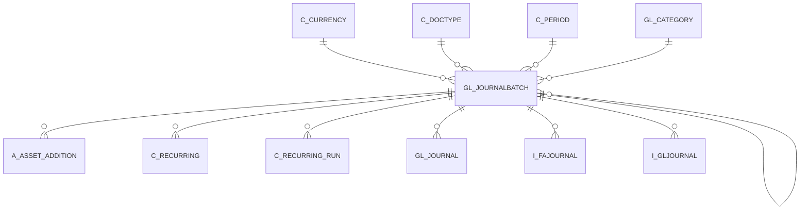

# GL_JOURNALBATCH

Area [GL](../../data-model/gl/index.md) · class **business** (proposed) · read from database `idempiere-db` (owner `ADEMPIERE`) · 1 row(s) when profiled

Application model: `org.compiere.model.X_GL_JournalBatch`, access level 1 - Org.

## Columns

| column | type | key | not null | business name | references (code) | nulls | distinct |
|---|---|---|---|---|---|---|---|
| `GL_JOURNALBATCH_ID` | NUMBER(10,0) | PK | yes | Journal Batch |  | 0 | 1 |
| `AD_CLIENT_ID` | NUMBER(10,0) |  | yes | Tenant |  | 0 | 1 |
| `AD_ORG_ID` | NUMBER(10,0) |  | yes | Organization |  | 0 | 1 |
| `ISACTIVE` | CHAR(1) |  | yes | Active |  | 0 | 1 |
| `CREATED` | DATE |  | yes | Created |  | 0 | 1 |
| `CREATEDBY` | NUMBER(10,0) |  | yes | Created By |  | 0 | 1 |
| `UPDATED` | DATE |  | yes | Updated |  | 0 | 1 |
| `UPDATEDBY` | NUMBER(10,0) |  | yes | Updated By |  | 0 | 1 |
| `DOCUMENTNO` | VARCHAR2(30 CHAR) |  | yes | Document No |  | 0 | 1 |
| `DESCRIPTION` | VARCHAR2(255 CHAR) |  | yes | Description |  | 0 | 1 |
| `POSTINGTYPE` | CHAR(1) |  | yes | Posting Type |  | 0 | 1 |
| `GL_CATEGORY_ID` | NUMBER(10,0) |  |  | GL Category | [GL_CATEGORY](../../data-model/gl/gl_category.md) | 0 | 1 |
| `DATEDOC` | DATE |  |  | Document Date |  | 0 | 1 |
| `DATEACCT` | DATE |  |  | Account Date |  | 0 | 1 |
| `C_PERIOD_ID` | NUMBER(10,0) |  |  | Period | [C_PERIOD](../../data-model/c/c_period.md) | 0 | 1 |
| `C_CURRENCY_ID` | NUMBER(10,0) |  |  | Currency | [C_CURRENCY](../../data-model/c/c_currency.md) | 0 | 1 |
| `TOTALDR` | NUMBER |  | yes | Total Debit |  | 0 | 1 |
| `TOTALCR` | NUMBER |  | yes | Total Credit |  | 0 | 1 |
| `CONTROLAMT` | NUMBER |  |  | Control Amount |  | 0 | 1 |
| `PROCESSING` | CHAR(1) |  | yes | Process Now |  | 0 | 1 |
| `PROCESSED` | CHAR(1) |  | yes | Processed |  | 0 | 1 |
| `COPYFROM` | CHAR(1) |  |  | Copy From |  | 1 | 0 |
| `C_DOCTYPE_ID` | NUMBER(10,0) |  | yes | Document Type | [C_DOCTYPE](../../data-model/c/c_doctype.md) | 0 | 1 |
| `DOCSTATUS` | CHAR(2) |  | yes | Document Status |  | 0 | 1 |
| `DOCACTION` | CHAR(2) |  | yes | Document Action |  | 0 | 1 |
| `ISAPPROVED` | CHAR(1) |  |  | Approved |  | 0 | 1 |
| `REVERSAL_ID` | NUMBER(10,0) |  |  | Reversal ID | [GL_JOURNALBATCH](../../data-model/gl/gl_journalbatch.md) | 1 | 0 |
| `GL_JOURNALBATCH_UU` | VARCHAR2(36 CHAR) |  |  | GL_JournalBatch_UU |  | 0 | 1 |

*references (code)* is the table the application model's code says a column points to; *Foreign keys* below are the constraints the database declares. Counts come from the profile; no value is ever shown.

## Check constraints

| name | expression |
|---|---|
| `SYS_C0023050` | `Processing in ('Y','N')` |
| `SYS_C0023052` | `IsActive in ('Y','N')` |
| `SYS_C0023054` | `Processed in ('Y','N')` |

## Foreign keys

**References**

| table | columns | on delete |
|---|---|---|
| [C_CURRENCY](../../data-model/c/c_currency.md) | GL_JOURNALBATCH.C_CURRENCY_ID → C_CURRENCY.C_CURRENCY_ID | NO ACTION |
| [C_DOCTYPE](../../data-model/c/c_doctype.md) | GL_JOURNALBATCH.C_DOCTYPE_ID → C_DOCTYPE.C_DOCTYPE_ID | NO ACTION |
| [C_PERIOD](../../data-model/c/c_period.md) | GL_JOURNALBATCH.C_PERIOD_ID → C_PERIOD.C_PERIOD_ID | NO ACTION |
| [GL_CATEGORY](../../data-model/gl/gl_category.md) | GL_JOURNALBATCH.GL_CATEGORY_ID → GL_CATEGORY.GL_CATEGORY_ID | NO ACTION |
| [GL_JOURNALBATCH](../../data-model/gl/gl_journalbatch.md) | GL_JOURNALBATCH.REVERSAL_ID → GL_JOURNALBATCH.GL_JOURNALBATCH_ID | NO ACTION |

**Referenced by**

| table | columns | on delete |
|---|---|---|
| [A_ASSET_ADDITION](../../data-model/a/a_asset_addition.md) | A_ASSET_ADDITION.GL_JOURNALBATCH_ID → GL_JOURNALBATCH.GL_JOURNALBATCH_ID | NO ACTION |
| [C_RECURRING](../../data-model/c/c_recurring.md) | C_RECURRING.GL_JOURNALBATCH_ID → GL_JOURNALBATCH.GL_JOURNALBATCH_ID | NO ACTION |
| [C_RECURRING_RUN](../../data-model/c/c_recurring_run.md) | C_RECURRING_RUN.GL_JOURNALBATCH_ID → GL_JOURNALBATCH.GL_JOURNALBATCH_ID | NO ACTION |
| [GL_JOURNAL](../../data-model/gl/gl_journal.md) | GL_JOURNAL.GL_JOURNALBATCH_ID → GL_JOURNALBATCH.GL_JOURNALBATCH_ID | CASCADE |
| [GL_JOURNALBATCH](../../data-model/gl/gl_journalbatch.md) | GL_JOURNALBATCH.REVERSAL_ID → GL_JOURNALBATCH.GL_JOURNALBATCH_ID | NO ACTION |
| `I_FAJOURNAL` | I_FAJOURNAL.GL_JOURNALBATCH_ID → GL_JOURNALBATCH.GL_JOURNALBATCH_ID | NO ACTION |
| `I_GLJOURNAL` | I_GLJOURNAL.GL_JOURNALBATCH_ID → GL_JOURNALBATCH.GL_JOURNALBATCH_ID | SET NULL |

## Write behaviour

- updates: **raw_sql_skips_updated**
- deletes: **deleted_by_users**
- change log: **recorded**
- evidence: 3 citation(s)

## Schema history

26 change(s); the latest:

| applied | release | operation | column | tickets |
|---|---|---|---|---|
| 2023-04-09T15:47 | iD11 | `add_constraint` |  | IDEMPIERE-5567 |
| 2023-04-09T15:47 | iD11 | `add_constraint` |  | IDEMPIERE-5567 |
| 2021-12-05T16:45 | i8.2z | `add_constraint` |  | IDEMPIERE-5075 |
| 2021-12-05T16:45 | i8.2z | `add_constraint` |  | IDEMPIERE-5075 |
| 2021-12-05T16:45 | i8.2z | `drop_constraint` |  | IDEMPIERE-5075 |
| 2021-12-05T16:45 | i8.2z | `add_constraint` |  | IDEMPIERE-5075 |
| 2021-12-05T16:45 | i8.2z | `drop_constraint` |  | IDEMPIERE-5075 |
| 2021-12-05T16:45 | i8.2z | `drop_constraint` |  | IDEMPIERE-5075 |
| 2021-12-05T16:45 | i8.2z | `drop_constraint` |  | IDEMPIERE-5075 |
| 2021-12-05T16:45 | i8.2z | `add_constraint` |  | IDEMPIERE-5075 |
| 2021-12-05T16:45 | i8.2z | `drop_constraint` |  | IDEMPIERE-5075 |
| 2021-12-05T16:45 | i8.2z | `add_constraint` |  | IDEMPIERE-5075 |
| 2020-08-04T01:00 | i7.1z | `modify_column` | DOCUMENTNO | IDEMPIERE-3862 |
| 2020-08-04T01:00 | i7.1z | `drop_column` | tmp_col_2_tmp | IDEMPIERE-3862 |
| 2020-08-04T01:00 | i7.1z | `modify_column` | DESCRIPTION | IDEMPIERE-3862 |

## Notes

<!-- ekos:manual id="table.gl_journalbatch.notes" -->
_Business notes about this table._
<!-- /ekos:manual -->
