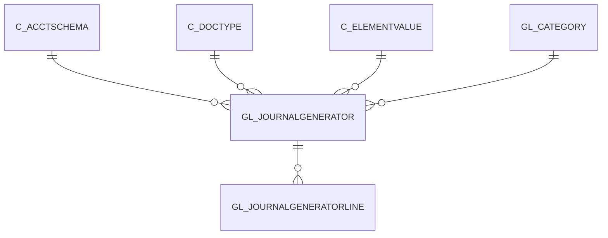

# GL_JOURNALGENERATOR

Area [GL](../../data-model/gl/index.md) · class **business** (proposed) · read from database `idempiere-db` (owner `ADEMPIERE`) · 2 row(s) when profiled

Application model: `org.compiere.model.X_GL_JournalGenerator`, access level 3 - Client - Org.

## Columns

| column | type | key | not null | business name | references (code) | nulls | distinct |
|---|---|---|---|---|---|---|---|
| `GL_JOURNALGENERATOR_ID` | NUMBER(10,0) | PK | yes | GL Journal Generator |  | 0 | 2 |
| `AD_CLIENT_ID` | NUMBER(10,0) |  | yes | Tenant |  | 0 | 1 |
| `AD_ORG_ID` | NUMBER(10,0) |  | yes | Organization |  | 0 | 1 |
| `CREATED` | DATE |  | yes | Created |  | 0 | 2 |
| `CREATEDBY` | NUMBER(10,0) |  | yes | Created By |  | 0 | 1 |
| `DESCRIPTION` | VARCHAR2(255 CHAR) |  |  | Description |  | 0 | 2 |
| `HELP` | VARCHAR2(2000 CHAR) |  |  | Comment/Help |  | 0 | 2 |
| `ISACTIVE` | CHAR(1) |  | yes | Active |  | 0 | 1 |
| `NAME` | VARCHAR2(60 CHAR) |  | yes | Name |  | 0 | 2 |
| `UPDATED` | DATE |  | yes | Updated |  | 0 | 2 |
| `UPDATEDBY` | NUMBER(10,0) |  | yes | Updated By |  | 0 | 1 |
| `C_ELEMENTVALUEADJUSTDR_ID` | NUMBER(10,0) |  |  | Account Adjust DR | [C_ELEMENTVALUE](../../data-model/c/c_elementvalue.md) | 0 | 2 |
| `C_ELEMENTVALUEADJUSTCR_ID` | NUMBER(10,0) |  |  | Account Adjust CR | [C_ELEMENTVALUE](../../data-model/c/c_elementvalue.md) | 0 | 2 |
| `C_DOCTYPE_ID` | NUMBER(10,0) |  |  | Document Type | [C_DOCTYPE](../../data-model/c/c_doctype.md) | 0 | 1 |
| `GL_CATEGORY_ID` | NUMBER(10,0) |  |  | GL Category | [GL_CATEGORY](../../data-model/gl/gl_category.md) | 0 | 1 |
| `GENERATEGLJOURNAL` | CHAR(1) |  |  | Generate GL Journal |  | 0 | 1 |
| `C_ACCTSCHEMA_ID` | NUMBER(10,0) |  |  | Accounting Schema | [C_ACCTSCHEMA](../../data-model/c/c_acctschema.md) | 0 | 1 |
| `POSTINGTYPE` | CHAR(1) |  |  | Posting Type |  | 0 | 1 |
| `GL_JOURNALGENERATOR_UU` | VARCHAR2(36 CHAR) |  |  | GL_JournalGenerator_UU |  | 0 | 2 |

*references (code)* is the table the application model's code says a column points to; *Foreign keys* below are the constraints the database declares. Counts come from the profile; no value is ever shown.

## Check constraints

| name | expression |
|---|---|
| `SYS_C0020548` | `IsActive IN ('Y','N')` |

## Foreign keys

**References**

| table | columns | on delete |
|---|---|---|
| [C_ACCTSCHEMA](../../data-model/c/c_acctschema.md) | GL_JOURNALGENERATOR.C_ACCTSCHEMA_ID → C_ACCTSCHEMA.C_ACCTSCHEMA_ID | NO ACTION |
| [C_DOCTYPE](../../data-model/c/c_doctype.md) | GL_JOURNALGENERATOR.C_DOCTYPE_ID → C_DOCTYPE.C_DOCTYPE_ID | NO ACTION |
| [C_ELEMENTVALUE](../../data-model/c/c_elementvalue.md) | GL_JOURNALGENERATOR.C_ELEMENTVALUEADJUSTCR_ID → C_ELEMENTVALUE.C_ELEMENTVALUE_ID | NO ACTION |
| [GL_CATEGORY](../../data-model/gl/gl_category.md) | GL_JOURNALGENERATOR.GL_CATEGORY_ID → GL_CATEGORY.GL_CATEGORY_ID | NO ACTION |

**Referenced by**

| table | columns | on delete |
|---|---|---|
| [GL_JOURNALGENERATORLINE](../../data-model/gl/gl_journalgeneratorline.md) | GL_JOURNALGENERATORLINE.GL_JOURNALGENERATOR_ID → GL_JOURNALGENERATOR.GL_JOURNALGENERATOR_ID | NO ACTION |

## Write behaviour

- updates: **po_only**
- deletes: **deleted_by_users**
- change log: **recorded**
- evidence: 1 citation(s)

## Schema history

38 change(s); the latest:

| applied | release | operation | column | tickets |
|---|---|---|---|---|
| 2023-04-09T15:47 | iD11 | `add_constraint` |  | IDEMPIERE-5567 |
| 2023-04-09T15:47 | iD11 | `add_constraint` |  | IDEMPIERE-5567 |
| 2021-12-05T16:45 | i8.2z | `drop_constraint` |  | IDEMPIERE-5075 |
| 2021-12-05T16:45 | i8.2z | `drop_constraint` |  | IDEMPIERE-5075 |
| 2021-12-05T16:45 | i8.2z | `drop_constraint` |  | IDEMPIERE-5075 |
| 2021-12-05T16:45 | i8.2z | `add_constraint` |  | IDEMPIERE-5075 |
| 2021-12-05T16:45 | i8.2z | `drop_constraint` |  | IDEMPIERE-5075 |
| 2021-12-05T16:45 | i8.2z | `drop_constraint` |  | IDEMPIERE-5075 |
| 2021-12-05T16:45 | i8.2z | `add_constraint` |  | IDEMPIERE-5075 |
| 2021-12-05T16:45 | i8.2z | `add_constraint` |  | IDEMPIERE-5075 |
| 2021-12-05T16:45 | i8.2z | `add_constraint` |  | IDEMPIERE-5075 |
| 2021-12-05T16:45 | i8.2z | `add_constraint` |  | IDEMPIERE-5075 |
| 2020-08-06T18:11 | i7.1z | `modify_column` | GenerateGLJournal | IDEMPIERE-4398 |
| 2020-08-06T18:11 | i7.1z | `modify_column` | GenerateGLJournal | IDEMPIERE-4398 |
| 2020-08-06T18:11 | i7.1z | `modify_column` | GenerateGLJournal | IDEMPIERE-4398 |

## Notes

<!-- ekos:manual id="table.gl_journalgenerator.notes" -->
_Business notes about this table._
<!-- /ekos:manual -->
