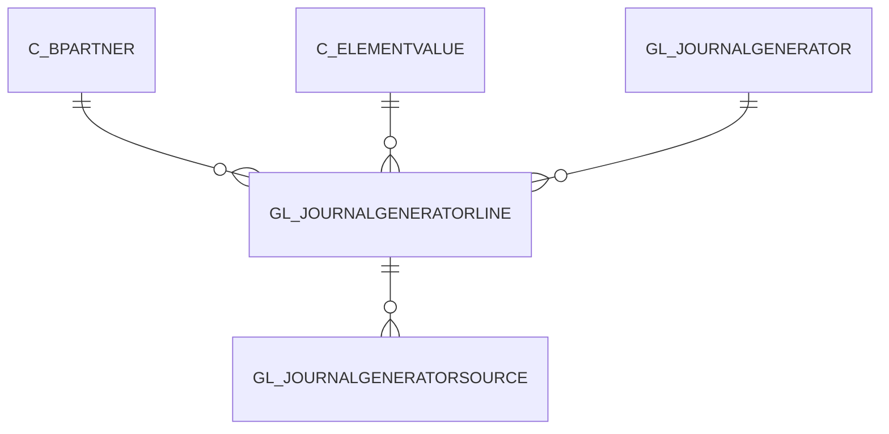

# GL_JOURNALGENERATORLINE

Area [GL](../../data-model/gl/index.md) · class **business** (proposed) · read from database `idempiere-db` (owner `ADEMPIERE`) · 6 row(s) when profiled

Application model: `org.compiere.model.X_GL_JournalGeneratorLine`, access level 3 - Client - Org.

## Columns

| column | type | key | not null | business name | references (code) | nulls | distinct |
|---|---|---|---|---|---|---|---|
| `GL_JOURNALGENERATORLINE_ID` | NUMBER(10,0) | PK | yes | Generator Line |  | 0 | 6 |
| `AD_CLIENT_ID` | NUMBER(10,0) |  | yes | Tenant |  | 0 | 1 |
| `AD_ORG_ID` | NUMBER(10,0) |  | yes | Organization |  | 0 | 1 |
| `CREATED` | DATE |  | yes | Created |  | 0 | 6 |
| `CREATEDBY` | NUMBER(10,0) |  | yes | Created By |  | 0 | 1 |
| `DESCRIPTION` | VARCHAR2(255 CHAR) |  |  | Description |  | 0 | 6 |
| `HELP` | VARCHAR2(2000 CHAR) |  |  | Comment/Help |  | 6 | 0 |
| `ISACTIVE` | CHAR(1) |  | yes | Active |  | 0 | 1 |
| `GL_JOURNALGENERATOR_ID` | NUMBER(10,0) |  | yes | GL Journal Generator | [GL_JOURNALGENERATOR](../../data-model/gl/gl_journalgenerator.md) | 0 | 2 |
| `UPDATED` | DATE |  | yes | Updated |  | 0 | 6 |
| `UPDATEDBY` | NUMBER(10,0) |  | yes | Updated By |  | 0 | 1 |
| `SEQNO` | NUMBER(10,0) |  | yes | Sequence |  | 0 | 5 |
| `C_ELEMENTVALUEDR_ID` | NUMBER(10,0) |  |  | Account DR | [C_ELEMENTVALUE](../../data-model/c/c_elementvalue.md) | 6 | 0 |
| `C_ELEMENTVALUECR_ID` | NUMBER(10,0) |  |  | Account CR | [C_ELEMENTVALUE](../../data-model/c/c_elementvalue.md) | 5 | 1 |
| `BPDIMENSIONTYPE` | CHAR(1) |  |  | Type of BP Dimension |  | 6 | 0 |
| `C_BPARTNER_ID` | NUMBER(10,0) |  |  | Business Partner | [C_BPARTNER](../../data-model/c/c_bpartner.md) | 6 | 0 |
| `BPCOLUMN` | VARCHAR2(124 CHAR) |  |  | BP Column |  | 6 | 0 |
| `ISCOPYALLDIMENSIONS` | CHAR(1) |  | yes | Copy All Dimensions |  | 0 | 2 |
| `ISSAMEPRODUCT` | CHAR(1) |  | yes | Same Product |  | 0 | 1 |
| `AMTMULTIPLIER` | NUMBER |  |  | Multiplier Amount |  | 0 | 2 |
| `ROUNDFACTOR` | NUMBER(10,0) |  |  | Round Factor |  | 0 | 1 |
| `GL_JOURNALGENERATORLINE_UU` | VARCHAR2(36 CHAR) |  |  | GL_JournalGeneratorLine_UU |  | 0 | 6 |

*references (code)* is the table the application model's code says a column points to; *Foreign keys* below are the constraints the database declares. Counts come from the profile; no value is ever shown.

## Check constraints

| name | expression |
|---|---|
| `SYS_C0020418` | `IsActive IN ('Y','N')` |
| `SYS_C0020419` | `IsCopyAllDimensions IN ('Y','N')` |
| `SYS_C0020422` | `IsSameProduct IN ('Y','N')` |

## Foreign keys

**References**

| table | columns | on delete |
|---|---|---|
| [C_BPARTNER](../../data-model/c/c_bpartner.md) | GL_JOURNALGENERATORLINE.C_BPARTNER_ID → C_BPARTNER.C_BPARTNER_ID | NO ACTION |
| [C_ELEMENTVALUE](../../data-model/c/c_elementvalue.md) | GL_JOURNALGENERATORLINE.C_ELEMENTVALUECR_ID → C_ELEMENTVALUE.C_ELEMENTVALUE_ID | NO ACTION |
| [GL_JOURNALGENERATOR](../../data-model/gl/gl_journalgenerator.md) | GL_JOURNALGENERATORLINE.GL_JOURNALGENERATOR_ID → GL_JOURNALGENERATOR.GL_JOURNALGENERATOR_ID | NO ACTION |

**Referenced by**

| table | columns | on delete |
|---|---|---|
| [GL_JOURNALGENERATORSOURCE](../../data-model/gl/gl_journalgeneratorsource.md) | GL_JOURNALGENERATORSOURCE.GL_JOURNALGENERATORLINE_ID → GL_JOURNALGENERATORLINE.GL_JOURNALGENERATORLINE_ID | NO ACTION |

## Write behaviour

- updates: **po_only**
- deletes: **deleted_by_users**
- change log: **recorded**
- evidence: 1 citation(s)

## Schema history

32 change(s); the latest:

| applied | release | operation | column | tickets |
|---|---|---|---|---|
| 2024-04-03T12:26 | iD11 | `modify_column` | BPColumn | IDEMPIERE-6064 |
| 2024-04-03T12:26 | iD11 | `modify_column` | BPColumn | IDEMPIERE-6064 |
| 2023-04-09T15:47 | iD11 | `add_constraint` |  | IDEMPIERE-5567 |
| 2023-04-09T15:47 | iD11 | `add_constraint` |  | IDEMPIERE-5567 |
| 2021-12-05T16:45 | i8.2z | `drop_constraint` |  | IDEMPIERE-5075 |
| 2021-12-05T16:45 | i8.2z | `drop_constraint` |  | IDEMPIERE-5075 |
| 2021-12-05T16:45 | i8.2z | `add_constraint` |  | IDEMPIERE-5075 |
| 2021-12-05T16:45 | i8.2z | `drop_constraint` |  | IDEMPIERE-5075 |
| 2021-12-05T16:45 | i8.2z | `add_constraint` |  | IDEMPIERE-5075 |
| 2021-12-05T16:45 | i8.2z | `add_constraint` |  | IDEMPIERE-5075 |
| 2021-12-05T16:45 | i8.2z | `drop_constraint` |  | IDEMPIERE-5075 |
| 2021-12-05T16:45 | i8.2z | `add_constraint` |  | IDEMPIERE-5075 |
| 2020-08-04T01:00 | i7.1z | `add_column` | tmp_col_4_tmp | IDEMPIERE-3862 |
| 2020-08-04T01:00 | i7.1z | `add_column` | tmp_col_1_tmp | IDEMPIERE-3862 |
| 2020-08-04T01:00 | i7.1z | `modify_column` | DESCRIPTION | IDEMPIERE-3862 |

## Notes

<!-- ekos:manual id="table.gl_journalgeneratorline.notes" -->
_Business notes about this table._
<!-- /ekos:manual -->
