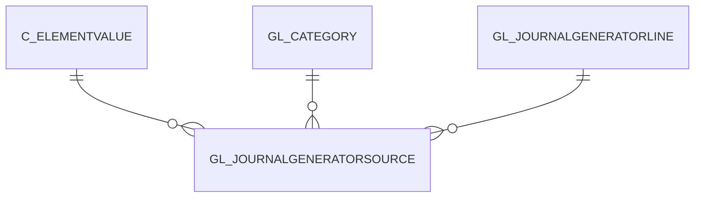

# GL_JOURNALGENERATORSOURCE

Area [GL](../../data-model/gl/index.md) · class **business** (proposed) · read from database `idempiere-db` (owner `ADEMPIERE`) · 8 row(s) when profiled

Application model: `org.compiere.model.X_GL_JournalGeneratorSource`, access level 3 - Client - Org.

## Columns

| column | type | key | not null | business name | references (code) | nulls | distinct |
|---|---|---|---|---|---|---|---|
| `GL_JOURNALGENERATORSOURCE_ID` | NUMBER(10,0) | PK | yes | Generator Source |  | 0 | 8 |
| `AD_CLIENT_ID` | NUMBER(10,0) |  | yes | Tenant |  | 0 | 1 |
| `AD_ORG_ID` | NUMBER(10,0) |  | yes | Organization |  | 0 | 1 |
| `CREATED` | DATE |  | yes | Created |  | 0 | 8 |
| `CREATEDBY` | NUMBER(10,0) |  | yes | Created By |  | 0 | 1 |
| `HELP` | VARCHAR2(2000 CHAR) |  |  | Comment/Help |  | 8 | 0 |
| `ISACTIVE` | CHAR(1) |  | yes | Active |  | 0 | 1 |
| `UPDATED` | DATE |  | yes | Updated |  | 0 | 8 |
| `UPDATEDBY` | NUMBER(10,0) |  | yes | Updated By |  | 0 | 1 |
| `GL_JOURNALGENERATORLINE_ID` | NUMBER(10,0) |  | yes | Generator Line | [GL_JOURNALGENERATORLINE](../../data-model/gl/gl_journalgeneratorline.md) | 0 | 6 |
| `C_ELEMENTVALUE_ID` | NUMBER(10,0) |  | yes | Account Element | [C_ELEMENTVALUE](../../data-model/c/c_elementvalue.md) | 0 | 8 |
| `AMTMULTIPLIER` | NUMBER |  | yes | Multiplier Amount |  | 0 | 1 |
| `ROUNDFACTOR` | NUMBER(10,0) |  |  | Round Factor |  | 0 | 1 |
| `GL_CATEGORY_ID` | NUMBER(10,0) |  |  | GL Category | [GL_CATEGORY](../../data-model/gl/gl_category.md) | 8 | 0 |
| `GL_JOURNALGENERATORSOURCE_UU` | VARCHAR2(36 CHAR) |  |  | GL_JournalGeneratorSource_UU |  | 0 | 8 |

*references (code)* is the table the application model's code says a column points to; *Foreign keys* below are the constraints the database declares. Counts come from the profile; no value is ever shown.

## Check constraints

| name | expression |
|---|---|
| `SYS_C0021606` | `IsActive IN ('Y','N')` |

## Foreign keys

**References**

| table | columns | on delete |
|---|---|---|
| [C_ELEMENTVALUE](../../data-model/c/c_elementvalue.md) | GL_JOURNALGENERATORSOURCE.C_ELEMENTVALUE_ID → C_ELEMENTVALUE.C_ELEMENTVALUE_ID | NO ACTION |
| [GL_CATEGORY](../../data-model/gl/gl_category.md) | GL_JOURNALGENERATORSOURCE.GL_CATEGORY_ID → GL_CATEGORY.GL_CATEGORY_ID | NO ACTION |
| [GL_JOURNALGENERATORLINE](../../data-model/gl/gl_journalgeneratorline.md) | GL_JOURNALGENERATORSOURCE.GL_JOURNALGENERATORLINE_ID → GL_JOURNALGENERATORLINE.GL_JOURNALGENERATORLINE_ID | NO ACTION |

**Referenced by**

_None._

## Write behaviour

- updates: **po_only**
- deletes: **deleted_by_users**
- change log: **recorded**
- evidence: 1 citation(s)

## Schema history

22 change(s); the latest:

| applied | release | operation | column | tickets |
|---|---|---|---|---|
| 2023-04-09T15:47 | iD11 | `add_constraint` |  | IDEMPIERE-5567 |
| 2023-04-09T15:47 | iD11 | `add_constraint` |  | IDEMPIERE-5567 |
| 2021-12-05T16:45 | i8.2z | `add_constraint` |  | IDEMPIERE-5075 |
| 2021-12-05T16:45 | i8.2z | `drop_constraint` |  | IDEMPIERE-5075 |
| 2021-12-05T16:45 | i8.2z | `drop_constraint` |  | IDEMPIERE-5075 |
| 2021-12-05T16:45 | i8.2z | `add_constraint` |  | IDEMPIERE-5075 |
| 2021-12-05T16:45 | i8.2z | `add_constraint` |  | IDEMPIERE-5075 |
| 2021-12-05T16:45 | i8.2z | `drop_constraint` |  | IDEMPIERE-5075 |
| 2020-08-04T01:00 | i7.1z | `modify_column` | GL_JOURNALGENERATORSOURCE_UU | IDEMPIERE-3862 |
| 2020-08-04T01:00 | i7.1z | `modify_column` | HELP | IDEMPIERE-3862 |
| 2020-08-04T01:00 | i7.1z | `drop_column` | tmp_col_1_tmp | IDEMPIERE-3862 |
| 2020-08-04T01:00 | i7.1z | `add_column` | tmp_col_2_tmp | IDEMPIERE-3862 |
| 2020-08-04T01:00 | i7.1z | `drop_column` | tmp_col_2_tmp | IDEMPIERE-3862 |
| 2020-08-04T01:00 | i7.1z | `add_column` | tmp_col_1_tmp | IDEMPIERE-3862 |
| 2014-05-02T10:09 | i2.0 | `modify_column` | updated | IDEMPIERE-709 |

## Notes

<!-- ekos:manual id="table.gl_journalgeneratorsource.notes" -->
_Business notes about this table._
<!-- /ekos:manual -->
