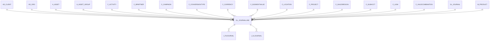

# GL_JOURNALLINE

Area [GL](../../data-model/gl/index.md) · class **business** (proposed) · read from database `idempiere-db` (owner `ADEMPIERE`) · 4 row(s) when profiled

Application model: `org.compiere.model.X_GL_JournalLine`, access level 1 - Org.

## Columns

| column | type | key | not null | business name | references (code) | nulls | distinct |
|---|---|---|---|---|---|---|---|
| `GL_JOURNALLINE_ID` | NUMBER(10,0) | PK | yes | Journal Line |  | 0 | 4 |
| `AD_CLIENT_ID` | NUMBER(10,0) |  | yes | Tenant |  | 0 | 1 |
| `AD_ORG_ID` | NUMBER(10,0) |  | yes | Organization |  | 0 | 2 |
| `ISACTIVE` | CHAR(1) |  | yes | Active |  | 0 | 1 |
| `CREATED` | DATE |  | yes | Created |  | 0 | 4 |
| `CREATEDBY` | NUMBER(10,0) |  | yes | Created By |  | 0 | 1 |
| `UPDATED` | DATE |  | yes | Updated |  | 0 | 4 |
| `UPDATEDBY` | NUMBER(10,0) |  | yes | Updated By |  | 0 | 1 |
| `GL_JOURNAL_ID` | NUMBER(10,0) |  | yes | Journal | [GL_JOURNAL](../../data-model/gl/gl_journal.md) | 0 | 2 |
| `LINE` | NUMBER(10,0) |  | yes | Line No |  | 0 | 2 |
| `ISGENERATED` | CHAR(1) |  | yes | Generated |  | 0 | 1 |
| `DESCRIPTION` | VARCHAR2(255 CHAR) |  |  | Description |  | 4 | 0 |
| `AMTSOURCEDR` | NUMBER |  | yes | Source Debit |  | 0 | 3 |
| `AMTSOURCECR` | NUMBER |  | yes | Source Credit |  | 0 | 3 |
| `C_CURRENCY_ID` | NUMBER(10,0) |  | yes | Currency | [C_CURRENCY](../../data-model/c/c_currency.md) | 0 | 2 |
| `CURRENCYRATE` | NUMBER |  | yes | Rate |  | 0 | 1 |
| `DATEACCT` | DATE |  | yes | Account Date |  | 0 | 1 |
| `AMTACCTDR` | NUMBER |  | yes | Accounted Debit |  | 0 | 3 |
| `AMTACCTCR` | NUMBER |  | yes | Accounted Credit |  | 0 | 3 |
| `C_UOM_ID` | NUMBER(10,0) |  |  | UOM | [C_UOM](../../data-model/c/c_uom.md) | 0 | 1 |
| `QTY` | NUMBER |  |  | Quantity |  | 0 | 1 |
| `C_VALIDCOMBINATION_ID` | NUMBER(10,0) |  |  | Combination | [C_VALIDCOMBINATION](../../data-model/c/c_validcombination.md) | 0 | 4 |
| `C_CONVERSIONTYPE_ID` | NUMBER(10,0) |  | yes | Currency Type | [C_CONVERSIONTYPE](../../data-model/c/c_conversiontype.md) | 0 | 1 |
| `PROCESSED` | CHAR(1) |  | yes | Processed |  | 0 | 1 |
| `A_ASSET_GROUP_ID` | NUMBER(10,0) |  |  | Asset Group | [A_ASSET_GROUP](../../data-model/a/a_asset_group.md) | 4 | 0 |
| `A_ASSET_ID` | NUMBER(10,0) |  |  | Asset | [A_ASSET](../../data-model/a/a_asset.md) | 4 | 0 |
| `A_CREATEASSET` | CHAR(1) |  |  | Create Asset |  | 0 | 1 |
| `A_PROCESSED` | CHAR(1) |  |  | Processed |  | 0 | 1 |
| `GL_JOURNALLINE_UU` | VARCHAR2(36 CHAR) |  |  | GL_JournalLine_UU |  | 0 | 4 |
| `AD_ORGTRX_ID` | NUMBER(10,0) |  |  | Trx Organization |  | 4 | 0 |
| `ACCOUNT_ID` | NUMBER(10,0) |  |  | Account | [C_ELEMENTVALUE](../../data-model/c/c_elementvalue.md) | 0 | 1 |
| `C_ACTIVITY_ID` | NUMBER(10,0) |  |  | Activity | [C_ACTIVITY](../../data-model/c/c_activity.md) | 4 | 0 |
| `C_BPARTNER_ID` | NUMBER(10,0) |  |  | Business Partner | [C_BPARTNER](../../data-model/c/c_bpartner.md) | 4 | 0 |
| `C_CAMPAIGN_ID` | NUMBER(10,0) |  |  | Campaign | [C_CAMPAIGN](../../data-model/c/c_campaign.md) | 4 | 0 |
| `C_LOCFROM_ID` | NUMBER(10,0) |  |  | Location From | [C_LOCATION](../../data-model/c/c_location.md) | 4 | 0 |
| `C_LOCTO_ID` | NUMBER(10,0) |  |  | Location To | [C_LOCATION](../../data-model/c/c_location.md) | 4 | 0 |
| `C_PROJECT_ID` | NUMBER(10,0) |  |  | Project | [C_PROJECT](../../data-model/c/c_project.md) | 4 | 0 |
| `C_SALESREGION_ID` | NUMBER(10,0) |  |  | Sales Region | [C_SALESREGION](../../data-model/c/c_salesregion.md) | 4 | 0 |
| `C_SUBACCT_ID` | NUMBER(10,0) |  |  | Sub Account | [C_SUBACCT](../../data-model/c/c_subacct.md) | 4 | 0 |
| `M_PRODUCT_ID` | NUMBER(10,0) |  |  | Product | [M_PRODUCT](../../data-model/m/m_product.md) | 4 | 0 |
| `USER1_ID` | NUMBER(10,0) |  |  | User Element List 1 | [C_ELEMENTVALUE](../../data-model/c/c_elementvalue.md) | 4 | 0 |
| `USER2_ID` | NUMBER(10,0) |  |  | User Element List 2 | [C_ELEMENTVALUE](../../data-model/c/c_elementvalue.md) | 4 | 0 |
| `ALIAS_VALIDCOMBINATION_ID` | NUMBER(10,0) |  |  | Alias List | [C_VALIDCOMBINATION](../../data-model/c/c_validcombination.md) | 4 | 0 |

*references (code)* is the table the application model's code says a column points to; *Foreign keys* below are the constraints the database declares. Counts come from the profile; no value is ever shown.

## Check constraints

| name | expression |
|---|---|
| `SYS_C0022665` | `IsGenerated in ('Y','N')` |
| `SYS_C0022666` | `IsActive in ('Y','N')` |
| `SYS_C0022667` | `A_CreateAsset IN ('Y','N')` |
| `SYS_C0022668` | `A_Processed IN ('Y','N')` |

## Foreign keys

**References**

| table | columns | on delete |
|---|---|---|
| [AD_CLIENT](../../data-model/ad/ad_client.md) | GL_JOURNALLINE.AD_CLIENT_ID → AD_CLIENT.AD_CLIENT_ID | NO ACTION |
| [AD_ORG](../../data-model/ad/ad_org.md) | GL_JOURNALLINE.AD_ORGTRX_ID → AD_ORG.AD_ORG_ID | NO ACTION |
| [A_ASSET](../../data-model/a/a_asset.md) | GL_JOURNALLINE.A_ASSET_ID → A_ASSET.A_ASSET_ID | NO ACTION |
| [A_ASSET_GROUP](../../data-model/a/a_asset_group.md) | GL_JOURNALLINE.A_ASSET_GROUP_ID → A_ASSET_GROUP.A_ASSET_GROUP_ID | NO ACTION |
| [C_ACTIVITY](../../data-model/c/c_activity.md) | GL_JOURNALLINE.C_ACTIVITY_ID → C_ACTIVITY.C_ACTIVITY_ID | NO ACTION |
| [C_BPARTNER](../../data-model/c/c_bpartner.md) | GL_JOURNALLINE.C_BPARTNER_ID → C_BPARTNER.C_BPARTNER_ID | NO ACTION |
| [C_CAMPAIGN](../../data-model/c/c_campaign.md) | GL_JOURNALLINE.C_CAMPAIGN_ID → C_CAMPAIGN.C_CAMPAIGN_ID | NO ACTION |
| [C_CONVERSIONTYPE](../../data-model/c/c_conversiontype.md) | GL_JOURNALLINE.C_CONVERSIONTYPE_ID → C_CONVERSIONTYPE.C_CONVERSIONTYPE_ID | NO ACTION |
| [C_CURRENCY](../../data-model/c/c_currency.md) | GL_JOURNALLINE.C_CURRENCY_ID → C_CURRENCY.C_CURRENCY_ID | NO ACTION |
| [C_ELEMENTVALUE](../../data-model/c/c_elementvalue.md) | GL_JOURNALLINE.ACCOUNT_ID → C_ELEMENTVALUE.C_ELEMENTVALUE_ID | NO ACTION |
| [C_LOCATION](../../data-model/c/c_location.md) | GL_JOURNALLINE.C_LOCFROM_ID → C_LOCATION.C_LOCATION_ID | NO ACTION |
| [C_PROJECT](../../data-model/c/c_project.md) | GL_JOURNALLINE.C_PROJECT_ID → C_PROJECT.C_PROJECT_ID | NO ACTION |
| [C_SALESREGION](../../data-model/c/c_salesregion.md) | GL_JOURNALLINE.C_SALESREGION_ID → C_SALESREGION.C_SALESREGION_ID | NO ACTION |
| [C_SUBACCT](../../data-model/c/c_subacct.md) | GL_JOURNALLINE.C_SUBACCT_ID → C_SUBACCT.C_SUBACCT_ID | NO ACTION |
| [C_UOM](../../data-model/c/c_uom.md) | GL_JOURNALLINE.C_UOM_ID → C_UOM.C_UOM_ID | NO ACTION |
| [C_VALIDCOMBINATION](../../data-model/c/c_validcombination.md) | GL_JOURNALLINE.ALIAS_VALIDCOMBINATION_ID → C_VALIDCOMBINATION.C_VALIDCOMBINATION_ID | NO ACTION |
| [GL_JOURNAL](../../data-model/gl/gl_journal.md) | GL_JOURNALLINE.GL_JOURNAL_ID → GL_JOURNAL.GL_JOURNAL_ID | CASCADE |
| [M_PRODUCT](../../data-model/m/m_product.md) | GL_JOURNALLINE.M_PRODUCT_ID → M_PRODUCT.M_PRODUCT_ID | NO ACTION |

**Referenced by**

| table | columns | on delete |
|---|---|---|
| `I_FAJOURNAL` | I_FAJOURNAL.GL_JOURNALLINE_ID → GL_JOURNALLINE.GL_JOURNALLINE_ID | NO ACTION |
| `I_GLJOURNAL` | I_GLJOURNAL.GL_JOURNALLINE_ID → GL_JOURNALLINE.GL_JOURNALLINE_ID | SET NULL |

## Write behaviour

- updates: **raw_sql_skips_updated**
- deletes: **deleted_by_users, deleted_by_cascade**
- change log: **recorded**
- evidence: 4 citation(s)

## Read by

| kind | name |
|---|---|
| View | `GL_JOURNALLINE_ACCT_V` |
| View | `gl_journalline_acct_v` |

## Schema history

86 change(s); the latest:

| applied | release | operation | column | tickets |
|---|---|---|---|---|
| 2024-05-14T13:59 | iD13 | `add_constraint` |  | IDEMPIERE-5598 |
| 2024-05-14T13:59 | iD13 | `add_column` | C_Employee_ID | IDEMPIERE-5598 |
| 2024-05-14T13:59 | iD13 | `add_constraint` |  | IDEMPIERE-5598 |
| 2024-05-14T13:59 | iD13 | `add_column` | C_Department_ID | IDEMPIERE-5598 |
| 2024-05-14T13:59 | iD13 | `add_constraint` |  | IDEMPIERE-5598 |
| 2024-05-14T13:59 | iD13 | `add_column` | C_Tax_ID | IDEMPIERE-5598 |
| 2024-05-14T13:59 | iD13 | `add_constraint` |  | IDEMPIERE-5598 |
| 2024-05-14T13:59 | iD13 | `add_column` | M_AttributeSetInstance_ID | IDEMPIERE-5598 |
| 2024-05-14T13:59 | iD13 | `add_constraint` |  | IDEMPIERE-5598 |
| 2024-05-14T13:59 | iD13 | `add_constraint` |  | IDEMPIERE-5598 |
| 2024-05-14T13:59 | iD13 | `add_column` | M_AttributeSetInstance_ID | IDEMPIERE-5598 |
| 2024-05-14T13:59 | iD13 | `add_column` | C_Tax_ID | IDEMPIERE-5598 |
| 2024-05-14T13:59 | iD13 | `add_constraint` |  | IDEMPIERE-5598 |
| 2024-05-14T13:59 | iD13 | `add_column` | C_Employee_ID | IDEMPIERE-5598 |
| 2024-05-14T13:59 | iD13 | `add_constraint` |  | IDEMPIERE-5598 |

## Open conflicts

| type | attribute | explanation |
|---|---|---|
| `model_column_missing` | `columns.C_Charge_ID` | unexplained |
| `model_column_missing` | `columns.C_CostCenter_ID` | unexplained |
| `model_column_missing` | `columns.C_Department_ID` | unexplained |
| `model_column_missing` | `columns.C_Employee_ID` | unexplained |
| `model_column_missing` | `columns.C_Tax_ID` | unexplained |
| `model_column_missing` | `columns.M_AttributeSetInstance_ID` | unexplained |
| `model_column_missing` | `columns.M_Warehouse_ID` | unexplained |

## Notes

<!-- ekos:manual id="table.gl_journalline.notes" -->
_Business notes about this table._
<!-- /ekos:manual -->
