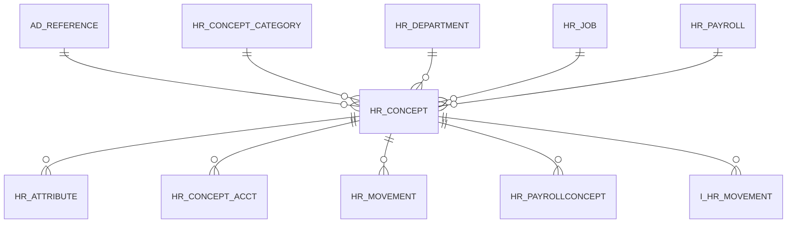

# HR_CONCEPT

Area [HR](../../data-model/hr/index.md) · class **business** (proposed) · read from database `idempiere-db` (owner `ADEMPIERE`) · 0 row(s) when profiled

Application model: `org.eevolution.model.X_HR_Concept`, access level 7 - System - Client - Org.

## Columns

| column | type | key | not null | business name | references (code) | nulls | distinct |
|---|---|---|---|---|---|---|---|
| `ACCOUNTSIGN` | CHAR(1) |  |  | Account Sign |  | 0 | 0 |
| `ISREADWRITE` | CHAR(1) |  |  | Read Write |  | 0 | 0 |
| `ISRECEIPT` | CHAR(1) |  |  | Receipt |  | 0 | 0 |
| `ISPAID` | CHAR(1) |  |  | Paid |  | 0 | 0 |
| `VALUE` | VARCHAR2(40 CHAR) |  |  | Search Key |  | 0 | 0 |
| `NAME` | VARCHAR2(60 CHAR) |  | yes | Name |  | 0 | 0 |
| `HR_CONCEPT_CATEGORY_ID` | NUMBER(10,0) |  |  | Payroll Concept Category | [HR_CONCEPT_CATEGORY](../../data-model/hr/hr_concept_category.md) | 0 | 0 |
| `HR_CONCEPT_ID` | NUMBER(10,0) | PK | yes | Payroll Concept |  | 0 | 0 |
| `HR_DEPARTMENT_ID` | NUMBER(10,0) |  |  | Payroll Department | [HR_DEPARTMENT](../../data-model/hr/hr_department.md) | 0 | 0 |
| `HR_JOB_ID` | NUMBER(10,0) |  |  | Payroll Job | [HR_JOB](../../data-model/hr/hr_job.md) | 0 | 0 |
| `HR_PAYROLL_ID` | NUMBER(10,0) |  |  | Payroll | [HR_PAYROLL](../../data-model/hr/hr_payroll.md) | 0 | 0 |
| `ISACTIVE` | CHAR(1) |  | yes | Active |  | 0 | 0 |
| `AD_CLIENT_ID` | NUMBER(10,0) |  | yes | Tenant |  | 0 | 0 |
| `ISEMPLOYEE` | CHAR(1) |  |  | Employee |  | 0 | 0 |
| `ISPRINTED` | CHAR(1) |  |  | Printed |  | 0 | 0 |
| `ISREGISTERED` | CHAR(1) |  |  | Registered |  | 0 | 0 |
| `TYPE` | CHAR(1) |  | yes | Type |  | 0 | 0 |
| `UPDATED` | DATE |  | yes | Updated |  | 0 | 0 |
| `UPDATEDBY` | NUMBER(10,0) |  | yes | Updated By |  | 0 | 0 |
| `VALIDFROM` | DATE |  |  | Valid from |  | 0 | 0 |
| `VALIDTO` | DATE |  |  | Valid to |  | 0 | 0 |
| `ISDEFAULT` | CHAR(1) |  |  | Default |  | 0 | 0 |
| `AD_ORG_ID` | NUMBER(10,0) |  | yes | Organization |  | 0 | 0 |
| `COLUMNTYPE` | CHAR(1) |  | yes | Column Type |  | 0 | 0 |
| `CREATED` | DATE |  | yes | Created |  | 0 | 0 |
| `CREATEDBY` | NUMBER(10,0) |  | yes | Created By |  | 0 | 0 |
| `DESCRIPTION` | VARCHAR2(255 CHAR) |  |  | Description |  | 0 | 0 |
| `AD_REFERENCE_ID` | NUMBER(10,0) |  |  | Reference | [AD_REFERENCE](../../data-model/ad/ad_reference.md) | 0 | 0 |
| `SEQNO` | NUMBER(10,0) |  |  | Sequence |  | 0 | 0 |
| `HR_CONCEPT_UU` | VARCHAR2(36 CHAR) |  |  | HR_Concept_UU |  | 0 | 0 |

*references (code)* is the table the application model's code says a column points to; *Foreign keys* below are the constraints the database declares. Counts come from the profile; no value is ever shown.

## Check constraints

| name | expression |
|---|---|
| `SYS_C0019926` | `IsDefault IN ('Y','N')` |
| `SYS_C0019927` | `IsEmployee IN ('Y','N')` |
| `SYS_C0019928` | `IsActive IN ('Y','N')` |
| `SYS_C0019929` | `IsRegistered IN ('Y','N')` |
| `SYS_C0019930` | `IsPrinted IN ('Y','N')` |
| `SYS_C0019931` | `IsReceipt IN ('Y','N')` |
| `SYS_C0019932` | `IsPaid IN ('Y','N')` |
| `SYS_C0019935` | `IsReadWrite IN ('Y','N')` |

## Foreign keys

**References**

| table | columns | on delete |
|---|---|---|
| [AD_REFERENCE](../../data-model/ad/ad_reference.md) | HR_CONCEPT.AD_REFERENCE_ID → AD_REFERENCE.AD_REFERENCE_ID | NO ACTION |
| [HR_CONCEPT_CATEGORY](../../data-model/hr/hr_concept_category.md) | HR_CONCEPT.HR_CONCEPT_CATEGORY_ID → HR_CONCEPT_CATEGORY.HR_CONCEPT_CATEGORY_ID | NO ACTION |
| [HR_DEPARTMENT](../../data-model/hr/hr_department.md) | HR_CONCEPT.HR_DEPARTMENT_ID → HR_DEPARTMENT.HR_DEPARTMENT_ID | NO ACTION |
| [HR_JOB](../../data-model/hr/hr_job.md) | HR_CONCEPT.HR_JOB_ID → HR_JOB.HR_JOB_ID | NO ACTION |
| [HR_PAYROLL](../../data-model/hr/hr_payroll.md) | HR_CONCEPT.HR_PAYROLL_ID → HR_PAYROLL.HR_PAYROLL_ID | NO ACTION |

**Referenced by**

| table | columns | on delete |
|---|---|---|
| [HR_ATTRIBUTE](../../data-model/hr/hr_attribute.md) | HR_ATTRIBUTE.HR_CONCEPT_ID → HR_CONCEPT.HR_CONCEPT_ID | NO ACTION |
| [HR_CONCEPT_ACCT](../../data-model/hr/hr_concept_acct.md) | HR_CONCEPT_ACCT.HR_CONCEPT_ID → HR_CONCEPT.HR_CONCEPT_ID | NO ACTION |
| [HR_MOVEMENT](../../data-model/hr/hr_movement.md) | HR_MOVEMENT.HR_CONCEPT_ID → HR_CONCEPT.HR_CONCEPT_ID | NO ACTION |
| [HR_PAYROLLCONCEPT](../../data-model/hr/hr_payrollconcept.md) | HR_PAYROLLCONCEPT.HR_CONCEPT_ID → HR_CONCEPT.HR_CONCEPT_ID | NO ACTION |
| `I_HR_MOVEMENT` | I_HR_MOVEMENT.HR_CONCEPT_ID → HR_CONCEPT.HR_CONCEPT_ID | NO ACTION |

## Write behaviour

- updates: **po_only**
- deletes: **deleted_by_users**
- change log: **recorded**
- evidence: 1 citation(s)

## Schema history

34 change(s); the latest:

| applied | release | operation | column | tickets |
|---|---|---|---|---|
| 2023-04-09T15:47 | iD11 | `add_constraint` |  | IDEMPIERE-5567 |
| 2023-04-09T15:47 | iD11 | `add_constraint` |  | IDEMPIERE-5567 |
| 2021-12-05T16:45 | i8.2z | `add_constraint` |  | IDEMPIERE-5075 |
| 2021-12-05T16:45 | i8.2z | `add_constraint` |  | IDEMPIERE-5075 |
| 2021-12-05T16:45 | i8.2z | `drop_constraint` |  | IDEMPIERE-5075 |
| 2021-12-05T16:45 | i8.2z | `drop_constraint` |  | IDEMPIERE-5075 |
| 2021-12-05T16:45 | i8.2z | `add_constraint` |  | IDEMPIERE-5075 |
| 2021-12-05T16:45 | i8.2z | `add_constraint` |  | IDEMPIERE-5075 |
| 2021-12-05T16:45 | i8.2z | `drop_constraint` |  | IDEMPIERE-5075 |
| 2021-12-05T16:45 | i8.2z | `add_constraint` |  | IDEMPIERE-5075 |
| 2021-12-05T16:45 | i8.2z | `drop_constraint` |  | IDEMPIERE-5075 |
| 2021-12-05T16:45 | i8.2z | `drop_constraint` |  | IDEMPIERE-5075 |
| 2020-08-04T01:00 | i7.1z | `add_column` | tmp_col_2_tmp | IDEMPIERE-3862 |
| 2020-08-04T01:00 | i7.1z | `drop_column` | tmp_col_1_tmp | IDEMPIERE-3862 |
| 2020-08-04T01:00 | i7.1z | `modify_column` | NAME | IDEMPIERE-3862 |

## Notes

<!-- ekos:manual id="table.hr_concept.notes" -->
_Business notes about this table._
<!-- /ekos:manual -->
