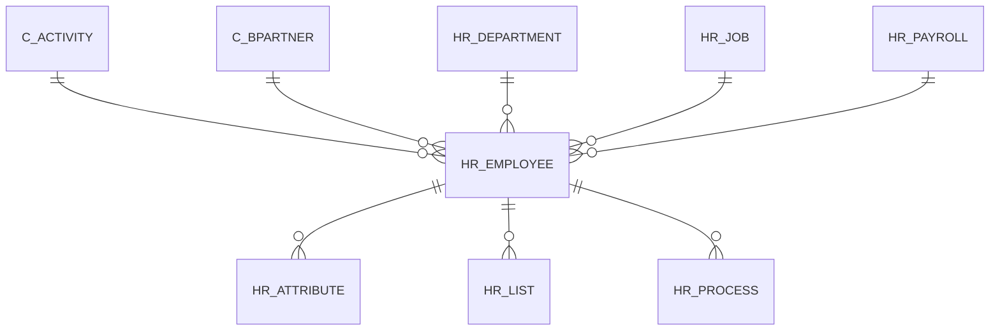

# HR_EMPLOYEE

Area [HR](../../data-model/hr/index.md) · class **business** (proposed) · read from database `idempiere-db` (owner `ADEMPIERE`) · 0 row(s) when profiled

Application model: `org.eevolution.model.X_HR_Employee`, access level 3 - Client - Org.

## Columns

| column | type | key | not null | business name | references (code) | nulls | distinct |
|---|---|---|---|---|---|---|---|
| `CODE` | VARCHAR2(1 CHAR) |  |  | Validation code |  | 0 | 0 |
| `NAME` | VARCHAR2(30 CHAR) |  |  | Name |  | 0 | 0 |
| `C_ACTIVITY_ID` | NUMBER(10,0) |  |  | Activity | [C_ACTIVITY](../../data-model/c/c_activity.md) | 0 | 0 |
| `C_BPARTNER_ID` | NUMBER(10,0) |  | yes | Business Partner | [C_BPARTNER](../../data-model/c/c_bpartner.md) | 0 | 0 |
| `CREATED` | DATE |  | yes | Created |  | 0 | 0 |
| `CREATEDBY` | NUMBER(10,0) |  | yes | Created By |  | 0 | 0 |
| `ENDDATE` | DATE |  |  | End Date |  | 0 | 0 |
| `HR_DEPARTMENT_ID` | NUMBER(10,0) |  | yes | Payroll Department | [HR_DEPARTMENT](../../data-model/hr/hr_department.md) | 0 | 0 |
| `HR_EMPLOYEE_ID` | NUMBER(10,0) | PK | yes | Payroll Employee |  | 0 | 0 |
| `HR_JOB_ID` | NUMBER(10,0) |  | yes | Payroll Job | [HR_JOB](../../data-model/hr/hr_job.md) | 0 | 0 |
| `HR_PAYROLL_ID` | NUMBER(10,0) |  |  | Payroll | [HR_PAYROLL](../../data-model/hr/hr_payroll.md) | 0 | 0 |
| `ISACTIVE` | CHAR(1) |  | yes | Active |  | 0 | 0 |
| `NAME2` | VARCHAR2(30 CHAR) |  |  | Name 2 |  | 0 | 0 |
| `NATIONALCODE` | VARCHAR2(60 CHAR) |  |  | National Code |  | 0 | 0 |
| `SSCODE` | VARCHAR2(60 CHAR) |  |  | Social Security Code |  | 0 | 0 |
| `STARTDATE` | DATE |  | yes | Start Date |  | 0 | 0 |
| `UPDATED` | DATE |  | yes | Updated |  | 0 | 0 |
| `AD_CLIENT_ID` | NUMBER(10,0) |  | yes | Tenant |  | 0 | 0 |
| `UPDATEDBY` | NUMBER(10,0) |  | yes | Updated By |  | 0 | 0 |
| `AD_ORG_ID` | NUMBER(10,0) |  | yes | Organization |  | 0 | 0 |
| `IMAGEURL` | VARCHAR2(120 CHAR) |  |  | Image URL |  | 0 | 0 |
| `HR_EMPLOYEE_UU` | VARCHAR2(36 CHAR) |  |  | HR_Employee_UU |  | 0 | 0 |

*references (code)* is the table the application model's code says a column points to; *Foreign keys* below are the constraints the database declares. Counts come from the profile; no value is ever shown.

## Check constraints

| name | expression |
|---|---|
| `SYS_C0019507` | `IsActive IN ('Y','N')` |

## Foreign keys

**References**

| table | columns | on delete |
|---|---|---|
| [C_ACTIVITY](../../data-model/c/c_activity.md) | HR_EMPLOYEE.C_ACTIVITY_ID → C_ACTIVITY.C_ACTIVITY_ID | NO ACTION |
| [C_BPARTNER](../../data-model/c/c_bpartner.md) | HR_EMPLOYEE.C_BPARTNER_ID → C_BPARTNER.C_BPARTNER_ID | NO ACTION |
| [HR_DEPARTMENT](../../data-model/hr/hr_department.md) | HR_EMPLOYEE.HR_DEPARTMENT_ID → HR_DEPARTMENT.HR_DEPARTMENT_ID | NO ACTION |
| [HR_JOB](../../data-model/hr/hr_job.md) | HR_EMPLOYEE.HR_JOB_ID → HR_JOB.HR_JOB_ID | NO ACTION |
| [HR_PAYROLL](../../data-model/hr/hr_payroll.md) | HR_EMPLOYEE.HR_PAYROLL_ID → HR_PAYROLL.HR_PAYROLL_ID | NO ACTION |

**Referenced by**

| table | columns | on delete |
|---|---|---|
| [HR_ATTRIBUTE](../../data-model/hr/hr_attribute.md) | HR_ATTRIBUTE.HR_EMPLOYEE_ID → HR_EMPLOYEE.HR_EMPLOYEE_ID | NO ACTION |
| [HR_LIST](../../data-model/hr/hr_list.md) | HR_LIST.HR_EMPLOYEE_ID → HR_EMPLOYEE.HR_EMPLOYEE_ID | NO ACTION |
| [HR_PROCESS](../../data-model/hr/hr_process.md) | HR_PROCESS.HR_EMPLOYEE_ID → HR_EMPLOYEE.HR_EMPLOYEE_ID | NO ACTION |

## Write behaviour

- updates: **po_only**
- deletes: **deleted_by_users**
- change log: **recorded**
- evidence: 1 citation(s)

## Schema history

41 change(s); the latest:

| applied | release | operation | column | tickets |
|---|---|---|---|---|
| 2023-04-09T15:47 | iD11 | `add_constraint` |  | IDEMPIERE-5567 |
| 2023-04-09T15:47 | iD11 | `add_constraint` |  | IDEMPIERE-5567 |
| 2021-12-05T16:45 | i8.2z | `add_constraint` |  | IDEMPIERE-5075 |
| 2021-12-05T16:45 | i8.2z | `add_constraint` |  | IDEMPIERE-5075 |
| 2021-12-05T16:45 | i8.2z | `add_constraint` |  | IDEMPIERE-5075 |
| 2021-12-05T16:45 | i8.2z | `add_constraint` |  | IDEMPIERE-5075 |
| 2021-12-05T16:45 | i8.2z | `drop_constraint` |  | IDEMPIERE-5075 |
| 2021-12-05T16:45 | i8.2z | `drop_constraint` |  | IDEMPIERE-5075 |
| 2021-12-05T16:45 | i8.2z | `drop_constraint` |  | IDEMPIERE-5075 |
| 2021-12-05T16:45 | i8.2z | `drop_constraint` |  | IDEMPIERE-5075 |
| 2021-12-05T16:45 | i8.2z | `add_constraint` |  | IDEMPIERE-5075 |
| 2021-12-05T16:45 | i8.2z | `drop_constraint` |  | IDEMPIERE-5075 |
| 2020-08-04T01:00 | i7.1z | `modify_column` | NAME2 | IDEMPIERE-3862 |
| 2020-08-04T01:00 | i7.1z | `drop_column` | tmp_col_3_tmp | IDEMPIERE-3862 |
| 2020-08-04T01:00 | i7.1z | `add_column` | tmp_col_4_tmp | IDEMPIERE-3862 |

## Notes

<!-- ekos:manual id="table.hr_employee.notes" -->
_Business notes about this table._
<!-- /ekos:manual -->
