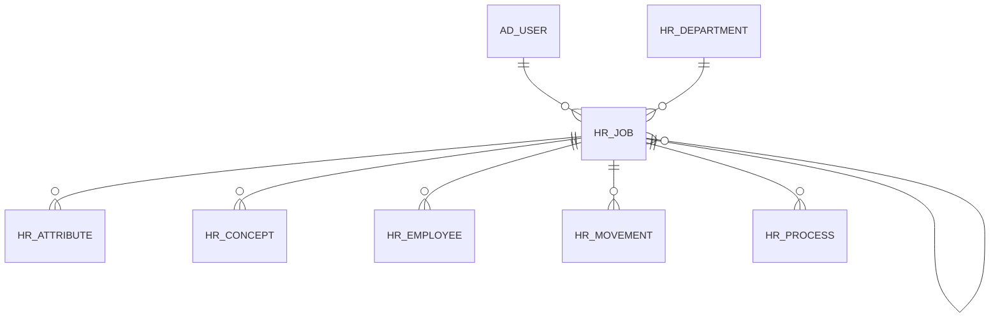

# HR_JOB

Area [HR](../../data-model/hr/index.md) · class **business** (proposed) · read from database `idempiere-db` (owner `ADEMPIERE`) · 0 row(s) when profiled

Application model: `org.eevolution.model.X_HR_Job`, access level 3 - Client - Org.

## Columns

| column | type | key | not null | business name | references (code) | nulls | distinct |
|---|---|---|---|---|---|---|---|
| `NAME` | VARCHAR2(60 CHAR) |  | yes | Name |  | 0 | 0 |
| `AD_ORG_ID` | NUMBER(10,0) |  | yes | Organization |  | 0 | 0 |
| `CREATED` | DATE |  | yes | Created |  | 0 | 0 |
| `CREATEDBY` | NUMBER(10,0) |  | yes | Created By |  | 0 | 0 |
| `DESCRIPTION` | VARCHAR2(255 CHAR) |  |  | Description |  | 0 | 0 |
| `HR_DEPARTMENT_ID` | NUMBER(10,0) |  |  | Payroll Department | [HR_DEPARTMENT](../../data-model/hr/hr_department.md) | 0 | 0 |
| `HR_JOB_ID` | NUMBER(10,0) | PK | yes | Payroll Job |  | 0 | 0 |
| `ISACTIVE` | CHAR(1) |  | yes | Active |  | 0 | 0 |
| `ISPARENT` | CHAR(1) |  |  | Parent link column |  | 0 | 0 |
| `JOBCANT` | NUMBER(10,0) |  |  | Job Qty |  | 0 | 0 |
| `NEXT_JOB_ID` | NUMBER(10,0) |  |  | Next Job | [HR_JOB](../../data-model/hr/hr_job.md) | 0 | 0 |
| `SUPERVISOR_ID` | NUMBER(10,0) |  |  | Supervisor | [AD_USER](../../data-model/ad/ad_user.md) | 0 | 0 |
| `UPDATED` | DATE |  | yes | Updated |  | 0 | 0 |
| `UPDATEDBY` | NUMBER(10,0) |  | yes | Updated By |  | 0 | 0 |
| `AD_CLIENT_ID` | NUMBER(10,0) |  | yes | Tenant |  | 0 | 0 |
| `VALUE` | VARCHAR2(40 CHAR) |  |  | Search Key |  | 0 | 0 |
| `HR_JOB_UU` | VARCHAR2(36 CHAR) |  |  | HR_Job_UU |  | 0 | 0 |

*references (code)* is the table the application model's code says a column points to; *Foreign keys* below are the constraints the database declares. Counts come from the profile; no value is ever shown.

## Check constraints

| name | expression |
|---|---|
| `SYS_C0019863` | `IsActive IN ('Y','N')` |
| `SYS_C0019864` | `IsParent IN ('Y','N')` |

## Foreign keys

**References**

| table | columns | on delete |
|---|---|---|
| [AD_USER](../../data-model/ad/ad_user.md) | HR_JOB.SUPERVISOR_ID → AD_USER.AD_USER_ID | NO ACTION |
| [HR_DEPARTMENT](../../data-model/hr/hr_department.md) | HR_JOB.HR_DEPARTMENT_ID → HR_DEPARTMENT.HR_DEPARTMENT_ID | NO ACTION |
| [HR_JOB](../../data-model/hr/hr_job.md) | HR_JOB.NEXT_JOB_ID → HR_JOB.HR_JOB_ID | NO ACTION |

**Referenced by**

| table | columns | on delete |
|---|---|---|
| [HR_ATTRIBUTE](../../data-model/hr/hr_attribute.md) | HR_ATTRIBUTE.HR_JOB_ID → HR_JOB.HR_JOB_ID | NO ACTION |
| [HR_CONCEPT](../../data-model/hr/hr_concept.md) | HR_CONCEPT.HR_JOB_ID → HR_JOB.HR_JOB_ID | NO ACTION |
| [HR_EMPLOYEE](../../data-model/hr/hr_employee.md) | HR_EMPLOYEE.HR_JOB_ID → HR_JOB.HR_JOB_ID | NO ACTION |
| [HR_JOB](../../data-model/hr/hr_job.md) | HR_JOB.NEXT_JOB_ID → HR_JOB.HR_JOB_ID | NO ACTION |
| [HR_MOVEMENT](../../data-model/hr/hr_movement.md) | HR_MOVEMENT.HR_JOB_ID → HR_JOB.HR_JOB_ID | NO ACTION |
| [HR_PROCESS](../../data-model/hr/hr_process.md) | HR_PROCESS.HR_JOB_ID → HR_JOB.HR_JOB_ID | NO ACTION |

## Write behaviour

- updates: **po_only**
- deletes: **deleted_by_users**
- change log: **recorded**
- evidence: 1 citation(s)

## Schema history

31 change(s); the latest:

| applied | release | operation | column | tickets |
|---|---|---|---|---|
| 2023-04-09T15:47 | iD11 | `add_constraint` |  | IDEMPIERE-5567 |
| 2023-04-09T15:47 | iD11 | `add_constraint` |  | IDEMPIERE-5567 |
| 2021-12-05T16:45 | i8.2z | `drop_constraint` |  | IDEMPIERE-5075 |
| 2021-12-05T16:45 | i8.2z | `add_constraint` |  | IDEMPIERE-5075 |
| 2021-12-05T16:45 | i8.2z | `add_constraint` |  | IDEMPIERE-5075 |
| 2021-12-05T16:45 | i8.2z | `add_constraint` |  | IDEMPIERE-5075 |
| 2021-12-05T16:45 | i8.2z | `drop_constraint` |  | IDEMPIERE-5075 |
| 2021-12-05T16:45 | i8.2z | `drop_constraint` |  | IDEMPIERE-5075 |
| 2020-08-04T01:00 | i7.1z | `create_index` |  | IDEMPIERE-3862 |
| 2020-08-04T01:00 | i7.1z | `modify_column` | NAME | IDEMPIERE-3862 |
| 2020-08-04T01:00 | i7.1z | `modify_column` | DESCRIPTION | IDEMPIERE-3862 |
| 2020-08-04T01:00 | i7.1z | `drop_column` | tmp_col_2_tmp | IDEMPIERE-3862 |
| 2020-08-04T01:00 | i7.1z | `modify_column` | HR_JOB_UU | IDEMPIERE-3862 |
| 2020-08-04T01:00 | i7.1z | `drop_column` | tmp_col_3_tmp | IDEMPIERE-3862 |
| 2020-08-04T01:00 | i7.1z | `modify_column` | VALUE | IDEMPIERE-3862 |

## Notes

<!-- ekos:manual id="table.hr_job.notes" -->
_Business notes about this table._
<!-- /ekos:manual -->
