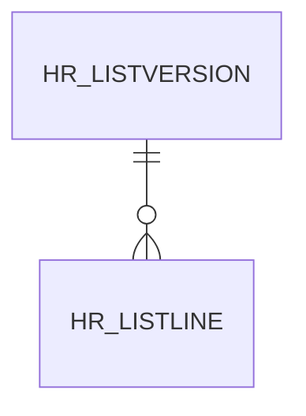

# HR_LISTLINE

Area [HR](../../data-model/hr/index.md) · class **business** (proposed) · read from database `idempiere-db` (owner `ADEMPIERE`) · 0 row(s) when profiled

Application model: `org.eevolution.model.X_HR_ListLine`, access level 3 - Client - Org.

## Columns

| column | type | key | not null | business name | references (code) | nulls | distinct |
|---|---|---|---|---|---|---|---|
| `NAME` | VARCHAR2(60 CHAR) |  |  | Name |  | 0 | 0 |
| `AD_ORG_ID` | NUMBER(10,0) |  | yes | Organization |  | 0 | 0 |
| `COL_1` | NUMBER |  |  | Col_1 |  | 0 | 0 |
| `COL_2` | NUMBER |  |  | Col_2 |  | 0 | 0 |
| `COL_3` | NUMBER |  |  | Col_3 |  | 0 | 0 |
| `COL_4` | NUMBER |  |  | Col_4 |  | 0 | 0 |
| `COL_5` | NUMBER |  |  | Col_5 |  | 0 | 0 |
| `COL_6` | NUMBER |  |  | Col_6 |  | 0 | 0 |
| `COL_7` | NUMBER |  |  | Col_7 |  | 0 | 0 |
| `COL_8` | NUMBER |  |  | Col_8 |  | 0 | 0 |
| `CREATED` | DATE |  | yes | Created |  | 0 | 0 |
| `CREATEDBY` | NUMBER(10,0) |  | yes | Created By |  | 0 | 0 |
| `HR_LISTLINE_ID` | NUMBER(10,0) | PK | yes | Payroll List Line |  | 0 | 0 |
| `HR_LISTVERSION_ID` | NUMBER(10,0) |  |  | Payroll List Version | [HR_LISTVERSION](../../data-model/hr/hr_listversion.md) | 0 | 0 |
| `ISACTIVE` | CHAR(1) |  | yes | Active |  | 0 | 0 |
| `MAXVALUE` | NUMBER |  | yes | Max Value |  | 0 | 0 |
| `MINVALUE` | NUMBER |  | yes | Min Value |  | 0 | 0 |
| `UPDATED` | DATE |  | yes | Updated |  | 0 | 0 |
| `AD_CLIENT_ID` | NUMBER(10,0) |  | yes | Tenant |  | 0 | 0 |
| `UPDATEDBY` | NUMBER(10,0) |  | yes | Updated By |  | 0 | 0 |
| `HR_LISTLINE_UU` | VARCHAR2(36 CHAR) |  |  | HR_ListLine_UU |  | 0 | 0 |

*references (code)* is the table the application model's code says a column points to; *Foreign keys* below are the constraints the database declares. Counts come from the profile; no value is ever shown.

## Check constraints

| name | expression |
|---|---|
| `SYS_C0022277` | `IsActive IN ('Y','N')` |

## Foreign keys

**References**

| table | columns | on delete |
|---|---|---|
| [HR_LISTVERSION](../../data-model/hr/hr_listversion.md) | HR_LISTLINE.HR_LISTVERSION_ID → HR_LISTVERSION.HR_LISTVERSION_ID | NO ACTION |

**Referenced by**

_None._

## Write behaviour

- updates: **po_only**
- deletes: **deleted_by_users**
- change log: **recorded**
- evidence: 1 citation(s)

## Schema history

18 change(s); the latest:

| applied | release | operation | column | tickets |
|---|---|---|---|---|
| 2023-04-09T15:47 | iD11 | `add_constraint` |  | IDEMPIERE-5567 |
| 2023-04-09T15:47 | iD11 | `add_constraint` |  | IDEMPIERE-5567 |
| 2021-12-05T16:45 | i8.2z | `drop_constraint` |  | IDEMPIERE-5075 |
| 2021-12-05T16:45 | i8.2z | `add_constraint` |  | IDEMPIERE-5075 |
| 2020-08-04T01:00 | i7.1z | `add_column` | tmp_col_1_tmp | IDEMPIERE-3862 |
| 2020-08-04T01:00 | i7.1z | `modify_column` | HR_LISTLINE_UU | IDEMPIERE-3862 |
| 2020-08-04T01:00 | i7.1z | `modify_column` | NAME | IDEMPIERE-3862 |
| 2020-08-04T01:00 | i7.1z | `add_column` | tmp_col_2_tmp | IDEMPIERE-3862 |
| 2020-08-04T01:00 | i7.1z | `drop_column` | tmp_col_1_tmp | IDEMPIERE-3862 |
| 2020-08-04T01:00 | i7.1z | `drop_column` | tmp_col_2_tmp | IDEMPIERE-3862 |
| 2014-05-02T10:09 | i2.0 | `modify_column` | updated | IDEMPIERE-709 |
| 2014-05-02T10:09 | i2.0 | `modify_column` | created | IDEMPIERE-709 |
| 2014-04-17T15:00 | i2.0 | `modify_column` | updated | IDEMPIERE-709 |
| 2014-04-17T15:00 | i2.0 | `modify_column` | created | IDEMPIERE-709 |
| 2014-04-17T15:00 | i2.0 | `modify_column` | created | IDEMPIERE-709 |

## Notes

<!-- ekos:manual id="table.hr_listline.notes" -->
_Business notes about this table._
<!-- /ekos:manual -->
