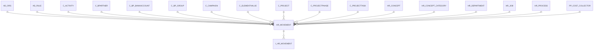

# HR_MOVEMENT

Area [HR](../../data-model/hr/index.md) · class **business** (proposed) · read from database `idempiere-db` (owner `ADEMPIERE`) · 0 row(s) when profiled

Application model: `org.eevolution.model.X_HR_Movement`, access level 3 - Client - Org.

## Columns

| column | type | key | not null | business name | references (code) | nulls | distinct |
|---|---|---|---|---|---|---|---|
| `ISREGISTERED` | CHAR(1) |  |  | Registered |  | 0 | 0 |
| `HR_CONCEPT_CATEGORY_ID` | NUMBER(10,0) |  |  | Payroll Concept Category | [HR_CONCEPT_CATEGORY](../../data-model/hr/hr_concept_category.md) | 0 | 0 |
| `HR_PROCESS_ID` | NUMBER(10,0) |  |  | Payroll Process | [HR_PROCESS](../../data-model/hr/hr_process.md) | 0 | 0 |
| `C_BPARTNER_ID` | NUMBER(10,0) |  |  | Business Partner | [C_BPARTNER](../../data-model/c/c_bpartner.md) | 0 | 0 |
| `HR_CONCEPT_ID` | NUMBER(10,0) |  | yes | Payroll Concept | [HR_CONCEPT](../../data-model/hr/hr_concept.md) | 0 | 0 |
| `COLUMNTYPE` | CHAR(1) |  |  | Column Type |  | 0 | 0 |
| `CREATED` | DATE |  | yes | Created |  | 0 | 0 |
| `CREATEDBY` | NUMBER(10,0) |  | yes | Created By |  | 0 | 0 |
| `DESCRIPTION` | VARCHAR2(255 CHAR) |  |  | Description |  | 0 | 0 |
| `HR_DEPARTMENT_ID` | NUMBER(10,0) |  |  | Payroll Department | [HR_DEPARTMENT](../../data-model/hr/hr_department.md) | 0 | 0 |
| `HR_JOB_ID` | NUMBER(10,0) |  |  | Payroll Job | [HR_JOB](../../data-model/hr/hr_job.md) | 0 | 0 |
| `HR_MOVEMENT_ID` | NUMBER(10,0) | PK | yes | Payroll Movement |  | 0 | 0 |
| `ISACTIVE` | CHAR(1) |  | yes | Active |  | 0 | 0 |
| `ISPRINTED` | CHAR(1) |  |  | Printed |  | 0 | 0 |
| `PROCESSED` | CHAR(1) |  | yes | Processed |  | 0 | 0 |
| `QTY` | NUMBER |  |  | Quantity |  | 0 | 0 |
| `SERVICEDATE` | DATE |  |  | Service date |  | 0 | 0 |
| `TEXTMSG` | VARCHAR2(255 CHAR) |  |  | Text Message |  | 0 | 0 |
| `UPDATED` | DATE |  | yes | Updated |  | 0 | 0 |
| `UPDATEDBY` | NUMBER(10,0) |  | yes | Updated By |  | 0 | 0 |
| `VALIDFROM` | DATE |  | yes | Valid from |  | 0 | 0 |
| `AD_CLIENT_ID` | NUMBER(10,0) |  | yes | Tenant |  | 0 | 0 |
| `VALIDTO` | DATE |  |  | Valid to |  | 0 | 0 |
| `AD_ORG_ID` | NUMBER(10,0) |  | yes | Organization |  | 0 | 0 |
| `AD_RULE_ID` | NUMBER(10,0) |  |  | Rule | [AD_RULE](../../data-model/ad/ad_rule.md) | 0 | 0 |
| `AMOUNT` | NUMBER |  |  | Amount |  | 0 | 0 |
| `C_ACTIVITY_ID` | NUMBER(10,0) |  |  | Activity | [C_ACTIVITY](../../data-model/c/c_activity.md) | 0 | 0 |
| `C_CAMPAIGN_ID` | NUMBER(10,0) |  |  | Campaign | [C_CAMPAIGN](../../data-model/c/c_campaign.md) | 0 | 0 |
| `AD_ORGTRX_ID` | NUMBER(10,0) |  |  | Trx Organization |  | 0 | 0 |
| `C_PROJECTPHASE_ID` | NUMBER(10,0) |  |  | Project Phase | [C_PROJECTPHASE](../../data-model/c/c_projectphase.md) | 0 | 0 |
| `C_PROJECTTASK_ID` | NUMBER(10,0) |  |  | Project Task | [C_PROJECTTASK](../../data-model/c/c_projecttask.md) | 0 | 0 |
| `C_PROJECT_ID` | NUMBER(10,0) |  |  | Project | [C_PROJECT](../../data-model/c/c_project.md) | 0 | 0 |
| `USER1_ID` | NUMBER(10,0) |  |  | User Element List 1 | [C_ELEMENTVALUE](../../data-model/c/c_elementvalue.md) | 0 | 0 |
| `USER2_ID` | NUMBER(10,0) |  |  | User Element List 2 | [C_ELEMENTVALUE](../../data-model/c/c_elementvalue.md) | 0 | 0 |
| `PP_COST_COLLECTOR_ID` | NUMBER(10,0) |  |  | Manufacturing Cost Collector | [PP_COST_COLLECTOR](../../data-model/pp/pp_cost_collector.md) | 0 | 0 |
| `C_BP_GROUP_ID` | NUMBER(10,0) |  |  | Business Partner Group | [C_BP_GROUP](../../data-model/c/c_bp_group.md) | 0 | 0 |
| `C_BP_BANKACCOUNT_ID` | NUMBER(10,0) |  |  | Partner Bank Account | [C_BP_BANKACCOUNT](../../data-model/c/c_bp_bankaccount.md) | 0 | 0 |
| `ACCOUNTSIGN` | CHAR(1) |  |  | Account Sign |  | 0 | 0 |
| `HR_MOVEMENT_UU` | VARCHAR2(36 CHAR) |  |  | HR_Movement_UU |  | 0 | 0 |

*references (code)* is the table the application model's code says a column points to; *Foreign keys* below are the constraints the database declares. Counts come from the profile; no value is ever shown.

## Check constraints

| name | expression |
|---|---|
| `SYS_C0020195` | `IsPrinted IN ('Y','N')` |
| `SYS_C0020197` | `IsActive IN ('Y','N')` |
| `SYS_C0020199` | `IsRegistered IN ('Y','N')` |
| `SYS_C0020200` | `Processed IN ('Y','N')` |

## Foreign keys

**References**

| table | columns | on delete |
|---|---|---|
| [AD_ORG](../../data-model/ad/ad_org.md) | HR_MOVEMENT.AD_ORGTRX_ID → AD_ORG.AD_ORG_ID | NO ACTION |
| [AD_RULE](../../data-model/ad/ad_rule.md) | HR_MOVEMENT.AD_RULE_ID → AD_RULE.AD_RULE_ID | NO ACTION |
| [C_ACTIVITY](../../data-model/c/c_activity.md) | HR_MOVEMENT.C_ACTIVITY_ID → C_ACTIVITY.C_ACTIVITY_ID | NO ACTION |
| [C_BPARTNER](../../data-model/c/c_bpartner.md) | HR_MOVEMENT.C_BPARTNER_ID → C_BPARTNER.C_BPARTNER_ID | NO ACTION |
| [C_BP_BANKACCOUNT](../../data-model/c/c_bp_bankaccount.md) | HR_MOVEMENT.C_BP_BANKACCOUNT_ID → C_BP_BANKACCOUNT.C_BP_BANKACCOUNT_ID | NO ACTION |
| [C_BP_GROUP](../../data-model/c/c_bp_group.md) | HR_MOVEMENT.C_BP_GROUP_ID → C_BP_GROUP.C_BP_GROUP_ID | NO ACTION |
| [C_CAMPAIGN](../../data-model/c/c_campaign.md) | HR_MOVEMENT.C_CAMPAIGN_ID → C_CAMPAIGN.C_CAMPAIGN_ID | NO ACTION |
| [C_ELEMENTVALUE](../../data-model/c/c_elementvalue.md) | HR_MOVEMENT.USER1_ID → C_ELEMENTVALUE.C_ELEMENTVALUE_ID | NO ACTION |
| [C_PROJECT](../../data-model/c/c_project.md) | HR_MOVEMENT.C_PROJECT_ID → C_PROJECT.C_PROJECT_ID | NO ACTION |
| [C_PROJECTPHASE](../../data-model/c/c_projectphase.md) | HR_MOVEMENT.C_PROJECTPHASE_ID → C_PROJECTPHASE.C_PROJECTPHASE_ID | NO ACTION |
| [C_PROJECTTASK](../../data-model/c/c_projecttask.md) | HR_MOVEMENT.C_PROJECTTASK_ID → C_PROJECTTASK.C_PROJECTTASK_ID | NO ACTION |
| [HR_CONCEPT](../../data-model/hr/hr_concept.md) | HR_MOVEMENT.HR_CONCEPT_ID → HR_CONCEPT.HR_CONCEPT_ID | NO ACTION |
| [HR_CONCEPT_CATEGORY](../../data-model/hr/hr_concept_category.md) | HR_MOVEMENT.HR_CONCEPT_CATEGORY_ID → HR_CONCEPT_CATEGORY.HR_CONCEPT_CATEGORY_ID | NO ACTION |
| [HR_DEPARTMENT](../../data-model/hr/hr_department.md) | HR_MOVEMENT.HR_DEPARTMENT_ID → HR_DEPARTMENT.HR_DEPARTMENT_ID | NO ACTION |
| [HR_JOB](../../data-model/hr/hr_job.md) | HR_MOVEMENT.HR_JOB_ID → HR_JOB.HR_JOB_ID | NO ACTION |
| [HR_PROCESS](../../data-model/hr/hr_process.md) | HR_MOVEMENT.HR_PROCESS_ID → HR_PROCESS.HR_PROCESS_ID | NO ACTION |
| [PP_COST_COLLECTOR](../../data-model/pp/pp_cost_collector.md) | HR_MOVEMENT.PP_COST_COLLECTOR_ID → PP_COST_COLLECTOR.PP_COST_COLLECTOR_ID | NO ACTION |

**Referenced by**

| table | columns | on delete |
|---|---|---|
| `I_HR_MOVEMENT` | I_HR_MOVEMENT.HR_MOVEMENT_ID → HR_MOVEMENT.HR_MOVEMENT_ID | NO ACTION |

## Write behaviour

- updates: **po_only**
- deletes: **deleted_by_users**
- change log: **recorded**
- evidence: 1 citation(s)

## Schema history

55 change(s); the latest:

| applied | release | operation | column | tickets |
|---|---|---|---|---|
| 2023-04-09T15:47 | iD11 | `add_constraint` |  | IDEMPIERE-5567 |
| 2023-04-09T15:47 | iD11 | `add_constraint` |  | IDEMPIERE-5567 |
| 2021-12-05T16:45 | i8.2z | `add_constraint` |  | IDEMPIERE-5075 |
| 2021-12-05T16:45 | i8.2z | `add_constraint` |  | IDEMPIERE-5075 |
| 2021-12-05T16:45 | i8.2z | `add_constraint` |  | IDEMPIERE-5075 |
| 2021-12-05T16:45 | i8.2z | `add_constraint` |  | IDEMPIERE-5075 |
| 2021-12-05T16:45 | i8.2z | `drop_constraint` |  | IDEMPIERE-5075 |
| 2021-12-05T16:45 | i8.2z | `add_constraint` |  | IDEMPIERE-5075 |
| 2021-12-05T16:45 | i8.2z | `add_constraint` |  | IDEMPIERE-5075 |
| 2021-12-05T16:45 | i8.2z | `drop_constraint` |  | IDEMPIERE-5075 |
| 2021-12-05T16:45 | i8.2z | `drop_constraint` |  | IDEMPIERE-5075 |
| 2021-12-05T16:45 | i8.2z | `drop_constraint` |  | IDEMPIERE-5075 |
| 2021-12-05T16:45 | i8.2z | `drop_constraint` |  | IDEMPIERE-5075 |
| 2021-12-05T16:45 | i8.2z | `add_constraint` |  | IDEMPIERE-5075 |
| 2021-12-05T16:45 | i8.2z | `add_constraint` |  | IDEMPIERE-5075 |

## Notes

<!-- ekos:manual id="table.hr_movement.notes" -->
_Business notes about this table._
<!-- /ekos:manual -->
