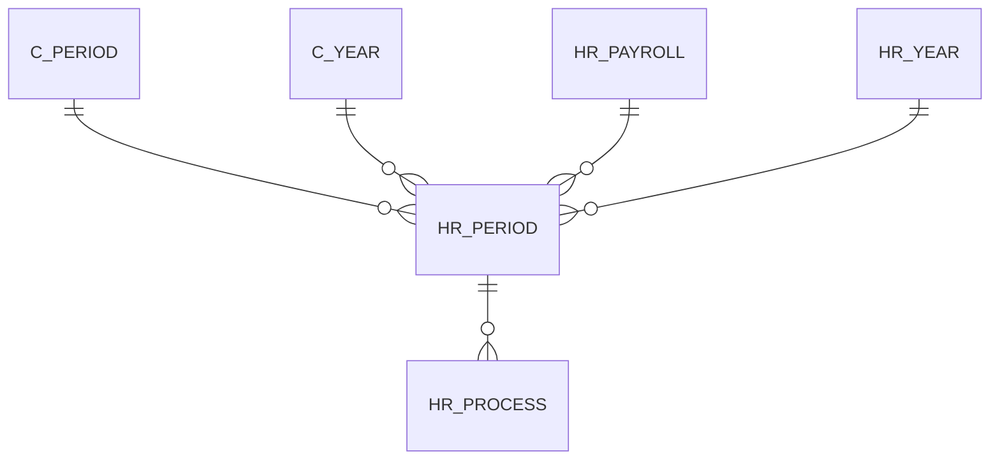

# HR_PERIOD

Area [HR](../../data-model/hr/index.md) · class **business** (proposed) · read from database `idempiere-db` (owner `ADEMPIERE`) · 0 row(s) when profiled

Application model: `org.eevolution.model.X_HR_Period`, access level 3 - Client - Org.

## Columns

| column | type | key | not null | business name | references (code) | nulls | distinct |
|---|---|---|---|---|---|---|---|
| `NAME` | VARCHAR2(40 CHAR) |  | yes | Name |  | 0 | 0 |
| `AD_ORG_ID` | NUMBER(10,0) |  | yes | Organization |  | 0 | 0 |
| `C_PERIOD_ID` | NUMBER(10,0) |  | yes | Period | [C_PERIOD](../../data-model/c/c_period.md) | 0 | 0 |
| `C_YEAR_ID` | NUMBER(10,0) |  | yes | Year | [C_YEAR](../../data-model/c/c_year.md) | 0 | 0 |
| `CREATED` | DATE |  | yes | Created |  | 0 | 0 |
| `CREATEDBY` | NUMBER(10,0) |  | yes | Created By |  | 0 | 0 |
| `DATEACCT` | DATE |  | yes | Account Date |  | 0 | 0 |
| `DESCRIPTION` | VARCHAR2(255 CHAR) |  |  | Description |  | 0 | 0 |
| `ENDDATE` | DATE |  |  | End Date |  | 0 | 0 |
| `HR_PAYROLL_ID` | NUMBER(10,0) |  | yes | Payroll | [HR_PAYROLL](../../data-model/hr/hr_payroll.md) | 0 | 0 |
| `HR_PERIOD_ID` | NUMBER(10,0) | PK | yes | Payroll Period |  | 0 | 0 |
| `HR_YEAR_ID` | NUMBER(10,0) |  |  | Payroll Year | [HR_YEAR](../../data-model/hr/hr_year.md) | 0 | 0 |
| `ISACTIVE` | CHAR(1) |  | yes | Active |  | 0 | 0 |
| `PERIODACTION` | VARCHAR2(1 CHAR) |  |  | Period Action |  | 0 | 0 |
| `PERIODNO` | NUMBER(10,0) |  | yes | Period No |  | 0 | 0 |
| `PERIODSTATUS` | VARCHAR2(1 CHAR) |  |  | Period Status |  | 0 | 0 |
| `PROCESSED` | CHAR(1) |  |  | Processed |  | 0 | 0 |
| `PROCESSING` | VARCHAR2(1 CHAR) |  |  | Process Now |  | 0 | 0 |
| `STARTDATE` | DATE |  | yes | Start Date |  | 0 | 0 |
| `UPDATED` | DATE |  | yes | Updated |  | 0 | 0 |
| `AD_CLIENT_ID` | NUMBER(10,0) |  | yes | Tenant |  | 0 | 0 |
| `UPDATEDBY` | NUMBER(10,0) |  | yes | Updated By |  | 0 | 0 |
| `HR_PERIOD_UU` | VARCHAR2(36 CHAR) |  |  | HR_Period_UU |  | 0 | 0 |

*references (code)* is the table the application model's code says a column points to; *Foreign keys* below are the constraints the database declares. Counts come from the profile; no value is ever shown.

## Check constraints

| name | expression |
|---|---|
| `SYS_C0019915` | `Processed IN ('Y','N')` |
| `SYS_C0019917` | `IsActive IN ('Y','N')` |

## Foreign keys

**References**

| table | columns | on delete |
|---|---|---|
| [C_PERIOD](../../data-model/c/c_period.md) | HR_PERIOD.C_PERIOD_ID → C_PERIOD.C_PERIOD_ID | NO ACTION |
| [C_YEAR](../../data-model/c/c_year.md) | HR_PERIOD.C_YEAR_ID → C_YEAR.C_YEAR_ID | NO ACTION |
| [HR_PAYROLL](../../data-model/hr/hr_payroll.md) | HR_PERIOD.HR_PAYROLL_ID → HR_PAYROLL.HR_PAYROLL_ID | NO ACTION |
| [HR_YEAR](../../data-model/hr/hr_year.md) | HR_PERIOD.HR_YEAR_ID → HR_YEAR.HR_YEAR_ID | NO ACTION |

**Referenced by**

| table | columns | on delete |
|---|---|---|
| [HR_PROCESS](../../data-model/hr/hr_process.md) | HR_PROCESS.HR_PERIOD_ID → HR_PERIOD.HR_PERIOD_ID | NO ACTION |

## Write behaviour

- updates: **po_only**
- deletes: **deleted_by_users**
- change log: **recorded**
- evidence: 1 citation(s)

## Schema history

38 change(s); the latest:

| applied | release | operation | column | tickets |
|---|---|---|---|---|
| 2023-04-09T15:47 | iD11 | `add_constraint` |  | IDEMPIERE-5567 |
| 2023-04-09T15:47 | iD11 | `add_constraint` |  | IDEMPIERE-5567 |
| 2021-12-05T16:45 | i8.2z | `add_constraint` |  | IDEMPIERE-5075 |
| 2021-12-05T16:45 | i8.2z | `drop_constraint` |  | IDEMPIERE-5075 |
| 2021-12-05T16:45 | i8.2z | `drop_constraint` |  | IDEMPIERE-5075 |
| 2021-12-05T16:45 | i8.2z | `drop_constraint` |  | IDEMPIERE-5075 |
| 2021-12-05T16:45 | i8.2z | `add_constraint` |  | IDEMPIERE-5075 |
| 2021-12-05T16:45 | i8.2z | `add_constraint` |  | IDEMPIERE-5075 |
| 2021-12-05T16:45 | i8.2z | `drop_constraint` |  | IDEMPIERE-5075 |
| 2021-12-05T16:45 | i8.2z | `add_constraint` |  | IDEMPIERE-5075 |
| 2020-08-04T01:00 | i7.1z | `modify_column` | NAME | IDEMPIERE-3862 |
| 2020-08-04T01:00 | i7.1z | `modify_column` | PERIODACTION | IDEMPIERE-3862 |
| 2020-08-04T01:00 | i7.1z | `add_column` | tmp_col_4_tmp | IDEMPIERE-3862 |
| 2020-08-04T01:00 | i7.1z | `modify_column` | PROCESSING | IDEMPIERE-3862 |
| 2020-08-04T01:00 | i7.1z | `drop_column` | tmp_col_4_tmp | IDEMPIERE-3862 |

## Notes

<!-- ekos:manual id="table.hr_period.notes" -->
_Business notes about this table._
<!-- /ekos:manual -->
