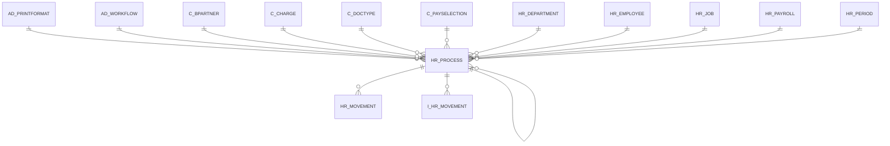

# HR_PROCESS

Area [HR](../../data-model/hr/index.md) · class **business** (proposed) · read from database `idempiere-db` (owner `ADEMPIERE`) · 0 row(s) when profiled

Application model: `org.eevolution.model.X_HR_Process`, access level 3 - Client - Org.

## Columns

| column | type | key | not null | business name | references (code) | nulls | distinct |
|---|---|---|---|---|---|---|---|
| `HR_JOB_ID` | NUMBER(10,0) |  |  | Payroll Job | [HR_JOB](../../data-model/hr/hr_job.md) | 0 | 0 |
| `C_DOCTYPE_ID` | NUMBER(10,0) |  |  | Document Type | [C_DOCTYPE](../../data-model/c/c_doctype.md) | 0 | 0 |
| `C_PAYSELECTION_ID` | NUMBER(10,0) |  |  | Payment Selection | [C_PAYSELECTION](../../data-model/c/c_payselection.md) | 0 | 0 |
| `HR_PROCESS_ID` | NUMBER(10,0) | PK | yes | Payroll Process |  | 0 | 0 |
| `HR_EMPLOYEE_ID` | NUMBER(10,0) |  |  | Payroll Employee | [HR_EMPLOYEE](../../data-model/hr/hr_employee.md) | 0 | 0 |
| `NAME` | VARCHAR2(60 CHAR) |  | yes | Name |  | 0 | 0 |
| `C_DOCTYPETARGET_ID` | NUMBER(10,0) |  | yes | Target Document Type | [C_DOCTYPE](../../data-model/c/c_doctype.md) | 0 | 0 |
| `COLUMNSQL` | VARCHAR2(255 CHAR) |  |  | Column SQL |  | 0 | 0 |
| `CREATED` | DATE |  | yes | Created |  | 0 | 0 |
| `CREATEDBY` | NUMBER(10,0) |  | yes | Created By |  | 0 | 0 |
| `DATEACCT` | DATE |  | yes | Account Date |  | 0 | 0 |
| `DOCACTION` | CHAR(2) |  | yes | Document Action |  | 0 | 0 |
| `DOCSTATUS` | VARCHAR2(2 CHAR) |  | yes | Document Status |  | 0 | 0 |
| `DOCUMENTNO` | VARCHAR2(90 CHAR) |  |  | Document No |  | 0 | 0 |
| `HR_DEPARTMENT_ID` | NUMBER(10,0) |  |  | Payroll Department | [HR_DEPARTMENT](../../data-model/hr/hr_department.md) | 0 | 0 |
| `HR_PAYROLL_ID` | NUMBER(10,0) |  | yes | Payroll | [HR_PAYROLL](../../data-model/hr/hr_payroll.md) | 0 | 0 |
| `HR_PERIOD_ID` | NUMBER(10,0) |  |  | Payroll Period | [HR_PERIOD](../../data-model/hr/hr_period.md) | 0 | 0 |
| `ISACTIVE` | CHAR(1) |  | yes | Active |  | 0 | 0 |
| `POSTED` | CHAR(1) |  | yes | Posted |  | 0 | 0 |
| `PROCESSED` | CHAR(1) |  | yes | Processed |  | 0 | 0 |
| `PROCESSING` | CHAR(1) |  |  | Process Now |  | 0 | 0 |
| `UPDATED` | DATE |  | yes | Updated |  | 0 | 0 |
| `AD_CLIENT_ID` | NUMBER(10,0) |  | yes | Tenant |  | 0 | 0 |
| `UPDATEDBY` | NUMBER(10,0) |  | yes | Updated By |  | 0 | 0 |
| `AD_ORG_ID` | NUMBER(10,0) |  | yes | Organization |  | 0 | 0 |
| `AD_PRINTFORMAT_ID` | NUMBER(10,0) |  |  | Print Format | [AD_PRINTFORMAT](../../data-model/ad/ad_printformat.md) | 0 | 0 |
| `AD_WORKFLOW_ID` | NUMBER(10,0) |  |  | Workflow | [AD_WORKFLOW](../../data-model/ad/ad_workflow.md) | 0 | 0 |
| `C_BPARTNER_ID` | NUMBER(10,0) |  |  | Business Partner | [C_BPARTNER](../../data-model/c/c_bpartner.md) | 0 | 0 |
| `C_CHARGE_ID` | NUMBER(10,0) |  |  | Charge | [C_CHARGE](../../data-model/c/c_charge.md) | 0 | 0 |
| `REVERSAL_ID` | NUMBER(10,0) |  |  | Reversal ID | [HR_PROCESS](../../data-model/hr/hr_process.md) | 0 | 0 |
| `PROCESSEDON` | NUMBER |  |  | Processed On |  | 0 | 0 |
| `HR_PROCESS_UU` | VARCHAR2(36 CHAR) |  |  | HR_Process_UU |  | 0 | 0 |

*references (code)* is the table the application model's code says a column points to; *Foreign keys* below are the constraints the database declares. Counts come from the profile; no value is ever shown.

## Check constraints

| name | expression |
|---|---|
| `SYS_C0021734` | `Processed IN ('Y','N')` |
| `SYS_C0021736` | `IsActive IN ('Y','N')` |

## Foreign keys

**References**

| table | columns | on delete |
|---|---|---|
| [AD_PRINTFORMAT](../../data-model/ad/ad_printformat.md) | HR_PROCESS.AD_PRINTFORMAT_ID → AD_PRINTFORMAT.AD_PRINTFORMAT_ID | NO ACTION |
| [AD_WORKFLOW](../../data-model/ad/ad_workflow.md) | HR_PROCESS.AD_WORKFLOW_ID → AD_WORKFLOW.AD_WORKFLOW_ID | NO ACTION |
| [C_BPARTNER](../../data-model/c/c_bpartner.md) | HR_PROCESS.C_BPARTNER_ID → C_BPARTNER.C_BPARTNER_ID | NO ACTION |
| [C_CHARGE](../../data-model/c/c_charge.md) | HR_PROCESS.C_CHARGE_ID → C_CHARGE.C_CHARGE_ID | NO ACTION |
| [C_DOCTYPE](../../data-model/c/c_doctype.md) | HR_PROCESS.C_DOCTYPETARGET_ID → C_DOCTYPE.C_DOCTYPE_ID | NO ACTION |
| [C_PAYSELECTION](../../data-model/c/c_payselection.md) | HR_PROCESS.C_PAYSELECTION_ID → C_PAYSELECTION.C_PAYSELECTION_ID | NO ACTION |
| [HR_DEPARTMENT](../../data-model/hr/hr_department.md) | HR_PROCESS.HR_DEPARTMENT_ID → HR_DEPARTMENT.HR_DEPARTMENT_ID | NO ACTION |
| [HR_EMPLOYEE](../../data-model/hr/hr_employee.md) | HR_PROCESS.HR_EMPLOYEE_ID → HR_EMPLOYEE.HR_EMPLOYEE_ID | NO ACTION |
| [HR_JOB](../../data-model/hr/hr_job.md) | HR_PROCESS.HR_JOB_ID → HR_JOB.HR_JOB_ID | NO ACTION |
| [HR_PAYROLL](../../data-model/hr/hr_payroll.md) | HR_PROCESS.HR_PAYROLL_ID → HR_PAYROLL.HR_PAYROLL_ID | NO ACTION |
| [HR_PERIOD](../../data-model/hr/hr_period.md) | HR_PROCESS.HR_PERIOD_ID → HR_PERIOD.HR_PERIOD_ID | NO ACTION |
| [HR_PROCESS](../../data-model/hr/hr_process.md) | HR_PROCESS.REVERSAL_ID → HR_PROCESS.HR_PROCESS_ID | NO ACTION |

**Referenced by**

| table | columns | on delete |
|---|---|---|
| [HR_MOVEMENT](../../data-model/hr/hr_movement.md) | HR_MOVEMENT.HR_PROCESS_ID → HR_PROCESS.HR_PROCESS_ID | NO ACTION |
| [HR_PROCESS](../../data-model/hr/hr_process.md) | HR_PROCESS.REVERSAL_ID → HR_PROCESS.HR_PROCESS_ID | NO ACTION |
| `I_HR_MOVEMENT` | I_HR_MOVEMENT.HR_PROCESS_ID → HR_PROCESS.HR_PROCESS_ID | NO ACTION |

## Write behaviour

- updates: **po_only**
- deletes: **deleted_by_users**
- change log: **recorded**
- evidence: 1 citation(s)

## Schema history

57 change(s); the latest:

| applied | release | operation | column | tickets |
|---|---|---|---|---|
| 2023-04-09T15:47 | iD11 | `add_constraint` |  | IDEMPIERE-5567 |
| 2023-04-09T15:47 | iD11 | `add_constraint` |  | IDEMPIERE-5567 |
| 2021-12-05T16:45 | i8.2z | `add_constraint` |  | IDEMPIERE-5075 |
| 2021-12-05T16:45 | i8.2z | `add_constraint` |  | IDEMPIERE-5075 |
| 2021-12-05T16:45 | i8.2z | `drop_constraint` |  | IDEMPIERE-5075 |
| 2021-12-05T16:45 | i8.2z | `add_constraint` |  | IDEMPIERE-5075 |
| 2021-12-05T16:45 | i8.2z | `drop_constraint` |  | IDEMPIERE-5075 |
| 2021-12-05T16:45 | i8.2z | `drop_constraint` |  | IDEMPIERE-5075 |
| 2021-12-05T16:45 | i8.2z | `drop_constraint` |  | IDEMPIERE-5075 |
| 2021-12-05T16:45 | i8.2z | `add_constraint` |  | IDEMPIERE-5075 |
| 2021-12-05T16:45 | i8.2z | `add_constraint` |  | IDEMPIERE-5075 |
| 2021-12-05T16:45 | i8.2z | `drop_constraint` |  | IDEMPIERE-5075 |
| 2021-12-05T16:45 | i8.2z | `drop_constraint` |  | IDEMPIERE-5075 |
| 2021-12-05T16:45 | i8.2z | `add_constraint` |  | IDEMPIERE-5075 |
| 2021-12-05T16:45 | i8.2z | `drop_constraint` |  | IDEMPIERE-5075 |

## Notes

<!-- ekos:manual id="table.hr_process.notes" -->
_Business notes about this table._
<!-- /ekos:manual -->
