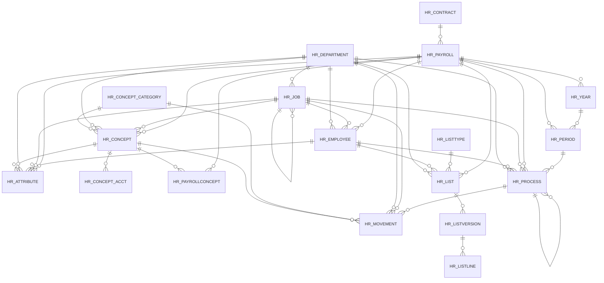

# Area HR

18 table(s), 18 in scope.

| table | class | scope | rows | description |
|---|---|---|---|---|
| [HR_ATTRIBUTE](../../data-model/hr/hr_attribute.md) | business | in | 0 |  |
| [HR_CONCEPT](../../data-model/hr/hr_concept.md) | business | in | 0 |  |
| [HR_CONCEPT_ACCT](../../data-model/hr/hr_concept_acct.md) | business | in | 0 |  |
| [HR_CONCEPT_CATEGORY](../../data-model/hr/hr_concept_category.md) | business | in | 0 |  |
| [HR_CONTRACT](../../data-model/hr/hr_contract.md) | business | in | 0 |  |
| [HR_DEPARTMENT](../../data-model/hr/hr_department.md) | business | in | 0 |  |
| [HR_EMPLOYEE](../../data-model/hr/hr_employee.md) | business | in | 0 |  |
| [HR_JOB](../../data-model/hr/hr_job.md) | business | in | 0 |  |
| [HR_LIST](../../data-model/hr/hr_list.md) | business | in | 0 |  |
| [HR_LISTLINE](../../data-model/hr/hr_listline.md) | business | in | 0 |  |
| [HR_LISTTYPE](../../data-model/hr/hr_listtype.md) | business | in | 0 |  |
| [HR_LISTVERSION](../../data-model/hr/hr_listversion.md) | business | in | 0 |  |
| [HR_MOVEMENT](../../data-model/hr/hr_movement.md) | business | in | 0 |  |
| [HR_PAYROLL](../../data-model/hr/hr_payroll.md) | business | in | 0 |  |
| [HR_PAYROLLCONCEPT](../../data-model/hr/hr_payrollconcept.md) | business | in | 0 |  |
| [HR_PERIOD](../../data-model/hr/hr_period.md) | business | in | 0 |  |
| [HR_PROCESS](../../data-model/hr/hr_process.md) | business | in | 0 |  |
| [HR_YEAR](../../data-model/hr/hr_year.md) | business | in | 0 |  |
