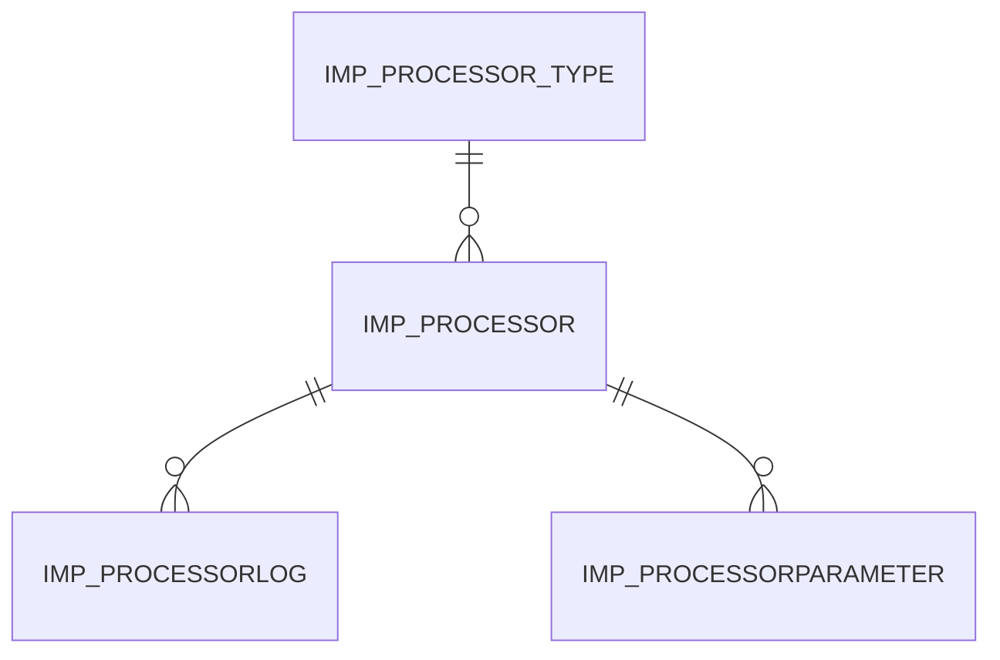

# IMP_PROCESSOR

Area [IMP](../../data-model/imp/index.md) · class **business** (proposed) · read from database `idempiere-db` (owner `ADEMPIERE`) · 2 row(s) when profiled

Application model: `org.compiere.model.X_IMP_Processor`, access level 6 - System - Client.

## Columns

| column | type | key | not null | business name | references (code) | nulls | distinct |
|---|---|---|---|---|---|---|---|
| `IMP_PROCESSOR_ID` | NUMBER(10,0) | PK | yes | Import Processor |  | 0 | 2 |
| `IMP_PROCESSOR_TYPE_ID` | NUMBER(10,0) |  | yes | Import Processor Type | [IMP_PROCESSOR_TYPE](../../data-model/imp/imp_processor_type.md) | 0 | 2 |
| `AD_CLIENT_ID` | NUMBER(10,0) |  | yes | Tenant |  | 0 | 1 |
| `AD_ORG_ID` | NUMBER(10,0) |  | yes | Organization |  | 0 | 1 |
| `ISACTIVE` | CHAR(1) |  | yes | Active |  | 0 | 1 |
| `CREATED` | DATE |  | yes | Created |  | 0 | 2 |
| `CREATEDBY` | NUMBER(10,0) |  | yes | Created By |  | 0 | 1 |
| `UPDATED` | DATE |  | yes | Updated |  | 0 | 2 |
| `UPDATEDBY` | NUMBER(10,0) |  | yes | Updated By |  | 0 | 1 |
| `VALUE` | VARCHAR2(40 CHAR) |  | yes | Search Key |  | 0 | 2 |
| `NAME` | VARCHAR2(60 CHAR) |  | yes | Name |  | 0 | 2 |
| `DESCRIPTION` | VARCHAR2(255 CHAR) |  |  | Description |  | 0 | 2 |
| `HELP` | VARCHAR2(2000 CHAR) |  |  | Comment/Help |  | 0 | 2 |
| `FREQUENCYTYPE` | CHAR(1) |  | yes | Frequency Type |  | 0 | 1 |
| `FREQUENCY` | NUMBER(10,0) |  | yes | Frequency |  | 0 | 1 |
| `DATELASTRUN` | DATE |  |  | Date Last Run |  | 2 | 0 |
| `DATENEXTRUN` | DATE |  |  | Date Next Run |  | 2 | 0 |
| `KEEPLOGDAYS` | NUMBER(10,0) |  | yes | Days to keep Log |  | 0 | 1 |
| `PROCESSING` | CHAR(1) |  |  | Process Now |  | 0 | 1 |
| `HOST` | VARCHAR2(255 CHAR) |  |  | Host |  | 0 | 1 |
| `PORT` | NUMBER(10,0) |  |  | Port |  | 1 | 1 |
| `ACCOUNT` | VARCHAR2(255 CHAR) |  |  | Account |  | 0 | 1 |
| `PASSWORDINFO` | VARCHAR2(255 CHAR) |  |  | Password Info |  | 0 | 1 |
| `IMP_PROCESSOR_UU` | VARCHAR2(36 CHAR) |  |  | IMP_Processor_UU |  | 0 | 2 |

*references (code)* is the table the application model's code says a column points to; *Foreign keys* below are the constraints the database declares. Counts come from the profile; no value is ever shown.

## Check constraints

| name | expression |
|---|---|
| `SYS_C0022958` | `IsActive IN ('Y','N')` |

## Foreign keys

**References**

| table | columns | on delete |
|---|---|---|
| [IMP_PROCESSOR_TYPE](../../data-model/imp/imp_processor_type.md) | IMP_PROCESSOR.IMP_PROCESSOR_TYPE_ID → IMP_PROCESSOR_TYPE.IMP_PROCESSOR_TYPE_ID | NO ACTION |

**Referenced by**

| table | columns | on delete |
|---|---|---|
| `IMP_PROCESSORLOG` | IMP_PROCESSORLOG.IMP_PROCESSOR_ID → IMP_PROCESSOR.IMP_PROCESSOR_ID | NO ACTION |
| [IMP_PROCESSORPARAMETER](../../data-model/imp/imp_processorparameter.md) | IMP_PROCESSORPARAMETER.IMP_PROCESSOR_ID → IMP_PROCESSOR.IMP_PROCESSOR_ID | NO ACTION |

## Write behaviour

- updates: **po_only**
- deletes: **deleted_by_users**
- change log: **recorded**
- evidence: 1 citation(s)

## Schema history

40 change(s); the latest:

| applied | release | operation | column | tickets |
|---|---|---|---|---|
| 2023-04-09T15:47 | iD11 | `add_constraint` |  | IDEMPIERE-5567 |
| 2023-04-09T15:47 | iD11 | `add_constraint` |  | IDEMPIERE-5567 |
| 2021-12-05T16:45 | i8.2z | `drop_constraint` |  | IDEMPIERE-5075 |
| 2021-12-05T16:45 | i8.2z | `add_constraint` |  | IDEMPIERE-5075 |
| 2020-08-04T01:00 | i7.1z | `add_column` | tmp_col_5_tmp | IDEMPIERE-3862 |
| 2020-08-04T01:00 | i7.1z | `modify_column` | VALUE | IDEMPIERE-3862 |
| 2020-08-04T01:00 | i7.1z | `modify_column` | NAME | IDEMPIERE-3862 |
| 2020-08-04T01:00 | i7.1z | `modify_column` | VALUE | IDEMPIERE-3862 |
| 2020-08-04T01:00 | i7.1z | `modify_column` | IMP_PROCESSOR_UU | IDEMPIERE-3862 |
| 2020-08-04T01:00 | i7.1z | `modify_column` | VALUE | IDEMPIERE-3862 |
| 2020-08-04T01:00 | i7.1z | `modify_column` | DESCRIPTION | IDEMPIERE-3862 |
| 2020-08-04T01:00 | i7.1z | `modify_column` | HOST | IDEMPIERE-3862 |
| 2020-08-04T01:00 | i7.1z | `modify_column` | ACCOUNT | IDEMPIERE-3862 |
| 2020-08-04T01:00 | i7.1z | `drop_column` | tmp_col_5_tmp | IDEMPIERE-3862 |
| 2020-08-04T01:00 | i7.1z | `drop_column` | tmp_col_4_tmp | IDEMPIERE-3862 |

## Notes

<!-- ekos:manual id="table.imp_processor.notes" -->
_Business notes about this table._
<!-- /ekos:manual -->
