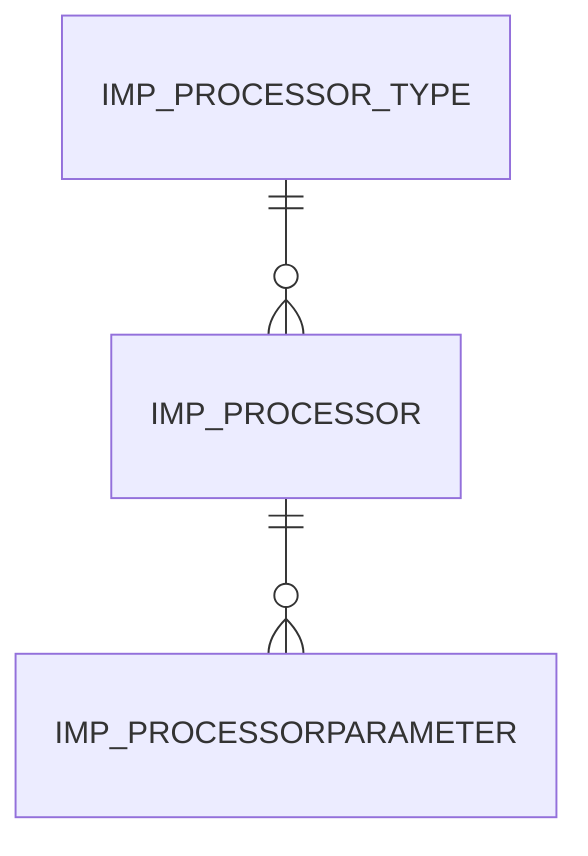

# Area IMP

4 table(s), 3 in scope.

| table | class | scope | rows | description |
|---|---|---|---|---|
| [IMP_PROCESSOR](../../data-model/imp/imp_processor.md) | business | in | 2 |  |
| `IMP_PROCESSORLOG` | log | out | 0 |  |
| [IMP_PROCESSORPARAMETER](../../data-model/imp/imp_processorparameter.md) | business | in | 6 |  |
| [IMP_PROCESSOR_TYPE](../../data-model/imp/imp_processor_type.md) | business | in | 2 |  |
