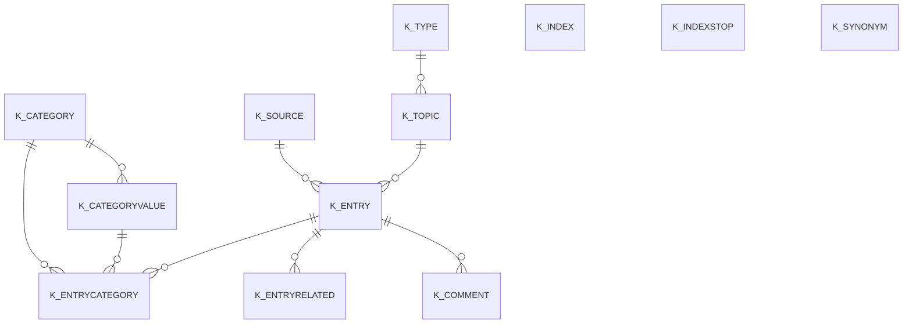

# Area K

13 table(s), 12 in scope.

| table | class | scope | rows | description |
|---|---|---|---|---|
| [K_CATEGORY](../../data-model/k/k_category.md) | business | in | 1 |  |
| [K_CATEGORYVALUE](../../data-model/k/k_categoryvalue.md) | business | in | 0 |  |
| [K_COMMENT](../../data-model/k/k_comment.md) | business | in | 0 |  |
| [K_ENTRY](../../data-model/k/k_entry.md) | business | in | 0 |  |
| [K_ENTRYCATEGORY](../../data-model/k/k_entrycategory.md) | business | in | 0 |  |
| [K_ENTRYRELATED](../../data-model/k/k_entryrelated.md) | business | in | 0 |  |
| [K_INDEX](../../data-model/k/k_index.md) | business | in | 0 |  |
| `K_INDEXLOG` | log | out | 0 |  |
| [K_INDEXSTOP](../../data-model/k/k_indexstop.md) | business | in | 0 |  |
| [K_SOURCE](../../data-model/k/k_source.md) | business | in | 1 |  |
| [K_SYNONYM](../../data-model/k/k_synonym.md) | business | in | 0 |  |
| [K_TOPIC](../../data-model/k/k_topic.md) | business | in | 1 |  |
| [K_TYPE](../../data-model/k/k_type.md) | business | in | 2 |  |
