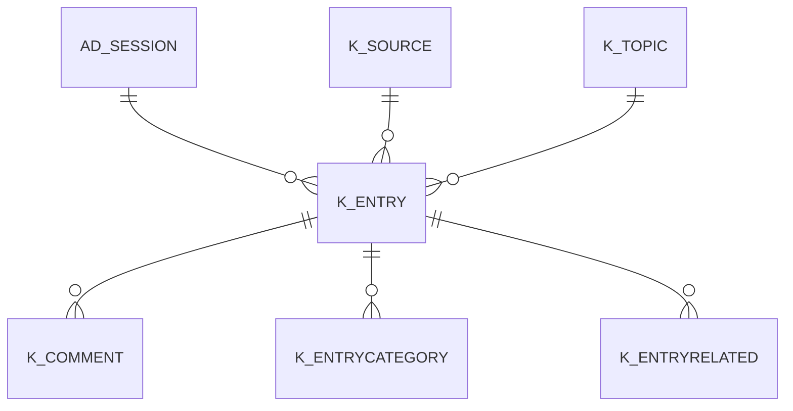

# K_ENTRY

Area [K](../../data-model/k/index.md) · class **business** (proposed) · read from database `idempiere-db` (owner `ADEMPIERE`) · 0 row(s) when profiled

## Columns

| column | type | key | not null | business name | references (code) | nulls | distinct |
|---|---|---|---|---|---|---|---|
| `K_ENTRY_ID` | NUMBER(10,0) | PK | yes |  |  | 0 | 0 |
| `AD_CLIENT_ID` | NUMBER(10,0) |  | yes |  |  | 0 | 0 |
| `AD_ORG_ID` | NUMBER(10,0) |  | yes |  |  | 0 | 0 |
| `ISACTIVE` | CHAR(1) |  | yes |  |  | 0 | 0 |
| `CREATED` | DATE |  | yes |  |  | 0 | 0 |
| `CREATEDBY` | NUMBER(10,0) |  | yes |  |  | 0 | 0 |
| `UPDATED` | DATE |  | yes |  |  | 0 | 0 |
| `UPDATEDBY` | NUMBER(10,0) |  | yes |  |  | 0 | 0 |
| `NAME` | VARCHAR2(60 CHAR) |  | yes |  |  | 0 | 0 |
| `K_TOPIC_ID` | NUMBER(10,0) |  | yes |  |  | 0 | 0 |
| `RATING` | NUMBER(10,0) |  | yes |  |  | 0 | 0 |
| `ISPUBLIC` | CHAR(1) |  | yes |  |  | 0 | 0 |
| `KEYWORDS` | VARCHAR2(255 CHAR) |  |  |  |  | 0 | 0 |
| `K_SOURCE_ID` | NUMBER(10,0) |  |  |  |  | 0 | 0 |
| `DESCRIPTIONURL` | VARCHAR2(120 CHAR) |  |  |  |  | 0 | 0 |
| `VALIDTO` | DATE |  |  |  |  | 0 | 0 |
| `AD_SESSION_ID` | NUMBER(10,0) |  |  |  |  | 0 | 0 |
| `TEXTMSG` | VARCHAR2(2000 CHAR) |  | yes |  |  | 0 | 0 |
| `K_ENTRY_UU` | VARCHAR2(36 CHAR) |  |  |  |  | 0 | 0 |

*references (code)* is the table the application model's code says a column points to; *Foreign keys* below are the constraints the database declares. Counts come from the profile; no value is ever shown.

## Check constraints

| name | expression |
|---|---|
| `SYS_C0022394` | `IsActive in ('Y','N')` |
| `SYS_C0022396` | `IsPublic in ('Y','N')` |

## Foreign keys

**References**

| table | columns | on delete |
|---|---|---|
| [AD_SESSION](../../data-model/ad/ad_session.md) | K_ENTRY.AD_SESSION_ID → AD_SESSION.AD_SESSION_ID | NO ACTION |
| [K_SOURCE](../../data-model/k/k_source.md) | K_ENTRY.K_SOURCE_ID → K_SOURCE.K_SOURCE_ID | NO ACTION |
| [K_TOPIC](../../data-model/k/k_topic.md) | K_ENTRY.K_TOPIC_ID → K_TOPIC.K_TOPIC_ID | NO ACTION |

**Referenced by**

| table | columns | on delete |
|---|---|---|
| [K_COMMENT](../../data-model/k/k_comment.md) | K_COMMENT.K_ENTRY_ID → K_ENTRY.K_ENTRY_ID | NO ACTION |
| [K_ENTRYCATEGORY](../../data-model/k/k_entrycategory.md) | K_ENTRYCATEGORY.K_ENTRY_ID → K_ENTRY.K_ENTRY_ID | NO ACTION |
| [K_ENTRYRELATED](../../data-model/k/k_entryrelated.md) | K_ENTRYRELATED.K_ENTRY_ID → K_ENTRY.K_ENTRY_ID | NO ACTION |

## Write behaviour

- updates: **po_only**
- deletes: **deleted_by_users**
- change log: **recorded**
- evidence: 1 citation(s)

## Schema history

27 change(s); the latest:

| applied | release | operation | column | tickets |
|---|---|---|---|---|
| 2023-04-09T15:47 | iD11 | `add_constraint` |  | IDEMPIERE-5567 |
| 2023-04-09T15:47 | iD11 | `add_constraint` |  | IDEMPIERE-5567 |
| 2021-12-05T16:45 | i8.2z | `drop_constraint` |  | IDEMPIERE-5075 |
| 2021-12-05T16:45 | i8.2z | `add_constraint` |  | IDEMPIERE-5075 |
| 2021-12-05T16:45 | i8.2z | `drop_constraint` |  | IDEMPIERE-5075 |
| 2021-12-05T16:45 | i8.2z | `drop_constraint` |  | IDEMPIERE-5075 |
| 2021-12-05T16:45 | i8.2z | `add_constraint` |  | IDEMPIERE-5075 |
| 2021-12-05T16:45 | i8.2z | `add_constraint` |  | IDEMPIERE-5075 |
| 2020-08-04T01:00 | i7.1z | `drop_column` | tmp_col_5_tmp | IDEMPIERE-3862 |
| 2020-08-04T01:00 | i7.1z | `drop_column` | tmp_col_4_tmp | IDEMPIERE-3862 |
| 2020-08-04T01:00 | i7.1z | `drop_column` | tmp_col_1_tmp | IDEMPIERE-3862 |
| 2020-08-04T01:00 | i7.1z | `add_column` | tmp_col_5_tmp | IDEMPIERE-3862 |
| 2020-08-04T01:00 | i7.1z | `modify_column` | TEXTMSG | IDEMPIERE-3862 |
| 2020-08-04T01:00 | i7.1z | `drop_column` | tmp_col_2_tmp | IDEMPIERE-3862 |
| 2020-08-04T01:00 | i7.1z | `drop_column` | tmp_col_3_tmp | IDEMPIERE-3862 |

## Open conflicts

| type | attribute | explanation |
|---|---|---|
| `table_without_model` | `model_class` | unexplained |

## Notes

<!-- ekos:manual id="table.k_entry.notes" -->
_Business notes about this table._
<!-- /ekos:manual -->
