# Area M

124 table(s), 123 in scope.

```mermaid
erDiagram
  M_ATTRIBUTESET ||--o{ M_ATTRIBUTESETINSTANCE : ""
  M_ATTRIBUTESET ||--o{ M_PRODUCT : ""
  M_ATTRIBUTESETINSTANCE ||--o{ M_BOMPRODUCT : ""
  M_ATTRIBUTESETINSTANCE ||--o{ M_COSTDETAIL : ""
  M_ATTRIBUTESETINSTANCE ||--o{ M_COSTHISTORY : ""
  M_ATTRIBUTESETINSTANCE ||--o{ M_INOUTLINE : ""
  M_ATTRIBUTESETINSTANCE ||--o{ M_INVENTORYLINE : ""
  M_ATTRIBUTESETINSTANCE ||--o{ M_MATCHINV : ""
  M_ATTRIBUTESETINSTANCE ||--o{ M_MATCHPO : ""
  M_ATTRIBUTESETINSTANCE ||--o{ M_MOVEMENTLINE : ""
  M_ATTRIBUTESETINSTANCE ||--o{ M_PRODUCT : ""
  M_ATTRIBUTESETINSTANCE ||--o{ M_PRODUCTIONLINE : ""
  M_ATTRIBUTESETINSTANCE ||--o{ M_TRANSACTION : ""
  M_ATTRIBUTESETINSTANCE ||--o{ M_TRANSACTIONALLOCATION : ""
  M_COSTDETAIL ||--o{ M_COSTHISTORY : ""
  M_INOUT ||--o{ M_INOUT : ""
  M_INOUT ||--o{ M_INOUTLINE : ""
  M_INOUT ||--o{ M_PACKAGE : ""
  M_INOUT ||--o{ M_RMA : ""
  M_INOUT ||--o{ M_SHIPPINGTRANSACTION : ""
  M_INOUTLINE ||--o{ M_COSTDETAIL : ""
  M_INOUTLINE ||--o{ M_INOUTLINE : ""
  M_INOUTLINE ||--o{ M_MATCHINV : ""
  M_INOUTLINE ||--o{ M_MATCHPO : ""
  M_INOUTLINE ||--o{ M_PRODUCTION : ""
  M_INOUTLINE ||--o{ M_RMALINE : ""
  M_INOUTLINE ||--o{ M_TRANSACTION : ""
  M_INOUTLINE ||--o{ M_TRANSACTIONALLOCATION : ""
  M_INVENTORY ||--o{ M_INVENTORY : ""
  M_INVENTORY ||--o{ M_INVENTORYLINE : ""
  M_INVENTORYLINE ||--o{ M_COSTDETAIL : ""
  M_INVENTORYLINE ||--o{ M_INVENTORYLINE : ""
  M_INVENTORYLINE ||--o{ M_TRANSACTION : ""
  M_INVENTORYLINE ||--o{ M_TRANSACTIONALLOCATION : ""
  M_LOCATOR ||--o{ M_INOUTLINE : ""
  M_LOCATOR ||--o{ M_INVENTORYLINE : ""
  M_LOCATOR ||--o{ M_MOVEMENTLINE : ""
  M_LOCATOR ||--o{ M_PRODUCT : ""
  M_LOCATOR ||--o{ M_PRODUCTION : ""
  M_LOCATOR ||--o{ M_PRODUCTIONLINE : ""
  M_LOCATOR ||--o{ M_TRANSACTION : ""
  M_LOCATOR ||--o{ M_WAREHOUSE : ""
  M_MATCHINV ||--o{ M_COSTDETAIL : ""
  M_MATCHINV ||--o{ M_MATCHINV : ""
  M_MATCHPO ||--o{ M_MATCHPO : ""
  M_MOVEMENT ||--o{ M_MOVEMENT : ""
  M_MOVEMENT ||--o{ M_MOVEMENTLINE : ""
  M_MOVEMENTLINE ||--o{ M_COSTDETAIL : ""
  M_MOVEMENTLINE ||--o{ M_MOVEMENTLINE : ""
  M_MOVEMENTLINE ||--o{ M_TRANSACTION : ""
  M_PACKAGE ||--o{ M_SHIPPINGTRANSACTION : ""
  M_PRICELIST ||--o{ M_PRICELIST : ""
  M_PRICELIST ||--o{ M_PRICELIST_VERSION : ""
  M_PRICELIST_VERSION ||--o{ M_PRICELIST_VERSION : ""
  M_PRODUCT ||--o{ M_BOMPRODUCT : ""
  M_PRODUCT ||--o{ M_COSTDETAIL : ""
  M_PRODUCT ||--o{ M_COSTHISTORY : ""
  M_PRODUCT ||--o{ M_INOUTLINE : ""
  M_PRODUCT ||--o{ M_INVENTORYLINE : ""
  M_PRODUCT ||--o{ M_MATCHINV : ""
  M_PRODUCT ||--o{ M_MATCHPO : ""
  M_PRODUCT ||--o{ M_MOVEMENTLINE : ""
  M_PRODUCT ||--o{ M_PRODUCTION : ""
  M_PRODUCT ||--o{ M_PRODUCTIONLINE : ""
  M_PRODUCT ||--o{ M_RMALINE : ""
  M_PRODUCT ||--o{ M_TRANSACTION : ""
  M_PRODUCT ||--o{ M_TRANSACTIONALLOCATION : ""
  M_PRODUCTION ||--o{ M_PRODUCTION : ""
  M_PRODUCTION ||--o{ M_PRODUCTIONLINE : ""
  M_PRODUCTIONLINE ||--o{ M_COSTDETAIL : ""
  M_PRODUCTIONLINE ||--o{ M_TRANSACTION : ""
  M_PRODUCTIONLINE ||--o{ M_TRANSACTIONALLOCATION : ""
  M_PRODUCT_CATEGORY ||--o{ M_PRODUCT : ""
  M_PRODUCT_CATEGORY ||--o{ M_PRODUCT_CATEGORY : ""
  M_RMA ||--o{ M_INOUT : ""
  M_RMA ||--o{ M_RMA : ""
  M_RMA ||--o{ M_RMALINE : ""
  M_RMALINE ||--o{ M_INOUTLINE : ""
  M_RMALINE ||--o{ M_RMALINE : ""
  M_SHIPPER ||--o{ M_INOUT : ""
  M_SHIPPER ||--o{ M_MOVEMENT : ""
  M_SHIPPER ||--o{ M_PACKAGE : ""
  M_SHIPPER ||--o{ M_SHIPPINGTRANSACTION : ""
  M_SHIPPERCFG ||--o{ M_SHIPPER : ""
  M_TRANSACTION ||--o{ M_TRANSACTIONALLOCATION : ""
  M_WAREHOUSE ||--o{ M_INOUT : ""
  M_WAREHOUSE ||--o{ M_INVENTORY : ""
  M_WAREHOUSE ||--o{ M_LOCATOR : ""
  M_WAREHOUSE ||--o{ M_MOVEMENT : ""
  M_WAREHOUSE ||--o{ M_SHIPPINGTRANSACTION : ""
  M_WAREHOUSE ||--o{ M_WAREHOUSE : ""
  M_ATTRIBUTE {
  }
```

The diagram shows the 30 most connected tables; 93 more are listed below.

| table | class | scope | rows | description |
|---|---|---|---|---|
| [M_ATTRIBUTE](../../data-model/m/m_attribute.md) | business | in | 4 |  |
| [M_ATTRIBUTEINSTANCE](../../data-model/m/m_attributeinstance.md) | business | in | 5 |  |
| [M_ATTRIBUTEINSTANCELINE](../../data-model/m/m_attributeinstanceline.md) | business | in | 0 |  |
| [M_ATTRIBUTESEARCH](../../data-model/m/m_attributesearch.md) | business | in | 1 |  |
| [M_ATTRIBUTESET](../../data-model/m/m_attributeset.md) | business | in | 4 |  |
| [M_ATTRIBUTESETEXCLUDE](../../data-model/m/m_attributesetexclude.md) | business | in | 0 |  |
| [M_ATTRIBUTESETINSTANCE](../../data-model/m/m_attributesetinstance.md) | business | in | 4 |  |
| [M_ATTRIBUTEUSE](../../data-model/m/m_attributeuse.md) | business | in | 5 |  |
| [M_ATTRIBUTEVALUE](../../data-model/m/m_attributevalue.md) | business | in | 9 |  |
| [M_BOM](../../data-model/m/m_bom.md) | business | in | 1 |  |
| [M_BOMALTERNATIVE](../../data-model/m/m_bomalternative.md) | business | in | 1 |  |
| [M_BOMPRODUCT](../../data-model/m/m_bomproduct.md) | business | in | 0 |  |
| [M_BP_PRICE](../../data-model/m/m_bp_price.md) | business | in | 0 |  |
| [M_CHANGENOTICE](../../data-model/m/m_changenotice.md) | business | in | 1 | Change Notice |
| [M_CHANGEREQUEST](../../data-model/m/m_changerequest.md) | business | in | 0 | Change Request |
| [M_COMMODITYSHIPMENT](../../data-model/m/m_commodityshipment.md) | business | in | 0 |  |
| [M_COST](../../data-model/m/m_cost.md) | business | in | 267 |  |
| [M_COSTDETAIL](../../data-model/m/m_costdetail.md) | business | in | 0 |  |
| [M_COSTELEMENT](../../data-model/m/m_costelement.md) | business | in | 9 |  |
| [M_COSTHISTORY](../../data-model/m/m_costhistory.md) | business | in | 0 |  |
| [M_COSTQUEUE](../../data-model/m/m_costqueue.md) | business | in | 0 |  |
| [M_COSTTYPE](../../data-model/m/m_costtype.md) | business | in | 1 |  |
| [M_DEMAND](../../data-model/m/m_demand.md) | business | in | 0 |  |
| [M_DEMANDDETAIL](../../data-model/m/m_demanddetail.md) | business | in | 0 |  |
| [M_DEMANDLINE](../../data-model/m/m_demandline.md) | business | in | 0 |  |
| [M_DISCOUNTSCHEMA](../../data-model/m/m_discountschema.md) | business | in | 3 | Trade Discount |
| [M_DISCOUNTSCHEMABREAK](../../data-model/m/m_discountschemabreak.md) | business | in | 1 |  |
| [M_DISCOUNTSCHEMALINE](../../data-model/m/m_discountschemaline.md) | business | in | 11 |  |
| [M_DISTRIBUTIONLIST](../../data-model/m/m_distributionlist.md) | business | in | 1 |  |
| [M_DISTRIBUTIONLISTLINE](../../data-model/m/m_distributionlistline.md) | business | in | 3 |  |
| [M_DISTRIBUTIONRUN](../../data-model/m/m_distributionrun.md) | business | in | 1 |  |
| [M_DISTRIBUTIONRUNLINE](../../data-model/m/m_distributionrunline.md) | business | in | 1 |  |
| [M_EDI](../../data-model/m/m_edi.md) | business | in | 0 |  |
| [M_EDI_INFO](../../data-model/m/m_edi_info.md) | business | in | 0 |  |
| [M_FORECAST](../../data-model/m/m_forecast.md) | business | in | 4 |  |
| [M_FORECASTLINE](../../data-model/m/m_forecastline.md) | business | in | 50 |  |
| [M_FREIGHT](../../data-model/m/m_freight.md) | business | in | 3 |  |
| [M_FREIGHTCATEGORY](../../data-model/m/m_freightcategory.md) | business | in | 2 |  |
| [M_INOUT](../../data-model/m/m_inout.md) | business | in | 9 | Shipment & Customer Returns, Receipts & Vendor Returns |
| [M_INOUTCONFIRM](../../data-model/m/m_inoutconfirm.md) | business | in | 1 |  |
| [M_INOUTLINE](../../data-model/m/m_inoutline.md) | business | in | 27 |  |
| [M_INOUTLINECONFIRM](../../data-model/m/m_inoutlineconfirm.md) | business | in | 1 |  |
| [M_INOUTLINEMA](../../data-model/m/m_inoutlinema.md) | business | in | 0 |  |
| [M_INVENTORY](../../data-model/m/m_inventory.md) | business | in | 3 | Physical Incentory |
| [M_INVENTORYLINE](../../data-model/m/m_inventoryline.md) | business | in | 1 |  |
| [M_INVENTORYLINEMA](../../data-model/m/m_inventorylinema.md) | business | in | 0 |  |
| [M_LOCATOR](../../data-model/m/m_locator.md) | business | in | 11 |  |
| [M_LOCATORTYPE](../../data-model/m/m_locatortype.md) | business | in | 0 |  |
| [M_LOT](../../data-model/m/m_lot.md) | business | in | 0 |  |
| [M_LOTCTL](../../data-model/m/m_lotctl.md) | business | in | 1 |  |
| [M_LOTCTLEXCLUDE](../../data-model/m/m_lotctlexclude.md) | business | in | 0 |  |
| [M_MATCHINV](../../data-model/m/m_matchinv.md) | business | in | 18 |  |
| [M_MATCHPO](../../data-model/m/m_matchpo.md) | business | in | 37 |  |
| [M_MOVEMENT](../../data-model/m/m_movement.md) | business | in | 1 | Internal Inventory Movements |
| [M_MOVEMENTCONFIRM](../../data-model/m/m_movementconfirm.md) | business | in | 0 |  |
| [M_MOVEMENTLINE](../../data-model/m/m_movementline.md) | business | in | 1 |  |
| [M_MOVEMENTLINECONFIRM](../../data-model/m/m_movementlineconfirm.md) | business | in | 0 |  |
| [M_MOVEMENTLINEMA](../../data-model/m/m_movementlinema.md) | business | in | 0 |  |
| [M_OPERATIONRESOURCE](../../data-model/m/m_operationresource.md) | business | in | 0 |  |
| [M_PACKAGE](../../data-model/m/m_package.md) | business | in | 1 |  |
| [M_PACKAGELINE](../../data-model/m/m_packageline.md) | business | in | 1 |  |
| [M_PACKAGEMPS](../../data-model/m/m_packagemps.md) | business | in | 0 |  |
| [M_PARTTYPE](../../data-model/m/m_parttype.md) | business | in | 0 |  |
| [M_PERPETUALINV](../../data-model/m/m_perpetualinv.md) | business | in | 0 |  |
| [M_PRICELIST](../../data-model/m/m_pricelist.md) | business | in | 4 |  |
| [M_PRICELIST_TRL](../../data-model/m/m_pricelist_trl.md) | translation | in | 4 |  |
| [M_PRICELIST_VERSION](../../data-model/m/m_pricelist_version.md) | business | in | 6 |  |
| [M_PRICELIST_VERSION_TRL](../../data-model/m/m_pricelist_version_trl.md) | translation | in | 6 |  |
| [M_PRODUCT](../../data-model/m/m_product.md) | business | in | 55 |  |
| [M_PRODUCTDOWNLOAD](../../data-model/m/m_productdownload.md) | business | in | 1 |  |
| [M_PRODUCTION](../../data-model/m/m_production.md) | business | in | 0 | Receipts & Vendor Returns |
| [M_PRODUCTIONLINE](../../data-model/m/m_productionline.md) | business | in | 0 | The actual quantities (BOM = planned) |
| [M_PRODUCTIONLINEMA](../../data-model/m/m_productionlinema.md) | business | in | 0 |  |
| [M_PRODUCTIONPLAN](../../data-model/m/m_productionplan.md) | business | in | 0 |  |
| [M_PRODUCTOPERATION](../../data-model/m/m_productoperation.md) | business | in | 0 |  |
| [M_PRODUCTPRICE](../../data-model/m/m_productprice.md) | business | in | 114 |  |
| [M_PRODUCTPRICEVENDORBREAK](../../data-model/m/m_productpricevendorbreak.md) | business | in | 0 |  |
| [M_PRODUCT_ACCT](../../data-model/m/m_product_acct.md) | business | in | 110 |  |
| [M_PRODUCT_BOM_OLD](../../data-model/m/m_product_bom_old.md) | business | in | 21 |  |
| [M_PRODUCT_CATEGORY](../../data-model/m/m_product_category.md) | business | in | 14 |  |
| [M_PRODUCT_CATEGORY_ACCT](../../data-model/m/m_product_category_acct.md) | business | in | 28 |  |
| [M_PRODUCT_CATEGORY_TRL](../../data-model/m/m_product_category_trl.md) | translation | in | 14 |  |
| [M_PRODUCT_PO](../../data-model/m/m_product_po.md) | business | in | 29 |  |
| [M_PRODUCT_QUALITYTEST](../../data-model/m/m_product_qualitytest.md) | business | in | 0 |  |
| [M_PRODUCT_TRL](../../data-model/m/m_product_trl.md) | translation | in | 55 |  |
| [M_PROMOTION](../../data-model/m/m_promotion.md) | business | in | 0 |  |
| [M_PROMOTIONDISTRIBUTION](../../data-model/m/m_promotiondistribution.md) | business | in | 0 |  |
| [M_PROMOTIONGROUP](../../data-model/m/m_promotiongroup.md) | business | in | 0 |  |
| [M_PROMOTIONGROUPLINE](../../data-model/m/m_promotiongroupline.md) | business | in | 0 |  |
| [M_PROMOTIONLINE](../../data-model/m/m_promotionline.md) | business | in | 0 |  |
| [M_PROMOTIONPRECONDITION](../../data-model/m/m_promotionprecondition.md) | business | in | 0 |  |
| [M_PROMOTIONREWARD](../../data-model/m/m_promotionreward.md) | business | in | 0 |  |
| [M_QUALITYTEST](../../data-model/m/m_qualitytest.md) | business | in | 0 |  |
| [M_QUALITYTESTRESULT](../../data-model/m/m_qualitytestresult.md) | business | in | 0 |  |
| [M_RELATEDPRODUCT](../../data-model/m/m_relatedproduct.md) | business | in | 1 |  |
| [M_REPLENISH](../../data-model/m/m_replenish.md) | business | in | 19 |  |
| [M_REQUISITION](../../data-model/m/m_requisition.md) | business | in | 1 |  |
| [M_REQUISITIONLINE](../../data-model/m/m_requisitionline.md) | business | in | 1 |  |
| [M_RMA](../../data-model/m/m_rma.md) | business | in | 1 |  |
| [M_RMALINE](../../data-model/m/m_rmaline.md) | business | in | 1 |  |
| [M_RMATAX](../../data-model/m/m_rmatax.md) | business | in | 0 |  |
| [M_RMATYPE](../../data-model/m/m_rmatype.md) | business | in | 1 |  |
| [M_SERNOCTL](../../data-model/m/m_sernoctl.md) | business | in | 1 |  |
| [M_SERNOCTLEXCLUDE](../../data-model/m/m_sernoctlexclude.md) | business | in | 0 |  |
| [M_SHIPPER](../../data-model/m/m_shipper.md) | business | in | 3 |  |
| [M_SHIPPERCFG](../../data-model/m/m_shippercfg.md) | business | in | 1 |  |
| [M_SHIPPERLABELS](../../data-model/m/m_shipperlabels.md) | business | in | 0 |  |
| [M_SHIPPERLABELSCFG](../../data-model/m/m_shipperlabelscfg.md) | business | in | 0 |  |
| [M_SHIPPERPACKAGING](../../data-model/m/m_shipperpackaging.md) | business | in | 0 |  |
| [M_SHIPPERPACKAGINGCFG](../../data-model/m/m_shipperpackagingcfg.md) | business | in | 0 |  |
| [M_SHIPPERPICKUPTYPES](../../data-model/m/m_shipperpickuptypes.md) | business | in | 0 |  |
| [M_SHIPPERPICKUPTYPESCFG](../../data-model/m/m_shipperpickuptypescfg.md) | business | in | 0 |  |
| [M_SHIPPINGPROCESSOR](../../data-model/m/m_shippingprocessor.md) | business | in | 1 |  |
| [M_SHIPPINGPROCESSORCFG](../../data-model/m/m_shippingprocessorcfg.md) | business | in | 1 |  |
| [M_SHIPPINGTRANSACTION](../../data-model/m/m_shippingtransaction.md) | business | in | 0 |  |
| [M_SHIPPINGTRANSACTIONLINE](../../data-model/m/m_shippingtransactionline.md) | business | in | 0 |  |
| [M_STORAGEONHAND](../../data-model/m/m_storageonhand.md) | business | in | 20 |  |
| [M_STORAGERESERVATION](../../data-model/m/m_storagereservation.md) | business | in | 2 |  |
| `M_STORAGERESERVATIONLOG` | log | out | 0 |  |
| [M_SUBSTITUTE](../../data-model/m/m_substitute.md) | business | in | 0 |  |
| [M_TRANSACTION](../../data-model/m/m_transaction.md) | business | in | 28 |  |
| [M_TRANSACTIONALLOCATION](../../data-model/m/m_transactionallocation.md) | business | in | 0 |  |
| [M_WAREHOUSE](../../data-model/m/m_warehouse.md) | business | in | 11 |  |
| [M_WAREHOUSE_ACCT](../../data-model/m/m_warehouse_acct.md) | business | in | 22 |  |
