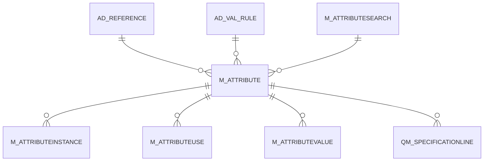

# M_ATTRIBUTE

Area [M](../../data-model/m/index.md) · class **business** (proposed) · read from database `idempiere-db` (owner `ADEMPIERE`) · 4 row(s) when profiled

Application model: `org.compiere.model.X_M_Attribute`, access level 7 - System - Client - Org.

## Columns

| column | type | key | not null | business name | references (code) | nulls | distinct |
|---|---|---|---|---|---|---|---|
| `M_ATTRIBUTE_ID` | NUMBER(10,0) | PK | yes | Attribute |  | 0 | 4 |
| `AD_CLIENT_ID` | NUMBER(10,0) |  | yes | Tenant |  | 0 | 1 |
| `AD_ORG_ID` | NUMBER(10,0) |  | yes | Organization |  | 0 | 1 |
| `ISACTIVE` | CHAR(1) |  | yes | Active |  | 0 | 1 |
| `CREATED` | DATE |  | yes | Created |  | 0 | 4 |
| `CREATEDBY` | NUMBER(10,0) |  | yes | Created By |  | 0 | 1 |
| `UPDATED` | DATE |  | yes | Updated |  | 0 | 4 |
| `UPDATEDBY` | NUMBER(10,0) |  | yes | Updated By |  | 0 | 1 |
| `NAME` | VARCHAR2(60 CHAR) |  | yes | Name |  | 0 | 4 |
| `DESCRIPTION` | VARCHAR2(255 CHAR) |  |  | Description |  | 4 | 0 |
| `ISMANDATORY` | CHAR(1) |  | yes | Mandatory |  | 0 | 1 |
| `ISINSTANCEATTRIBUTE` | CHAR(1) |  | yes | Instance Attribute |  | 0 | 2 |
| `M_ATTRIBUTESEARCH_ID` | NUMBER(10,0) |  |  | Attribute Search | [M_ATTRIBUTESEARCH](../../data-model/m/m_attributesearch.md) | 3 | 1 |
| `ATTRIBUTEVALUETYPE` | CHAR(1) |  | yes | Attribute Value Type |  | 0 | 2 |
| `M_ATTRIBUTE_UU` | VARCHAR2(36 CHAR) |  |  | M_Attribute_UU |  | 0 | 4 |
| `DATEFORMAT` | VARCHAR2(20 CHAR) |  |  | Date Format |  | 4 | 0 |
| `AD_REFERENCE_ID` | NUMBER(10,0) |  |  | Reference | [AD_REFERENCE](../../data-model/ad/ad_reference.md) | 4 | 0 |
| `AD_REFERENCE_VALUE_ID` | NUMBER(10,0) |  |  | Reference Key | [AD_REFERENCE](../../data-model/ad/ad_reference.md) | 4 | 0 |
| `AD_VAL_RULE_ID` | NUMBER(10,0) |  |  | Dynamic Validation | [AD_VAL_RULE](../../data-model/ad/ad_val_rule.md) | 4 | 0 |

*references (code)* is the table the application model's code says a column points to; *Foreign keys* below are the constraints the database declares. Counts come from the profile; no value is ever shown.

## Check constraints

| name | expression |
|---|---|
| `SYS_C0022134` | `IsActive in ('Y','N')` |
| `SYS_C0022137` | `IsInstanceAttribute in ('Y','N')` |
| `SYS_C0022138` | `IsMandatory in ('Y','N')` |

## Foreign keys

**References**

| table | columns | on delete |
|---|---|---|
| [AD_REFERENCE](../../data-model/ad/ad_reference.md) | M_ATTRIBUTE.AD_REFERENCE_VALUE_ID → AD_REFERENCE.AD_REFERENCE_ID | NO ACTION |
| [AD_VAL_RULE](../../data-model/ad/ad_val_rule.md) | M_ATTRIBUTE.AD_VAL_RULE_ID → AD_VAL_RULE.AD_VAL_RULE_ID | NO ACTION |
| [M_ATTRIBUTESEARCH](../../data-model/m/m_attributesearch.md) | M_ATTRIBUTE.M_ATTRIBUTESEARCH_ID → M_ATTRIBUTESEARCH.M_ATTRIBUTESEARCH_ID | NO ACTION |

**Referenced by**

| table | columns | on delete |
|---|---|---|
| [M_ATTRIBUTEINSTANCE](../../data-model/m/m_attributeinstance.md) | M_ATTRIBUTEINSTANCE.M_ATTRIBUTE_ID → M_ATTRIBUTE.M_ATTRIBUTE_ID | NO ACTION |
| [M_ATTRIBUTEUSE](../../data-model/m/m_attributeuse.md) | M_ATTRIBUTEUSE.M_ATTRIBUTE_ID → M_ATTRIBUTE.M_ATTRIBUTE_ID | NO ACTION |
| [M_ATTRIBUTEVALUE](../../data-model/m/m_attributevalue.md) | M_ATTRIBUTEVALUE.M_ATTRIBUTE_ID → M_ATTRIBUTE.M_ATTRIBUTE_ID | CASCADE |
| [QM_SPECIFICATIONLINE](../../data-model/qm/qm_specificationline.md) | QM_SPECIFICATIONLINE.M_ATTRIBUTE_ID → M_ATTRIBUTE.M_ATTRIBUTE_ID | NO ACTION |

## Write behaviour

- updates: **po_only**
- deletes: **deleted_by_users**
- change log: **recorded**
- evidence: 1 citation(s)

## Read by

| kind | name |
|---|---|
| Procedure | [ProductAttribute](../../logic/productattribute.md) |

## Schema history

36 change(s); the latest:

| applied | release | operation | column | tickets |
|---|---|---|---|---|
| 2024-07-23T16:30 | iD13 | `add_column` | EntityType | IDEMPIERE-4224 |
| 2024-07-23T16:30 | iD13 | `add_column` | DefaultValue | IDEMPIERE-4224 |
| 2024-07-23T16:30 | iD13 | `add_constraint` |  | IDEMPIERE-4224 |
| 2024-07-23T16:30 | iD13 | `add_column` | DefaultValue | IDEMPIERE-4224 |
| 2024-07-23T16:30 | iD13 | `add_constraint` |  | IDEMPIERE-4224 |
| 2024-07-23T16:30 | iD13 | `add_column` | EntityType | IDEMPIERE-4224 |
| 2023-04-09T15:47 | iD11 | `add_constraint` |  | IDEMPIERE-5567 |
| 2023-04-09T15:47 | iD11 | `add_constraint` |  | IDEMPIERE-5567 |
| 2021-12-05T16:45 | i8.2z | `drop_constraint` |  | IDEMPIERE-5075 |
| 2021-12-05T16:45 | i8.2z | `add_constraint` |  | IDEMPIERE-5075 |
| 2020-08-04T01:00 | i7.1z | `modify_column` | DESCRIPTION | IDEMPIERE-3862 |
| 2020-08-04T01:00 | i7.1z | `modify_column` | NAME | IDEMPIERE-3862 |
| 2020-08-04T01:00 | i7.1z | `modify_column` | NAME | IDEMPIERE-3862 |
| 2020-08-04T01:00 | i7.1z | `drop_column` | tmp_col_2_tmp | IDEMPIERE-3862 |
| 2020-08-04T01:00 | i7.1z | `add_column` | tmp_col_2_tmp | IDEMPIERE-3862 |

## Open conflicts

| type | attribute | explanation |
|---|---|---|
| `model_column_missing` | `columns.DefaultValue` | unexplained |
| `model_column_missing` | `columns.EntityType` | unexplained |

## Notes

<!-- ekos:manual id="table.m_attribute.notes" -->
_Business notes about this table._
<!-- /ekos:manual -->
