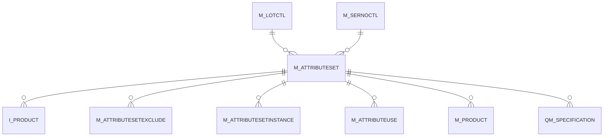

# M_ATTRIBUTESET

Area [M](../../data-model/m/index.md) · class **business** (proposed) · read from database `idempiere-db` (owner `ADEMPIERE`) · 4 row(s) when profiled

Application model: `org.compiere.model.X_M_AttributeSet`, access level 7 - System - Client - Org.

## Columns

| column | type | key | not null | business name | references (code) | nulls | distinct |
|---|---|---|---|---|---|---|---|
| `M_ATTRIBUTESET_ID` | NUMBER(10,0) | PK | yes | Attribute Set |  | 0 | 4 |
| `AD_CLIENT_ID` | NUMBER(10,0) |  | yes | Tenant |  | 0 | 2 |
| `AD_ORG_ID` | NUMBER(10,0) |  | yes | Organization |  | 0 | 2 |
| `ISACTIVE` | CHAR(1) |  | yes | Active |  | 0 | 2 |
| `CREATED` | DATE |  | yes | Created |  | 0 | 4 |
| `CREATEDBY` | NUMBER(10,0) |  | yes | Created By |  | 0 | 2 |
| `UPDATED` | DATE |  | yes | Updated |  | 0 | 4 |
| `UPDATEDBY` | NUMBER(10,0) |  | yes | Updated By |  | 0 | 2 |
| `NAME` | VARCHAR2(60 CHAR) |  | yes | Name |  | 0 | 4 |
| `DESCRIPTION` | VARCHAR2(255 CHAR) |  |  | Description |  | 0 | 4 |
| `ISSERNO` | CHAR(1) |  | yes | Serial No |  | 0 | 2 |
| `M_SERNOCTL_ID` | NUMBER(10,0) |  |  | Serial No Control | [M_SERNOCTL](../../data-model/m/m_sernoctl.md) | 4 | 0 |
| `ISLOT` | CHAR(1) |  | yes | Lot |  | 0 | 2 |
| `M_LOTCTL_ID` | NUMBER(10,0) |  |  | Lot Control | [M_LOTCTL](../../data-model/m/m_lotctl.md) | 3 | 1 |
| `ISGUARANTEEDATE` | CHAR(1) |  | yes | Guarantee Date |  | 0 | 2 |
| `GUARANTEEDAYS` | NUMBER(10,0) |  |  | Guarantee Days |  | 0 | 3 |
| `ISINSTANCEATTRIBUTE` | CHAR(1) |  | yes | Instance Attribute |  | 0 | 2 |
| `MANDATORYTYPE` | CHAR(1) |  | yes | Mandatory Type |  | 0 | 1 |
| `ISGUARANTEEDATEMANDATORY` | CHAR(1) |  | yes | Mandatory Guarantee Date |  | 0 | 1 |
| `ISLOTMANDATORY` | CHAR(1) |  | yes | Mandatory Lot |  | 0 | 1 |
| `ISSERNOMANDATORY` | CHAR(1) |  | yes | Mandatory Serial No |  | 0 | 1 |
| `SERNOCHARSOVERWRITE` | CHAR(1 CHAR) |  |  | Ser No Char Start Overwrite |  | 4 | 0 |
| `LOTCHARSOVERWRITE` | CHAR(1 CHAR) |  |  | Lot Char Start Overwrite |  | 4 | 0 |
| `LOTCHAREOVERWRITE` | CHAR(1 CHAR) |  |  | Lot Char End Overwrite |  | 4 | 0 |
| `SERNOCHAREOVERWRITE` | CHAR(1 CHAR) |  |  | Ser No Char End Overwrite |  | 4 | 0 |
| `M_ATTRIBUTESET_UU` | VARCHAR2(36 CHAR) |  |  | M_AttributeSet_UU |  | 0 | 4 |
| `USEGUARANTEEDATEFORMPOLICY` | CHAR(1) |  |  | Use Guarantee Date for Material Policy |  | 0 | 1 |
| `ISAUTOGENERATELOT` | CHAR(1) |  |  | Is Auto Generate Lot |  | 0 | 1 |
| `M_ATTRIBUTESET_TYPE` | VARCHAR2(3 CHAR) |  |  | Attribute Set Type |  | 0 | 1 |

*references (code)* is the table the application model's code says a column points to; *Foreign keys* below are the constraints the database declares. Counts come from the profile; no value is ever shown.

## Check constraints

| name | expression |
|---|---|
| `SYS_C0022295` | `IsSerNo in ('Y','N')` |
| `SYS_C0022297` | `IsActive in ('Y','N')` |
| `SYS_C0022298` | `IsAutoGenerateLot IN ('Y','N')` |
| `SYS_C0022299` | `UseGuaranteeDateForMPolicy IN ('Y','N')` |
| `SYS_C0022301` | `IsGuaranteeDate in ('Y','N')` |
| `SYS_C0022302` | `IsLot in ('Y','N')` |

## Foreign keys

**References**

| table | columns | on delete |
|---|---|---|
| [M_LOTCTL](../../data-model/m/m_lotctl.md) | M_ATTRIBUTESET.M_LOTCTL_ID → M_LOTCTL.M_LOTCTL_ID | NO ACTION |
| [M_SERNOCTL](../../data-model/m/m_sernoctl.md) | M_ATTRIBUTESET.M_SERNOCTL_ID → M_SERNOCTL.M_SERNOCTL_ID | NO ACTION |

**Referenced by**

| table | columns | on delete |
|---|---|---|
| `I_PRODUCT` | I_PRODUCT.M_ATTRIBUTESET_ID → M_ATTRIBUTESET.M_ATTRIBUTESET_ID | SET NULL |
| [M_ATTRIBUTESETEXCLUDE](../../data-model/m/m_attributesetexclude.md) | M_ATTRIBUTESETEXCLUDE.M_ATTRIBUTESET_ID → M_ATTRIBUTESET.M_ATTRIBUTESET_ID | NO ACTION |
| [M_ATTRIBUTESETINSTANCE](../../data-model/m/m_attributesetinstance.md) | M_ATTRIBUTESETINSTANCE.M_ATTRIBUTESET_ID → M_ATTRIBUTESET.M_ATTRIBUTESET_ID | NO ACTION |
| [M_ATTRIBUTEUSE](../../data-model/m/m_attributeuse.md) | M_ATTRIBUTEUSE.M_ATTRIBUTESET_ID → M_ATTRIBUTESET.M_ATTRIBUTESET_ID | NO ACTION |
| [M_PRODUCT](../../data-model/m/m_product.md) | M_PRODUCT.M_ATTRIBUTESET_ID → M_ATTRIBUTESET.M_ATTRIBUTESET_ID | CASCADE |
| [QM_SPECIFICATION](../../data-model/qm/qm_specification.md) | QM_SPECIFICATION.M_ATTRIBUTESET_ID → M_ATTRIBUTESET.M_ATTRIBUTESET_ID | NO ACTION |

## Write behaviour

- updates: **raw_sql_skips_updated**
- deletes: **deleted_by_users**
- change log: **recorded**
- evidence: 6 citation(s)

## Read by

| kind | name |
|---|---|
| Procedure | [ProductAttribute](../../logic/productattribute.md) |
| Procedure | [productAttribute](../../logic/productattribute.md) |
| View | `RV_WAREHOUSEPRICE` |
| View | `rv_warehouseprice` |

## Schema history

31 change(s); the latest:

| applied | release | operation | column | tickets |
|---|---|---|---|---|
| 2024-07-23T16:30 | iD13 | `add_column` | EntityType | IDEMPIERE-4224 |
| 2024-07-23T16:30 | iD13 | `add_constraint` |  | IDEMPIERE-4224 |
| 2024-07-23T16:30 | iD13 | `add_constraint` |  | IDEMPIERE-4224 |
| 2024-07-23T16:30 | iD13 | `add_column` | EntityType | IDEMPIERE-4224 |
| 2023-04-09T15:47 | iD11 | `add_constraint` |  | IDEMPIERE-5567 |
| 2023-04-09T15:47 | iD11 | `add_constraint` |  | IDEMPIERE-5567 |
| 2021-12-05T16:45 | i8.2z | `add_constraint` |  | IDEMPIERE-5075 |
| 2021-12-05T16:45 | i8.2z | `add_constraint` |  | IDEMPIERE-5075 |
| 2021-12-05T16:45 | i8.2z | `drop_constraint` |  | IDEMPIERE-5075 |
| 2021-12-05T16:45 | i8.2z | `drop_constraint` |  | IDEMPIERE-5075 |
| 2020-11-12T09:40 | i8.1z | `modify_column` | SERNOCHAREOVERWRITE | IDEMPIERE-3862 |
| 2020-11-12T09:40 | i8.1z | `modify_column` | SERNOCHARSOVERWRITE | IDEMPIERE-3862 |
| 2020-11-12T09:40 | i8.1z | `modify_column` | LOTCHAREOVERWRITE | IDEMPIERE-3862 |
| 2020-11-12T09:40 | i8.1z | `modify_column` | LOTCHARSOVERWRITE | IDEMPIERE-3862 |
| 2020-08-04T01:00 | i7.1z | `drop_column` | tmp_col_2_tmp | IDEMPIERE-3862 |

## Open conflicts

| type | attribute | explanation |
|---|---|---|
| `model_column_missing` | `columns.EntityType` | unexplained |
| `mandatory_but_nullable` | `columns.M_AttributeSet_Type.nullable` | unexplained |

## Notes

<!-- ekos:manual id="table.m_attributeset.notes" -->
_Business notes about this table._
<!-- /ekos:manual -->
