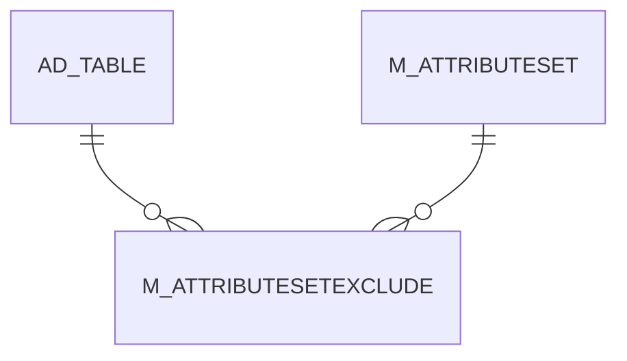

# M_ATTRIBUTESETEXCLUDE

Area [M](../../data-model/m/index.md) · class **business** (proposed) · read from database `idempiere-db` (owner `ADEMPIERE`) · 0 row(s) when profiled

Application model: `org.compiere.model.X_M_AttributeSetExclude`, access level 2 - Client.

## Columns

| column | type | key | not null | business name | references (code) | nulls | distinct |
|---|---|---|---|---|---|---|---|
| `M_ATTRIBUTESETEXCLUDE_ID` | NUMBER(10,0) | PK | yes | Exclude Attribute Set |  | 0 | 0 |
| `AD_CLIENT_ID` | NUMBER(10,0) |  | yes | Tenant |  | 0 | 0 |
| `AD_ORG_ID` | NUMBER(10,0) |  | yes | Organization |  | 0 | 0 |
| `ISACTIVE` | CHAR(1) |  | yes | Active |  | 0 | 0 |
| `CREATED` | DATE |  | yes | Created |  | 0 | 0 |
| `CREATEDBY` | NUMBER(10,0) |  | yes | Created By |  | 0 | 0 |
| `UPDATED` | DATE |  | yes | Updated |  | 0 | 0 |
| `UPDATEDBY` | NUMBER(10,0) |  | yes | Updated By |  | 0 | 0 |
| `M_ATTRIBUTESET_ID` | NUMBER(10,0) |  | yes | Attribute Set | [M_ATTRIBUTESET](../../data-model/m/m_attributeset.md) | 0 | 0 |
| `AD_TABLE_ID` | NUMBER(10,0) |  | yes | Table | [AD_TABLE](../../data-model/ad/ad_table.md) | 0 | 0 |
| `ISSOTRX` | CHAR(1) |  | yes | Sales Transaction |  | 0 | 0 |
| `M_ATTRIBUTESETEXCLUDE_UU` | VARCHAR2(36 CHAR) |  |  | M_AttributeSetExclude_UU |  | 0 | 0 |

*references (code)* is the table the application model's code says a column points to; *Foreign keys* below are the constraints the database declares. Counts come from the profile; no value is ever shown.

## Check constraints

| name | expression |
|---|---|
| `SYS_C0022548` | `IsSOTrx in ('Y','N')` |
| `SYS_C0022549` | `IsActive in ('Y','N')` |

## Foreign keys

**References**

| table | columns | on delete |
|---|---|---|
| [AD_TABLE](../../data-model/ad/ad_table.md) | M_ATTRIBUTESETEXCLUDE.AD_TABLE_ID → AD_TABLE.AD_TABLE_ID | NO ACTION |
| [M_ATTRIBUTESET](../../data-model/m/m_attributeset.md) | M_ATTRIBUTESETEXCLUDE.M_ATTRIBUTESET_ID → M_ATTRIBUTESET.M_ATTRIBUTESET_ID | NO ACTION |

**Referenced by**

_None._

## Write behaviour

- updates: **po_only**
- deletes: **deleted_by_users**
- change log: **recorded**
- evidence: 1 citation(s)

## Schema history

9 change(s); the latest:

| applied | release | operation | column | tickets |
|---|---|---|---|---|
| 2023-04-09T15:47 | iD11 | `add_constraint` |  | IDEMPIERE-5567 |
| 2023-04-09T15:47 | iD11 | `add_constraint` |  | IDEMPIERE-5567 |
| 2021-12-05T16:45 | i8.2z | `add_constraint` |  | IDEMPIERE-5075 |
| 2021-12-05T16:45 | i8.2z | `drop_constraint` |  | IDEMPIERE-5075 |
| 2021-12-05T16:45 | i8.2z | `drop_constraint` |  | IDEMPIERE-5075 |
| 2021-12-05T16:45 | i8.2z | `add_constraint` |  | IDEMPIERE-5075 |
| 2020-08-04T01:00 | i7.1z | `drop_column` | tmp_col_1_tmp | IDEMPIERE-3862 |
| 2020-08-04T01:00 | i7.1z | `add_column` | tmp_col_1_tmp | IDEMPIERE-3862 |
| 2020-08-04T01:00 | i7.1z | `modify_column` | M_ATTRIBUTESETEXCLUDE_UU | IDEMPIERE-3862 |

## Notes

<!-- ekos:manual id="table.m_attributesetexclude.notes" -->
_Business notes about this table._
<!-- /ekos:manual -->
