# M_ATTRIBUTESETINSTANCE

Area [M](../../data-model/m/index.md) · class **business** (proposed) · read from database `idempiere-db` (owner `ADEMPIERE`) · 4 row(s) when profiled

Application model: `org.compiere.model.X_M_AttributeSetInstance`, access level 3 - Client - Org.

## Columns

| column | type | key | not null | business name | references (code) | nulls | distinct |
|---|---|---|---|---|---|---|---|
| `M_ATTRIBUTESETINSTANCE_ID` | NUMBER(10,0) | PK | yes | Attribute Set Instance |  | 0 | 4 |
| `AD_CLIENT_ID` | NUMBER(10,0) |  | yes | Tenant |  | 0 | 2 |
| `AD_ORG_ID` | NUMBER(10,0) |  | yes | Organization |  | 0 | 2 |
| `ISACTIVE` | CHAR(1) |  | yes | Active |  | 0 | 1 |
| `CREATED` | DATE |  | yes | Created |  | 0 | 4 |
| `CREATEDBY` | NUMBER(10,0) |  | yes | Created By |  | 0 | 2 |
| `UPDATED` | DATE |  | yes | Updated |  | 0 | 4 |
| `UPDATEDBY` | NUMBER(10,0) |  | yes | Updated By |  | 0 | 2 |
| `M_ATTRIBUTESET_ID` | NUMBER(10,0) |  |  | Attribute Set | [M_ATTRIBUTESET](../../data-model/m/m_attributeset.md) | 0 | 3 |
| `SERNO` | VARCHAR2(40 CHAR) |  |  | Serial No |  | 4 | 0 |
| `LOT` | VARCHAR2(40 CHAR) |  |  | Lot No |  | 4 | 0 |
| `GUARANTEEDATE` | DATE |  |  | Guarantee Date |  | 4 | 0 |
| `DESCRIPTION` | VARCHAR2(1023 CHAR) |  |  | Description |  | 0 | 4 |
| `M_LOT_ID` | NUMBER(10,0) |  |  | Lot | [M_LOT](../../data-model/m/m_lot.md) | 4 | 0 |
| `M_ATTRIBUTESETINSTANCE_UU` | VARCHAR2(36 CHAR) |  |  | M_AttributeSetInstance_UU |  | 0 | 4 |

*references (code)* is the table the application model's code says a column points to; *Foreign keys* below are the constraints the database declares. Counts come from the profile; no value is ever shown.

## Check constraints

| name | expression |
|---|---|
| `SYS_C0021885` | `IsActive in ('Y','N')` |

## Foreign keys

**References**

| table | columns | on delete |
|---|---|---|
| [M_ATTRIBUTESET](../../data-model/m/m_attributeset.md) | M_ATTRIBUTESETINSTANCE.M_ATTRIBUTESET_ID → M_ATTRIBUTESET.M_ATTRIBUTESET_ID | NO ACTION |
| [M_LOT](../../data-model/m/m_lot.md) | M_ATTRIBUTESETINSTANCE.M_LOT_ID → M_LOT.M_LOT_ID | NO ACTION |

**Referenced by**

| table | columns | on delete |
|---|---|---|
| [A_ASSET](../../data-model/a/a_asset.md) | A_ASSET.M_ATTRIBUTESETINSTANCE_ID → M_ATTRIBUTESETINSTANCE.M_ATTRIBUTESETINSTANCE_ID | NO ACTION |
| [A_ASSET_ADDITION](../../data-model/a/a_asset_addition.md) | A_ASSET_ADDITION.M_ATTRIBUTESETINSTANCE_ID → M_ATTRIBUTESETINSTANCE.M_ATTRIBUTESETINSTANCE_ID | NO ACTION |
| [A_ASSET_PRODUCT](../../data-model/a/a_asset_product.md) | A_ASSET_PRODUCT.M_ATTRIBUTESETINSTANCE_ID → M_ATTRIBUTESETINSTANCE.M_ATTRIBUTESETINSTANCE_ID | NO ACTION |
| [C_INVOICELINE](../../data-model/c/c_invoiceline.md) | C_INVOICELINE.M_ATTRIBUTESETINSTANCE_ID → M_ATTRIBUTESETINSTANCE.M_ATTRIBUTESETINSTANCE_ID | NO ACTION |
| [C_LANDEDCOSTALLOCATION](../../data-model/c/c_landedcostallocation.md) | C_LANDEDCOSTALLOCATION.M_ATTRIBUTESETINSTANCE_ID → M_ATTRIBUTESETINSTANCE.M_ATTRIBUTESETINSTANCE_ID | NO ACTION |
| [C_ORDERLINE](../../data-model/c/c_orderline.md) | C_ORDERLINE.M_ATTRIBUTESETINSTANCE_ID → M_ATTRIBUTESETINSTANCE.M_ATTRIBUTESETINSTANCE_ID | NO ACTION |
| [C_PROJECTISSUE](../../data-model/c/c_projectissue.md) | C_PROJECTISSUE.M_ATTRIBUTESETINSTANCE_ID → M_ATTRIBUTESETINSTANCE.M_ATTRIBUTESETINSTANCE_ID | NO ACTION |
| [C_PROJECTISSUEMA](../../data-model/c/c_projectissuema.md) | C_PROJECTISSUEMA.M_ATTRIBUTESETINSTANCE_ID → M_ATTRIBUTESETINSTANCE.M_ATTRIBUTESETINSTANCE_ID | NO ACTION |
| [C_RFQLINE](../../data-model/c/c_rfqline.md) | C_RFQLINE.M_ATTRIBUTESETINSTANCE_ID → M_ATTRIBUTESETINSTANCE.M_ATTRIBUTESETINSTANCE_ID | NO ACTION |
| [DD_ORDERLINE](../../data-model/dd/dd_orderline.md) | DD_ORDERLINE.M_ATTRIBUTESETINSTANCETO_ID → M_ATTRIBUTESETINSTANCE.M_ATTRIBUTESETINSTANCE_ID | NO ACTION |
| `I_ASSET` | I_ASSET.M_ATTRIBUTESETINSTANCE_ID → M_ATTRIBUTESETINSTANCE.M_ATTRIBUTESETINSTANCE_ID | NO ACTION |
| [M_ATTRIBUTEINSTANCE](../../data-model/m/m_attributeinstance.md) | M_ATTRIBUTEINSTANCE.M_ATTRIBUTESETINSTANCE_ID → M_ATTRIBUTESETINSTANCE.M_ATTRIBUTESETINSTANCE_ID | CASCADE |
| [M_BOMPRODUCT](../../data-model/m/m_bomproduct.md) | M_BOMPRODUCT.M_ATTRIBUTESETINSTANCE_ID → M_ATTRIBUTESETINSTANCE.M_ATTRIBUTESETINSTANCE_ID | NO ACTION |
| [M_COST](../../data-model/m/m_cost.md) | M_COST.M_ATTRIBUTESETINSTANCE_ID → M_ATTRIBUTESETINSTANCE.M_ATTRIBUTESETINSTANCE_ID | CASCADE |
| [M_COSTDETAIL](../../data-model/m/m_costdetail.md) | M_COSTDETAIL.M_ATTRIBUTESETINSTANCE_ID → M_ATTRIBUTESETINSTANCE.M_ATTRIBUTESETINSTANCE_ID | NO ACTION |
| [M_COSTHISTORY](../../data-model/m/m_costhistory.md) | M_COSTHISTORY.M_ATTRIBUTESETINSTANCE_ID → M_ATTRIBUTESETINSTANCE.M_ATTRIBUTESETINSTANCE_ID | NO ACTION |
| [M_COSTQUEUE](../../data-model/m/m_costqueue.md) | M_COSTQUEUE.M_ATTRIBUTESETINSTANCE_ID → M_ATTRIBUTESETINSTANCE.M_ATTRIBUTESETINSTANCE_ID | CASCADE |
| [M_INOUTLINE](../../data-model/m/m_inoutline.md) | M_INOUTLINE.M_ATTRIBUTESETINSTANCE_ID → M_ATTRIBUTESETINSTANCE.M_ATTRIBUTESETINSTANCE_ID | NO ACTION |
| [M_INOUTLINEMA](../../data-model/m/m_inoutlinema.md) | M_INOUTLINEMA.M_ATTRIBUTESETINSTANCE_ID → M_ATTRIBUTESETINSTANCE.M_ATTRIBUTESETINSTANCE_ID | CASCADE |
| [M_INVENTORYLINE](../../data-model/m/m_inventoryline.md) | M_INVENTORYLINE.M_ATTRIBUTESETINSTANCE_ID → M_ATTRIBUTESETINSTANCE.M_ATTRIBUTESETINSTANCE_ID | NO ACTION |
| [M_INVENTORYLINEMA](../../data-model/m/m_inventorylinema.md) | M_INVENTORYLINEMA.M_ATTRIBUTESETINSTANCE_ID → M_ATTRIBUTESETINSTANCE.M_ATTRIBUTESETINSTANCE_ID | CASCADE |
| [M_MATCHINV](../../data-model/m/m_matchinv.md) | M_MATCHINV.M_ATTRIBUTESETINSTANCE_ID → M_ATTRIBUTESETINSTANCE.M_ATTRIBUTESETINSTANCE_ID | NO ACTION |
| [M_MATCHPO](../../data-model/m/m_matchpo.md) | M_MATCHPO.M_ATTRIBUTESETINSTANCE_ID → M_ATTRIBUTESETINSTANCE.M_ATTRIBUTESETINSTANCE_ID | NO ACTION |
| [M_MOVEMENTLINE](../../data-model/m/m_movementline.md) | M_MOVEMENTLINE.M_ATTRIBUTESETINSTANCETO_ID → M_ATTRIBUTESETINSTANCE.M_ATTRIBUTESETINSTANCE_ID | NO ACTION |
| [M_MOVEMENTLINEMA](../../data-model/m/m_movementlinema.md) | M_MOVEMENTLINEMA.M_ATTRIBUTESETINSTANCE_ID → M_ATTRIBUTESETINSTANCE.M_ATTRIBUTESETINSTANCE_ID | CASCADE |
| [M_PRODUCT](../../data-model/m/m_product.md) | M_PRODUCT.M_ATTRIBUTESETINSTANCE_ID → M_ATTRIBUTESETINSTANCE.M_ATTRIBUTESETINSTANCE_ID | NO ACTION |
| [M_PRODUCTIONLINE](../../data-model/m/m_productionline.md) | M_PRODUCTIONLINE.M_ATTRIBUTESETINSTANCE_ID → M_ATTRIBUTESETINSTANCE.M_ATTRIBUTESETINSTANCE_ID | NO ACTION |
| [M_PRODUCTIONLINEMA](../../data-model/m/m_productionlinema.md) | M_PRODUCTIONLINEMA.M_ATTRIBUTESETINSTANCE_ID → M_ATTRIBUTESETINSTANCE.M_ATTRIBUTESETINSTANCE_ID | CASCADE |
| [M_QUALITYTESTRESULT](../../data-model/m/m_qualitytestresult.md) | M_QUALITYTESTRESULT.M_ATTRIBUTESETINSTANCE_ID → M_ATTRIBUTESETINSTANCE.M_ATTRIBUTESETINSTANCE_ID | NO ACTION |
| [M_REQUISITIONLINE](../../data-model/m/m_requisitionline.md) | M_REQUISITIONLINE.M_ATTRIBUTESETINSTANCE_ID → M_ATTRIBUTESETINSTANCE.M_ATTRIBUTESETINSTANCE_ID | NO ACTION |
| [M_STORAGEONHAND](../../data-model/m/m_storageonhand.md) | M_STORAGEONHAND.M_ATTRIBUTESETINSTANCE_ID → M_ATTRIBUTESETINSTANCE.M_ATTRIBUTESETINSTANCE_ID | NO ACTION |
| [M_STORAGERESERVATION](../../data-model/m/m_storagereservation.md) | M_STORAGERESERVATION.M_ATTRIBUTESETINSTANCE_ID → M_ATTRIBUTESETINSTANCE.M_ATTRIBUTESETINSTANCE_ID | NO ACTION |
| `M_STORAGERESERVATIONLOG` | M_STORAGERESERVATIONLOG.M_ATTRIBUTESETINSTANCE_ID → M_ATTRIBUTESETINSTANCE.M_ATTRIBUTESETINSTANCE_ID | NO ACTION |
| [M_TRANSACTION](../../data-model/m/m_transaction.md) | M_TRANSACTION.M_ATTRIBUTESETINSTANCE_ID → M_ATTRIBUTESETINSTANCE.M_ATTRIBUTESETINSTANCE_ID | NO ACTION |
| [M_TRANSACTIONALLOCATION](../../data-model/m/m_transactionallocation.md) | M_TRANSACTIONALLOCATION.M_ATTRIBUTESETINSTANCE_ID → M_ATTRIBUTESETINSTANCE.M_ATTRIBUTESETINSTANCE_ID | NO ACTION |
| [PP_COST_COLLECTOR](../../data-model/pp/pp_cost_collector.md) | PP_COST_COLLECTOR.M_ATTRIBUTESETINSTANCE_ID → M_ATTRIBUTESETINSTANCE.M_ATTRIBUTESETINSTANCE_ID | NO ACTION |
| [PP_COST_COLLECTORMA](../../data-model/pp/pp_cost_collectorma.md) | PP_COST_COLLECTORMA.M_ATTRIBUTESETINSTANCE_ID → M_ATTRIBUTESETINSTANCE.M_ATTRIBUTESETINSTANCE_ID | NO ACTION |
| [PP_ORDER](../../data-model/pp/pp_order.md) | PP_ORDER.M_ATTRIBUTESETINSTANCE_ID → M_ATTRIBUTESETINSTANCE.M_ATTRIBUTESETINSTANCE_ID | NO ACTION |
| [PP_ORDER_BOM](../../data-model/pp/pp_order_bom.md) | PP_ORDER_BOM.M_ATTRIBUTESETINSTANCE_ID → M_ATTRIBUTESETINSTANCE.M_ATTRIBUTESETINSTANCE_ID | NO ACTION |
| [PP_ORDER_BOMLINE](../../data-model/pp/pp_order_bomline.md) | PP_ORDER_BOMLINE.M_ATTRIBUTESETINSTANCE_ID → M_ATTRIBUTESETINSTANCE.M_ATTRIBUTESETINSTANCE_ID | NO ACTION |
| [PP_ORDER_COST](../../data-model/pp/pp_order_cost.md) | PP_ORDER_COST.M_ATTRIBUTESETINSTANCE_ID → M_ATTRIBUTESETINSTANCE.M_ATTRIBUTESETINSTANCE_ID | NO ACTION |
| [PP_PRODUCT_BOM](../../data-model/pp/pp_product_bom.md) | PP_PRODUCT_BOM.M_ATTRIBUTESETINSTANCE_ID → M_ATTRIBUTESETINSTANCE.M_ATTRIBUTESETINSTANCE_ID | NO ACTION |
| [PP_PRODUCT_BOMLINE](../../data-model/pp/pp_product_bomline.md) | PP_PRODUCT_BOMLINE.M_ATTRIBUTESETINSTANCE_ID → M_ATTRIBUTESETINSTANCE.M_ATTRIBUTESETINSTANCE_ID | NO ACTION |
| `T_INVENTORYVALUE` | T_INVENTORYVALUE.M_ATTRIBUTESETINSTANCE_ID → M_ATTRIBUTESETINSTANCE.M_ATTRIBUTESETINSTANCE_ID | CASCADE |
| `T_TRANSACTION` | T_TRANSACTION.M_ATTRIBUTESETINSTANCE_ID → M_ATTRIBUTESETINSTANCE.M_ATTRIBUTESETINSTANCE_ID | CASCADE |

```mermaid
erDiagram
  M_ATTRIBUTESET ||--o{ M_ATTRIBUTESETINSTANCE : ""
  M_ATTRIBUTESETINSTANCE ||--o{ A_ASSET : ""
  M_ATTRIBUTESETINSTANCE ||--o{ A_ASSET_ADDITION : ""
  M_ATTRIBUTESETINSTANCE ||--o{ A_ASSET_PRODUCT : ""
  M_ATTRIBUTESETINSTANCE ||--o{ C_INVOICELINE : ""
  M_ATTRIBUTESETINSTANCE ||--o{ C_LANDEDCOSTALLOCATION : ""
  M_ATTRIBUTESETINSTANCE ||--o{ C_ORDERLINE : ""
  M_ATTRIBUTESETINSTANCE ||--o{ C_PROJECTISSUE : ""
  M_ATTRIBUTESETINSTANCE ||--o{ C_PROJECTISSUEMA : ""
  M_ATTRIBUTESETINSTANCE ||--o{ C_RFQLINE : ""
  M_ATTRIBUTESETINSTANCE ||--o{ DD_ORDERLINE : ""
  M_ATTRIBUTESETINSTANCE ||--o{ I_ASSET : ""
  M_ATTRIBUTESETINSTANCE ||--o{ M_ATTRIBUTEINSTANCE : ""
  M_ATTRIBUTESETINSTANCE ||--o{ M_BOMPRODUCT : ""
  M_ATTRIBUTESETINSTANCE ||--o{ M_COST : ""
  M_ATTRIBUTESETINSTANCE ||--o{ M_COSTDETAIL : ""
  M_ATTRIBUTESETINSTANCE ||--o{ M_COSTHISTORY : ""
  M_ATTRIBUTESETINSTANCE ||--o{ M_COSTQUEUE : ""
  M_ATTRIBUTESETINSTANCE ||--o{ M_INOUTLINE : ""
  M_ATTRIBUTESETINSTANCE ||--o{ M_INOUTLINEMA : ""
  M_ATTRIBUTESETINSTANCE ||--o{ M_INVENTORYLINE : ""
  M_ATTRIBUTESETINSTANCE ||--o{ M_INVENTORYLINEMA : ""
  M_ATTRIBUTESETINSTANCE ||--o{ M_MATCHINV : ""
  M_ATTRIBUTESETINSTANCE ||--o{ M_MATCHPO : ""
  M_ATTRIBUTESETINSTANCE ||--o{ M_MOVEMENTLINE : ""
  M_ATTRIBUTESETINSTANCE ||--o{ M_MOVEMENTLINEMA : ""
  M_ATTRIBUTESETINSTANCE ||--o{ M_PRODUCT : ""
  M_ATTRIBUTESETINSTANCE ||--o{ M_PRODUCTIONLINE : ""
  M_LOT ||--o{ M_ATTRIBUTESETINSTANCE : ""
```

18 more neighbour(s) not drawn.

## Write behaviour

- updates: **raw_sql_skips_updated**
- deletes: **deleted_by_app, deleted_by_users**
- change log: **recorded**
- evidence: 3 citation(s)

## Read by

| kind | name |
|---|---|
| Procedure | [ProductAttribute](../../logic/productattribute.md) |
| Procedure | [productAttribute](../../logic/productattribute.md) |
| View | `C_INVOICE_LINETAX_V` |
| View | `C_INVOICE_LINETAX_VT` |
| View | `M_INOUT_LINECONFIRM_V` |
| View | `M_INOUT_LINECONFIRM_VT` |
| View | `M_INOUT_LINE_V` |
| View | `M_INOUT_LINE_VT` |
| View | `M_RMA_CREATEFROM_V` |
| View | `RV_COSTDETAIL` |
| View | `RV_C_INVOICELINE` |
| View | `RV_DD_ORDERDETAIL` |
| View | `RV_INOUTDETAILS` |
| View | `RV_ORDERDETAIL` |
| View | `RV_PP_ORDER_RECEIPT_ISSUE` |
| View | `RV_STORAGE` |
| View | `RV_TRANSACTION` |
| View | `c_invoice_linetax_v` |
| View | `c_invoice_linetax_vt` |
| View | `m_inout_line_v` |
| View | `m_inout_line_vt` |
| View | `m_inout_lineconfirm_v` |
| View | `m_inout_lineconfirm_vt` |
| View | `m_rma_createfrom_v` |
| View | `rv_c_invoiceline` |
| View | `rv_costdetail` |
| View | `rv_dd_orderdetail` |
| View | `rv_inoutdetails` |
| View | `rv_orderdetail` |
| View | `rv_pp_order_receipt_issue` |
| View | `rv_storage` |
| View | `rv_transaction` |

## Schema history

20 change(s); the latest:

| applied | release | operation | column | tickets |
|---|---|---|---|---|
| 2024-02-26T15:06 | iD12 | `modify_column` | Description | IDEMPIERE-5859 |
| 2024-02-26T15:06 | iD12 | `modify_column` | Description | IDEMPIERE-5859 |
| 2023-04-09T15:47 | iD11 | `add_constraint` |  | IDEMPIERE-5567 |
| 2023-04-09T15:47 | iD11 | `add_constraint` |  | IDEMPIERE-5567 |
| 2021-12-05T16:45 | i8.2z | `drop_constraint` |  | IDEMPIERE-5075 |
| 2021-12-05T16:45 | i8.2z | `add_constraint` |  | IDEMPIERE-5075 |
| 2021-12-05T16:45 | i8.2z | `add_constraint` |  | IDEMPIERE-5075 |
| 2021-12-05T16:45 | i8.2z | `drop_constraint` |  | IDEMPIERE-5075 |
| 2020-08-04T01:00 | i7.1z | `add_column` | tmp_col_2_tmp | IDEMPIERE-3862 |
| 2020-08-04T01:00 | i7.1z | `drop_column` | tmp_col_2_tmp | IDEMPIERE-3862 |
| 2020-08-04T01:00 | i7.1z | `drop_column` | tmp_col_3_tmp | IDEMPIERE-3862 |
| 2020-08-04T01:00 | i7.1z | `add_column` | tmp_col_3_tmp | IDEMPIERE-3862 |
| 2020-08-04T01:00 | i7.1z | `add_column` | tmp_col_4_tmp | IDEMPIERE-3862 |
| 2020-08-04T01:00 | i7.1z | `modify_column` | SERNO | IDEMPIERE-3862 |
| 2020-08-04T01:00 | i7.1z | `modify_column` | DESCRIPTION | IDEMPIERE-3862 |

## Open conflicts

| type | attribute | explanation |
|---|---|---|
| `mandatory_but_nullable` | `columns.M_AttributeSet_ID.nullable` | unexplained |

## Notes

<!-- ekos:manual id="table.m_attributesetinstance.notes" -->
_Business notes about this table._
<!-- /ekos:manual -->
