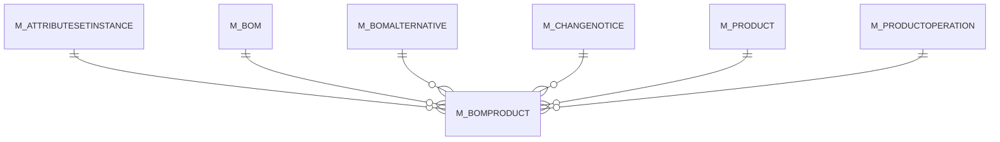

# M_BOMPRODUCT

Area [M](../../data-model/m/index.md) · class **business** (proposed) · read from database `idempiere-db` (owner `ADEMPIERE`) · 0 row(s) when profiled

## Columns

| column | type | key | not null | business name | references (code) | nulls | distinct |
|---|---|---|---|---|---|---|---|
| `M_BOMPRODUCT_ID` | NUMBER(10,0) | PK | yes |  |  | 0 | 0 |
| `AD_CLIENT_ID` | NUMBER(10,0) |  | yes |  |  | 0 | 0 |
| `AD_ORG_ID` | NUMBER(10,0) |  | yes |  |  | 0 | 0 |
| `ISACTIVE` | CHAR(1) |  | yes |  |  | 0 | 0 |
| `CREATED` | DATE |  | yes |  |  | 0 | 0 |
| `CREATEDBY` | NUMBER(10,0) |  | yes |  |  | 0 | 0 |
| `UPDATED` | DATE |  | yes |  |  | 0 | 0 |
| `UPDATEDBY` | NUMBER(10,0) |  | yes |  |  | 0 | 0 |
| `LINE` | NUMBER(10,0) |  | yes |  |  | 0 | 0 |
| `M_BOM_ID` | NUMBER(10,0) |  | yes |  |  | 0 | 0 |
| `BOMPRODUCTTYPE` | CHAR(1) |  | yes |  |  | 0 | 0 |
| `ISPHANTOM` | CHAR(1) |  | yes |  |  | 0 | 0 |
| `M_PRODUCTBOM_ID` | NUMBER(10,0) |  |  |  |  | 0 | 0 |
| `M_CHANGENOTICE_ID` | NUMBER(10,0) |  |  |  |  | 0 | 0 |
| `M_ATTRIBUTESETINSTANCE_ID` | NUMBER(10,0) |  |  |  |  | 0 | 0 |
| `M_BOMALTERNATIVE_ID` | NUMBER(10,0) |  |  |  |  | 0 | 0 |
| `BOMQTY` | NUMBER |  | yes |  |  | 0 | 0 |
| `DESCRIPTION` | VARCHAR2(255 CHAR) |  |  |  |  | 0 | 0 |
| `HELP` | VARCHAR2(2000 CHAR) |  |  |  |  | 0 | 0 |
| `M_PRODUCTOPERATION_ID` | NUMBER(10,0) |  |  |  |  | 0 | 0 |
| `SEQNO` | NUMBER(10,0) |  |  |  |  | 0 | 0 |
| `LEADTIMEOFFSET` | NUMBER(10,0) |  | yes |  |  | 0 | 0 |
| `M_BOMPRODUCT_UU` | VARCHAR2(36 CHAR) |  |  |  |  | 0 | 0 |

*references (code)* is the table the application model's code says a column points to; *Foreign keys* below are the constraints the database declares. Counts come from the profile; no value is ever shown.

## Check constraints

| name | expression |
|---|---|
| `SYS_C0020588` | `IsActive in ('Y','N')` |
| `SYS_C0020589` | `IsPhantom in ('Y','N')` |

## Foreign keys

**References**

| table | columns | on delete |
|---|---|---|
| [M_ATTRIBUTESETINSTANCE](../../data-model/m/m_attributesetinstance.md) | M_BOMPRODUCT.M_ATTRIBUTESETINSTANCE_ID → M_ATTRIBUTESETINSTANCE.M_ATTRIBUTESETINSTANCE_ID | NO ACTION |
| [M_BOM](../../data-model/m/m_bom.md) | M_BOMPRODUCT.M_BOM_ID → M_BOM.M_BOM_ID | CASCADE |
| [M_BOMALTERNATIVE](../../data-model/m/m_bomalternative.md) | M_BOMPRODUCT.M_BOMALTERNATIVE_ID → M_BOMALTERNATIVE.M_BOMALTERNATIVE_ID | NO ACTION |
| [M_CHANGENOTICE](../../data-model/m/m_changenotice.md) | M_BOMPRODUCT.M_CHANGENOTICE_ID → M_CHANGENOTICE.M_CHANGENOTICE_ID | SET NULL |
| [M_PRODUCT](../../data-model/m/m_product.md) | M_BOMPRODUCT.M_PRODUCTBOM_ID → M_PRODUCT.M_PRODUCT_ID | NO ACTION |
| [M_PRODUCTOPERATION](../../data-model/m/m_productoperation.md) | M_BOMPRODUCT.M_PRODUCTOPERATION_ID → M_PRODUCTOPERATION.M_PRODUCTOPERATION_ID | NO ACTION |

**Referenced by**

_None._

## Write behaviour

- updates: **po_only**
- deletes: **deleted_by_users, deleted_by_cascade**
- change log: **recorded**
- evidence: 2 citation(s)

## Schema history

23 change(s); the latest:

| applied | release | operation | column | tickets |
|---|---|---|---|---|
| 2023-04-09T15:47 | iD11 | `add_constraint` |  | IDEMPIERE-5567 |
| 2023-04-09T15:47 | iD11 | `add_constraint` |  | IDEMPIERE-5567 |
| 2021-12-05T16:45 | i8.2z | `add_constraint` |  | IDEMPIERE-5075 |
| 2021-12-05T16:45 | i8.2z | `add_constraint` |  | IDEMPIERE-5075 |
| 2021-12-05T16:45 | i8.2z | `drop_constraint` |  | IDEMPIERE-5075 |
| 2021-12-05T16:45 | i8.2z | `add_constraint` |  | IDEMPIERE-5075 |
| 2021-12-05T16:45 | i8.2z | `drop_constraint` |  | IDEMPIERE-5075 |
| 2021-12-05T16:45 | i8.2z | `drop_constraint` |  | IDEMPIERE-5075 |
| 2021-12-05T16:45 | i8.2z | `add_constraint` |  | IDEMPIERE-5075 |
| 2021-12-05T16:45 | i8.2z | `drop_constraint` |  | IDEMPIERE-5075 |
| 2021-12-05T16:45 | i8.2z | `drop_constraint` |  | IDEMPIERE-5075 |
| 2021-12-05T16:45 | i8.2z | `add_constraint` |  | IDEMPIERE-5075 |
| 2021-12-05T16:45 | i8.2z | `drop_constraint` |  | IDEMPIERE-5075 |
| 2021-12-05T16:45 | i8.2z | `add_constraint` |  | IDEMPIERE-5075 |
| 2020-08-04T01:00 | i7.1z | `drop_column` | tmp_col_3_tmp | IDEMPIERE-3862 |

## Open conflicts

| type | attribute | explanation |
|---|---|---|
| `table_without_model` | `model_class` | unexplained |

## Notes

<!-- ekos:manual id="table.m_bomproduct.notes" -->
_Business notes about this table._
<!-- /ekos:manual -->
