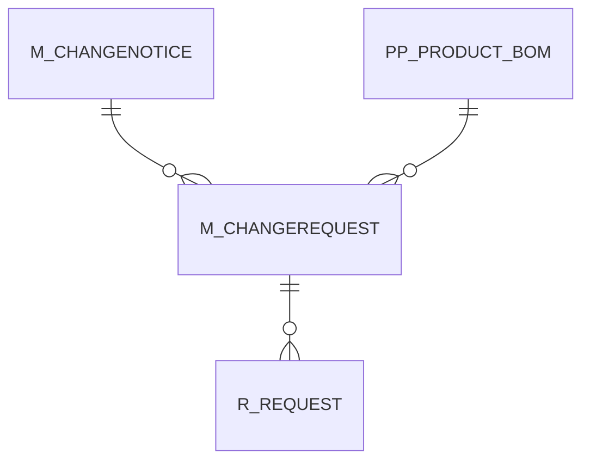

# M_CHANGEREQUEST

Change Request

Area [M](../../data-model/m/index.md) · class **business** (proposed) · read from database `idempiere-db` (owner `ADEMPIERE`) · 0 row(s) when profiled

Application model: `org.compiere.model.X_M_ChangeRequest`, access level 3 - Client - Org.

## Columns

| column | type | key | not null | business name | references (code) | nulls | distinct |
|---|---|---|---|---|---|---|---|
| `M_CHANGEREQUEST_ID` | NUMBER(10,0) | PK | yes | Change Request |  | 0 | 0 |
| `AD_CLIENT_ID` | NUMBER(10,0) |  | yes | Tenant |  | 0 | 0 |
| `AD_ORG_ID` | NUMBER(10,0) |  | yes | Organization |  | 0 | 0 |
| `ISACTIVE` | CHAR(1) |  | yes | Active |  | 0 | 0 |
| `CREATED` | DATE |  | yes | Created |  | 0 | 0 |
| `CREATEDBY` | NUMBER(10,0) |  | yes | Created By |  | 0 | 0 |
| `UPDATED` | DATE |  | yes | Updated |  | 0 | 0 |
| `UPDATEDBY` | NUMBER(10,0) |  | yes | Updated By |  | 0 | 0 |
| `M_CHANGENOTICE_ID` | NUMBER(10,0) |  |  | Change Notice | [M_CHANGENOTICE](../../data-model/m/m_changenotice.md) | 0 | 0 |
| `DOCUMENTNO` | VARCHAR2(30 CHAR) |  | yes | Document No |  | 0 | 0 |
| `NAME` | VARCHAR2(60 CHAR) |  | yes | Name |  | 0 | 0 |
| `DESCRIPTION` | VARCHAR2(255 CHAR) |  |  | Description |  | 0 | 0 |
| `HELP` | VARCHAR2(2000 CHAR) |  |  | Comment/Help |  | 0 | 0 |
| `DETAILINFO` | CLOB |  |  | Detail Information |  | 0 |  |
| `M_FIXCHANGENOTICE_ID` | NUMBER(10,0) |  |  | Fixed in | [M_CHANGENOTICE](../../data-model/m/m_changenotice.md) | 0 | 0 |
| `PROCESSED` | CHAR(1) |  | yes | Processed |  | 0 | 0 |
| `ISAPPROVED` | CHAR(1) |  | yes | Approved |  | 0 | 0 |
| `PP_PRODUCT_BOM_ID` | NUMBER(10,0) |  |  | BOM &amp; Formula | [PP_PRODUCT_BOM](../../data-model/pp/pp_product_bom.md) | 0 | 0 |
| `M_CHANGEREQUEST_UU` | VARCHAR2(36 CHAR) |  |  | M_ChangeRequest_UU |  | 0 | 0 |

*references (code)* is the table the application model's code says a column points to; *Foreign keys* below are the constraints the database declares. Counts come from the profile; no value is ever shown.

## Check constraints

| name | expression |
|---|---|
| `SYS_C0022996` | `IsActive in ('Y','N')` |

## Foreign keys

**References**

| table | columns | on delete |
|---|---|---|
| [M_CHANGENOTICE](../../data-model/m/m_changenotice.md) | M_CHANGEREQUEST.M_CHANGENOTICE_ID → M_CHANGENOTICE.M_CHANGENOTICE_ID | NO ACTION |
| [PP_PRODUCT_BOM](../../data-model/pp/pp_product_bom.md) | M_CHANGEREQUEST.PP_PRODUCT_BOM_ID → PP_PRODUCT_BOM.PP_PRODUCT_BOM_ID | NO ACTION |

**Referenced by**

| table | columns | on delete |
|---|---|---|
| [R_REQUEST](../../data-model/r/r_request.md) | R_REQUEST.M_CHANGEREQUEST_ID → M_CHANGEREQUEST.M_CHANGEREQUEST_ID | NO ACTION |

## Write behaviour

- updates: **po_only**
- deletes: **deleted_by_users**
- change log: **recorded**
- evidence: 1 citation(s)

## Schema history

27 change(s); the latest:

| applied | release | operation | column | tickets |
|---|---|---|---|---|
| 2023-04-09T15:47 | iD11 | `add_constraint` |  | IDEMPIERE-5567 |
| 2023-04-09T15:47 | iD11 | `add_constraint` |  | IDEMPIERE-5567 |
| 2021-12-05T16:45 | i8.2z | `drop_constraint` |  | IDEMPIERE-5075 |
| 2021-12-05T16:45 | i8.2z | `add_constraint` |  | IDEMPIERE-5075 |
| 2021-12-05T16:45 | i8.2z | `add_constraint` |  | IDEMPIERE-5075 |
| 2021-12-05T16:45 | i8.2z | `drop_constraint` |  | IDEMPIERE-5075 |
| 2021-12-05T16:45 | i8.2z | `drop_constraint` |  | IDEMPIERE-5075 |
| 2021-12-05T16:45 | i8.2z | `add_constraint` |  | IDEMPIERE-5075 |
| 2020-08-04T01:00 | i7.1z | `add_column` | tmp_col_2_tmp | IDEMPIERE-3862 |
| 2020-08-04T01:00 | i7.1z | `add_column` | tmp_col_1_tmp | IDEMPIERE-3862 |
| 2020-08-04T01:00 | i7.1z | `modify_column` | DESCRIPTION | IDEMPIERE-3862 |
| 2020-08-04T01:00 | i7.1z | `modify_column` | NAME | IDEMPIERE-3862 |
| 2020-08-04T01:00 | i7.1z | `modify_column` | NAME | IDEMPIERE-3862 |
| 2020-08-04T01:00 | i7.1z | `add_column` | tmp_col_5_tmp | IDEMPIERE-3862 |
| 2020-08-04T01:00 | i7.1z | `modify_column` | DOCUMENTNO | IDEMPIERE-3862 |

## Notes

<!-- ekos:manual id="table.m_changerequest.notes" -->
_Business notes about this table._
<!-- /ekos:manual -->
