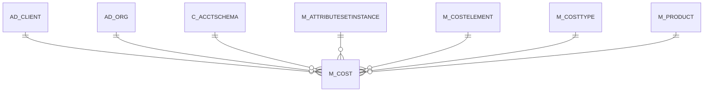

# M_COST

Area [M](../../data-model/m/index.md) · class **business** (proposed) · read from database `idempiere-db` (owner `ADEMPIERE`) · 267 row(s) when profiled

Application model: `org.compiere.model.X_M_Cost`, access level 3 - Client - Org.

## Columns

| column | type | key | not null | business name | references (code) | nulls | distinct |
|---|---|---|---|---|---|---|---|
| `AD_CLIENT_ID` | NUMBER(10,0) | PK | yes | Tenant |  | 0 | 1 |
| `AD_ORG_ID` | NUMBER(10,0) | PK | yes | Organization |  | 0 | 1 |
| `M_PRODUCT_ID` | NUMBER(10,0) | PK | yes | Product | [M_PRODUCT](../../data-model/m/m_product.md) | 0 | 55 |
| `M_COSTTYPE_ID` | NUMBER(10,0) | PK | yes | Cost Type | [M_COSTTYPE](../../data-model/m/m_costtype.md) | 0 | 1 |
| `C_ACCTSCHEMA_ID` | NUMBER(10,0) | PK | yes | Accounting Schema | [C_ACCTSCHEMA](../../data-model/c/c_acctschema.md) | 0 | 1 |
| `M_COSTELEMENT_ID` | NUMBER(10,0) | PK | yes | Cost Element | [M_COSTELEMENT](../../data-model/m/m_costelement.md) | 0 | 5 |
| `M_ATTRIBUTESETINSTANCE_ID` | NUMBER(10,0) | PK | yes | Attribute Set Instance | [M_ATTRIBUTESETINSTANCE](../../data-model/m/m_attributesetinstance.md) | 0 | 1 |
| `ISACTIVE` | CHAR(1) |  | yes | Active |  | 0 | 1 |
| `CREATED` | DATE |  | yes | Created |  | 0 | 10 |
| `CREATEDBY` | NUMBER(10,0) |  | yes | Created By |  | 0 | 1 |
| `UPDATED` | DATE |  | yes | Updated |  | 0 | 15 |
| `UPDATEDBY` | NUMBER(10,0) |  | yes | Updated By |  | 0 | 1 |
| `CURRENTCOSTPRICE` | NUMBER |  | yes | Current Cost Price |  | 0 | 10 |
| `CURRENTQTY` | NUMBER |  | yes | Current Quantity |  | 0 | 1 |
| `CUMULATEDAMT` | NUMBER |  |  | Accumulated Amt |  | 0 | 1 |
| `CUMULATEDQTY` | NUMBER |  |  | Accumulated Qty |  | 0 | 1 |
| `FUTURECOSTPRICE` | NUMBER |  |  | Future Cost Price |  | 0 | 1 |
| `DESCRIPTION` | VARCHAR2(255 CHAR) |  |  | Description |  | 267 | 0 |
| `PERCENT` | NUMBER(10,0) |  |  | Percent |  | 0 | 1 |
| `CURRENTCOSTPRICELL` | NUMBER |  |  | Current Cost Price Lower Level |  | 0 | 3 |
| `FUTURECOSTPRICELL` | NUMBER |  |  | Future Cost Price Lower Level |  | 267 | 0 |
| `ISCOSTFROZEN` | CHAR(1) |  |  | Cost Frozen |  | 0 | 1 |
| `M_COST_UU` | VARCHAR2(36 CHAR) |  |  | M_Cost_UU |  | 0 | 267 |

*references (code)* is the table the application model's code says a column points to; *Foreign keys* below are the constraints the database declares. Counts come from the profile; no value is ever shown.

## Check constraints

| name | expression |
|---|---|
| `SYS_C0022698` | `IsCostFrozen IN ('Y','N')` |
| `SYS_C0022700` | `IsActive in ('Y','N')` |

## Foreign keys

**References**

| table | columns | on delete |
|---|---|---|
| [AD_CLIENT](../../data-model/ad/ad_client.md) | M_COST.AD_CLIENT_ID → AD_CLIENT.AD_CLIENT_ID | NO ACTION |
| [AD_ORG](../../data-model/ad/ad_org.md) | M_COST.AD_ORG_ID → AD_ORG.AD_ORG_ID | NO ACTION |
| [C_ACCTSCHEMA](../../data-model/c/c_acctschema.md) | M_COST.C_ACCTSCHEMA_ID → C_ACCTSCHEMA.C_ACCTSCHEMA_ID | CASCADE |
| [M_ATTRIBUTESETINSTANCE](../../data-model/m/m_attributesetinstance.md) | M_COST.M_ATTRIBUTESETINSTANCE_ID → M_ATTRIBUTESETINSTANCE.M_ATTRIBUTESETINSTANCE_ID | CASCADE |
| [M_COSTELEMENT](../../data-model/m/m_costelement.md) | M_COST.M_COSTELEMENT_ID → M_COSTELEMENT.M_COSTELEMENT_ID | CASCADE |
| [M_COSTTYPE](../../data-model/m/m_costtype.md) | M_COST.M_COSTTYPE_ID → M_COSTTYPE.M_COSTTYPE_ID | CASCADE |
| [M_PRODUCT](../../data-model/m/m_product.md) | M_COST.M_PRODUCT_ID → M_PRODUCT.M_PRODUCT_ID | NO ACTION |

**Referenced by**

_None._

## Write behaviour

- updates: **po_only**
- deletes: **deleted_by_app, deleted_by_cascade**
- change log: **not_recorded**
- evidence: 6 citation(s)

## Read by

| kind | name |
|---|---|
| View | `RV_COST` |
| View | `RV_COSTSUMMARY` |
| View | `rv_cost` |
| View | `rv_costsummary` |

## Schema history

22 change(s); the latest:

| applied | release | operation | column | tickets |
|---|---|---|---|---|
| 2023-04-09T15:47 | iD11 | `add_constraint` |  | IDEMPIERE-5567 |
| 2023-04-09T15:47 | iD11 | `add_constraint` |  | IDEMPIERE-5567 |
| 2021-12-05T16:45 | i8.2z | `add_constraint` |  | IDEMPIERE-5075 |
| 2021-12-05T16:45 | i8.2z | `drop_constraint` |  | IDEMPIERE-5075 |
| 2021-12-05T16:45 | i8.2z | `add_constraint` |  | IDEMPIERE-5075 |
| 2021-12-05T16:45 | i8.2z | `drop_constraint` |  | IDEMPIERE-5075 |
| 2021-12-05T16:45 | i8.2z | `add_constraint` |  | IDEMPIERE-5075 |
| 2021-12-05T16:45 | i8.2z | `drop_constraint` |  | IDEMPIERE-5075 |
| 2021-12-05T16:45 | i8.2z | `drop_constraint` |  | IDEMPIERE-5075 |
| 2021-12-05T16:45 | i8.2z | `drop_constraint` |  | IDEMPIERE-5075 |
| 2021-12-05T16:45 | i8.2z | `add_constraint` |  | IDEMPIERE-5075 |
| 2021-12-05T16:45 | i8.2z | `add_constraint` |  | IDEMPIERE-5075 |
| 2021-12-05T16:45 | i8.2z | `add_constraint` |  | IDEMPIERE-5075 |
| 2021-12-05T16:45 | i8.2z | `add_constraint` |  | IDEMPIERE-5075 |
| 2021-12-05T16:45 | i8.2z | `drop_constraint` |  | IDEMPIERE-5075 |

## Open conflicts

| type | attribute | explanation |
|---|---|---|
| `mandatory_but_nullable` | `columns.CurrentCostPriceLL.nullable` | unexplained |
| `mandatory_but_nullable` | `columns.FutureCostPrice.nullable` | unexplained |

## Notes

<!-- ekos:manual id="table.m_cost.notes" -->
_Business notes about this table._
<!-- /ekos:manual -->
