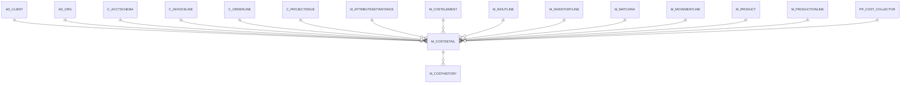

# M_COSTDETAIL

Area [M](../../data-model/m/index.md) · class **business** (proposed) · read from database `idempiere-db` (owner `ADEMPIERE`) · 0 row(s) when profiled

Application model: `org.compiere.model.X_M_CostDetail`, access level 3 - Client - Org.

## Columns

| column | type | key | not null | business name | references (code) | nulls | distinct |
|---|---|---|---|---|---|---|---|
| `M_COSTDETAIL_ID` | NUMBER(10,0) | PK | yes | Cost Detail |  | 0 | 0 |
| `AD_CLIENT_ID` | NUMBER(10,0) |  | yes | Tenant |  | 0 | 0 |
| `AD_ORG_ID` | NUMBER(10,0) |  | yes | Organization |  | 0 | 0 |
| `C_ACCTSCHEMA_ID` | NUMBER(10,0) |  | yes | Accounting Schema | [C_ACCTSCHEMA](../../data-model/c/c_acctschema.md) | 0 | 0 |
| `M_PRODUCT_ID` | NUMBER(10,0) |  | yes | Product | [M_PRODUCT](../../data-model/m/m_product.md) | 0 | 0 |
| `M_ATTRIBUTESETINSTANCE_ID` | NUMBER(10,0) |  | yes | Attribute Set Instance | [M_ATTRIBUTESETINSTANCE](../../data-model/m/m_attributesetinstance.md) | 0 | 0 |
| `ISACTIVE` | CHAR(1) |  | yes | Active |  | 0 | 0 |
| `CREATED` | DATE |  | yes | Created |  | 0 | 0 |
| `CREATEDBY` | NUMBER(10,0) |  | yes | Created By |  | 0 | 0 |
| `UPDATED` | DATE |  | yes | Updated |  | 0 | 0 |
| `UPDATEDBY` | NUMBER(10,0) |  | yes | Updated By |  | 0 | 0 |
| `M_COSTELEMENT_ID` | NUMBER(10,0) |  |  | Cost Element | [M_COSTELEMENT](../../data-model/m/m_costelement.md) | 0 | 0 |
| `C_ORDERLINE_ID` | NUMBER(10,0) |  |  | Sales Order Line | [C_ORDERLINE](../../data-model/c/c_orderline.md) | 0 | 0 |
| `M_INOUTLINE_ID` | NUMBER(10,0) |  |  | Shipment/Receipt Line | [M_INOUTLINE](../../data-model/m/m_inoutline.md) | 0 | 0 |
| `C_INVOICELINE_ID` | NUMBER(10,0) |  |  | Invoice Line | [C_INVOICELINE](../../data-model/c/c_invoiceline.md) | 0 | 0 |
| `M_MOVEMENTLINE_ID` | NUMBER(10,0) |  |  | Move Line | [M_MOVEMENTLINE](../../data-model/m/m_movementline.md) | 0 | 0 |
| `M_INVENTORYLINE_ID` | NUMBER(10,0) |  |  | Phys.Inventory Line | [M_INVENTORYLINE](../../data-model/m/m_inventoryline.md) | 0 | 0 |
| `M_PRODUCTIONLINE_ID` | NUMBER(10,0) |  |  | Production Line | [M_PRODUCTIONLINE](../../data-model/m/m_productionline.md) | 0 | 0 |
| `C_PROJECTISSUE_ID` | NUMBER(10,0) |  |  | Project Issue | [C_PROJECTISSUE](../../data-model/c/c_projectissue.md) | 0 | 0 |
| `ISSOTRX` | CHAR(1) |  | yes | Sales Transaction |  | 0 | 0 |
| `AMT` | NUMBER |  | yes | Amount |  | 0 | 0 |
| `QTY` | NUMBER |  | yes | Quantity |  | 0 | 0 |
| `DELTAAMT` | NUMBER |  |  | Delta Amount |  | 0 | 0 |
| `DELTAQTY` | NUMBER |  |  | Delta Quantity |  | 0 | 0 |
| `DESCRIPTION` | VARCHAR2(255 CHAR) |  |  | Description |  | 0 | 0 |
| `PROCESSED` | CHAR(1) |  | yes | Processed |  | 0 | 0 |
| `PP_COST_COLLECTOR_ID` | NUMBER(10,0) |  |  | Manufacturing Cost Collector | [PP_COST_COLLECTOR](../../data-model/pp/pp_cost_collector.md) | 0 | 0 |
| `CURRENTCOSTPRICE` | NUMBER |  |  | Current Cost Price |  | 0 | 0 |
| `CURRENTQTY` | NUMBER |  |  | Current Quantity |  | 0 | 0 |
| `CUMULATEDAMT` | NUMBER |  |  | Accumulated Amt |  | 0 | 0 |
| `CUMULATEDQTY` | NUMBER |  |  | Accumulated Qty |  | 0 | 0 |
| `M_COSTDETAIL_UU` | VARCHAR2(36 CHAR) |  |  | M_CostDetail_UU |  | 0 | 0 |
| `M_MATCHINV_ID` | NUMBER(10,0) |  |  | Match Invoice | [M_MATCHINV](../../data-model/m/m_matchinv.md) | 0 | 0 |

*references (code)* is the table the application model's code says a column points to; *Foreign keys* below are the constraints the database declares. Counts come from the profile; no value is ever shown.

## Check constraints

| name | expression |
|---|---|
| `SYS_C0019704` | `Processed in ('Y','N')` |
| `SYS_C0019705` | `IsSOTrx in ('Y','N')` |
| `SYS_C0019706` | `IsActive in ('Y','N')` |

## Foreign keys

**References**

| table | columns | on delete |
|---|---|---|
| [AD_CLIENT](../../data-model/ad/ad_client.md) | M_COSTDETAIL.AD_CLIENT_ID → AD_CLIENT.AD_CLIENT_ID | NO ACTION |
| [AD_ORG](../../data-model/ad/ad_org.md) | M_COSTDETAIL.AD_ORG_ID → AD_ORG.AD_ORG_ID | NO ACTION |
| [C_ACCTSCHEMA](../../data-model/c/c_acctschema.md) | M_COSTDETAIL.C_ACCTSCHEMA_ID → C_ACCTSCHEMA.C_ACCTSCHEMA_ID | NO ACTION |
| [C_INVOICELINE](../../data-model/c/c_invoiceline.md) | M_COSTDETAIL.C_INVOICELINE_ID → C_INVOICELINE.C_INVOICELINE_ID | NO ACTION |
| [C_ORDERLINE](../../data-model/c/c_orderline.md) | M_COSTDETAIL.C_ORDERLINE_ID → C_ORDERLINE.C_ORDERLINE_ID | NO ACTION |
| [C_PROJECTISSUE](../../data-model/c/c_projectissue.md) | M_COSTDETAIL.C_PROJECTISSUE_ID → C_PROJECTISSUE.C_PROJECTISSUE_ID | NO ACTION |
| [M_ATTRIBUTESETINSTANCE](../../data-model/m/m_attributesetinstance.md) | M_COSTDETAIL.M_ATTRIBUTESETINSTANCE_ID → M_ATTRIBUTESETINSTANCE.M_ATTRIBUTESETINSTANCE_ID | NO ACTION |
| [M_COSTELEMENT](../../data-model/m/m_costelement.md) | M_COSTDETAIL.M_COSTELEMENT_ID → M_COSTELEMENT.M_COSTELEMENT_ID | NO ACTION |
| [M_INOUTLINE](../../data-model/m/m_inoutline.md) | M_COSTDETAIL.M_INOUTLINE_ID → M_INOUTLINE.M_INOUTLINE_ID | NO ACTION |
| [M_INVENTORYLINE](../../data-model/m/m_inventoryline.md) | M_COSTDETAIL.M_INVENTORYLINE_ID → M_INVENTORYLINE.M_INVENTORYLINE_ID | NO ACTION |
| [M_MATCHINV](../../data-model/m/m_matchinv.md) | M_COSTDETAIL.M_MATCHINV_ID → M_MATCHINV.M_MATCHINV_ID | NO ACTION |
| [M_MOVEMENTLINE](../../data-model/m/m_movementline.md) | M_COSTDETAIL.M_MOVEMENTLINE_ID → M_MOVEMENTLINE.M_MOVEMENTLINE_ID | NO ACTION |
| [M_PRODUCT](../../data-model/m/m_product.md) | M_COSTDETAIL.M_PRODUCT_ID → M_PRODUCT.M_PRODUCT_ID | NO ACTION |
| [M_PRODUCTIONLINE](../../data-model/m/m_productionline.md) | M_COSTDETAIL.M_PRODUCTIONLINE_ID → M_PRODUCTIONLINE.M_PRODUCTIONLINE_ID | NO ACTION |
| [PP_COST_COLLECTOR](../../data-model/pp/pp_cost_collector.md) | M_COSTDETAIL.PP_COST_COLLECTOR_ID → PP_COST_COLLECTOR.PP_COST_COLLECTOR_ID | NO ACTION |

**Referenced by**

| table | columns | on delete |
|---|---|---|
| [M_COSTHISTORY](../../data-model/m/m_costhistory.md) | M_COSTHISTORY.M_COSTDETAIL_ID → M_COSTDETAIL.M_COSTDETAIL_ID | NO ACTION |

## Write behaviour

- updates: **po_only**
- deletes: **deleted_by_app, deleted_by_users**
- change log: **not_recorded**
- evidence: 3 citation(s)

## Read by

| kind | name |
|---|---|
| View | `M_COSTMOVEMENT_V` |
| View | `RV_COSTDETAIL` |
| View | `m_costmovement_v` |
| View | `rv_costdetail` |

## Schema history

56 change(s); the latest:

| applied | release | operation | column | tickets |
|---|---|---|---|---|
| 2024-10-23T12:56 | iD12 | `add_column` | Ref_CostDetail_ID | IDEMPIERE-6203 |
| 2024-10-23T12:56 | iD12 | `add_column` | Ref_CostDetail_ID | IDEMPIERE-6203 |
| 2024-09-03T14:11 | iD12 | `add_column` | BackDateProcessedOn | IDEMPIERE-6203 |
| 2024-09-03T14:11 | iD12 | `add_column` | BackDateProcessedOn | IDEMPIERE-6203 |
| 2024-08-05T15:48 | iD12 | `add_column` | IsBackDate | IDEMPIERE-6203 |
| 2024-08-05T15:48 | iD12 | `modify_column` | DateAcct | IDEMPIERE-6203 |
| 2024-08-05T15:48 | iD12 | `add_column` | DateAcct | IDEMPIERE-6203 |
| 2024-08-05T15:48 | iD12 | `modify_column` | DateAcct | IDEMPIERE-6203 |
| 2024-08-05T15:48 | iD12 | `modify_column` | DateAcct | IDEMPIERE-6203 |
| 2024-08-05T15:48 | iD12 | `add_column` | DateAcct | IDEMPIERE-6203 |
| 2024-08-05T15:48 | iD12 | `add_column` | IsBackDate | IDEMPIERE-6203 |
| 2024-08-05T15:48 | iD12 | `modify_column` | DateAcct | IDEMPIERE-6203 |
| 2023-04-09T15:47 | iD11 | `add_constraint` |  | IDEMPIERE-5567 |
| 2023-04-09T15:47 | iD11 | `add_constraint` |  | IDEMPIERE-5567 |
| 2021-12-05T16:45 | i8.2z | `drop_constraint` |  | IDEMPIERE-5075 |

## Open conflicts

| type | attribute | explanation |
|---|---|---|
| `model_column_missing` | `columns.BackDateProcessedOn` | unexplained |
| `model_column_missing` | `columns.DateAcct` | unexplained |
| `model_column_missing` | `columns.IsBackDate` | unexplained |
| `model_column_missing` | `columns.Ref_CostDetail_ID` | unexplained |

## Notes

<!-- ekos:manual id="table.m_costdetail.notes" -->
_Business notes about this table._
<!-- /ekos:manual -->
