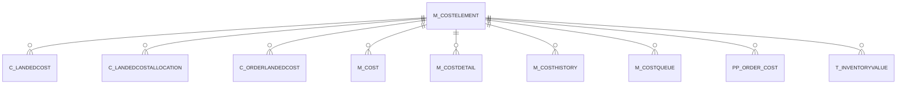

# M_COSTELEMENT

Area [M](../../data-model/m/index.md) · class **business** (proposed) · read from database `idempiere-db` (owner `ADEMPIERE`) · 9 row(s) when profiled

Application model: `org.compiere.model.X_M_CostElement`, access level 2 - Client.

## Columns

| column | type | key | not null | business name | references (code) | nulls | distinct |
|---|---|---|---|---|---|---|---|
| `M_COSTELEMENT_ID` | NUMBER(10,0) | PK | yes | Cost Element |  | 0 | 9 |
| `AD_CLIENT_ID` | NUMBER(10,0) |  | yes | Tenant |  | 0 | 1 |
| `AD_ORG_ID` | NUMBER(10,0) |  | yes | Organization |  | 0 | 2 |
| `ISACTIVE` | CHAR(1) |  | yes | Active |  | 0 | 2 |
| `CREATED` | DATE |  | yes | Created |  | 0 | 9 |
| `CREATEDBY` | NUMBER(10,0) |  | yes | Created By |  | 0 | 1 |
| `UPDATED` | DATE |  | yes | Updated |  | 0 | 9 |
| `UPDATEDBY` | NUMBER(10,0) |  | yes | Updated By |  | 0 | 1 |
| `NAME` | VARCHAR2(60 CHAR) |  | yes | Name |  | 0 | 9 |
| `DESCRIPTION` | VARCHAR2(255 CHAR) |  |  | Description |  | 3 | 3 |
| `COSTELEMENTTYPE` | CHAR(1) |  | yes | Cost Element Type |  | 0 | 5 |
| `COSTINGMETHOD` | CHAR(1) |  |  | Costing Method |  | 1 | 4 |
| `ISCALCULATED` | CHAR(1) |  | yes | Calculated |  | 0 | 2 |
| `M_COSTELEMENT_UU` | VARCHAR2(36 CHAR) |  |  | M_CostElement_UU |  | 0 | 9 |

*references (code)* is the table the application model's code says a column points to; *Foreign keys* below are the constraints the database declares. Counts come from the profile; no value is ever shown.

## Check constraints

| name | expression |
|---|---|
| `SYS_C0021147` | `IsActive in ('Y','N')` |
| `SYS_C0021149` | `IsCalculated in ('Y','N')` |

## Foreign keys

**References**

_None._

**Referenced by**

| table | columns | on delete |
|---|---|---|
| [C_LANDEDCOST](../../data-model/c/c_landedcost.md) | C_LANDEDCOST.M_COSTELEMENT_ID → M_COSTELEMENT.M_COSTELEMENT_ID | NO ACTION |
| [C_LANDEDCOSTALLOCATION](../../data-model/c/c_landedcostallocation.md) | C_LANDEDCOSTALLOCATION.M_COSTELEMENT_ID → M_COSTELEMENT.M_COSTELEMENT_ID | NO ACTION |
| [C_ORDERLANDEDCOST](../../data-model/c/c_orderlandedcost.md) | C_ORDERLANDEDCOST.M_COSTELEMENT_ID → M_COSTELEMENT.M_COSTELEMENT_ID | NO ACTION |
| [M_COST](../../data-model/m/m_cost.md) | M_COST.M_COSTELEMENT_ID → M_COSTELEMENT.M_COSTELEMENT_ID | CASCADE |
| [M_COSTDETAIL](../../data-model/m/m_costdetail.md) | M_COSTDETAIL.M_COSTELEMENT_ID → M_COSTELEMENT.M_COSTELEMENT_ID | NO ACTION |
| [M_COSTHISTORY](../../data-model/m/m_costhistory.md) | M_COSTHISTORY.M_COSTELEMENT_ID → M_COSTELEMENT.M_COSTELEMENT_ID | NO ACTION |
| [M_COSTQUEUE](../../data-model/m/m_costqueue.md) | M_COSTQUEUE.M_COSTELEMENT_ID → M_COSTELEMENT.M_COSTELEMENT_ID | CASCADE |
| [PP_ORDER_COST](../../data-model/pp/pp_order_cost.md) | PP_ORDER_COST.M_COSTELEMENT_ID → M_COSTELEMENT.M_COSTELEMENT_ID | NO ACTION |
| `T_INVENTORYVALUE` | T_INVENTORYVALUE.M_COSTELEMENT_ID → M_COSTELEMENT.M_COSTELEMENT_ID | CASCADE |

## Write behaviour

- updates: **raw_sql_skips_updated**
- deletes: **deleted_by_users**
- change log: **recorded**
- evidence: 4 citation(s)

## Read by

| kind | name |
|---|---|
| View | `RV_COST` |
| View | `rv_cost` |

## Schema history

13 change(s); the latest:

| applied | release | operation | column | tickets |
|---|---|---|---|---|
| 2023-04-09T15:47 | iD11 | `add_constraint` |  | IDEMPIERE-5567 |
| 2023-04-09T15:47 | iD11 | `add_constraint` |  | IDEMPIERE-5567 |
| 2020-08-04T01:00 | i7.1z | `add_column` | tmp_col_1_tmp | IDEMPIERE-3862 |
| 2020-08-04T01:00 | i7.1z | `modify_column` | NAME | IDEMPIERE-3862 |
| 2020-08-04T01:00 | i7.1z | `drop_column` | tmp_col_3_tmp | IDEMPIERE-3862 |
| 2020-08-04T01:00 | i7.1z | `add_column` | tmp_col_3_tmp | IDEMPIERE-3862 |
| 2020-08-04T01:00 | i7.1z | `drop_column` | tmp_col_1_tmp | IDEMPIERE-3862 |
| 2020-08-04T01:00 | i7.1z | `modify_column` | M_COSTELEMENT_UU | IDEMPIERE-3862 |
| 2020-08-04T01:00 | i7.1z | `modify_column` | NAME | IDEMPIERE-3862 |
| 2020-08-04T01:00 | i7.1z | `add_column` | tmp_col_2_tmp | IDEMPIERE-3862 |
| 2020-08-04T01:00 | i7.1z | `modify_column` | NAME | IDEMPIERE-3862 |
| 2020-08-04T01:00 | i7.1z | `drop_column` | tmp_col_2_tmp | IDEMPIERE-3862 |
| 2020-08-04T01:00 | i7.1z | `modify_column` | DESCRIPTION | IDEMPIERE-3862 |

## Notes

<!-- ekos:manual id="table.m_costelement.notes" -->
_Business notes about this table._
<!-- /ekos:manual -->
