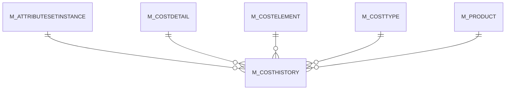

# M_COSTHISTORY

Area [M](../../data-model/m/index.md) · class **business** (proposed) · read from database `idempiere-db` (owner `ADEMPIERE`) · 0 row(s) when profiled

Application model: `org.compiere.model.X_M_CostHistory`, access level 3 - Client - Org.

## Columns

| column | type | key | not null | business name | references (code) | nulls | distinct |
|---|---|---|---|---|---|---|---|
| `AD_CLIENT_ID` | NUMBER(10,0) |  | yes | Tenant |  | 0 | 0 |
| `AD_ORG_ID` | NUMBER(10,0) |  | yes | Organization |  | 0 | 0 |
| `CREATED` | DATE |  | yes | Created |  | 0 | 0 |
| `CREATEDBY` | NUMBER(10,0) |  | yes | Created By |  | 0 | 0 |
| `ISACTIVE` | CHAR(1) |  | yes | Active |  | 0 | 0 |
| `M_ATTRIBUTESETINSTANCE_ID` | NUMBER(10,0) |  | yes | Attribute Set Instance | [M_ATTRIBUTESETINSTANCE](../../data-model/m/m_attributesetinstance.md) | 0 | 0 |
| `M_COSTDETAIL_ID` | NUMBER(10,0) |  | yes | Cost Detail | [M_COSTDETAIL](../../data-model/m/m_costdetail.md) | 0 | 0 |
| `M_COSTELEMENT_ID` | NUMBER(10,0) |  | yes | Cost Element | [M_COSTELEMENT](../../data-model/m/m_costelement.md) | 0 | 0 |
| `M_COSTHISTORY_ID` | NUMBER(10,0) | PK | yes | Cost History |  | 0 | 0 |
| `M_COSTHISTORY_UU` | VARCHAR2(36 CHAR) |  | yes | Cost History UUID |  | 0 | 0 |
| `M_COSTTYPE_ID` | NUMBER(10,0) |  | yes | Cost Type | [M_COSTTYPE](../../data-model/m/m_costtype.md) | 0 | 0 |
| `NEWCAMT` | NUMBER |  |  | New Accumulated Amt |  | 0 | 0 |
| `NEWCOSTPRICE` | NUMBER |  | yes | New Cost Price |  | 0 | 0 |
| `NEWCQTY` | NUMBER |  |  | New Accumulated Qty |  | 0 | 0 |
| `NEWQTY` | NUMBER |  | yes | New Current Quantity |  | 0 | 0 |
| `OLDCAMT` | NUMBER |  |  | Old Accumulated Amt |  | 0 | 0 |
| `OLDCOSTPRICE` | NUMBER |  | yes | Old Current Cost Price |  | 0 | 0 |
| `OLDCQTY` | NUMBER |  |  | Old Accumulated Qty |  | 0 | 0 |
| `OLDQTY` | NUMBER |  | yes | Old Current Quantity |  | 0 | 0 |
| `UPDATED` | DATE |  | yes | Updated |  | 0 | 0 |
| `UPDATEDBY` | NUMBER(10,0) |  | yes | Updated By |  | 0 | 0 |
| `M_PRODUCT_ID` | NUMBER(10,0) |  |  | Product | [M_PRODUCT](../../data-model/m/m_product.md) | 0 | 0 |

*references (code)* is the table the application model's code says a column points to; *Foreign keys* below are the constraints the database declares. Counts come from the profile; no value is ever shown.

## Check constraints

| name | expression |
|---|---|
| `SYS_C0019653` | `IsActive IN ('Y','N')` |

## Foreign keys

**References**

| table | columns | on delete |
|---|---|---|
| [M_ATTRIBUTESETINSTANCE](../../data-model/m/m_attributesetinstance.md) | M_COSTHISTORY.M_ATTRIBUTESETINSTANCE_ID → M_ATTRIBUTESETINSTANCE.M_ATTRIBUTESETINSTANCE_ID | NO ACTION |
| [M_COSTDETAIL](../../data-model/m/m_costdetail.md) | M_COSTHISTORY.M_COSTDETAIL_ID → M_COSTDETAIL.M_COSTDETAIL_ID | NO ACTION |
| [M_COSTELEMENT](../../data-model/m/m_costelement.md) | M_COSTHISTORY.M_COSTELEMENT_ID → M_COSTELEMENT.M_COSTELEMENT_ID | NO ACTION |
| [M_COSTTYPE](../../data-model/m/m_costtype.md) | M_COSTHISTORY.M_COSTTYPE_ID → M_COSTTYPE.M_COSTTYPE_ID | NO ACTION |
| [M_PRODUCT](../../data-model/m/m_product.md) | M_COSTHISTORY.M_PRODUCT_ID → M_PRODUCT.M_PRODUCT_ID | NO ACTION |

**Referenced by**

_None._

## Write behaviour

- updates: **po_only**
- deletes: **deleted_by_users**
- change log: **recorded**
- evidence: 1 citation(s)

## Read by

| kind | name |
|---|---|
| View | `M_COSTMOVEMENT_V` |
| View | `m_costmovement_v` |

## Schema history

39 change(s); the latest:

| applied | release | operation | column | tickets |
|---|---|---|---|---|
| 2024-09-03T14:11 | iD12 | `add_column` | BackDateProcessedOn | IDEMPIERE-6203 |
| 2024-09-03T14:11 | iD12 | `add_column` | BackDateProcessedOn | IDEMPIERE-6203 |
| 2024-08-05T15:48 | iD12 | `add_column` | IsBackDate | IDEMPIERE-6203 |
| 2024-08-05T15:48 | iD12 | `modify_column` | DateAcct | IDEMPIERE-6203 |
| 2024-08-05T15:48 | iD12 | `modify_column` | DateAcct | IDEMPIERE-6203 |
| 2024-08-05T15:48 | iD12 | `modify_column` | DateAcct | IDEMPIERE-6203 |
| 2024-08-05T15:48 | iD12 | `modify_column` | DateAcct | IDEMPIERE-6203 |
| 2024-08-05T15:48 | iD12 | `add_column` | IsBackDate | IDEMPIERE-6203 |
| 2024-08-05T15:48 | iD12 | `add_column` | DateAcct | IDEMPIERE-6203 |
| 2024-08-05T15:48 | iD12 | `add_column` | DateAcct | IDEMPIERE-6203 |
| 2023-04-09T15:47 | iD11 | `add_constraint` |  | IDEMPIERE-5567 |
| 2023-04-09T15:47 | iD11 | `add_constraint` |  | IDEMPIERE-5567 |
| 2022-11-30T12:16 | iD10 | `add_constraint` |  | IDEMPIERE-5504 |
| 2022-11-30T12:16 | iD10 | `add_column` | M_Product_ID | IDEMPIERE-5504 |
| 2022-11-30T12:16 | iD10 | `add_constraint` |  | IDEMPIERE-5504 |

## Open conflicts

| type | attribute | explanation |
|---|---|---|
| `model_column_missing` | `columns.BackDateProcessedOn` | unexplained |
| `model_column_missing` | `columns.DateAcct` | unexplained |
| `model_column_missing` | `columns.IsBackDate` | unexplained |

## Notes

<!-- ekos:manual id="table.m_costhistory.notes" -->
_Business notes about this table._
<!-- /ekos:manual -->
