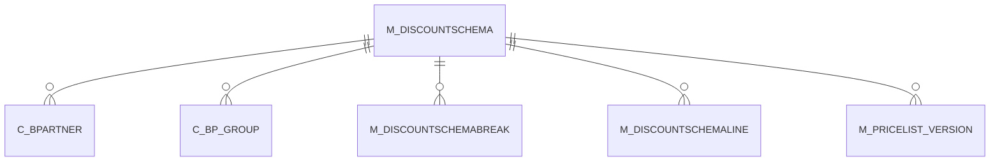

# M_DISCOUNTSCHEMA

Trade Discount

Area [M](../../data-model/m/index.md) · class **business** (proposed) · read from database `idempiere-db` (owner `ADEMPIERE`) · 3 row(s) when profiled

Application model: `org.compiere.model.X_M_DiscountSchema`, access level 3 - Client - Org.

## Columns

| column | type | key | not null | business name | references (code) | nulls | distinct |
|---|---|---|---|---|---|---|---|
| `M_DISCOUNTSCHEMA_ID` | NUMBER(10,0) | PK | yes | Discount Schema |  | 0 | 3 |
| `AD_CLIENT_ID` | NUMBER(10,0) |  | yes | Tenant |  | 0 | 1 |
| `AD_ORG_ID` | NUMBER(10,0) |  | yes | Organization |  | 0 | 2 |
| `ISACTIVE` | CHAR(1) |  | yes | Active |  | 0 | 1 |
| `CREATED` | DATE |  | yes | Created |  | 0 | 2 |
| `CREATEDBY` | NUMBER(10,0) |  | yes | Created By |  | 0 | 2 |
| `UPDATED` | DATE |  | yes | Updated |  | 0 | 3 |
| `UPDATEDBY` | NUMBER(10,0) |  | yes | Updated By |  | 0 | 1 |
| `NAME` | VARCHAR2(60 CHAR) |  | yes | Name |  | 0 | 3 |
| `DESCRIPTION` | VARCHAR2(255 CHAR) |  |  | Description |  | 2 | 1 |
| `VALIDFROM` | DATE |  | yes | Valid from |  | 0 | 3 |
| `DISCOUNTTYPE` | CHAR(1) |  | yes | Discount Type |  | 0 | 2 |
| `SCRIPT` | VARCHAR2(2000 CHAR) |  |  | Script |  | 3 | 0 |
| `FLATDISCOUNT` | NUMBER |  |  | Flat Discount % |  | 2 | 1 |
| `ISQUANTITYBASED` | CHAR(1) |  | yes | Quantity based |  | 0 | 1 |
| `CUMULATIVELEVEL` | CHAR(1) |  |  | Accumulation Level |  | 2 | 1 |
| `PROCESSING` | CHAR(1) |  |  | Process Now |  | 2 | 1 |
| `ISBPARTNERFLATDISCOUNT` | CHAR(1) |  | yes | B.Partner Flat Discount |  | 0 | 1 |
| `M_DISCOUNTSCHEMA_UU` | VARCHAR2(36 CHAR) |  |  | M_DiscountSchema_UU |  | 0 | 3 |

*references (code)* is the table the application model's code says a column points to; *Foreign keys* below are the constraints the database declares. Counts come from the profile; no value is ever shown.

## Check constraints

| name | expression |
|---|---|
| `SYS_C0021883` | `IsQuantityBased in ('Y','N')` |
| `SYS_C0021884` | `IsActive in ('Y','N')` |

## Foreign keys

**References**

_None._

**Referenced by**

| table | columns | on delete |
|---|---|---|
| [C_BPARTNER](../../data-model/c/c_bpartner.md) | C_BPARTNER.PO_DISCOUNTSCHEMA_ID → M_DISCOUNTSCHEMA.M_DISCOUNTSCHEMA_ID | NO ACTION |
| [C_BP_GROUP](../../data-model/c/c_bp_group.md) | C_BP_GROUP.PO_DISCOUNTSCHEMA_ID → M_DISCOUNTSCHEMA.M_DISCOUNTSCHEMA_ID | SET NULL |
| [M_DISCOUNTSCHEMABREAK](../../data-model/m/m_discountschemabreak.md) | M_DISCOUNTSCHEMABREAK.M_DISCOUNTSCHEMA_ID → M_DISCOUNTSCHEMA.M_DISCOUNTSCHEMA_ID | CASCADE |
| [M_DISCOUNTSCHEMALINE](../../data-model/m/m_discountschemaline.md) | M_DISCOUNTSCHEMALINE.M_DISCOUNTSCHEMA_ID → M_DISCOUNTSCHEMA.M_DISCOUNTSCHEMA_ID | CASCADE |
| [M_PRICELIST_VERSION](../../data-model/m/m_pricelist_version.md) | M_PRICELIST_VERSION.M_DISCOUNTSCHEMA_ID → M_DISCOUNTSCHEMA.M_DISCOUNTSCHEMA_ID | NO ACTION |

## Write behaviour

- updates: **po_only**
- deletes: **deleted_by_users**
- change log: **recorded**
- evidence: 1 citation(s)

## Schema history

16 change(s); the latest:

| applied | release | operation | column | tickets |
|---|---|---|---|---|
| 2023-04-09T15:47 | iD11 | `add_constraint` |  | IDEMPIERE-5567 |
| 2023-04-09T15:47 | iD11 | `add_constraint` |  | IDEMPIERE-5567 |
| 2020-08-04T01:00 | i7.1z | `modify_column` | NAME | IDEMPIERE-3862 |
| 2020-08-04T01:00 | i7.1z | `add_column` | tmp_col_4_tmp | IDEMPIERE-3862 |
| 2020-08-04T01:00 | i7.1z | `add_column` | tmp_col_3_tmp | IDEMPIERE-3862 |
| 2020-08-04T01:00 | i7.1z | `modify_column` | NAME | IDEMPIERE-3862 |
| 2020-08-04T01:00 | i7.1z | `drop_column` | tmp_col_1_tmp | IDEMPIERE-3862 |
| 2020-08-04T01:00 | i7.1z | `modify_column` | M_DISCOUNTSCHEMA_UU | IDEMPIERE-3862 |
| 2020-08-04T01:00 | i7.1z | `drop_column` | tmp_col_2_tmp | IDEMPIERE-3862 |
| 2020-08-04T01:00 | i7.1z | `drop_column` | tmp_col_3_tmp | IDEMPIERE-3862 |
| 2020-08-04T01:00 | i7.1z | `add_column` | tmp_col_2_tmp | IDEMPIERE-3862 |
| 2020-08-04T01:00 | i7.1z | `modify_column` | SCRIPT | IDEMPIERE-3862 |
| 2020-08-04T01:00 | i7.1z | `modify_column` | NAME | IDEMPIERE-3862 |
| 2020-08-04T01:00 | i7.1z | `modify_column` | DESCRIPTION | IDEMPIERE-3862 |
| 2020-08-04T01:00 | i7.1z | `drop_column` | tmp_col_4_tmp | IDEMPIERE-3862 |

## Notes

<!-- ekos:manual id="table.m_discountschema.notes" -->
_Business notes about this table._
<!-- /ekos:manual -->
