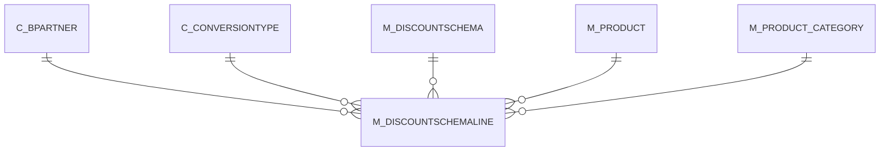

# M_DISCOUNTSCHEMALINE

Area [M](../../data-model/m/index.md) · class **business** (proposed) · read from database `idempiere-db` (owner `ADEMPIERE`) · 11 row(s) when profiled

Application model: `org.compiere.model.X_M_DiscountSchemaLine`, access level 3 - Client - Org.

## Columns

| column | type | key | not null | business name | references (code) | nulls | distinct |
|---|---|---|---|---|---|---|---|
| `M_DISCOUNTSCHEMALINE_ID` | NUMBER(10,0) | PK | yes | Discount Price List |  | 0 | 11 |
| `AD_CLIENT_ID` | NUMBER(10,0) |  | yes | Tenant |  | 0 | 1 |
| `AD_ORG_ID` | NUMBER(10,0) |  | yes | Organization |  | 0 | 1 |
| `ISACTIVE` | CHAR(1) |  | yes | Active |  | 0 | 1 |
| `CREATED` | DATE |  | yes | Created |  | 0 | 11 |
| `CREATEDBY` | NUMBER(10,0) |  | yes | Created By |  | 0 | 1 |
| `UPDATED` | DATE |  | yes | Updated |  | 0 | 11 |
| `UPDATEDBY` | NUMBER(10,0) |  | yes | Updated By |  | 0 | 1 |
| `M_DISCOUNTSCHEMA_ID` | NUMBER(10,0) |  | yes | Discount Schema | [M_DISCOUNTSCHEMA](../../data-model/m/m_discountschema.md) | 0 | 2 |
| `SEQNO` | NUMBER(10,0) |  | yes | Sequence |  | 0 | 6 |
| `M_PRODUCT_CATEGORY_ID` | NUMBER(10,0) |  |  | Product Category | [M_PRODUCT_CATEGORY](../../data-model/m/m_product_category.md) | 5 | 3 |
| `C_BPARTNER_ID` | NUMBER(10,0) |  |  | Business Partner | [C_BPARTNER](../../data-model/c/c_bpartner.md) | 8 | 3 |
| `M_PRODUCT_ID` | NUMBER(10,0) |  |  | Product | [M_PRODUCT](../../data-model/m/m_product.md) | 10 | 1 |
| `CONVERSIONDATE` | DATE |  | yes | Conversion Date |  | 0 | 3 |
| `LIST_BASE` | CHAR(1) |  | yes | List price Base |  | 0 | 1 |
| `LIST_ADDAMT` | NUMBER |  | yes | List price Surcharge Amount |  | 0 | 2 |
| `LIST_DISCOUNT` | NUMBER |  | yes | List price Discount % |  | 0 | 2 |
| `LIST_ROUNDING` | CHAR(1) |  | yes | List price Rounding |  | 0 | 1 |
| `LIST_MINAMT` | NUMBER |  | yes | List price min Margin |  | 0 | 1 |
| `LIST_MAXAMT` | NUMBER |  | yes | List price max Margin |  | 0 | 1 |
| `LIST_FIXED` | NUMBER |  |  | Fixed List Price |  | 0 | 1 |
| `STD_BASE` | CHAR(1) |  | yes | Standard price Base |  | 0 | 2 |
| `STD_ADDAMT` | NUMBER |  | yes | Standard price Surcharge Amount |  | 0 | 2 |
| `STD_DISCOUNT` | NUMBER |  | yes | Standard price Discount % |  | 0 | 6 |
| `STD_ROUNDING` | CHAR(1) |  | yes | Standard price Rounding |  | 0 | 1 |
| `STD_MINAMT` | NUMBER |  | yes | Standard price min Margin |  | 0 | 1 |
| `STD_MAXAMT` | NUMBER |  | yes | Standard max Margin |  | 0 | 1 |
| `STD_FIXED` | NUMBER |  |  | Fixed Standard Price |  | 0 | 1 |
| `LIMIT_BASE` | CHAR(1) |  | yes | Limit price Base |  | 0 | 2 |
| `LIMIT_ADDAMT` | NUMBER |  | yes | Limit price Surcharge Amount |  | 0 | 2 |
| `LIMIT_DISCOUNT` | NUMBER |  | yes | Limit price Discount % |  | 0 | 7 |
| `LIMIT_ROUNDING` | CHAR(1) |  | yes | Limit price Rounding |  | 0 | 1 |
| `LIMIT_MINAMT` | NUMBER |  | yes | Limit price min Margin |  | 0 | 1 |
| `LIMIT_MAXAMT` | NUMBER |  | yes | Limit price max Margin |  | 0 | 1 |
| `LIMIT_FIXED` | NUMBER |  |  | Fixed Limit Price |  | 0 | 1 |
| `C_CONVERSIONTYPE_ID` | NUMBER(10,0) |  | yes | Currency Type | [C_CONVERSIONTYPE](../../data-model/c/c_conversiontype.md) | 0 | 1 |
| `CLASSIFICATION` | VARCHAR2(12 CHAR) |  |  | Classification |  | 11 | 0 |
| `GROUP2` | VARCHAR2(255 CHAR) |  |  | Group2 |  | 11 | 0 |
| `GROUP1` | VARCHAR2(255 CHAR) |  |  | Group1 |  | 11 | 0 |
| `M_DISCOUNTSCHEMALINE_UU` | VARCHAR2(36 CHAR) |  |  | M_DiscountSchemaLine_UU |  | 0 | 11 |
| `DESCRIPTION` | VARCHAR2(255 CHAR) |  |  | Description |  | 11 | 0 |
| `ISIGNOREISCURRENTVENDOR` | CHAR(1) |  | yes | Ignore Current Vendor Flag |  | 0 | 1 |
| `VENDORCATEGORY` | VARCHAR2(30 CHAR) |  |  | Partner Category |  | 11 | 0 |

*references (code)* is the table the application model's code says a column points to; *Foreign keys* below are the constraints the database declares. Counts come from the profile; no value is ever shown.

## Check constraints

| name | expression |
|---|---|
| `SYS_C0020717` | `IsActive in ('Y','N')` |
| `SYS_C0020719` | `IsIgnoreIsCurrentVendor IN ('Y','N')` |

## Foreign keys

**References**

| table | columns | on delete |
|---|---|---|
| [C_BPARTNER](../../data-model/c/c_bpartner.md) | M_DISCOUNTSCHEMALINE.C_BPARTNER_ID → C_BPARTNER.C_BPARTNER_ID | NO ACTION |
| [C_CONVERSIONTYPE](../../data-model/c/c_conversiontype.md) | M_DISCOUNTSCHEMALINE.C_CONVERSIONTYPE_ID → C_CONVERSIONTYPE.C_CONVERSIONTYPE_ID | NO ACTION |
| [M_DISCOUNTSCHEMA](../../data-model/m/m_discountschema.md) | M_DISCOUNTSCHEMALINE.M_DISCOUNTSCHEMA_ID → M_DISCOUNTSCHEMA.M_DISCOUNTSCHEMA_ID | CASCADE |
| [M_PRODUCT](../../data-model/m/m_product.md) | M_DISCOUNTSCHEMALINE.M_PRODUCT_ID → M_PRODUCT.M_PRODUCT_ID | SET NULL |
| [M_PRODUCT_CATEGORY](../../data-model/m/m_product_category.md) | M_DISCOUNTSCHEMALINE.M_PRODUCT_CATEGORY_ID → M_PRODUCT_CATEGORY.M_PRODUCT_CATEGORY_ID | NO ACTION |

**Referenced by**

_None._

## Write behaviour

- updates: **po_only**
- deletes: **deleted_by_users, deleted_by_cascade**
- change log: **recorded**
- evidence: 2 citation(s)

## Schema history

31 change(s); the latest:

| applied | release | operation | column | tickets |
|---|---|---|---|---|
| 2023-04-09T15:47 | iD11 | `add_constraint` |  | IDEMPIERE-5567 |
| 2023-04-09T15:47 | iD11 | `add_constraint` |  | IDEMPIERE-5567 |
| 2021-12-05T16:45 | i8.2z | `drop_constraint` |  | IDEMPIERE-5075 |
| 2021-12-05T16:45 | i8.2z | `add_constraint` |  | IDEMPIERE-5075 |
| 2021-12-05T16:45 | i8.2z | `drop_constraint` |  | IDEMPIERE-5075 |
| 2021-12-05T16:45 | i8.2z | `add_constraint` |  | IDEMPIERE-5075 |
| 2021-12-05T16:45 | i8.2z | `drop_constraint` |  | IDEMPIERE-5075 |
| 2021-12-05T16:45 | i8.2z | `add_constraint` |  | IDEMPIERE-5075 |
| 2021-12-05T16:45 | i8.2z | `add_constraint` |  | IDEMPIERE-5075 |
| 2021-12-05T16:45 | i8.2z | `drop_constraint` |  | IDEMPIERE-5075 |
| 2021-12-05T16:45 | i8.2z | `drop_constraint` |  | IDEMPIERE-5075 |
| 2021-12-05T16:45 | i8.2z | `add_constraint` |  | IDEMPIERE-5075 |
| 2020-09-17T14:00 | i7.1z | `add_column` | VendorCategory | IDEMPIERE-4452 |
| 2020-09-17T14:00 | i7.1z | `add_column` | VendorCategory | IDEMPIERE-4452 |
| 2020-09-17T14:00 | i7.1z | `add_column` | IsIgnoreIsCurrentVendor | IDEMPIERE-4452 |

## Notes

<!-- ekos:manual id="table.m_discountschemaline.notes" -->
_Business notes about this table._
<!-- /ekos:manual -->
