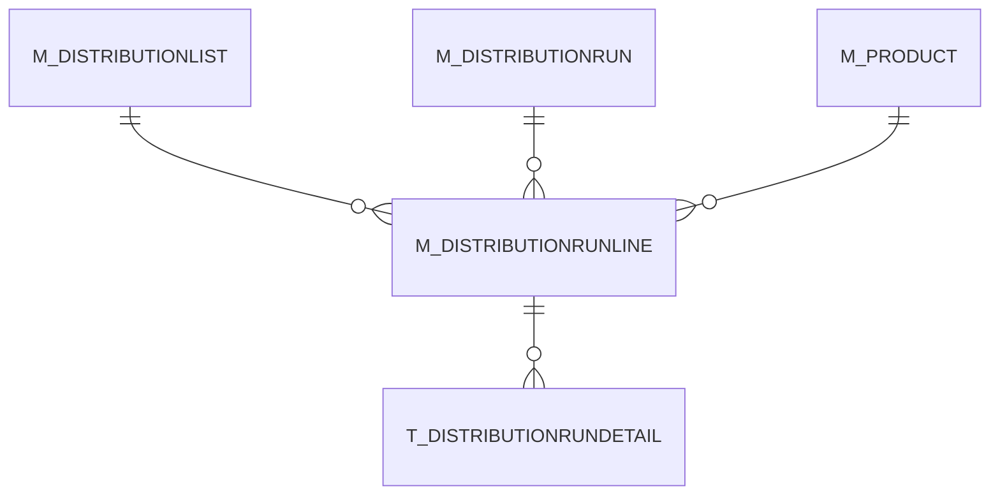

# M_DISTRIBUTIONRUNLINE

Area [M](../../data-model/m/index.md) · class **business** (proposed) · read from database `idempiere-db` (owner `ADEMPIERE`) · 1 row(s) when profiled

Application model: `org.compiere.model.X_M_DistributionRunLine`, access level 3 - Client - Org.

## Columns

| column | type | key | not null | business name | references (code) | nulls | distinct |
|---|---|---|---|---|---|---|---|
| `M_DISTRIBUTIONRUNLINE_ID` | NUMBER(10,0) | PK | yes | Distribution Run Line |  | 0 | 1 |
| `AD_CLIENT_ID` | NUMBER(10,0) |  | yes | Tenant |  | 0 | 1 |
| `AD_ORG_ID` | NUMBER(10,0) |  | yes | Organization |  | 0 | 1 |
| `ISACTIVE` | CHAR(1) |  | yes | Active |  | 0 | 1 |
| `CREATED` | DATE |  | yes | Created |  | 0 | 1 |
| `CREATEDBY` | NUMBER(10,0) |  | yes | Created By |  | 0 | 1 |
| `UPDATED` | DATE |  | yes | Updated |  | 0 | 1 |
| `UPDATEDBY` | NUMBER(10,0) |  | yes | Updated By |  | 0 | 1 |
| `M_DISTRIBUTIONRUN_ID` | NUMBER(10,0) |  | yes | Distribution Run | [M_DISTRIBUTIONRUN](../../data-model/m/m_distributionrun.md) | 0 | 1 |
| `LINE` | NUMBER(10,0) |  | yes | Line No |  | 0 | 1 |
| `DESCRIPTION` | VARCHAR2(255 CHAR) |  |  | Description |  | 1 | 0 |
| `M_DISTRIBUTIONLIST_ID` | NUMBER(10,0) |  | yes | Distribution List | [M_DISTRIBUTIONLIST](../../data-model/m/m_distributionlist.md) | 0 | 1 |
| `M_PRODUCT_ID` | NUMBER(10,0) |  | yes | Product | [M_PRODUCT](../../data-model/m/m_product.md) | 0 | 1 |
| `TOTALQTY` | NUMBER |  | yes | Total Quantity |  | 0 | 1 |
| `MINQTY` | NUMBER |  | yes | Minimum Quantity |  | 0 | 1 |
| `M_DISTRIBUTIONRUNLINE_UU` | VARCHAR2(36 CHAR) |  |  | M_DistributionRunLine_UU |  | 0 | 1 |

*references (code)* is the table the application model's code says a column points to; *Foreign keys* below are the constraints the database declares. Counts come from the profile; no value is ever shown.

## Check constraints

| name | expression |
|---|---|
| `SYS_C0021938` | `IsActive in ('Y','N')` |

## Foreign keys

**References**

| table | columns | on delete |
|---|---|---|
| [M_DISTRIBUTIONLIST](../../data-model/m/m_distributionlist.md) | M_DISTRIBUTIONRUNLINE.M_DISTRIBUTIONLIST_ID → M_DISTRIBUTIONLIST.M_DISTRIBUTIONLIST_ID | CASCADE |
| [M_DISTRIBUTIONRUN](../../data-model/m/m_distributionrun.md) | M_DISTRIBUTIONRUNLINE.M_DISTRIBUTIONRUN_ID → M_DISTRIBUTIONRUN.M_DISTRIBUTIONRUN_ID | CASCADE |
| [M_PRODUCT](../../data-model/m/m_product.md) | M_DISTRIBUTIONRUNLINE.M_PRODUCT_ID → M_PRODUCT.M_PRODUCT_ID | NO ACTION |

**Referenced by**

| table | columns | on delete |
|---|---|---|
| `T_DISTRIBUTIONRUNDETAIL` | T_DISTRIBUTIONRUNDETAIL.M_DISTRIBUTIONRUNLINE_ID → M_DISTRIBUTIONRUNLINE.M_DISTRIBUTIONRUNLINE_ID | CASCADE |

## Write behaviour

- updates: **raw_sql_skips_updated**
- deletes: **deleted_by_users, deleted_by_cascade**
- change log: **recorded**
- evidence: 6 citation(s)

## Schema history

14 change(s); the latest:

| applied | release | operation | column | tickets |
|---|---|---|---|---|
| 2023-04-09T15:47 | iD11 | `add_constraint` |  | IDEMPIERE-5567 |
| 2023-04-09T15:47 | iD11 | `add_constraint` |  | IDEMPIERE-5567 |
| 2021-12-05T16:45 | i8.2z | `add_constraint` |  | IDEMPIERE-5075 |
| 2021-12-05T16:45 | i8.2z | `drop_constraint` |  | IDEMPIERE-5075 |
| 2021-12-05T16:45 | i8.2z | `add_constraint` |  | IDEMPIERE-5075 |
| 2021-12-05T16:45 | i8.2z | `drop_constraint` |  | IDEMPIERE-5075 |
| 2021-12-05T16:45 | i8.2z | `drop_constraint` |  | IDEMPIERE-5075 |
| 2021-12-05T16:45 | i8.2z | `add_constraint` |  | IDEMPIERE-5075 |
| 2020-08-04T01:00 | i7.1z | `add_column` | tmp_col_1_tmp | IDEMPIERE-3862 |
| 2020-08-04T01:00 | i7.1z | `add_column` | tmp_col_2_tmp | IDEMPIERE-3862 |
| 2020-08-04T01:00 | i7.1z | `modify_column` | DESCRIPTION | IDEMPIERE-3862 |
| 2020-08-04T01:00 | i7.1z | `drop_column` | tmp_col_2_tmp | IDEMPIERE-3862 |
| 2020-08-04T01:00 | i7.1z | `drop_column` | tmp_col_1_tmp | IDEMPIERE-3862 |
| 2020-08-04T01:00 | i7.1z | `modify_column` | M_DISTRIBUTIONRUNLINE_UU | IDEMPIERE-3862 |

## Notes

<!-- ekos:manual id="table.m_distributionrunline.notes" -->
_Business notes about this table._
<!-- /ekos:manual -->
