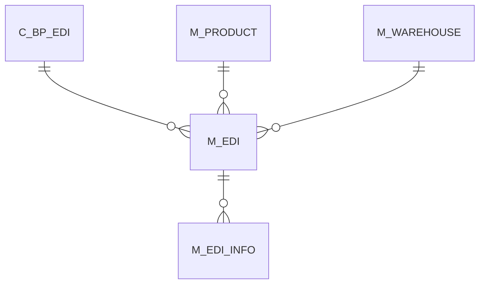

# M_EDI

Area [M](../../data-model/m/index.md) · class **business** (proposed) · read from database `idempiere-db` (owner `ADEMPIERE`) · 0 row(s) when profiled

## Columns

| column | type | key | not null | business name | references (code) | nulls | distinct |
|---|---|---|---|---|---|---|---|
| `M_EDI_ID` | NUMBER(10,0) | PK | yes |  |  | 0 | 0 |
| `AD_CLIENT_ID` | NUMBER(10,0) |  | yes |  |  | 0 | 0 |
| `AD_ORG_ID` | NUMBER(10,0) |  | yes |  |  | 0 | 0 |
| `ISACTIVE` | CHAR(1) |  | yes |  |  | 0 | 0 |
| `CREATED` | DATE |  | yes |  |  | 0 | 0 |
| `CREATEDBY` | NUMBER(10,0) |  | yes |  |  | 0 | 0 |
| `UPDATED` | DATE |  | yes |  |  | 0 | 0 |
| `UPDATEDBY` | NUMBER(10,0) |  | yes |  |  | 0 | 0 |
| `C_BP_EDI_ID` | NUMBER(10,0) |  | yes |  |  | 0 | 0 |
| `DOCUMENTNO` | VARCHAR2(30 CHAR) |  | yes |  |  | 0 | 0 |
| `LINE` | NUMBER(10,0) |  | yes |  |  | 0 | 0 |
| `TRXTYPE` | CHAR(1) |  | yes |  |  | 0 | 0 |
| `EDISTATUS` | CHAR(1) |  | yes |  |  | 0 | 0 |
| `M_WAREHOUSE_ID` | NUMBER(10,0) |  | yes |  |  | 0 | 0 |
| `M_PRODUCT_ID` | NUMBER(10,0) |  | yes |  |  | 0 | 0 |
| `REQUEST_QTY` | NUMBER |  | yes |  |  | 0 | 0 |
| `REQUEST_SHIPDATE` | DATE |  | yes |  |  | 0 | 0 |
| `REQUEST_PRICE` | NUMBER |  |  |  |  | 0 | 0 |
| `TRXSENT` | DATE |  | yes |  |  | 0 | 0 |
| `TRXRECEIVED` | DATE |  |  |  |  | 0 | 0 |
| `REPLY_RECEIVED` | DATE |  |  |  |  | 0 | 0 |
| `REPLY_QTYCONFIRMED` | NUMBER |  |  |  |  | 0 | 0 |
| `REPLY_QTYAVAILABLE` | NUMBER |  |  |  |  | 0 | 0 |
| `REPLY_SHIPDATE` | DATE |  |  |  |  | 0 | 0 |
| `REPLY_PRICE` | NUMBER |  |  |  |  | 0 | 0 |
| `REPLY_REMARKS` | VARCHAR2(2000 CHAR) |  |  |  |  | 0 | 0 |
| `PROCESSED` | CHAR(1) |  | yes |  |  | 0 | 0 |

*references (code)* is the table the application model's code says a column points to; *Foreign keys* below are the constraints the database declares. Counts come from the profile; no value is ever shown.

## Check constraints

| name | expression |
|---|---|
| `SYS_C0021340` | `Processed in ('Y','N')` |
| `SYS_C0021342` | `IsActive in ('Y','N')` |

## Foreign keys

**References**

| table | columns | on delete |
|---|---|---|
| [C_BP_EDI](../../data-model/c/c_bp_edi.md) | M_EDI.C_BP_EDI_ID → C_BP_EDI.C_BP_EDI_ID | NO ACTION |
| [M_PRODUCT](../../data-model/m/m_product.md) | M_EDI.M_PRODUCT_ID → M_PRODUCT.M_PRODUCT_ID | NO ACTION |
| [M_WAREHOUSE](../../data-model/m/m_warehouse.md) | M_EDI.M_WAREHOUSE_ID → M_WAREHOUSE.M_WAREHOUSE_ID | NO ACTION |

**Referenced by**

| table | columns | on delete |
|---|---|---|
| [M_EDI_INFO](../../data-model/m/m_edi_info.md) | M_EDI_INFO.M_EDI_ID → M_EDI.M_EDI_ID | NO ACTION |

## Write behaviour

- updates: **po_only**
- deletes: **deleted_by_users**
- change log: **recorded**
- evidence: 1 citation(s)

## Schema history

15 change(s); the latest:

| applied | release | operation | column | tickets |
|---|---|---|---|---|
| 2021-12-05T16:45 | i8.2z | `drop_constraint` |  | IDEMPIERE-5075 |
| 2021-12-05T16:45 | i8.2z | `drop_constraint` |  | IDEMPIERE-5075 |
| 2021-12-05T16:45 | i8.2z | `add_constraint` |  | IDEMPIERE-5075 |
| 2021-12-05T16:45 | i8.2z | `add_constraint` |  | IDEMPIERE-5075 |
| 2021-12-05T16:45 | i8.2z | `drop_constraint` |  | IDEMPIERE-5075 |
| 2021-12-05T16:45 | i8.2z | `add_constraint` |  | IDEMPIERE-5075 |
| 2020-08-04T01:00 | i7.1z | `add_column` | tmp_col_1_tmp | IDEMPIERE-3862 |
| 2020-08-04T01:00 | i7.1z | `modify_column` | DOCUMENTNO | IDEMPIERE-3862 |
| 2020-08-04T01:00 | i7.1z | `create_index` |  | IDEMPIERE-3862 |
| 2020-08-04T01:00 | i7.1z | `modify_column` | DOCUMENTNO | IDEMPIERE-3862 |
| 2020-08-04T01:00 | i7.1z | `modify_column` | REPLY_REMARKS | IDEMPIERE-3862 |
| 2020-08-04T01:00 | i7.1z | `drop_column` | tmp_col_1_tmp | IDEMPIERE-3862 |
| 2020-08-04T01:00 | i7.1z | `modify_column` | DOCUMENTNO | IDEMPIERE-3862 |
| 2020-08-04T01:00 | i7.1z | `add_column` | tmp_col_2_tmp | IDEMPIERE-3862 |
| 2020-08-04T01:00 | i7.1z | `drop_column` | tmp_col_2_tmp | IDEMPIERE-3862 |

## Open conflicts

| type | attribute | explanation |
|---|---|---|
| `table_without_model` | `model_class` | unexplained |

## Notes

<!-- ekos:manual id="table.m_edi.notes" -->
_Business notes about this table._
<!-- /ekos:manual -->
