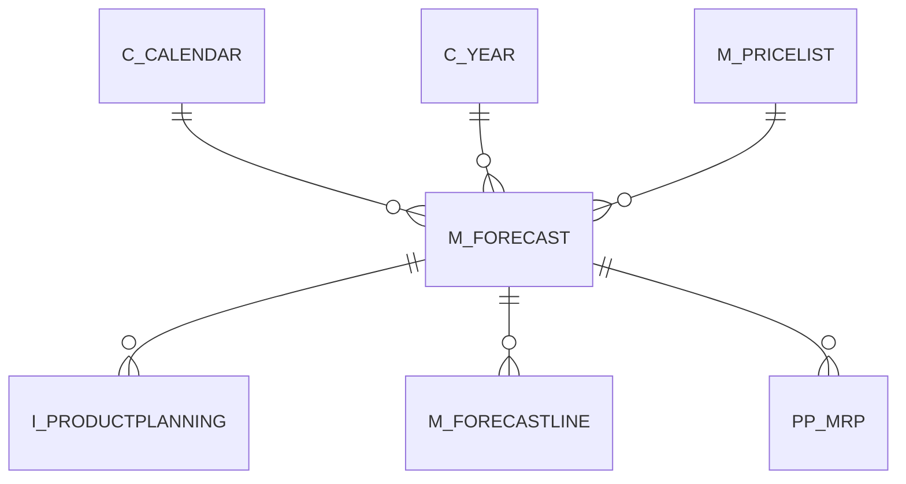

# M_FORECAST

Area [M](../../data-model/m/index.md) · class **business** (proposed) · read from database `idempiere-db` (owner `ADEMPIERE`) · 4 row(s) when profiled

Application model: `org.compiere.model.X_M_Forecast`, access level 3 - Client - Org.

## Columns

| column | type | key | not null | business name | references (code) | nulls | distinct |
|---|---|---|---|---|---|---|---|
| `M_FORECAST_ID` | NUMBER(10,0) | PK | yes | Forecast |  | 0 | 4 |
| `AD_CLIENT_ID` | NUMBER(10,0) |  | yes | Tenant |  | 0 | 1 |
| `AD_ORG_ID` | NUMBER(10,0) |  | yes | Organization |  | 0 | 3 |
| `ISACTIVE` | CHAR(1) |  | yes | Active |  | 0 | 1 |
| `CREATED` | DATE |  | yes | Created |  | 0 | 4 |
| `CREATEDBY` | NUMBER(10,0) |  | yes | Created By |  | 0 | 1 |
| `UPDATED` | DATE |  | yes | Updated |  | 0 | 4 |
| `UPDATEDBY` | NUMBER(10,0) |  | yes | Updated By |  | 0 | 1 |
| `NAME` | VARCHAR2(60 CHAR) |  | yes | Name |  | 0 | 3 |
| `DESCRIPTION` | VARCHAR2(255 CHAR) |  |  | Description |  | 0 | 3 |
| `HELP` | VARCHAR2(2000 CHAR) |  |  | Comment/Help |  | 4 | 0 |
| `ISDEFAULT` | CHAR(1) |  | yes | Default |  | 0 | 1 |
| `C_CALENDAR_ID` | NUMBER(10,0) |  | yes | Calendar | [C_CALENDAR](../../data-model/c/c_calendar.md) | 0 | 1 |
| `C_YEAR_ID` | NUMBER(10,0) |  | yes | Year | [C_YEAR](../../data-model/c/c_year.md) | 0 | 1 |
| `PROCESSING` | CHAR(1) |  |  | Process Now |  | 0 | 1 |
| `M_PRICELIST_ID` | NUMBER(10,0) |  |  | Price List | [M_PRICELIST](../../data-model/m/m_pricelist.md) | 0 | 1 |
| `M_FORECAST_UU` | VARCHAR2(36 CHAR) |  |  | M_Forecast_UU |  | 0 | 4 |

*references (code)* is the table the application model's code says a column points to; *Foreign keys* below are the constraints the database declares. Counts come from the profile; no value is ever shown.

## Check constraints

| name | expression |
|---|---|
| `SYS_C0021092` | `IsDefault in ('Y','N')` |
| `SYS_C0021093` | `IsActive in ('Y','N')` |

## Foreign keys

**References**

| table | columns | on delete |
|---|---|---|
| [C_CALENDAR](../../data-model/c/c_calendar.md) | M_FORECAST.C_CALENDAR_ID → C_CALENDAR.C_CALENDAR_ID | NO ACTION |
| [C_YEAR](../../data-model/c/c_year.md) | M_FORECAST.C_YEAR_ID → C_YEAR.C_YEAR_ID | NO ACTION |
| [M_PRICELIST](../../data-model/m/m_pricelist.md) | M_FORECAST.M_PRICELIST_ID → M_PRICELIST.M_PRICELIST_ID | NO ACTION |

**Referenced by**

| table | columns | on delete |
|---|---|---|
| `I_PRODUCTPLANNING` | I_PRODUCTPLANNING.M_FORECAST_ID → M_FORECAST.M_FORECAST_ID | NO ACTION |
| [M_FORECASTLINE](../../data-model/m/m_forecastline.md) | M_FORECASTLINE.M_FORECAST_ID → M_FORECAST.M_FORECAST_ID | CASCADE |
| [PP_MRP](../../data-model/pp/pp_mrp.md) | PP_MRP.M_FORECAST_ID → M_FORECAST.M_FORECAST_ID | NO ACTION |

## Write behaviour

- updates: **po_only**
- deletes: **deleted_by_users**
- change log: **recorded**
- evidence: 1 citation(s)

## Read by

| kind | name |
|---|---|
| Procedure | [documentNo](../../logic/documentno.md) |
| View | `RV_M_FORECAST` |
| View | `rv_m_forecast` |

## Schema history

22 change(s); the latest:

| applied | release | operation | column | tickets |
|---|---|---|---|---|
| 2023-04-09T15:47 | iD11 | `add_constraint` |  | IDEMPIERE-5567 |
| 2023-04-09T15:47 | iD11 | `add_constraint` |  | IDEMPIERE-5567 |
| 2021-12-05T16:45 | i8.2z | `drop_constraint` |  | IDEMPIERE-5075 |
| 2021-12-05T16:45 | i8.2z | `add_constraint` |  | IDEMPIERE-5075 |
| 2021-12-05T16:45 | i8.2z | `add_constraint` |  | IDEMPIERE-5075 |
| 2021-12-05T16:45 | i8.2z | `drop_constraint` |  | IDEMPIERE-5075 |
| 2021-12-05T16:45 | i8.2z | `drop_constraint` |  | IDEMPIERE-5075 |
| 2021-12-05T16:45 | i8.2z | `add_constraint` |  | IDEMPIERE-5075 |
| 2020-08-04T01:00 | i7.1z | `add_column` | tmp_col_3_tmp | IDEMPIERE-3862 |
| 2020-08-04T01:00 | i7.1z | `drop_column` | tmp_col_1_tmp | IDEMPIERE-3862 |
| 2020-08-04T01:00 | i7.1z | `drop_column` | tmp_col_3_tmp | IDEMPIERE-3862 |
| 2020-08-04T01:00 | i7.1z | `modify_column` | M_FORECAST_UU | IDEMPIERE-3862 |
| 2020-08-04T01:00 | i7.1z | `drop_column` | tmp_col_2_tmp | IDEMPIERE-3862 |
| 2020-08-04T01:00 | i7.1z | `add_column` | tmp_col_2_tmp | IDEMPIERE-3862 |
| 2020-08-04T01:00 | i7.1z | `modify_column` | NAME | IDEMPIERE-3862 |

## Notes

<!-- ekos:manual id="table.m_forecast.notes" -->
_Business notes about this table._
<!-- /ekos:manual -->
