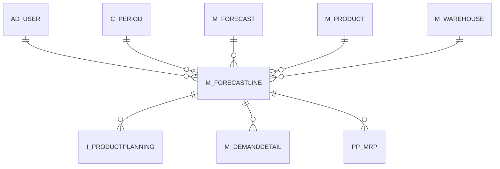

# M_FORECASTLINE

Area [M](../../data-model/m/index.md) · class **business** (proposed) · read from database `idempiere-db` (owner `ADEMPIERE`) · 50 row(s) when profiled

Application model: `org.compiere.model.X_M_ForecastLine`, access level 3 - Client - Org.

## Columns

| column | type | key | not null | business name | references (code) | nulls | distinct |
|---|---|---|---|---|---|---|---|
| `M_FORECASTLINE_ID` | NUMBER(10,0) | PK | yes | Forecast Line |  | 0 | 50 |
| `AD_CLIENT_ID` | NUMBER(10,0) |  | yes | Tenant |  | 0 | 1 |
| `AD_ORG_ID` | NUMBER(10,0) |  | yes | Organization |  | 0 | 3 |
| `ISACTIVE` | CHAR(1) |  | yes | Active |  | 0 | 1 |
| `CREATED` | DATE |  | yes | Created |  | 0 | 50 |
| `CREATEDBY` | NUMBER(10,0) |  | yes | Created By |  | 0 | 1 |
| `UPDATED` | DATE |  | yes | Updated |  | 0 | 50 |
| `UPDATEDBY` | NUMBER(10,0) |  | yes | Updated By |  | 0 | 1 |
| `M_FORECAST_ID` | NUMBER(10,0) |  | yes | Forecast | [M_FORECAST](../../data-model/m/m_forecast.md) | 0 | 4 |
| `C_PERIOD_ID` | NUMBER(10,0) |  | yes | Period | [C_PERIOD](../../data-model/c/c_period.md) | 0 | 4 |
| `QTY` | NUMBER |  | yes | Quantity |  | 0 | 8 |
| `M_PRODUCT_ID` | NUMBER(10,0) |  | yes | Product | [M_PRODUCT](../../data-model/m/m_product.md) | 0 | 3 |
| `QTYCALCULATED` | NUMBER |  | yes | Calculated Quantity |  | 0 | 1 |
| `M_WAREHOUSE_ID` | NUMBER(10,0) |  | yes | Warehouse | [M_WAREHOUSE](../../data-model/m/m_warehouse.md) | 0 | 3 |
| `DATEPROMISED` | DATE |  | yes | Date Promised |  | 0 | 4 |
| `SALESREP_ID` | NUMBER(10,0) |  |  | Sales Representative | [AD_USER](../../data-model/ad/ad_user.md) | 0 | 2 |
| `M_FORECASTLINE_UU` | VARCHAR2(36 CHAR) |  |  | M_ForecastLine_UU |  | 0 | 50 |

*references (code)* is the table the application model's code says a column points to; *Foreign keys* below are the constraints the database declares. Counts come from the profile; no value is ever shown.

## Check constraints

| name | expression |
|---|---|
| `SYS_C0022131` | `IsActive in ('Y','N')` |

## Foreign keys

**References**

| table | columns | on delete |
|---|---|---|
| [AD_USER](../../data-model/ad/ad_user.md) | M_FORECASTLINE.SALESREP_ID → AD_USER.AD_USER_ID | NO ACTION |
| [C_PERIOD](../../data-model/c/c_period.md) | M_FORECASTLINE.C_PERIOD_ID → C_PERIOD.C_PERIOD_ID | NO ACTION |
| [M_FORECAST](../../data-model/m/m_forecast.md) | M_FORECASTLINE.M_FORECAST_ID → M_FORECAST.M_FORECAST_ID | CASCADE |
| [M_PRODUCT](../../data-model/m/m_product.md) | M_FORECASTLINE.M_PRODUCT_ID → M_PRODUCT.M_PRODUCT_ID | CASCADE |
| [M_WAREHOUSE](../../data-model/m/m_warehouse.md) | M_FORECASTLINE.M_WAREHOUSE_ID → M_WAREHOUSE.M_WAREHOUSE_ID | NO ACTION |

**Referenced by**

| table | columns | on delete |
|---|---|---|
| `I_PRODUCTPLANNING` | I_PRODUCTPLANNING.M_FORECASTLINE_ID → M_FORECASTLINE.M_FORECASTLINE_ID | NO ACTION |
| [M_DEMANDDETAIL](../../data-model/m/m_demanddetail.md) | M_DEMANDDETAIL.M_FORECASTLINE_ID → M_FORECASTLINE.M_FORECASTLINE_ID | CASCADE |
| [PP_MRP](../../data-model/pp/pp_mrp.md) | PP_MRP.M_FORECASTLINE_ID → M_FORECASTLINE.M_FORECASTLINE_ID | NO ACTION |

## Write behaviour

- updates: **po_only**
- deletes: **deleted_by_users, deleted_by_cascade**
- change log: **recorded**
- evidence: 3 citation(s)

## Read by

| kind | name |
|---|---|
| View | `RV_M_FORECAST` |
| View | `rv_m_forecast` |

## Schema history

15 change(s); the latest:

| applied | release | operation | column | tickets |
|---|---|---|---|---|
| 2023-04-09T15:47 | iD11 | `add_constraint` |  | IDEMPIERE-5567 |
| 2023-04-09T15:47 | iD11 | `add_constraint` |  | IDEMPIERE-5567 |
| 2021-12-05T16:45 | i8.2z | `add_constraint` |  | IDEMPIERE-5075 |
| 2021-12-05T16:45 | i8.2z | `drop_constraint` |  | IDEMPIERE-5075 |
| 2021-12-05T16:45 | i8.2z | `add_constraint` |  | IDEMPIERE-5075 |
| 2021-12-05T16:45 | i8.2z | `add_constraint` |  | IDEMPIERE-5075 |
| 2021-12-05T16:45 | i8.2z | `add_constraint` |  | IDEMPIERE-5075 |
| 2021-12-05T16:45 | i8.2z | `drop_constraint` |  | IDEMPIERE-5075 |
| 2021-12-05T16:45 | i8.2z | `drop_constraint` |  | IDEMPIERE-5075 |
| 2021-12-05T16:45 | i8.2z | `drop_constraint` |  | IDEMPIERE-5075 |
| 2020-08-04T01:00 | i7.1z | `add_column` | tmp_col_1_tmp | IDEMPIERE-3862 |
| 2020-08-04T01:00 | i7.1z | `drop_column` | tmp_col_1_tmp | IDEMPIERE-3862 |
| 2020-08-04T01:00 | i7.1z | `modify_column` | M_FORECASTLINE_UU | IDEMPIERE-3862 |
| 2013-04-18T15:26 | i1.0a-i1.0b | `add_constraint` |  |  |
| 2013-04-18T15:26 | i1.0a-i1.0b | `add_constraint` |  |  |

## Notes

<!-- ekos:manual id="table.m_forecastline.notes" -->
_Business notes about this table._
<!-- /ekos:manual -->
