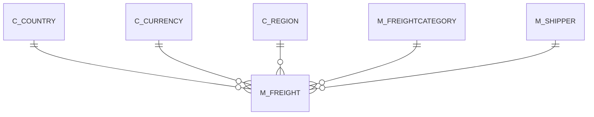

# M_FREIGHT

Area [M](../../data-model/m/index.md) · class **business** (proposed) · read from database `idempiere-db` (owner `ADEMPIERE`) · 3 row(s) when profiled

Application model: `org.compiere.model.X_M_Freight`, access level 3 - Client - Org.

## Columns

| column | type | key | not null | business name | references (code) | nulls | distinct |
|---|---|---|---|---|---|---|---|
| `M_FREIGHT_ID` | NUMBER(10,0) | PK | yes | Freight |  | 0 | 3 |
| `AD_CLIENT_ID` | NUMBER(10,0) |  | yes | Tenant |  | 0 | 1 |
| `AD_ORG_ID` | NUMBER(10,0) |  | yes | Organization |  | 0 | 1 |
| `ISACTIVE` | CHAR(1) |  | yes | Active |  | 0 | 1 |
| `CREATED` | DATE |  | yes | Created |  | 0 | 3 |
| `CREATEDBY` | NUMBER(10,0) |  | yes | Created By |  | 0 | 1 |
| `UPDATED` | DATE |  | yes | Updated |  | 0 | 3 |
| `UPDATEDBY` | NUMBER(10,0) |  | yes | Updated By |  | 0 | 1 |
| `M_SHIPPER_ID` | NUMBER(10,0) |  | yes | Shipper | [M_SHIPPER](../../data-model/m/m_shipper.md) | 0 | 1 |
| `M_FREIGHTCATEGORY_ID` | NUMBER(10,0) |  | yes | Freight Category | [M_FREIGHTCATEGORY](../../data-model/m/m_freightcategory.md) | 0 | 1 |
| `VALIDFROM` | DATE |  | yes | Valid from |  | 0 | 1 |
| `C_COUNTRY_ID` | NUMBER(10,0) |  |  | Country | [C_COUNTRY](../../data-model/c/c_country.md) | 0 | 1 |
| `TO_COUNTRY_ID` | NUMBER(10,0) |  |  | To |  | 0 | 1 |
| `C_REGION_ID` | NUMBER(10,0) |  |  | Region | [C_REGION](../../data-model/c/c_region.md) | 3 | 0 |
| `TO_REGION_ID` | NUMBER(10,0) |  |  | To | [C_REGION](../../data-model/c/c_region.md) | 3 | 0 |
| `C_CURRENCY_ID` | NUMBER(10,0) |  | yes | Currency | [C_CURRENCY](../../data-model/c/c_currency.md) | 0 | 1 |
| `FREIGHTAMT` | NUMBER |  | yes | Freight Amount |  | 0 | 3 |
| `M_FREIGHT_UU` | VARCHAR2(36 CHAR) |  |  | M_Freight_UU |  | 0 | 3 |
| `MAXWEIGHT` | NUMBER |  |  | Max Weight |  | 0 | 3 |
| `MAXDIMENSION` | NUMBER |  |  | Max Dimension |  | 0 | 1 |

*references (code)* is the table the application model's code says a column points to; *Foreign keys* below are the constraints the database declares. Counts come from the profile; no value is ever shown.

## Foreign keys

**References**

| table | columns | on delete |
|---|---|---|
| [C_COUNTRY](../../data-model/c/c_country.md) | M_FREIGHT.TO_COUNTRY_ID → C_COUNTRY.C_COUNTRY_ID | NO ACTION |
| [C_CURRENCY](../../data-model/c/c_currency.md) | M_FREIGHT.C_CURRENCY_ID → C_CURRENCY.C_CURRENCY_ID | NO ACTION |
| [C_REGION](../../data-model/c/c_region.md) | M_FREIGHT.TO_REGION_ID → C_REGION.C_REGION_ID | NO ACTION |
| [M_FREIGHTCATEGORY](../../data-model/m/m_freightcategory.md) | M_FREIGHT.M_FREIGHTCATEGORY_ID → M_FREIGHTCATEGORY.M_FREIGHTCATEGORY_ID | NO ACTION |
| [M_SHIPPER](../../data-model/m/m_shipper.md) | M_FREIGHT.M_SHIPPER_ID → M_SHIPPER.M_SHIPPER_ID | NO ACTION |

**Referenced by**

_None._

## Write behaviour

- updates: **po_only**
- deletes: **deleted_by_users**
- change log: **recorded**
- evidence: 1 citation(s)

## Schema history

23 change(s); the latest:

| applied | release | operation | column | tickets |
|---|---|---|---|---|
| 2023-04-09T15:47 | iD11 | `add_constraint` |  | IDEMPIERE-5567 |
| 2023-04-09T15:47 | iD11 | `add_constraint` |  | IDEMPIERE-5567 |
| 2021-12-05T16:45 | i8.2z | `drop_constraint` |  | IDEMPIERE-5075 |
| 2021-12-05T16:45 | i8.2z | `add_constraint` |  | IDEMPIERE-5075 |
| 2021-12-05T16:45 | i8.2z | `drop_constraint` |  | IDEMPIERE-5075 |
| 2021-12-05T16:45 | i8.2z | `add_constraint` |  | IDEMPIERE-5075 |
| 2021-12-05T16:45 | i8.2z | `add_constraint` |  | IDEMPIERE-5075 |
| 2021-12-05T16:45 | i8.2z | `add_constraint` |  | IDEMPIERE-5075 |
| 2021-12-05T16:45 | i8.2z | `add_constraint` |  | IDEMPIERE-5075 |
| 2021-12-05T16:45 | i8.2z | `drop_constraint` |  | IDEMPIERE-5075 |
| 2021-12-05T16:45 | i8.2z | `drop_constraint` |  | IDEMPIERE-5075 |
| 2021-12-05T16:45 | i8.2z | `add_constraint` |  | IDEMPIERE-5075 |
| 2021-12-05T16:45 | i8.2z | `add_constraint` |  | IDEMPIERE-5075 |
| 2021-12-05T16:45 | i8.2z | `drop_constraint` |  | IDEMPIERE-5075 |
| 2021-12-05T16:45 | i8.2z | `drop_constraint` |  | IDEMPIERE-5075 |

## Notes

<!-- ekos:manual id="table.m_freight.notes" -->
_Business notes about this table._
<!-- /ekos:manual -->
