# M_INOUTLINE

Area [M](../../data-model/m/index.md) · class **business** (proposed) · read from database `idempiere-db` (owner `ADEMPIERE`) · 27 row(s) when profiled

Application model: `org.compiere.model.X_M_InOutLine`, access level 1 - Org.

## Columns

| column | type | key | not null | business name | references (code) | nulls | distinct |
|---|---|---|---|---|---|---|---|
| `M_INOUTLINE_ID` | NUMBER(10,0) | PK | yes | Shipment/Receipt Line |  | 0 | 27 |
| `AD_CLIENT_ID` | NUMBER(10,0) |  | yes | Tenant |  | 0 | 1 |
| `AD_ORG_ID` | NUMBER(10,0) |  | yes | Organization |  | 0 | 1 |
| `ISACTIVE` | CHAR(1) |  | yes | Active |  | 0 | 1 |
| `CREATED` | DATE |  | yes | Created |  | 0 | 10 |
| `CREATEDBY` | NUMBER(10,0) |  | yes | Created By |  | 0 | 2 |
| `UPDATED` | DATE |  | yes | Updated |  | 0 | 10 |
| `UPDATEDBY` | NUMBER(10,0) |  | yes | Updated By |  | 0 | 2 |
| `LINE` | NUMBER(10,0) |  | yes | Line No |  | 0 | 10 |
| `DESCRIPTION` | VARCHAR2(255 CHAR) |  |  | Description |  | 25 | 2 |
| `M_INOUT_ID` | NUMBER(10,0) |  | yes | Shipment/Receipt | [M_INOUT](../../data-model/m/m_inout.md) | 0 | 9 |
| `C_ORDERLINE_ID` | NUMBER(10,0) |  |  | Sales Order Line | [C_ORDERLINE](../../data-model/c/c_orderline.md) | 0 | 27 |
| `M_LOCATOR_ID` | NUMBER(10,0) |  |  | Locator | [M_LOCATOR](../../data-model/m/m_locator.md) | 1 | 1 |
| `M_PRODUCT_ID` | NUMBER(10,0) |  |  | Product | [M_PRODUCT](../../data-model/m/m_product.md) | 0 | 20 |
| `C_UOM_ID` | NUMBER(10,0) |  | yes | UOM | [C_UOM](../../data-model/c/c_uom.md) | 0 | 2 |
| `MOVEMENTQTY` | NUMBER |  | yes | Movement Quantity |  | 0 | 10 |
| `ISINVOICED` | CHAR(1) |  | yes | Invoiced |  | 0 | 2 |
| `M_ATTRIBUTESETINSTANCE_ID` | NUMBER(10,0) |  |  | Attribute Set Instance | [M_ATTRIBUTESETINSTANCE](../../data-model/m/m_attributesetinstance.md) | 0 | 1 |
| `ISDESCRIPTION` | CHAR(1) |  | yes | Description Only |  | 0 | 1 |
| `CONFIRMEDQTY` | NUMBER |  |  | Confirmed Quantity |  | 0 | 1 |
| `PICKEDQTY` | NUMBER |  |  | Picked Quantity |  | 0 | 1 |
| `SCRAPPEDQTY` | NUMBER |  |  | Scrapped Quantity |  | 0 | 1 |
| `TARGETQTY` | NUMBER |  |  | Target Quantity |  | 0 | 1 |
| `REF_INOUTLINE_ID` | NUMBER(10,0) |  |  | Referenced Shipment Line |  | 27 | 0 |
| `PROCESSED` | CHAR(1) |  | yes | Processed |  | 0 | 1 |
| `QTYENTERED` | NUMBER |  | yes | Quantity |  | 0 | 10 |
| `C_CHARGE_ID` | NUMBER(10,0) |  |  | Charge | [C_CHARGE](../../data-model/c/c_charge.md) | 27 | 0 |
| `C_PROJECT_ID` | NUMBER(10,0) |  |  | Project | [C_PROJECT](../../data-model/c/c_project.md) | 27 | 0 |
| `C_PROJECTPHASE_ID` | NUMBER(10,0) |  |  | Project Phase | [C_PROJECTPHASE](../../data-model/c/c_projectphase.md) | 27 | 0 |
| `C_PROJECTTASK_ID` | NUMBER(10,0) |  |  | Project Task | [C_PROJECTTASK](../../data-model/c/c_projecttask.md) | 27 | 0 |
| `C_CAMPAIGN_ID` | NUMBER(10,0) |  |  | Campaign | [C_CAMPAIGN](../../data-model/c/c_campaign.md) | 27 | 0 |
| `C_ACTIVITY_ID` | NUMBER(10,0) |  |  | Activity | [C_ACTIVITY](../../data-model/c/c_activity.md) | 27 | 0 |
| `USER1_ID` | NUMBER(10,0) |  |  | User Element List 1 | [C_ELEMENTVALUE](../../data-model/c/c_elementvalue.md) | 27 | 0 |
| `USER2_ID` | NUMBER(10,0) |  |  | User Element List 2 | [C_ELEMENTVALUE](../../data-model/c/c_elementvalue.md) | 27 | 0 |
| `AD_ORGTRX_ID` | NUMBER(10,0) |  |  | Trx Organization |  | 27 | 0 |
| `M_RMALINE_ID` | NUMBER(10,0) |  |  | RMA Line | [M_RMALINE](../../data-model/m/m_rmaline.md) | 27 | 0 |
| `REVERSALLINE_ID` | NUMBER(10,0) |  |  | Reversal Line | [M_INOUTLINE](../../data-model/m/m_inoutline.md) | 27 | 0 |
| `M_INOUTLINE_UU` | VARCHAR2(36 CHAR) |  |  | M_InOutLine_UU |  | 0 | 27 |
| `QTYOVERRECEIPT` | NUMBER |  |  |  |  | 0 | 1 |
| `ISAUTOPRODUCE` | CHAR(1) |  |  | Auto Produce |  | 0 | 1 |

*references (code)* is the table the application model's code says a column points to; *Foreign keys* below are the constraints the database declares. Counts come from the profile; no value is ever shown.

## Check constraints

| name | expression |
|---|---|
| `SYS_C0019452` | `IsAutoProduce IN ('Y','N')` |
| `SYS_C0019453` | `IsActive in ('Y','N')` |
| `SYS_C0019455` | `IsInvoiced in ('Y','N')` |

## Foreign keys

**References**

| table | columns | on delete |
|---|---|---|
| [AD_ORG](../../data-model/ad/ad_org.md) | M_INOUTLINE.AD_ORGTRX_ID → AD_ORG.AD_ORG_ID | NO ACTION |
| [C_ACTIVITY](../../data-model/c/c_activity.md) | M_INOUTLINE.C_ACTIVITY_ID → C_ACTIVITY.C_ACTIVITY_ID | NO ACTION |
| [C_CAMPAIGN](../../data-model/c/c_campaign.md) | M_INOUTLINE.C_CAMPAIGN_ID → C_CAMPAIGN.C_CAMPAIGN_ID | NO ACTION |
| [C_CHARGE](../../data-model/c/c_charge.md) | M_INOUTLINE.C_CHARGE_ID → C_CHARGE.C_CHARGE_ID | NO ACTION |
| [C_ELEMENTVALUE](../../data-model/c/c_elementvalue.md) | M_INOUTLINE.USER1_ID → C_ELEMENTVALUE.C_ELEMENTVALUE_ID | NO ACTION |
| [C_ORDERLINE](../../data-model/c/c_orderline.md) | M_INOUTLINE.C_ORDERLINE_ID → C_ORDERLINE.C_ORDERLINE_ID | NO ACTION |
| [C_PROJECT](../../data-model/c/c_project.md) | M_INOUTLINE.C_PROJECT_ID → C_PROJECT.C_PROJECT_ID | NO ACTION |
| [C_PROJECTPHASE](../../data-model/c/c_projectphase.md) | M_INOUTLINE.C_PROJECTPHASE_ID → C_PROJECTPHASE.C_PROJECTPHASE_ID | NO ACTION |
| [C_PROJECTTASK](../../data-model/c/c_projecttask.md) | M_INOUTLINE.C_PROJECTTASK_ID → C_PROJECTTASK.C_PROJECTTASK_ID | NO ACTION |
| [C_UOM](../../data-model/c/c_uom.md) | M_INOUTLINE.C_UOM_ID → C_UOM.C_UOM_ID | NO ACTION |
| [M_ATTRIBUTESETINSTANCE](../../data-model/m/m_attributesetinstance.md) | M_INOUTLINE.M_ATTRIBUTESETINSTANCE_ID → M_ATTRIBUTESETINSTANCE.M_ATTRIBUTESETINSTANCE_ID | NO ACTION |
| [M_INOUT](../../data-model/m/m_inout.md) | M_INOUTLINE.M_INOUT_ID → M_INOUT.M_INOUT_ID | CASCADE |
| [M_INOUTLINE](../../data-model/m/m_inoutline.md) | M_INOUTLINE.REF_INOUTLINE_ID → M_INOUTLINE.M_INOUTLINE_ID | NO ACTION |
| [M_LOCATOR](../../data-model/m/m_locator.md) | M_INOUTLINE.M_LOCATOR_ID → M_LOCATOR.M_LOCATOR_ID | NO ACTION |
| [M_PRODUCT](../../data-model/m/m_product.md) | M_INOUTLINE.M_PRODUCT_ID → M_PRODUCT.M_PRODUCT_ID | NO ACTION |
| [M_RMALINE](../../data-model/m/m_rmaline.md) | M_INOUTLINE.M_RMALINE_ID → M_RMALINE.M_RMALINE_ID | NO ACTION |

**Referenced by**

| table | columns | on delete |
|---|---|---|
| [A_ASSET](../../data-model/a/a_asset.md) | A_ASSET.M_INOUTLINE_ID → M_INOUTLINE.M_INOUTLINE_ID | NO ACTION |
| [A_ASSET_ADDITION](../../data-model/a/a_asset_addition.md) | A_ASSET_ADDITION.M_INOUTLINE_ID → M_INOUTLINE.M_INOUTLINE_ID | NO ACTION |
| [A_ASSET_DELIVERY](../../data-model/a/a_asset_delivery.md) | A_ASSET_DELIVERY.M_INOUTLINE_ID → M_INOUTLINE.M_INOUTLINE_ID | CASCADE |
| [C_INVOICELINE](../../data-model/c/c_invoiceline.md) | C_INVOICELINE.M_INOUTLINE_ID → M_INOUTLINE.M_INOUTLINE_ID | NO ACTION |
| [C_LANDEDCOST](../../data-model/c/c_landedcost.md) | C_LANDEDCOST.M_INOUTLINE_ID → M_INOUTLINE.M_INOUTLINE_ID | NO ACTION |
| [C_LANDEDCOSTALLOCATION](../../data-model/c/c_landedcostallocation.md) | C_LANDEDCOSTALLOCATION.M_INOUTLINE_ID → M_INOUTLINE.M_INOUTLINE_ID | NO ACTION |
| [C_PROJECTISSUE](../../data-model/c/c_projectissue.md) | C_PROJECTISSUE.M_INOUTLINE_ID → M_INOUTLINE.M_INOUTLINE_ID | NO ACTION |
| [M_COSTDETAIL](../../data-model/m/m_costdetail.md) | M_COSTDETAIL.M_INOUTLINE_ID → M_INOUTLINE.M_INOUTLINE_ID | NO ACTION |
| [M_INOUTLINE](../../data-model/m/m_inoutline.md) | M_INOUTLINE.REF_INOUTLINE_ID → M_INOUTLINE.M_INOUTLINE_ID | NO ACTION |
| [M_INOUTLINECONFIRM](../../data-model/m/m_inoutlineconfirm.md) | M_INOUTLINECONFIRM.M_INOUTLINE_ID → M_INOUTLINE.M_INOUTLINE_ID | CASCADE |
| [M_INOUTLINEMA](../../data-model/m/m_inoutlinema.md) | M_INOUTLINEMA.M_INOUTLINE_ID → M_INOUTLINE.M_INOUTLINE_ID | CASCADE |
| [M_MATCHINV](../../data-model/m/m_matchinv.md) | M_MATCHINV.M_INOUTLINE_ID → M_INOUTLINE.M_INOUTLINE_ID | NO ACTION |
| [M_MATCHPO](../../data-model/m/m_matchpo.md) | M_MATCHPO.M_INOUTLINE_ID → M_INOUTLINE.M_INOUTLINE_ID | NO ACTION |
| [M_PACKAGELINE](../../data-model/m/m_packageline.md) | M_PACKAGELINE.M_INOUTLINE_ID → M_INOUTLINE.M_INOUTLINE_ID | NO ACTION |
| [M_PRODUCTION](../../data-model/m/m_production.md) | M_PRODUCTION.M_INOUTLINE_ID → M_INOUTLINE.M_INOUTLINE_ID | NO ACTION |
| [M_RMALINE](../../data-model/m/m_rmaline.md) | M_RMALINE.M_INOUTLINE_ID → M_INOUTLINE.M_INOUTLINE_ID | NO ACTION |
| [M_TRANSACTION](../../data-model/m/m_transaction.md) | M_TRANSACTION.M_INOUTLINE_ID → M_INOUTLINE.M_INOUTLINE_ID | NO ACTION |
| [M_TRANSACTIONALLOCATION](../../data-model/m/m_transactionallocation.md) | M_TRANSACTIONALLOCATION.OUT_M_INOUTLINE_ID → M_INOUTLINE.M_INOUTLINE_ID | NO ACTION |
| `T_TRANSACTION` | T_TRANSACTION.M_INOUTLINE_ID → M_INOUTLINE.M_INOUTLINE_ID | CASCADE |

```mermaid
erDiagram
  AD_ORG ||--o{ M_INOUTLINE : ""
  C_ACTIVITY ||--o{ M_INOUTLINE : ""
  C_CAMPAIGN ||--o{ M_INOUTLINE : ""
  C_CHARGE ||--o{ M_INOUTLINE : ""
  C_ELEMENTVALUE ||--o{ M_INOUTLINE : ""
  C_ORDERLINE ||--o{ M_INOUTLINE : ""
  C_PROJECT ||--o{ M_INOUTLINE : ""
  C_PROJECTPHASE ||--o{ M_INOUTLINE : ""
  C_PROJECTTASK ||--o{ M_INOUTLINE : ""
  C_UOM ||--o{ M_INOUTLINE : ""
  M_ATTRIBUTESETINSTANCE ||--o{ M_INOUTLINE : ""
  M_INOUT ||--o{ M_INOUTLINE : ""
  M_INOUTLINE ||--o{ A_ASSET : ""
  M_INOUTLINE ||--o{ A_ASSET_ADDITION : ""
  M_INOUTLINE ||--o{ A_ASSET_DELIVERY : ""
  M_INOUTLINE ||--o{ C_INVOICELINE : ""
  M_INOUTLINE ||--o{ C_LANDEDCOST : ""
  M_INOUTLINE ||--o{ C_LANDEDCOSTALLOCATION : ""
  M_INOUTLINE ||--o{ C_PROJECTISSUE : ""
  M_INOUTLINE ||--o{ M_COSTDETAIL : ""
  M_INOUTLINE ||--o{ M_INOUTLINE : ""
  M_INOUTLINE ||--o{ M_INOUTLINECONFIRM : ""
  M_INOUTLINE ||--o{ M_INOUTLINEMA : ""
  M_INOUTLINE ||--o{ M_MATCHINV : ""
  M_INOUTLINE ||--o{ M_MATCHPO : ""
  M_INOUTLINE ||--o{ M_PACKAGELINE : ""
  M_INOUTLINE ||--o{ M_PRODUCTION : ""
  M_INOUTLINE ||--o{ M_RMALINE : ""
  M_LOCATOR ||--o{ M_INOUTLINE : ""
  M_PRODUCT ||--o{ M_INOUTLINE : ""
  M_RMALINE ||--o{ M_INOUTLINE : ""
```

3 more neighbour(s) not drawn.

## Write behaviour

- updates: **raw_sql_skips_updated**
- deletes: **deleted_by_users, deleted_by_cascade**
- change log: **recorded**
- evidence: 5 citation(s)

## Read by

| kind | name |
|---|---|
| View | `C_INVOICE_CANDIDATE_V` |
| View | `C_INVOICE_CREATEFROM_V` |
| View | `M_INOUTLINEMA_RETURNED` |
| View | `M_INOUTLINEMA_V` |
| View | `M_INOUTLINEMA_VT` |
| View | `M_INOUT_CANDIDATE_V` |
| View | `M_INOUT_CREATEFROM_V` |
| View | `M_INOUT_LINECONFIRM_V` |
| View | `M_INOUT_LINECONFIRM_VT` |
| View | `M_INOUT_LINE_V` |
| View | `M_INOUT_LINE_VT` |
| View | `M_PACKAGELINES_AVAIL_V` |
| View | `M_RMA_CREATEFROM_V` |
| View | `M_TRANSACTION_V` |
| View | `RV_INOUTDETAILS` |
| View | `RV_INOUTLINECONFIRM` |
| View | `RV_TRANSACTION` |
| View | `X_PACKAGELINEWEIGHT` |
| View | `c_invoice_candidate_v` |
| View | `c_invoice_createfrom_v` |
| View | `m_inout_candidate_v` |
| View | `m_inout_createfrom_v` |
| View | `m_inout_line_v` |
| View | `m_inout_line_vt` |
| View | `m_inout_lineconfirm_v` |
| View | `m_inout_lineconfirm_vt` |
| View | `m_inoutlinema_returned` |
| View | `m_inoutlinema_v` |
| View | `m_inoutlinema_vt` |
| View | `m_packagelines_avail_v` |
| View | `m_rma_createfrom_v` |
| View | `m_transaction_v` |
| View | `rv_inoutdetails` |
| View | `rv_inoutlineconfirm` |
| View | `rv_transaction` |
| View | `x_packagelineweight` |

## Schema history

60 change(s); the latest:

| applied | release | operation | column | tickets |
|---|---|---|---|---|
| 2024-05-14T13:59 | iD13 | `add_constraint` |  | IDEMPIERE-5598 |
| 2024-05-14T13:59 | iD13 | `add_constraint` |  | IDEMPIERE-5598 |
| 2024-05-14T13:59 | iD13 | `add_column` | C_CostCenter_ID | IDEMPIERE-5598 |
| 2024-05-14T13:59 | iD13 | `add_column` | C_Department_ID | IDEMPIERE-5598 |
| 2024-05-14T13:59 | iD13 | `add_constraint` |  | IDEMPIERE-5598 |
| 2024-05-14T13:59 | iD13 | `add_column` | C_Department_ID | IDEMPIERE-5598 |
| 2024-05-14T13:59 | iD13 | `add_column` | C_CostCenter_ID | IDEMPIERE-5598 |
| 2024-05-14T13:59 | iD13 | `add_constraint` |  | IDEMPIERE-5598 |
| 2023-04-09T15:47 | iD11 | `add_constraint` |  | IDEMPIERE-5567 |
| 2023-04-09T15:47 | iD11 | `add_constraint` |  | IDEMPIERE-5567 |
| 2021-12-05T16:45 | i8.2z | `add_constraint` |  | IDEMPIERE-5075 |
| 2021-12-05T16:45 | i8.2z | `add_constraint` |  | IDEMPIERE-5075 |
| 2021-12-05T16:45 | i8.2z | `add_constraint` |  | IDEMPIERE-5075 |
| 2021-12-05T16:45 | i8.2z | `add_constraint` |  | IDEMPIERE-5075 |
| 2021-12-05T16:45 | i8.2z | `drop_constraint` |  | IDEMPIERE-5075 |

## Open conflicts

| type | attribute | explanation |
|---|---|---|
| `model_column_missing` | `columns.C_CostCenter_ID` | unexplained |
| `model_column_missing` | `columns.C_Department_ID` | unexplained |
| `mandatory_but_nullable` | `columns.M_AttributeSetInstance_ID.nullable` | unexplained |

## Notes

<!-- ekos:manual id="table.m_inoutline.notes" -->
_Business notes about this table._
<!-- /ekos:manual -->
