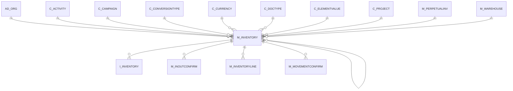

# M_INVENTORY

Physical Incentory

Area [M](../../data-model/m/index.md) · class **business** (proposed) · read from database `idempiere-db` (owner `ADEMPIERE`) · 3 row(s) when profiled

Application model: `org.compiere.model.X_M_Inventory`, access level 1 - Org.

## Columns

| column | type | key | not null | business name | references (code) | nulls | distinct |
|---|---|---|---|---|---|---|---|
| `M_INVENTORY_ID` | NUMBER(10,0) | PK | yes | Phys.Inventory |  | 0 | 3 |
| `AD_CLIENT_ID` | NUMBER(10,0) |  | yes | Tenant |  | 0 | 1 |
| `AD_ORG_ID` | NUMBER(10,0) |  | yes | Organization |  | 0 | 2 |
| `ISACTIVE` | CHAR(1) |  | yes | Active |  | 0 | 1 |
| `CREATED` | DATE |  | yes | Created |  | 0 | 3 |
| `CREATEDBY` | NUMBER(10,0) |  | yes | Created By |  | 0 | 1 |
| `UPDATED` | DATE |  | yes | Updated |  | 0 | 3 |
| `UPDATEDBY` | NUMBER(10,0) |  | yes | Updated By |  | 0 | 1 |
| `DOCUMENTNO` | VARCHAR2(30 CHAR) |  | yes | Document No |  | 0 | 3 |
| `DESCRIPTION` | VARCHAR2(255 CHAR) |  |  | Description |  | 3 | 0 |
| `M_WAREHOUSE_ID` | NUMBER(10,0) |  |  | Warehouse | [M_WAREHOUSE](../../data-model/m/m_warehouse.md) | 0 | 2 |
| `MOVEMENTDATE` | DATE |  | yes | Movement Date |  | 0 | 2 |
| `POSTED` | CHAR(1) |  | yes | Posted |  | 0 | 1 |
| `PROCESSED` | CHAR(1) |  | yes | Processed |  | 0 | 1 |
| `PROCESSING` | CHAR(1) |  |  | Process Now |  | 0 | 1 |
| `UPDATEQTY` | CHAR(1) |  |  | Update Quantities |  | 0 | 1 |
| `GENERATELIST` | CHAR(1) |  |  | Generate List |  | 0 | 1 |
| `M_PERPETUALINV_ID` | NUMBER(10,0) |  |  | Perpetual Inventory | [M_PERPETUALINV](../../data-model/m/m_perpetualinv.md) | 3 | 0 |
| `AD_ORGTRX_ID` | NUMBER(10,0) |  |  | Trx Organization |  | 3 | 0 |
| `C_PROJECT_ID` | NUMBER(10,0) |  |  | Project | [C_PROJECT](../../data-model/c/c_project.md) | 3 | 0 |
| `C_CAMPAIGN_ID` | NUMBER(10,0) |  |  | Campaign | [C_CAMPAIGN](../../data-model/c/c_campaign.md) | 3 | 0 |
| `C_ACTIVITY_ID` | NUMBER(10,0) |  |  | Activity | [C_ACTIVITY](../../data-model/c/c_activity.md) | 3 | 0 |
| `USER1_ID` | NUMBER(10,0) |  |  | User Element List 1 | [C_ELEMENTVALUE](../../data-model/c/c_elementvalue.md) | 3 | 0 |
| `USER2_ID` | NUMBER(10,0) |  |  | User Element List 2 | [C_ELEMENTVALUE](../../data-model/c/c_elementvalue.md) | 3 | 0 |
| `ISAPPROVED` | CHAR(1) |  | yes | Approved |  | 0 | 1 |
| `DOCSTATUS` | CHAR(2) |  | yes | Document Status |  | 0 | 1 |
| `DOCACTION` | CHAR(2) |  | yes | Document Action |  | 0 | 1 |
| `APPROVALAMT` | NUMBER |  |  | Approval Amount |  | 0 | 1 |
| `C_DOCTYPE_ID` | NUMBER(10,0) |  | yes | Document Type | [C_DOCTYPE](../../data-model/c/c_doctype.md) | 0 | 1 |
| `REVERSAL_ID` | NUMBER(10,0) |  |  | Reversal ID | [M_INVENTORY](../../data-model/m/m_inventory.md) | 3 | 0 |
| `PROCESSEDON` | NUMBER |  |  | Processed On |  | 3 | 0 |
| `M_INVENTORY_UU` | VARCHAR2(36 CHAR) |  |  | M_Inventory_UU |  | 0 | 3 |
| `COSTINGMETHOD` | CHAR(1) |  |  | Costing Method |  | 3 | 0 |
| `C_CONVERSIONTYPE_ID` | NUMBER(10,0) |  |  | Currency Type | [C_CONVERSIONTYPE](../../data-model/c/c_conversiontype.md) | 3 | 0 |
| `C_CURRENCY_ID` | NUMBER(10,0) |  |  | Currency | [C_CURRENCY](../../data-model/c/c_currency.md) | 3 | 0 |

*references (code)* is the table the application model's code says a column points to; *Foreign keys* below are the constraints the database declares. Counts come from the profile; no value is ever shown.

## Check constraints

| name | expression |
|---|---|
| `SYS_C0020972` | `UpdateQty in ('Y','N')` |
| `SYS_C0020975` | `Processed in ('Y','N')` |
| `SYS_C0020976` | `IsActive in ('Y','N')` |
| `SYS_C0020977` | `GenerateList in ('Y','N')` |

## Foreign keys

**References**

| table | columns | on delete |
|---|---|---|
| [AD_ORG](../../data-model/ad/ad_org.md) | M_INVENTORY.AD_ORGTRX_ID → AD_ORG.AD_ORG_ID | NO ACTION |
| [C_ACTIVITY](../../data-model/c/c_activity.md) | M_INVENTORY.C_ACTIVITY_ID → C_ACTIVITY.C_ACTIVITY_ID | NO ACTION |
| [C_CAMPAIGN](../../data-model/c/c_campaign.md) | M_INVENTORY.C_CAMPAIGN_ID → C_CAMPAIGN.C_CAMPAIGN_ID | NO ACTION |
| [C_CONVERSIONTYPE](../../data-model/c/c_conversiontype.md) | M_INVENTORY.C_CONVERSIONTYPE_ID → C_CONVERSIONTYPE.C_CONVERSIONTYPE_ID | NO ACTION |
| [C_CURRENCY](../../data-model/c/c_currency.md) | M_INVENTORY.C_CURRENCY_ID → C_CURRENCY.C_CURRENCY_ID | NO ACTION |
| [C_DOCTYPE](../../data-model/c/c_doctype.md) | M_INVENTORY.C_DOCTYPE_ID → C_DOCTYPE.C_DOCTYPE_ID | NO ACTION |
| [C_ELEMENTVALUE](../../data-model/c/c_elementvalue.md) | M_INVENTORY.USER1_ID → C_ELEMENTVALUE.C_ELEMENTVALUE_ID | NO ACTION |
| [C_PROJECT](../../data-model/c/c_project.md) | M_INVENTORY.C_PROJECT_ID → C_PROJECT.C_PROJECT_ID | NO ACTION |
| [M_INVENTORY](../../data-model/m/m_inventory.md) | M_INVENTORY.REVERSAL_ID → M_INVENTORY.M_INVENTORY_ID | NO ACTION |
| [M_PERPETUALINV](../../data-model/m/m_perpetualinv.md) | M_INVENTORY.M_PERPETUALINV_ID → M_PERPETUALINV.M_PERPETUALINV_ID | NO ACTION |
| [M_WAREHOUSE](../../data-model/m/m_warehouse.md) | M_INVENTORY.M_WAREHOUSE_ID → M_WAREHOUSE.M_WAREHOUSE_ID | NO ACTION |

**Referenced by**

| table | columns | on delete |
|---|---|---|
| `I_INVENTORY` | I_INVENTORY.M_INVENTORY_ID → M_INVENTORY.M_INVENTORY_ID | SET NULL |
| [M_INOUTCONFIRM](../../data-model/m/m_inoutconfirm.md) | M_INOUTCONFIRM.M_INVENTORY_ID → M_INVENTORY.M_INVENTORY_ID | NO ACTION |
| [M_INVENTORY](../../data-model/m/m_inventory.md) | M_INVENTORY.REVERSAL_ID → M_INVENTORY.M_INVENTORY_ID | NO ACTION |
| [M_INVENTORYLINE](../../data-model/m/m_inventoryline.md) | M_INVENTORYLINE.M_INVENTORY_ID → M_INVENTORY.M_INVENTORY_ID | CASCADE |
| [M_MOVEMENTCONFIRM](../../data-model/m/m_movementconfirm.md) | M_MOVEMENTCONFIRM.M_INVENTORY_ID → M_INVENTORY.M_INVENTORY_ID | NO ACTION |

## Write behaviour

- updates: **po_only**
- deletes: **deleted_by_users**
- change log: **recorded**
- evidence: 1 citation(s)

## Read by

| kind | name |
|---|---|
| View | `RV_UNPOSTED` |
| View | `RV_UNPROCESSED` |
| View | `rv_unposted` |
| View | `rv_unprocessed` |

## Schema history

59 change(s); the latest:

| applied | release | operation | column | tickets |
|---|---|---|---|---|
| 2024-05-14T13:59 | iD13 | `add_column` | C_Department_ID | IDEMPIERE-5598 |
| 2024-05-14T13:59 | iD13 | `add_constraint` |  | IDEMPIERE-5598 |
| 2024-05-14T13:59 | iD13 | `add_column` | C_Department_ID | IDEMPIERE-5598 |
| 2024-05-14T13:59 | iD13 | `add_constraint` |  | IDEMPIERE-5598 |
| 2024-05-14T13:59 | iD13 | `add_constraint` |  | IDEMPIERE-5598 |
| 2024-05-14T13:59 | iD13 | `add_column` | C_CostCenter_ID | IDEMPIERE-5598 |
| 2024-05-14T13:59 | iD13 | `add_constraint` |  | IDEMPIERE-5598 |
| 2024-05-14T13:59 | iD13 | `add_column` | C_CostCenter_ID | IDEMPIERE-5598 |
| 2023-04-09T15:47 | iD11 | `add_constraint` |  | IDEMPIERE-5567 |
| 2023-04-09T15:47 | iD11 | `add_constraint` |  | IDEMPIERE-5567 |
| 2021-12-05T16:45 | i8.2z | `drop_constraint` |  | IDEMPIERE-5075 |
| 2021-12-05T16:45 | i8.2z | `drop_constraint` |  | IDEMPIERE-5075 |
| 2021-12-05T16:45 | i8.2z | `add_constraint` |  | IDEMPIERE-5075 |
| 2021-12-05T16:45 | i8.2z | `add_constraint` |  | IDEMPIERE-5075 |
| 2021-12-05T16:45 | i8.2z | `add_constraint` |  | IDEMPIERE-5075 |

## Open conflicts

| type | attribute | explanation |
|---|---|---|
| `model_column_missing` | `columns.C_CostCenter_ID` | unexplained |
| `model_column_missing` | `columns.C_Department_ID` | unexplained |

## Notes

<!-- ekos:manual id="table.m_inventory.notes" -->
_Business notes about this table._
<!-- /ekos:manual -->
