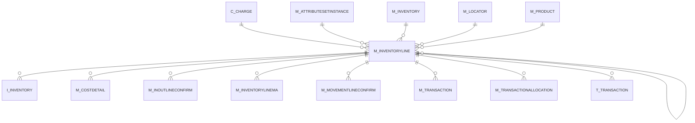

# M_INVENTORYLINE

Area [M](../../data-model/m/index.md) · class **business** (proposed) · read from database `idempiere-db` (owner `ADEMPIERE`) · 1 row(s) when profiled

Application model: `org.compiere.model.X_M_InventoryLine`, access level 1 - Org.

## Columns

| column | type | key | not null | business name | references (code) | nulls | distinct |
|---|---|---|---|---|---|---|---|
| `M_INVENTORYLINE_ID` | NUMBER(10,0) | PK | yes | Phys.Inventory Line |  | 0 | 1 |
| `AD_CLIENT_ID` | NUMBER(10,0) |  | yes | Tenant |  | 0 | 1 |
| `AD_ORG_ID` | NUMBER(10,0) |  | yes | Organization |  | 0 | 1 |
| `ISACTIVE` | CHAR(1) |  | yes | Active |  | 0 | 1 |
| `CREATED` | DATE |  | yes | Created |  | 0 | 1 |
| `CREATEDBY` | NUMBER(10,0) |  | yes | Created By |  | 0 | 1 |
| `UPDATED` | DATE |  | yes | Updated |  | 0 | 1 |
| `UPDATEDBY` | NUMBER(10,0) |  | yes | Updated By |  | 0 | 1 |
| `M_INVENTORY_ID` | NUMBER(10,0) |  | yes | Phys.Inventory | [M_INVENTORY](../../data-model/m/m_inventory.md) | 0 | 1 |
| `M_LOCATOR_ID` | NUMBER(10,0) |  |  | Locator | [M_LOCATOR](../../data-model/m/m_locator.md) | 0 | 1 |
| `M_PRODUCT_ID` | NUMBER(10,0) |  | yes | Product | [M_PRODUCT](../../data-model/m/m_product.md) | 0 | 1 |
| `LINE` | NUMBER(10,0) |  |  | Line No |  | 0 | 1 |
| `QTYBOOK` | NUMBER |  | yes | Quantity book |  | 0 | 1 |
| `QTYCOUNT` | NUMBER |  | yes | Quantity count |  | 0 | 1 |
| `DESCRIPTION` | VARCHAR2(255 CHAR) |  |  | Description |  | 0 | 1 |
| `M_ATTRIBUTESETINSTANCE_ID` | NUMBER(10,0) |  |  | Attribute Set Instance | [M_ATTRIBUTESETINSTANCE](../../data-model/m/m_attributesetinstance.md) | 0 | 1 |
| `C_CHARGE_ID` | NUMBER(10,0) |  |  | Charge | [C_CHARGE](../../data-model/c/c_charge.md) | 1 | 0 |
| `INVENTORYTYPE` | CHAR(1) |  | yes | Inventory Type |  | 0 | 1 |
| `PROCESSED` | CHAR(1) |  | yes | Processed |  | 0 | 1 |
| `QTYINTERNALUSE` | NUMBER |  |  | Internal Use Qty |  | 1 | 0 |
| `REVERSALLINE_ID` | NUMBER(10,0) |  |  | Reversal Line | [M_INVENTORYLINE](../../data-model/m/m_inventoryline.md) | 1 | 0 |
| `QTYCSV` | NUMBER(10,0) |  | yes | Qty Csv |  | 0 | 1 |
| `M_INVENTORYLINE_UU` | VARCHAR2(36 CHAR) |  |  | M_InventoryLine_UU |  | 0 | 1 |
| `CURRENTCOSTPRICE` | NUMBER |  |  | Current Cost Price |  | 0 | 1 |
| `NEWCOSTPRICE` | NUMBER |  |  | New Cost Price |  | 0 | 1 |

*references (code)* is the table the application model's code says a column points to; *Foreign keys* below are the constraints the database declares. Counts come from the profile; no value is ever shown.

## Check constraints

| name | expression |
|---|---|
| `SYS_C0020221` | `IsActive in ('Y','N')` |

## Foreign keys

**References**

| table | columns | on delete |
|---|---|---|
| [C_CHARGE](../../data-model/c/c_charge.md) | M_INVENTORYLINE.C_CHARGE_ID → C_CHARGE.C_CHARGE_ID | NO ACTION |
| [M_ATTRIBUTESETINSTANCE](../../data-model/m/m_attributesetinstance.md) | M_INVENTORYLINE.M_ATTRIBUTESETINSTANCE_ID → M_ATTRIBUTESETINSTANCE.M_ATTRIBUTESETINSTANCE_ID | NO ACTION |
| [M_INVENTORY](../../data-model/m/m_inventory.md) | M_INVENTORYLINE.M_INVENTORY_ID → M_INVENTORY.M_INVENTORY_ID | CASCADE |
| [M_INVENTORYLINE](../../data-model/m/m_inventoryline.md) | M_INVENTORYLINE.REVERSALLINE_ID → M_INVENTORYLINE.M_INVENTORYLINE_ID | NO ACTION |
| [M_LOCATOR](../../data-model/m/m_locator.md) | M_INVENTORYLINE.M_LOCATOR_ID → M_LOCATOR.M_LOCATOR_ID | NO ACTION |
| [M_PRODUCT](../../data-model/m/m_product.md) | M_INVENTORYLINE.M_PRODUCT_ID → M_PRODUCT.M_PRODUCT_ID | NO ACTION |

**Referenced by**

| table | columns | on delete |
|---|---|---|
| `I_INVENTORY` | I_INVENTORY.M_COSTINGLINE_ID → M_INVENTORYLINE.M_INVENTORYLINE_ID | NO ACTION |
| [M_COSTDETAIL](../../data-model/m/m_costdetail.md) | M_COSTDETAIL.M_INVENTORYLINE_ID → M_INVENTORYLINE.M_INVENTORYLINE_ID | NO ACTION |
| [M_INOUTLINECONFIRM](../../data-model/m/m_inoutlineconfirm.md) | M_INOUTLINECONFIRM.M_INVENTORYLINE_ID → M_INVENTORYLINE.M_INVENTORYLINE_ID | NO ACTION |
| [M_INVENTORYLINE](../../data-model/m/m_inventoryline.md) | M_INVENTORYLINE.REVERSALLINE_ID → M_INVENTORYLINE.M_INVENTORYLINE_ID | NO ACTION |
| [M_INVENTORYLINEMA](../../data-model/m/m_inventorylinema.md) | M_INVENTORYLINEMA.M_INVENTORYLINE_ID → M_INVENTORYLINE.M_INVENTORYLINE_ID | CASCADE |
| [M_MOVEMENTLINECONFIRM](../../data-model/m/m_movementlineconfirm.md) | M_MOVEMENTLINECONFIRM.M_INVENTORYLINE_ID → M_INVENTORYLINE.M_INVENTORYLINE_ID | NO ACTION |
| [M_TRANSACTION](../../data-model/m/m_transaction.md) | M_TRANSACTION.M_INVENTORYLINE_ID → M_INVENTORYLINE.M_INVENTORYLINE_ID | NO ACTION |
| [M_TRANSACTIONALLOCATION](../../data-model/m/m_transactionallocation.md) | M_TRANSACTIONALLOCATION.OUT_M_INVENTORYLINE_ID → M_INVENTORYLINE.M_INVENTORYLINE_ID | NO ACTION |
| `T_TRANSACTION` | T_TRANSACTION.M_INVENTORYLINE_ID → M_INVENTORYLINE.M_INVENTORYLINE_ID | CASCADE |

## Write behaviour

- updates: **raw_sql_skips_updated**
- deletes: **deleted_by_app, deleted_by_users, deleted_by_cascade**
- change log: **recorded**
- evidence: 8 citation(s)

## Read by

| kind | name |
|---|---|
| View | `M_TRANSACTION_V` |
| View | `RV_TRANSACTION` |
| View | `m_transaction_v` |
| View | `rv_transaction` |

## Schema history

46 change(s); the latest:

| applied | release | operation | column | tickets |
|---|---|---|---|---|
| 2026-05-19T18:39 | iD13 | `modify_column` | C_UOM_ID | IDEMPIERE-7010 |
| 2026-05-19T18:39 | iD13 | `add_column` | C_UOM_ID | IDEMPIERE-7010 |
| 2026-05-19T18:39 | iD13 | `add_column` | C_UOM_ID | IDEMPIERE-7010 |
| 2026-05-19T18:39 | iD13 | `add_constraint` |  | IDEMPIERE-7010 |
| 2026-05-19T18:39 | iD13 | `modify_column` | C_UOM_ID | IDEMPIERE-7010 |
| 2026-05-19T18:39 | iD13 | `modify_column` | C_UOM_ID | IDEMPIERE-7010 |
| 2026-05-19T18:39 | iD13 | `add_column` | QtyEntered | IDEMPIERE-7010 |
| 2026-05-19T18:39 | iD13 | `add_constraint` |  | IDEMPIERE-7010 |
| 2026-05-19T18:39 | iD13 | `add_column` | QtyEntered | IDEMPIERE-7010 |
| 2026-05-19T18:39 | iD13 | `modify_column` | C_UOM_ID | IDEMPIERE-7010 |
| 2024-05-14T13:59 | iD13 | `add_column` | C_Department_ID | IDEMPIERE-5598 |
| 2024-05-14T13:59 | iD13 | `add_column` | C_CostCenter_ID | IDEMPIERE-5598 |
| 2024-05-14T13:59 | iD13 | `add_constraint` |  | IDEMPIERE-5598 |
| 2024-05-14T13:59 | iD13 | `add_constraint` |  | IDEMPIERE-5598 |
| 2024-05-14T13:59 | iD13 | `add_constraint` |  | IDEMPIERE-5598 |

## Open conflicts

| type | attribute | explanation |
|---|---|---|
| `model_column_missing` | `columns.C_CostCenter_ID` | unexplained |
| `model_column_missing` | `columns.C_Department_ID` | unexplained |
| `model_column_missing` | `columns.C_UOM_ID` | unexplained |
| `mandatory_but_nullable` | `columns.M_AttributeSetInstance_ID.nullable` | unexplained |
| `model_column_missing` | `columns.QtyEntered` | unexplained |

## Notes

<!-- ekos:manual id="table.m_inventoryline.notes" -->
_Business notes about this table._
<!-- /ekos:manual -->
