# M_LOCATOR

Area [M](../../data-model/m/index.md) · class **business** (proposed) · read from database `idempiere-db` (owner `ADEMPIERE`) · 11 row(s) when profiled

Application model: `org.compiere.model.X_M_Locator`, access level 7 - System - Client - Org.

## Columns

| column | type | key | not null | business name | references (code) | nulls | distinct |
|---|---|---|---|---|---|---|---|
| `M_LOCATOR_ID` | NUMBER(10,0) | PK | yes | Locator |  | 0 | 11 |
| `AD_CLIENT_ID` | NUMBER(10,0) |  | yes | Tenant |  | 0 | 1 |
| `AD_ORG_ID` | NUMBER(10,0) |  | yes | Organization |  | 0 | 8 |
| `ISACTIVE` | CHAR(1) |  | yes | Active |  | 0 | 1 |
| `CREATED` | DATE |  | yes | Created |  | 0 | 11 |
| `CREATEDBY` | NUMBER(10,0) |  | yes | Created By |  | 0 | 2 |
| `UPDATED` | DATE |  | yes | Updated |  | 0 | 11 |
| `UPDATEDBY` | NUMBER(10,0) |  | yes | Updated By |  | 0 | 1 |
| `VALUE` | VARCHAR2(40 CHAR) |  | yes | Search Key |  | 0 | 11 |
| `M_WAREHOUSE_ID` | NUMBER(10,0) |  | yes | Warehouse | [M_WAREHOUSE](../../data-model/m/m_warehouse.md) | 0 | 11 |
| `PRIORITYNO` | NUMBER(10,0) |  | yes | Relative Priority |  | 0 | 1 |
| `ISDEFAULT` | CHAR(1) |  | yes | Default |  | 0 | 1 |
| `X` | VARCHAR2(60 CHAR) |  |  | Aisle (X) |  | 0 | 10 |
| `Y` | VARCHAR2(60 CHAR) |  |  | Bin (Y) |  | 0 | 10 |
| `Z` | VARCHAR2(60 CHAR) |  |  | Level (Z) |  | 0 | 10 |
| `M_LOCATOR_UU` | VARCHAR2(36 CHAR) |  |  | M_Locator_UU |  | 0 | 11 |
| `M_LOCATORTYPE_ID` | NUMBER(10,0) |  |  | Locator Type | [M_LOCATORTYPE](../../data-model/m/m_locatortype.md) | 11 | 0 |

*references (code)* is the table the application model's code says a column points to; *Foreign keys* below are the constraints the database declares. Counts come from the profile; no value is ever shown.

## Check constraints

| name | expression |
|---|---|
| `SYS_C0022905` | `IsActive in ('Y','N')` |

## Foreign keys

**References**

| table | columns | on delete |
|---|---|---|
| [AD_CLIENT](../../data-model/ad/ad_client.md) | M_LOCATOR.AD_CLIENT_ID → AD_CLIENT.AD_CLIENT_ID | NO ACTION |
| [AD_ORG](../../data-model/ad/ad_org.md) | M_LOCATOR.AD_ORG_ID → AD_ORG.AD_ORG_ID | NO ACTION |
| [M_LOCATORTYPE](../../data-model/m/m_locatortype.md) | M_LOCATOR.M_LOCATORTYPE_ID → M_LOCATORTYPE.M_LOCATORTYPE_ID | NO ACTION |
| [M_WAREHOUSE](../../data-model/m/m_warehouse.md) | M_LOCATOR.M_WAREHOUSE_ID → M_WAREHOUSE.M_WAREHOUSE_ID | CASCADE |

**Referenced by**

| table | columns | on delete |
|---|---|---|
| [A_ASSET](../../data-model/a/a_asset.md) | A_ASSET.M_LOCATOR_ID → M_LOCATOR.M_LOCATOR_ID | NO ACTION |
| [A_ASSET_ADDITION](../../data-model/a/a_asset_addition.md) | A_ASSET_ADDITION.M_LOCATOR_ID → M_LOCATOR.M_LOCATOR_ID | NO ACTION |
| [A_ASSET_PRODUCT](../../data-model/a/a_asset_product.md) | A_ASSET_PRODUCT.M_LOCATOR_ID → M_LOCATOR.M_LOCATOR_ID | NO ACTION |
| [C_PROJECTISSUE](../../data-model/c/c_projectissue.md) | C_PROJECTISSUE.M_LOCATOR_ID → M_LOCATOR.M_LOCATOR_ID | NO ACTION |
| [DD_ORDERLINE](../../data-model/dd/dd_orderline.md) | DD_ORDERLINE.M_LOCATORTO_ID → M_LOCATOR.M_LOCATOR_ID | NO ACTION |
| [FACT_ACCT](../../data-model/fact/fact_acct.md) | FACT_ACCT.M_LOCATOR_ID → M_LOCATOR.M_LOCATOR_ID | NO ACTION |
| `I_ASSET` | I_ASSET.M_LOCATOR_ID → M_LOCATOR.M_LOCATOR_ID | NO ACTION |
| `I_FIXEDASSET` | I_FIXEDASSET.M_LOCATOR_ID → M_LOCATOR.M_LOCATOR_ID | NO ACTION |
| `I_INVENTORY` | I_INVENTORY.M_LOCATOR_ID → M_LOCATOR.M_LOCATOR_ID | SET NULL |
| `I_MOVEMENT` | I_MOVEMENT.M_LOCATORTO_ID → M_LOCATOR.M_LOCATOR_ID | NO ACTION |
| [M_INOUTLINE](../../data-model/m/m_inoutline.md) | M_INOUTLINE.M_LOCATOR_ID → M_LOCATOR.M_LOCATOR_ID | NO ACTION |
| [M_INVENTORYLINE](../../data-model/m/m_inventoryline.md) | M_INVENTORYLINE.M_LOCATOR_ID → M_LOCATOR.M_LOCATOR_ID | NO ACTION |
| [M_MOVEMENTLINE](../../data-model/m/m_movementline.md) | M_MOVEMENTLINE.M_LOCATOR_ID → M_LOCATOR.M_LOCATOR_ID | NO ACTION |
| [M_PRODUCT](../../data-model/m/m_product.md) | M_PRODUCT.M_LOCATOR_ID → M_LOCATOR.M_LOCATOR_ID | NO ACTION |
| [M_PRODUCTION](../../data-model/m/m_production.md) | M_PRODUCTION.M_LOCATOR_ID → M_LOCATOR.M_LOCATOR_ID | NO ACTION |
| [M_PRODUCTIONLINE](../../data-model/m/m_productionline.md) | M_PRODUCTIONLINE.M_LOCATOR_ID → M_LOCATOR.M_LOCATOR_ID | NO ACTION |
| [M_PRODUCTIONPLAN](../../data-model/m/m_productionplan.md) | M_PRODUCTIONPLAN.M_LOCATOR_ID → M_LOCATOR.M_LOCATOR_ID | NO ACTION |
| [M_REPLENISH](../../data-model/m/m_replenish.md) | M_REPLENISH.M_LOCATOR_ID → M_LOCATOR.M_LOCATOR_ID | NO ACTION |
| [M_STORAGEONHAND](../../data-model/m/m_storageonhand.md) | M_STORAGEONHAND.M_LOCATOR_ID → M_LOCATOR.M_LOCATOR_ID | NO ACTION |
| [M_TRANSACTION](../../data-model/m/m_transaction.md) | M_TRANSACTION.M_LOCATOR_ID → M_LOCATOR.M_LOCATOR_ID | NO ACTION |
| [M_WAREHOUSE](../../data-model/m/m_warehouse.md) | M_WAREHOUSE.M_RESERVELOCATOR_ID → M_LOCATOR.M_LOCATOR_ID | NO ACTION |
| [PP_COST_COLLECTOR](../../data-model/pp/pp_cost_collector.md) | PP_COST_COLLECTOR.M_LOCATOR_ID → M_LOCATOR.M_LOCATOR_ID | NO ACTION |
| [PP_ORDER_BOMLINE](../../data-model/pp/pp_order_bomline.md) | PP_ORDER_BOMLINE.M_LOCATOR_ID → M_LOCATOR.M_LOCATOR_ID | NO ACTION |
| `T_TRANSACTION` | T_TRANSACTION.M_LOCATOR_ID → M_LOCATOR.M_LOCATOR_ID | CASCADE |

```mermaid
erDiagram
  AD_CLIENT ||--o{ M_LOCATOR : ""
  AD_ORG ||--o{ M_LOCATOR : ""
  M_LOCATOR ||--o{ A_ASSET : ""
  M_LOCATOR ||--o{ A_ASSET_ADDITION : ""
  M_LOCATOR ||--o{ A_ASSET_PRODUCT : ""
  M_LOCATOR ||--o{ C_PROJECTISSUE : ""
  M_LOCATOR ||--o{ DD_ORDERLINE : ""
  M_LOCATOR ||--o{ FACT_ACCT : ""
  M_LOCATOR ||--o{ I_ASSET : ""
  M_LOCATOR ||--o{ I_FIXEDASSET : ""
  M_LOCATOR ||--o{ I_INVENTORY : ""
  M_LOCATOR ||--o{ I_MOVEMENT : ""
  M_LOCATOR ||--o{ M_INOUTLINE : ""
  M_LOCATOR ||--o{ M_INVENTORYLINE : ""
  M_LOCATOR ||--o{ M_MOVEMENTLINE : ""
  M_LOCATOR ||--o{ M_PRODUCT : ""
  M_LOCATOR ||--o{ M_PRODUCTION : ""
  M_LOCATOR ||--o{ M_PRODUCTIONLINE : ""
  M_LOCATOR ||--o{ M_PRODUCTIONPLAN : ""
  M_LOCATOR ||--o{ M_REPLENISH : ""
  M_LOCATOR ||--o{ M_STORAGEONHAND : ""
  M_LOCATOR ||--o{ M_TRANSACTION : ""
  M_LOCATOR ||--o{ M_WAREHOUSE : ""
  M_LOCATOR ||--o{ PP_COST_COLLECTOR : ""
  M_LOCATOR ||--o{ PP_ORDER_BOMLINE : ""
  M_LOCATOR ||--o{ T_TRANSACTION : ""
  M_LOCATORTYPE ||--o{ M_LOCATOR : ""
  M_WAREHOUSE ||--o{ M_LOCATOR : ""
```

## Write behaviour

- updates: **raw_sql_skips_updated**
- deletes: **deleted_by_users, deleted_by_cascade**
- change log: **recorded**
- evidence: 3 citation(s)

## Read by

| kind | name |
|---|---|
| Procedure | [BOMQTYONHAND](../../logic/bomqtyonhand.md) |
| Procedure | [BOMQTYONHANDFORRESERVATION](../../logic/bomqtyonhandforreservation.md) |
| Procedure | [BOMQTYORDERED](../../logic/bomqtyordered.md) |
| Procedure | [BOMQTYRESERVED](../../logic/bomqtyreserved.md) |
| Procedure | [BOMQtyOnHand](../../logic/bomqtyonhand.md) |
| Procedure | [BOMQtyOnHandForReservation](../../logic/bomqtyonhandforreservation.md) |
| Procedure | [Bomqtyonhand](../../logic/bomqtyonhand.md) |
| Procedure | [BomqtyonhandASI](../../logic/bomqtyonhandasi.md) |
| Procedure | [Bomqtyordered](../../logic/bomqtyordered.md) |
| Procedure | [BomqtyorderedASI](../../logic/bomqtyorderedasi.md) |
| Procedure | [Bomqtyreserved](../../logic/bomqtyreserved.md) |
| Procedure | [BomqtyreservedASI](../../logic/bomqtyreservedasi.md) |
| Procedure | [bomqtyonhand](../../logic/bomqtyonhand.md) |
| Procedure | [bomqtyordered](../../logic/bomqtyordered.md) |
| Procedure | [bomqtyreserved](../../logic/bomqtyreserved.md) |
| Procedure | [prodqtyordered](../../logic/prodqtyordered.md) |
| Procedure | [prodqtyreserved](../../logic/prodqtyreserved.md) |
| View | `M_INOUT_LINECONFIRM_V` |
| View | `M_INOUT_LINECONFIRM_VT` |
| View | `M_INOUT_LINE_V` |
| View | `M_INOUT_LINE_VT` |
| View | `M_PRODUCT_STOCK_V` |
| View | `M_PRODUCT_SUBSTITUTERELATED_V` |
| View | `RV_INOUTDETAILS` |
| View | `RV_M_TRANSACTION_SUM` |
| View | `RV_PP_ORDER_STORAGE` |
| View | `RV_STORAGE` |
| View | `RV_STORAGE_PER_PRODUCT` |
| View | `RV_TRANSACTION` |
| View | `m_inout_line_v` |
| View | `m_inout_line_vt` |
| View | `m_inout_lineconfirm_v` |
| View | `m_inout_lineconfirm_vt` |
| View | `m_product_stock_v` |
| View | `m_product_substituterelated_v` |
| View | `rv_inoutdetails` |
| View | `rv_m_transaction_sum` |
| View | `rv_pp_order_storage` |
| View | `rv_storage` |
| View | `rv_storage_per_product` |
| View | `rv_transaction` |

## Schema history

30 change(s); the latest:

| applied | release | operation | column | tickets |
|---|---|---|---|---|
| 2023-04-09T15:47 | iD11 | `add_constraint` |  | IDEMPIERE-5567 |
| 2023-04-09T15:47 | iD11 | `add_constraint` |  | IDEMPIERE-5567 |
| 2021-12-05T16:45 | i8.2z | `drop_constraint` |  | IDEMPIERE-5075 |
| 2021-12-05T16:45 | i8.2z | `drop_constraint` |  | IDEMPIERE-5075 |
| 2021-12-05T16:45 | i8.2z | `drop_constraint` |  | IDEMPIERE-5075 |
| 2021-12-05T16:45 | i8.2z | `add_constraint` |  | IDEMPIERE-5075 |
| 2021-12-05T16:45 | i8.2z | `add_constraint` |  | IDEMPIERE-5075 |
| 2021-12-05T16:45 | i8.2z | `add_constraint` |  | IDEMPIERE-5075 |
| 2020-08-04T01:00 | i7.1z | `modify_column` | Y | IDEMPIERE-3862 |
| 2020-08-04T01:00 | i7.1z | `add_column` | tmp_col_4_tmp | IDEMPIERE-3862 |
| 2020-08-04T01:00 | i7.1z | `drop_column` | tmp_col_3_tmp | IDEMPIERE-3862 |
| 2020-08-04T01:00 | i7.1z | `drop_column` | tmp_col_2_tmp | IDEMPIERE-3862 |
| 2020-08-04T01:00 | i7.1z | `modify_column` | VALUE | IDEMPIERE-3862 |
| 2020-08-04T01:00 | i7.1z | `add_column` | tmp_col_2_tmp | IDEMPIERE-3862 |
| 2020-08-04T01:00 | i7.1z | `drop_column` | tmp_col_1_tmp | IDEMPIERE-3862 |

## Open conflicts

| type | attribute | explanation |
|---|---|---|
| `mandatory_but_nullable` | `columns.X.nullable` | unexplained |
| `mandatory_but_nullable` | `columns.Y.nullable` | unexplained |
| `mandatory_but_nullable` | `columns.Z.nullable` | unexplained |

## Notes

<!-- ekos:manual id="table.m_locator.notes" -->
_Business notes about this table._
<!-- /ekos:manual -->
