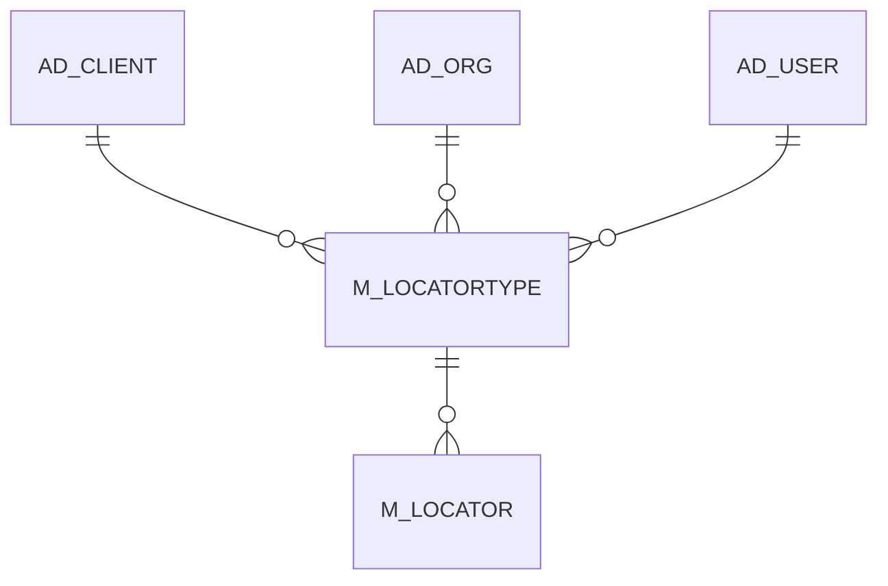

# M_LOCATORTYPE

Area [M](../../data-model/m/index.md) · class **business** (proposed) · read from database `idempiere-db` (owner `ADEMPIERE`) · 0 row(s) when profiled

Application model: `org.compiere.model.X_M_LocatorType`, access level 3 - Client - Org.

## Columns

| column | type | key | not null | business name | references (code) | nulls | distinct |
|---|---|---|---|---|---|---|---|
| `AD_CLIENT_ID` | NUMBER(10,0) |  | yes | Tenant |  | 0 | 0 |
| `AD_ORG_ID` | NUMBER(10,0) |  | yes | Organization |  | 0 | 0 |
| `CREATED` | DATE |  | yes | Created |  | 0 | 0 |
| `CREATEDBY` | NUMBER(10,0) |  | yes | Created By |  | 0 | 0 |
| `DESCRIPTION` | VARCHAR2(255 CHAR) |  |  | Description |  | 0 | 0 |
| `HELP` | VARCHAR2(2000 CHAR) |  |  | Comment/Help |  | 0 | 0 |
| `ISACTIVE` | CHAR(1) |  | yes | Active |  | 0 | 0 |
| `ISAVAILABLEFORREPLENISHMENT` | CHAR(1) |  | yes | Available for Replenishment |  | 0 | 0 |
| `ISAVAILABLEFORRESERVATION` | CHAR(1) |  | yes | Available for Reservation |  | 0 | 0 |
| `ISAVAILABLEFORSHIPPING` | CHAR(1) |  | yes | Available for Shipping |  | 0 | 0 |
| `M_LOCATORTYPE_ID` | NUMBER(10,0) | PK | yes | Locator Type |  | 0 | 0 |
| `M_LOCATORTYPE_UU` | VARCHAR2(36 CHAR) |  |  | M_LocatorType_UU |  | 0 | 0 |
| `NAME` | VARCHAR2(60 CHAR) |  | yes | Name |  | 0 | 0 |
| `UPDATED` | DATE |  | yes | Updated |  | 0 | 0 |
| `UPDATEDBY` | NUMBER(10,0) |  | yes | Updated By |  | 0 | 0 |

*references (code)* is the table the application model's code says a column points to; *Foreign keys* below are the constraints the database declares. Counts come from the profile; no value is ever shown.

## Check constraints

| name | expression |
|---|---|
| `SYS_C0023022` | `IsAvailableForReservation IN ('Y','N')` |
| `SYS_C0023023` | `IsAvailableForReplenishment IN ('Y','N')` |
| `SYS_C0023025` | `IsAvailableForShipping IN ('Y','N')` |
| `SYS_C0023027` | `IsActive IN ('Y','N')` |

## Foreign keys

**References**

| table | columns | on delete |
|---|---|---|
| [AD_CLIENT](../../data-model/ad/ad_client.md) | M_LOCATORTYPE.AD_CLIENT_ID → AD_CLIENT.AD_CLIENT_ID | NO ACTION |
| [AD_ORG](../../data-model/ad/ad_org.md) | M_LOCATORTYPE.AD_ORG_ID → AD_ORG.AD_ORG_ID | NO ACTION |
| [AD_USER](../../data-model/ad/ad_user.md) | M_LOCATORTYPE.CREATEDBY → AD_USER.AD_USER_ID | NO ACTION |

**Referenced by**

| table | columns | on delete |
|---|---|---|
| [M_LOCATOR](../../data-model/m/m_locator.md) | M_LOCATOR.M_LOCATORTYPE_ID → M_LOCATORTYPE.M_LOCATORTYPE_ID | NO ACTION |

## Write behaviour

- updates: **po_only**
- deletes: **deleted_by_users**
- change log: **recorded**
- evidence: 1 citation(s)

## Read by

| kind | name |
|---|---|
| Procedure | [BOMQTYONHANDFORRESERVATION](../../logic/bomqtyonhandforreservation.md) |
| Procedure | [BOMQtyOnHandForReservation](../../logic/bomqtyonhandforreservation.md) |
| View | `M_PRODUCT_STOCK_V` |
| View | `M_PRODUCT_SUBSTITUTERELATED_V` |
| View | `RV_STORAGE` |
| View | `m_product_stock_v` |
| View | `m_product_substituterelated_v` |
| View | `rv_storage` |

## Schema history

14 change(s); the latest:

| applied | release | operation | column | tickets |
|---|---|---|---|---|
| 2020-08-04T01:00 | i7.1z | `modify_column` | DESCRIPTION | IDEMPIERE-3862 |
| 2020-08-04T01:00 | i7.1z | `modify_column` | NAME | IDEMPIERE-3862 |
| 2020-08-04T01:00 | i7.1z | `modify_column` | M_LOCATORTYPE_UU | IDEMPIERE-3862 |
| 2020-08-04T01:00 | i7.1z | `modify_column` | HELP | IDEMPIERE-3862 |
| 2015-06-09T18:30 | i2.1z | `create_table` |  | IDEMPIERE-2668 |
| 2015-06-09T18:30 | i2.1z | `add_constraint` |  | IDEMPIERE-2668 |
| 2015-06-09T18:30 | i2.1z | `add_constraint` |  | IDEMPIERE-2668 |
| 2015-06-09T18:30 | i2.1z | `create_table` |  | IDEMPIERE-2668 |
| 2015-06-09T18:30 | i2.1z | `add_constraint` |  | IDEMPIERE-2668 |
| 2015-06-09T18:30 | i2.1z | `add_constraint` |  | IDEMPIERE-2668 |
| 2015-06-09T18:30 | i2.1z | `add_constraint` |  | IDEMPIERE-2668 |
| 2015-06-09T18:30 | i2.1z | `add_constraint` |  | IDEMPIERE-2668 |
| 2015-06-09T18:30 | i2.1z | `add_constraint` |  | IDEMPIERE-2668 |
| 2015-06-09T18:30 | i2.1z | `add_constraint` |  | IDEMPIERE-2668 |

## Notes

<!-- ekos:manual id="table.m_locatortype.notes" -->
_Business notes about this table._
<!-- /ekos:manual -->
