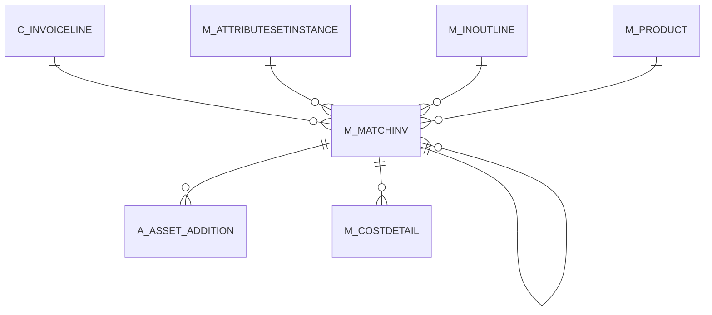

# M_MATCHINV

Area [M](../../data-model/m/index.md) · class **business** (proposed) · read from database `idempiere-db` (owner `ADEMPIERE`) · 18 row(s) when profiled

Application model: `org.compiere.model.X_M_MatchInv`, access level 3 - Client - Org.

## Columns

| column | type | key | not null | business name | references (code) | nulls | distinct |
|---|---|---|---|---|---|---|---|
| `M_MATCHINV_ID` | NUMBER(10,0) | PK | yes | Match Invoice |  | 0 | 18 |
| `AD_CLIENT_ID` | NUMBER(10,0) |  | yes | Tenant |  | 0 | 1 |
| `AD_ORG_ID` | NUMBER(10,0) |  | yes | Organization |  | 0 | 1 |
| `ISACTIVE` | CHAR(1) |  | yes | Active |  | 0 | 1 |
| `CREATED` | DATE |  | yes | Created |  | 0 | 4 |
| `CREATEDBY` | NUMBER(10,0) |  | yes | Created By |  | 0 | 1 |
| `UPDATED` | DATE |  | yes | Updated |  | 0 | 4 |
| `UPDATEDBY` | NUMBER(10,0) |  | yes | Updated By |  | 0 | 1 |
| `M_INOUTLINE_ID` | NUMBER(10,0) |  |  | Shipment/Receipt Line | [M_INOUTLINE](../../data-model/m/m_inoutline.md) | 0 | 18 |
| `C_INVOICELINE_ID` | NUMBER(10,0) |  | yes | Invoice Line | [C_INVOICELINE](../../data-model/c/c_invoiceline.md) | 0 | 18 |
| `M_PRODUCT_ID` | NUMBER(10,0) |  |  | Product | [M_PRODUCT](../../data-model/m/m_product.md) | 0 | 16 |
| `DATETRX` | DATE |  | yes | Transaction Date |  | 0 | 4 |
| `QTY` | NUMBER |  | yes | Quantity |  | 0 | 8 |
| `PROCESSING` | CHAR(1) |  | yes | Process Now |  | 0 | 1 |
| `PROCESSED` | CHAR(1) |  | yes | Processed |  | 0 | 1 |
| `POSTED` | CHAR(1) |  | yes | Posted |  | 0 | 1 |
| `DOCUMENTNO` | VARCHAR2(30 CHAR) |  |  | Document No |  | 0 | 18 |
| `DATEACCT` | DATE |  |  | Account Date |  | 0 | 4 |
| `M_ATTRIBUTESETINSTANCE_ID` | NUMBER(10,0) |  |  | Attribute Set Instance | [M_ATTRIBUTESETINSTANCE](../../data-model/m/m_attributesetinstance.md) | 18 | 0 |
| `DESCRIPTION` | VARCHAR2(255 CHAR) |  |  | Description |  | 18 | 0 |
| `PROCESSEDON` | NUMBER |  |  | Processed On |  | 0 | 4 |
| `M_MATCHINV_UU` | VARCHAR2(36 CHAR) |  |  | M_MatchInv_UU |  | 0 | 18 |
| `REVERSAL_ID` | NUMBER(10,0) |  |  | Reversal ID | [M_MATCHINV](../../data-model/m/m_matchinv.md) | 18 | 0 |
| `REF_MATCHINV_ID` | NUMBER(10,0) |  |  | Referenced Match Invoice | [M_MATCHINV](../../data-model/m/m_matchinv.md) | 18 | 0 |

*references (code)* is the table the application model's code says a column points to; *Foreign keys* below are the constraints the database declares. Counts come from the profile; no value is ever shown.

## Check constraints

| name | expression |
|---|---|
| `SYS_C0019442` | `Processed in ('Y','N')` |
| `SYS_C0019443` | `IsActive in ('Y','N')` |

## Foreign keys

**References**

| table | columns | on delete |
|---|---|---|
| [C_INVOICELINE](../../data-model/c/c_invoiceline.md) | M_MATCHINV.C_INVOICELINE_ID → C_INVOICELINE.C_INVOICELINE_ID | NO ACTION |
| [M_ATTRIBUTESETINSTANCE](../../data-model/m/m_attributesetinstance.md) | M_MATCHINV.M_ATTRIBUTESETINSTANCE_ID → M_ATTRIBUTESETINSTANCE.M_ATTRIBUTESETINSTANCE_ID | NO ACTION |
| [M_INOUTLINE](../../data-model/m/m_inoutline.md) | M_MATCHINV.M_INOUTLINE_ID → M_INOUTLINE.M_INOUTLINE_ID | NO ACTION |
| [M_MATCHINV](../../data-model/m/m_matchinv.md) | M_MATCHINV.REF_MATCHINV_ID → M_MATCHINV.M_MATCHINV_ID | NO ACTION |
| [M_PRODUCT](../../data-model/m/m_product.md) | M_MATCHINV.M_PRODUCT_ID → M_PRODUCT.M_PRODUCT_ID | NO ACTION |

**Referenced by**

| table | columns | on delete |
|---|---|---|
| [A_ASSET_ADDITION](../../data-model/a/a_asset_addition.md) | A_ASSET_ADDITION.M_MATCHINV_ID → M_MATCHINV.M_MATCHINV_ID | NO ACTION |
| [M_COSTDETAIL](../../data-model/m/m_costdetail.md) | M_COSTDETAIL.M_MATCHINV_ID → M_MATCHINV.M_MATCHINV_ID | NO ACTION |
| [M_MATCHINV](../../data-model/m/m_matchinv.md) | M_MATCHINV.REF_MATCHINV_ID → M_MATCHINV.M_MATCHINV_ID | NO ACTION |

## Write behaviour

- updates: **po_only**
- deletes: **deleted_by_app, deleted_by_users**
- change log: **recorded**
- evidence: 4 citation(s)

## Read by

| kind | name |
|---|---|
| View | `C_INVOICE_CREATEFROM_V` |
| View | `M_INOUT_CREATEFROM_V` |
| View | `RV_UNPOSTED` |
| View | `c_invoice_createfrom_v` |
| View | `m_inout_createfrom_v` |
| View | `rv_unposted` |

## Schema history

33 change(s); the latest:

| applied | release | operation | column | tickets |
|---|---|---|---|---|
| 2023-04-09T15:47 | iD11 | `add_constraint` |  | IDEMPIERE-5567 |
| 2023-04-09T15:47 | iD11 | `add_constraint` |  | IDEMPIERE-5567 |
| 2021-12-05T16:45 | i8.2z | `add_constraint` |  | IDEMPIERE-5075 |
| 2021-12-05T16:45 | i8.2z | `add_constraint` |  | IDEMPIERE-5075 |
| 2021-12-05T16:45 | i8.2z | `drop_constraint` |  | IDEMPIERE-5075 |
| 2021-12-05T16:45 | i8.2z | `drop_constraint` |  | IDEMPIERE-5075 |
| 2021-12-05T16:45 | i8.2z | `add_constraint` |  | IDEMPIERE-5075 |
| 2021-12-05T16:45 | i8.2z | `add_constraint` |  | IDEMPIERE-5075 |
| 2021-12-05T16:45 | i8.2z | `drop_constraint` |  | IDEMPIERE-5075 |
| 2021-12-05T16:45 | i8.2z | `drop_constraint` |  | IDEMPIERE-5075 |
| 2020-08-04T01:00 | i7.1z | `modify_column` | M_MATCHINV_UU | IDEMPIERE-3862 |
| 2020-08-04T01:00 | i7.1z | `modify_column` | DESCRIPTION | IDEMPIERE-3862 |
| 2020-08-04T01:00 | i7.1z | `drop_column` | tmp_col_1_tmp | IDEMPIERE-3862 |
| 2020-08-04T01:00 | i7.1z | `add_column` | tmp_col_1_tmp | IDEMPIERE-3862 |
| 2020-08-04T01:00 | i7.1z | `drop_column` | tmp_col_2_tmp | IDEMPIERE-3862 |

## Open conflicts

| type | attribute | explanation |
|---|---|---|
| `mandatory_but_nullable` | `columns.DateAcct.nullable` | unexplained |
| `mandatory_but_nullable` | `columns.M_Product_ID.nullable` | unexplained |

## Notes

<!-- ekos:manual id="table.m_matchinv.notes" -->
_Business notes about this table._
<!-- /ekos:manual -->
