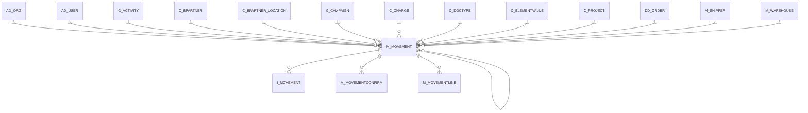

# M_MOVEMENT

Internal Inventory Movements

Area [M](../../data-model/m/index.md) · class **business** (proposed) · read from database `idempiere-db` (owner `ADEMPIERE`) · 1 row(s) when profiled

Application model: `org.compiere.model.X_M_Movement`, access level 1 - Org.

## Columns

| column | type | key | not null | business name | references (code) | nulls | distinct |
|---|---|---|---|---|---|---|---|
| `M_MOVEMENT_ID` | NUMBER(10,0) | PK | yes | Inventory Move |  | 0 | 1 |
| `AD_CLIENT_ID` | NUMBER(10,0) |  | yes | Tenant |  | 0 | 1 |
| `AD_ORG_ID` | NUMBER(10,0) |  | yes | Organization |  | 0 | 1 |
| `ISACTIVE` | CHAR(1) |  | yes | Active |  | 0 | 1 |
| `CREATED` | DATE |  | yes | Created |  | 0 | 1 |
| `CREATEDBY` | NUMBER(10,0) |  | yes | Created By |  | 0 | 1 |
| `UPDATEDBY` | NUMBER(10,0) |  | yes | Updated By |  | 0 | 1 |
| `UPDATED` | DATE |  | yes | Updated |  | 0 | 1 |
| `DOCUMENTNO` | VARCHAR2(30 CHAR) |  | yes | Document No |  | 0 | 1 |
| `DESCRIPTION` | VARCHAR2(255 CHAR) |  |  | Description |  | 0 | 1 |
| `MOVEMENTDATE` | DATE |  | yes | Movement Date |  | 0 | 1 |
| `POSTED` | CHAR(1) |  | yes | Posted |  | 0 | 1 |
| `PROCESSED` | CHAR(1) |  | yes | Processed |  | 0 | 1 |
| `PROCESSING` | CHAR(1) |  |  | Process Now |  | 0 | 1 |
| `AD_ORGTRX_ID` | NUMBER(10,0) |  |  | Trx Organization |  | 1 | 0 |
| `C_PROJECT_ID` | NUMBER(10,0) |  |  | Project | [C_PROJECT](../../data-model/c/c_project.md) | 1 | 0 |
| `C_CAMPAIGN_ID` | NUMBER(10,0) |  |  | Campaign | [C_CAMPAIGN](../../data-model/c/c_campaign.md) | 1 | 0 |
| `C_ACTIVITY_ID` | NUMBER(10,0) |  |  | Activity | [C_ACTIVITY](../../data-model/c/c_activity.md) | 1 | 0 |
| `USER1_ID` | NUMBER(10,0) |  |  | User Element List 1 | [C_ELEMENTVALUE](../../data-model/c/c_elementvalue.md) | 1 | 0 |
| `USER2_ID` | NUMBER(10,0) |  |  | User Element List 2 | [C_ELEMENTVALUE](../../data-model/c/c_elementvalue.md) | 1 | 0 |
| `DATERECEIVED` | DATE |  |  | Date Received |  | 1 | 0 |
| `DOCACTION` | CHAR(2) |  | yes | Document Action |  | 0 | 1 |
| `DOCSTATUS` | CHAR(2) |  | yes | Document Status |  | 0 | 1 |
| `ISINTRANSIT` | CHAR(1) |  | yes | In Transit |  | 0 | 1 |
| `C_DOCTYPE_ID` | NUMBER(10,0) |  | yes | Document Type | [C_DOCTYPE](../../data-model/c/c_doctype.md) | 0 | 1 |
| `ISAPPROVED` | CHAR(1) |  | yes | Approved |  | 0 | 1 |
| `APPROVALAMT` | NUMBER |  |  | Approval Amount |  | 0 | 1 |
| `FREIGHTCOSTRULE` | CHAR(1) |  |  | Freight Cost Rule |  | 1 | 0 |
| `M_SHIPPER_ID` | NUMBER(10,0) |  |  | Shipper | [M_SHIPPER](../../data-model/m/m_shipper.md) | 1 | 0 |
| `PRIORITYRULE` | CHAR(1) |  |  | Priority |  | 1 | 0 |
| `SALESREP_ID` | NUMBER(10,0) |  |  | Sales Representative | [AD_USER](../../data-model/ad/ad_user.md) | 1 | 0 |
| `AD_USER_ID` | NUMBER(10,0) |  |  | User/Contact | [AD_USER](../../data-model/ad/ad_user.md) | 1 | 0 |
| `C_BPARTNER_ID` | NUMBER(10,0) |  |  | Business Partner | [C_BPARTNER](../../data-model/c/c_bpartner.md) | 1 | 0 |
| `C_BPARTNER_LOCATION_ID` | NUMBER(10,0) |  |  | Partner Location | [C_BPARTNER_LOCATION](../../data-model/c/c_bpartner_location.md) | 1 | 0 |
| `C_CHARGE_ID` | NUMBER(10,0) |  |  | Charge | [C_CHARGE](../../data-model/c/c_charge.md) | 1 | 0 |
| `CHARGEAMT` | NUMBER |  |  | Charge amount |  | 1 | 0 |
| `CREATEFROM` | CHAR(1) |  |  | Create lines from |  | 1 | 0 |
| `DD_ORDER_ID` | NUMBER(10,0) |  |  | Distribution Order | [DD_ORDER](../../data-model/dd/dd_order.md) | 1 | 0 |
| `DELIVERYRULE` | CHAR(1) |  |  | Delivery Rule |  | 1 | 0 |
| `DELIVERYVIARULE` | CHAR(1) |  |  | Delivery Via |  | 1 | 0 |
| `FREIGHTAMT` | NUMBER |  |  | Freight Amount |  | 1 | 0 |
| `REVERSAL_ID` | NUMBER(10,0) |  |  | Reversal ID | [M_MOVEMENT](../../data-model/m/m_movement.md) | 1 | 0 |
| `POREFERENCE` | VARCHAR2(20 CHAR) |  |  | Order Reference |  | 1 | 0 |
| `PROCESSEDON` | NUMBER |  |  | Processed On |  | 0 | 1 |
| `M_MOVEMENT_UU` | VARCHAR2(36 CHAR) |  |  | M_Movement_UU |  | 0 | 1 |
| `M_WAREHOUSE_ID` | NUMBER(10,0) |  |  | Warehouse | [M_WAREHOUSE](../../data-model/m/m_warehouse.md) | 1 | 0 |
| `M_WAREHOUSETO_ID` | NUMBER(10,0) |  |  | Warehouse To | [M_WAREHOUSE](../../data-model/m/m_warehouse.md) | 1 | 0 |

*references (code)* is the table the application model's code says a column points to; *Foreign keys* below are the constraints the database declares. Counts come from the profile; no value is ever shown.

## Check constraints

| name | expression |
|---|---|
| `SYS_C0021375` | `IsActive in ('Y','N')` |
| `SYS_C0021376` | `Processed in ('Y','N')` |

## Foreign keys

**References**

| table | columns | on delete |
|---|---|---|
| [AD_ORG](../../data-model/ad/ad_org.md) | M_MOVEMENT.AD_ORGTRX_ID → AD_ORG.AD_ORG_ID | NO ACTION |
| [AD_USER](../../data-model/ad/ad_user.md) | M_MOVEMENT.AD_USER_ID → AD_USER.AD_USER_ID | NO ACTION |
| [C_ACTIVITY](../../data-model/c/c_activity.md) | M_MOVEMENT.C_ACTIVITY_ID → C_ACTIVITY.C_ACTIVITY_ID | NO ACTION |
| [C_BPARTNER](../../data-model/c/c_bpartner.md) | M_MOVEMENT.C_BPARTNER_ID → C_BPARTNER.C_BPARTNER_ID | NO ACTION |
| [C_BPARTNER_LOCATION](../../data-model/c/c_bpartner_location.md) | M_MOVEMENT.C_BPARTNER_LOCATION_ID → C_BPARTNER_LOCATION.C_BPARTNER_LOCATION_ID | NO ACTION |
| [C_CAMPAIGN](../../data-model/c/c_campaign.md) | M_MOVEMENT.C_CAMPAIGN_ID → C_CAMPAIGN.C_CAMPAIGN_ID | NO ACTION |
| [C_CHARGE](../../data-model/c/c_charge.md) | M_MOVEMENT.C_CHARGE_ID → C_CHARGE.C_CHARGE_ID | NO ACTION |
| [C_DOCTYPE](../../data-model/c/c_doctype.md) | M_MOVEMENT.C_DOCTYPE_ID → C_DOCTYPE.C_DOCTYPE_ID | NO ACTION |
| [C_ELEMENTVALUE](../../data-model/c/c_elementvalue.md) | M_MOVEMENT.USER1_ID → C_ELEMENTVALUE.C_ELEMENTVALUE_ID | NO ACTION |
| [C_PROJECT](../../data-model/c/c_project.md) | M_MOVEMENT.C_PROJECT_ID → C_PROJECT.C_PROJECT_ID | NO ACTION |
| [DD_ORDER](../../data-model/dd/dd_order.md) | M_MOVEMENT.DD_ORDER_ID → DD_ORDER.DD_ORDER_ID | NO ACTION |
| [M_MOVEMENT](../../data-model/m/m_movement.md) | M_MOVEMENT.REVERSAL_ID → M_MOVEMENT.M_MOVEMENT_ID | NO ACTION |
| [M_SHIPPER](../../data-model/m/m_shipper.md) | M_MOVEMENT.M_SHIPPER_ID → M_SHIPPER.M_SHIPPER_ID | NO ACTION |
| [M_WAREHOUSE](../../data-model/m/m_warehouse.md) | M_MOVEMENT.M_WAREHOUSETO_ID → M_WAREHOUSE.M_WAREHOUSE_ID | NO ACTION |

**Referenced by**

| table | columns | on delete |
|---|---|---|
| `I_MOVEMENT` | I_MOVEMENT.M_MOVEMENT_ID → M_MOVEMENT.M_MOVEMENT_ID | NO ACTION |
| [M_MOVEMENT](../../data-model/m/m_movement.md) | M_MOVEMENT.REVERSAL_ID → M_MOVEMENT.M_MOVEMENT_ID | NO ACTION |
| [M_MOVEMENTCONFIRM](../../data-model/m/m_movementconfirm.md) | M_MOVEMENTCONFIRM.M_MOVEMENT_ID → M_MOVEMENT.M_MOVEMENT_ID | CASCADE |
| [M_MOVEMENTLINE](../../data-model/m/m_movementline.md) | M_MOVEMENTLINE.M_MOVEMENT_ID → M_MOVEMENT.M_MOVEMENT_ID | CASCADE |

## Write behaviour

- updates: **raw_sql_skips_updated**
- deletes: **deleted_by_users**
- change log: **recorded**
- evidence: 2 citation(s)

## Read by

| kind | name |
|---|---|
| View | `M_MOVEMENT_CANDIDATE_V` |
| View | `RV_UNPOSTED` |
| View | `RV_UNPROCESSED` |
| View | `m_movement_candidate_v` |
| View | `rv_unposted` |
| View | `rv_unprocessed` |

## Schema history

68 change(s); the latest:

| applied | release | operation | column | tickets |
|---|---|---|---|---|
| 2024-05-14T13:59 | iD13 | `add_constraint` |  | IDEMPIERE-5598 |
| 2024-05-14T13:59 | iD13 | `add_column` | C_Department_ID | IDEMPIERE-5598 |
| 2024-05-14T13:59 | iD13 | `add_constraint` |  | IDEMPIERE-5598 |
| 2024-05-14T13:59 | iD13 | `add_constraint` |  | IDEMPIERE-5598 |
| 2024-05-14T13:59 | iD13 | `add_column` | C_CostCenter_ID | IDEMPIERE-5598 |
| 2024-05-14T13:59 | iD13 | `add_column` | C_Department_ID | IDEMPIERE-5598 |
| 2024-05-14T13:59 | iD13 | `add_constraint` |  | IDEMPIERE-5598 |
| 2024-05-14T13:59 | iD13 | `add_column` | C_CostCenter_ID | IDEMPIERE-5598 |
| 2023-04-09T15:47 | iD11 | `add_constraint` |  | IDEMPIERE-5567 |
| 2023-04-09T15:47 | iD11 | `add_constraint` |  | IDEMPIERE-5567 |
| 2021-12-05T16:45 | i8.2z | `drop_constraint` |  | IDEMPIERE-5075 |
| 2021-12-05T16:45 | i8.2z | `add_constraint` |  | IDEMPIERE-5075 |
| 2021-12-05T16:45 | i8.2z | `drop_constraint` |  | IDEMPIERE-5075 |
| 2021-12-05T16:45 | i8.2z | `add_constraint` |  | IDEMPIERE-5075 |
| 2021-12-05T16:45 | i8.2z | `add_constraint` |  | IDEMPIERE-5075 |

## Open conflicts

| type | attribute | explanation |
|---|---|---|
| `model_column_missing` | `columns.C_CostCenter_ID` | unexplained |
| `model_column_missing` | `columns.C_Department_ID` | unexplained |

## Notes

<!-- ekos:manual id="table.m_movement.notes" -->
_Business notes about this table._
<!-- /ekos:manual -->
