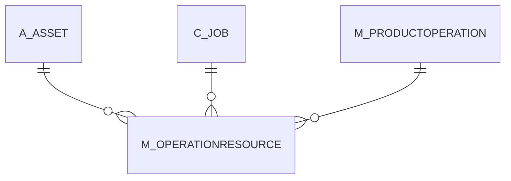

# M_OPERATIONRESOURCE

Area [M](../../data-model/m/index.md) · class **business** (proposed) · read from database `idempiere-db` (owner `ADEMPIERE`) · 0 row(s) when profiled

Application model: `org.compiere.model.X_M_OperationResource`, access level 3 - Client - Org.

## Columns

| column | type | key | not null | business name | references (code) | nulls | distinct |
|---|---|---|---|---|---|---|---|
| `M_OPERATIONRESOURCE_ID` | NUMBER(10,0) | PK | yes | Operation Resource |  | 0 | 0 |
| `AD_CLIENT_ID` | NUMBER(10,0) |  | yes | Tenant |  | 0 | 0 |
| `AD_ORG_ID` | NUMBER(10,0) |  | yes | Organization |  | 0 | 0 |
| `ISACTIVE` | CHAR(1) |  | yes | Active |  | 0 | 0 |
| `CREATED` | DATE |  | yes | Created |  | 0 | 0 |
| `CREATEDBY` | NUMBER(10,0) |  | yes | Created By |  | 0 | 0 |
| `UPDATED` | DATE |  | yes | Updated |  | 0 | 0 |
| `UPDATEDBY` | NUMBER(10,0) |  | yes | Updated By |  | 0 | 0 |
| `M_PRODUCTOPERATION_ID` | NUMBER(10,0) |  | yes | Product Operation | [M_PRODUCTOPERATION](../../data-model/m/m_productoperation.md) | 0 | 0 |
| `NAME` | VARCHAR2(60 CHAR) |  | yes | Name |  | 0 | 0 |
| `DESCRIPTION` | VARCHAR2(255 CHAR) |  |  | Description |  | 0 | 0 |
| `HELP` | VARCHAR2(2000 CHAR) |  |  | Comment/Help |  | 0 | 0 |
| `A_ASSET_ID` | NUMBER(10,0) |  |  | Asset | [A_ASSET](../../data-model/a/a_asset.md) | 0 | 0 |
| `C_JOB_ID` | NUMBER(10,0) |  |  | Position | [C_JOB](../../data-model/c/c_job.md) | 0 | 0 |
| `SETUPTIME` | NUMBER |  | yes | Setup Time |  | 0 | 0 |
| `UNITRUNTIME` | NUMBER |  | yes | Runtime per Unit |  | 0 | 0 |
| `TEARDOWNTIME` | NUMBER |  | yes | Teardown Time |  | 0 | 0 |
| `M_OPERATIONRESOURCE_UU` | VARCHAR2(36 CHAR) |  |  | M_OperationResource_UU |  | 0 | 0 |

*references (code)* is the table the application model's code says a column points to; *Foreign keys* below are the constraints the database declares. Counts come from the profile; no value is ever shown.

## Foreign keys

**References**

| table | columns | on delete |
|---|---|---|
| [A_ASSET](../../data-model/a/a_asset.md) | M_OPERATIONRESOURCE.A_ASSET_ID → A_ASSET.A_ASSET_ID | NO ACTION |
| [C_JOB](../../data-model/c/c_job.md) | M_OPERATIONRESOURCE.C_JOB_ID → C_JOB.C_JOB_ID | NO ACTION |
| [M_PRODUCTOPERATION](../../data-model/m/m_productoperation.md) | M_OPERATIONRESOURCE.M_PRODUCTOPERATION_ID → M_PRODUCTOPERATION.M_PRODUCTOPERATION_ID | CASCADE |

**Referenced by**

_None._

## Write behaviour

- updates: **po_only**
- deletes: **deleted_by_users, deleted_by_cascade**
- change log: **recorded**
- evidence: 2 citation(s)

## Schema history

22 change(s); the latest:

| applied | release | operation | column | tickets |
|---|---|---|---|---|
| 2023-04-09T15:47 | iD11 | `add_constraint` |  | IDEMPIERE-5567 |
| 2023-04-09T15:47 | iD11 | `add_constraint` |  | IDEMPIERE-5567 |
| 2021-12-05T16:45 | i8.2z | `drop_constraint` |  | IDEMPIERE-5075 |
| 2021-12-05T16:45 | i8.2z | `add_constraint` |  | IDEMPIERE-5075 |
| 2021-12-05T16:45 | i8.2z | `drop_constraint` |  | IDEMPIERE-5075 |
| 2021-12-05T16:45 | i8.2z | `add_constraint` |  | IDEMPIERE-5075 |
| 2021-12-05T16:45 | i8.2z | `drop_constraint` |  | IDEMPIERE-5075 |
| 2021-12-05T16:45 | i8.2z | `add_constraint` |  | IDEMPIERE-5075 |
| 2020-08-04T01:00 | i7.1z | `modify_column` | HELP | IDEMPIERE-3862 |
| 2020-08-04T01:00 | i7.1z | `add_column` | tmp_col_2_tmp | IDEMPIERE-3862 |
| 2020-08-04T01:00 | i7.1z | `modify_column` | M_OPERATIONRESOURCE_UU | IDEMPIERE-3862 |
| 2020-08-04T01:00 | i7.1z | `add_column` | tmp_col_1_tmp | IDEMPIERE-3862 |
| 2020-08-04T01:00 | i7.1z | `drop_column` | tmp_col_3_tmp | IDEMPIERE-3862 |
| 2020-08-04T01:00 | i7.1z | `modify_column` | NAME | IDEMPIERE-3862 |
| 2020-08-04T01:00 | i7.1z | `add_column` | tmp_col_3_tmp | IDEMPIERE-3862 |

## Notes

<!-- ekos:manual id="table.m_operationresource.notes" -->
_Business notes about this table._
<!-- /ekos:manual -->
