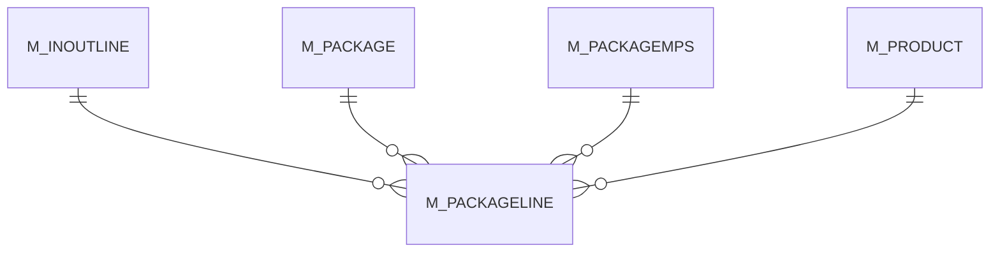

# M_PACKAGELINE

Area [M](../../data-model/m/index.md) · class **business** (proposed) · read from database `idempiere-db` (owner `ADEMPIERE`) · 1 row(s) when profiled

Application model: `org.compiere.model.X_M_PackageLine`, access level 1 - Org.

## Columns

| column | type | key | not null | business name | references (code) | nulls | distinct |
|---|---|---|---|---|---|---|---|
| `M_PACKAGELINE_ID` | NUMBER(10,0) | PK | yes | Package Line |  | 0 | 1 |
| `AD_CLIENT_ID` | NUMBER(10,0) |  | yes | Tenant |  | 0 | 1 |
| `AD_ORG_ID` | NUMBER(10,0) |  | yes | Organization |  | 0 | 1 |
| `ISACTIVE` | CHAR(1) |  | yes | Active |  | 0 | 1 |
| `CREATED` | DATE |  | yes | Created |  | 0 | 1 |
| `CREATEDBY` | NUMBER(10,0) |  | yes | Created By |  | 0 | 1 |
| `UPDATED` | DATE |  | yes | Updated |  | 0 | 1 |
| `UPDATEDBY` | NUMBER(10,0) |  | yes | Updated By |  | 0 | 1 |
| `M_PACKAGE_ID` | NUMBER(10,0) |  | yes | Package | [M_PACKAGE](../../data-model/m/m_package.md) | 0 | 1 |
| `M_INOUTLINE_ID` | NUMBER(10,0) |  | yes | Shipment/Receipt Line | [M_INOUTLINE](../../data-model/m/m_inoutline.md) | 0 | 1 |
| `QTY` | NUMBER |  | yes | Quantity |  | 0 | 1 |
| `DESCRIPTION` | VARCHAR2(255 CHAR) |  |  | Description |  | 1 | 0 |
| `M_PACKAGELINE_UU` | VARCHAR2(36 CHAR) |  |  | M_PackageLine_UU |  | 0 | 1 |
| `M_PRODUCT_ID` | NUMBER(10,0) |  |  | Product | [M_PRODUCT](../../data-model/m/m_product.md) | 1 | 0 |
| `M_PACKAGEMPS_ID` | NUMBER(10,0) |  |  | Package MPS | [M_PACKAGEMPS](../../data-model/m/m_packagemps.md) | 1 | 0 |

*references (code)* is the table the application model's code says a column points to; *Foreign keys* below are the constraints the database declares. Counts come from the profile; no value is ever shown.

## Foreign keys

**References**

| table | columns | on delete |
|---|---|---|
| [M_INOUTLINE](../../data-model/m/m_inoutline.md) | M_PACKAGELINE.M_INOUTLINE_ID → M_INOUTLINE.M_INOUTLINE_ID | NO ACTION |
| [M_PACKAGE](../../data-model/m/m_package.md) | M_PACKAGELINE.M_PACKAGE_ID → M_PACKAGE.M_PACKAGE_ID | NO ACTION |
| [M_PACKAGEMPS](../../data-model/m/m_packagemps.md) | M_PACKAGELINE.M_PACKAGEMPS_ID → M_PACKAGEMPS.M_PACKAGEMPS_ID | NO ACTION |
| [M_PRODUCT](../../data-model/m/m_product.md) | M_PACKAGELINE.M_PRODUCT_ID → M_PRODUCT.M_PRODUCT_ID | NO ACTION |

**Referenced by**

_None._

## Write behaviour

- updates: **po_only**
- deletes: **deleted_by_app, deleted_by_users**
- change log: **recorded**
- evidence: 3 citation(s)

## Read by

| kind | name |
|---|---|
| View | `M_PACKAGELINES_AVAIL_V` |
| View | `X_PACKAGELINEWEIGHT` |
| View | `m_packagelines_avail_v` |
| View | `x_packagelineweight` |

## Schema history

20 change(s); the latest:

| applied | release | operation | column | tickets |
|---|---|---|---|---|
| 2023-04-09T15:47 | iD11 | `add_constraint` |  | IDEMPIERE-5567 |
| 2023-04-09T15:47 | iD11 | `add_constraint` |  | IDEMPIERE-5567 |
| 2021-12-05T16:45 | i8.2z | `drop_constraint` |  | IDEMPIERE-5075 |
| 2021-12-05T16:45 | i8.2z | `drop_constraint` |  | IDEMPIERE-5075 |
| 2021-12-05T16:45 | i8.2z | `add_constraint` |  | IDEMPIERE-5075 |
| 2021-12-05T16:45 | i8.2z | `add_constraint` |  | IDEMPIERE-5075 |
| 2020-08-04T01:00 | i7.1z | `drop_column` | tmp_col_2_tmp | IDEMPIERE-3862 |
| 2020-08-04T01:00 | i7.1z | `drop_column` | tmp_col_1_tmp | IDEMPIERE-3862 |
| 2020-08-04T01:00 | i7.1z | `add_column` | tmp_col_1_tmp | IDEMPIERE-3862 |
| 2020-08-04T01:00 | i7.1z | `add_column` | tmp_col_2_tmp | IDEMPIERE-3862 |
| 2020-08-04T01:00 | i7.1z | `modify_column` | M_PACKAGELINE_UU | IDEMPIERE-3862 |
| 2020-08-04T01:00 | i7.1z | `modify_column` | DESCRIPTION | IDEMPIERE-3862 |
| 2013-04-18T15:26 | i1.0a-i1.0b | `add_constraint` |  |  |
| 2013-04-18T15:26 | i1.0a-i1.0b | `add_constraint` |  |  |
| 2013-04-18T15:26 | i1.0a-i1.0b | `add_constraint` |  |  |

## Notes

<!-- ekos:manual id="table.m_packageline.notes" -->
_Business notes about this table._
<!-- /ekos:manual -->
