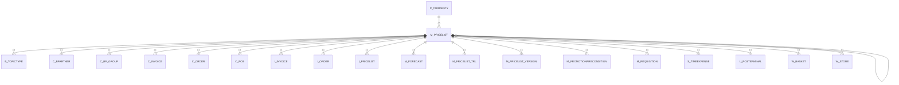

# M_PRICELIST

Area [M](../../data-model/m/index.md) · class **business** (proposed) · read from database `idempiere-db` (owner `ADEMPIERE`) · 4 row(s) when profiled

Application model: `org.compiere.model.X_M_PriceList`, access level 3 - Client - Org.

## Columns

| column | type | key | not null | business name | references (code) | nulls | distinct |
|---|---|---|---|---|---|---|---|
| `M_PRICELIST_ID` | NUMBER(10,0) | PK | yes | Price List |  | 0 | 4 |
| `AD_CLIENT_ID` | NUMBER(10,0) |  | yes | Tenant |  | 0 | 1 |
| `AD_ORG_ID` | NUMBER(10,0) |  | yes | Organization |  | 0 | 2 |
| `ISACTIVE` | CHAR(1) |  | yes | Active |  | 0 | 1 |
| `CREATED` | DATE |  | yes | Created |  | 0 | 4 |
| `CREATEDBY` | NUMBER(10,0) |  | yes | Created By |  | 0 | 2 |
| `UPDATED` | DATE |  | yes | Updated |  | 0 | 4 |
| `UPDATEDBY` | NUMBER(10,0) |  | yes | Updated By |  | 0 | 2 |
| `NAME` | VARCHAR2(60 CHAR) |  | yes | Name |  | 0 | 4 |
| `DESCRIPTION` | VARCHAR2(255 CHAR) |  |  | Description |  | 0 | 4 |
| `BASEPRICELIST_ID` | NUMBER(10,0) |  |  | Base Price List | [M_PRICELIST](../../data-model/m/m_pricelist.md) | 3 | 1 |
| `ISTAXINCLUDED` | CHAR(1) |  | yes | Price includes Tax |  | 0 | 1 |
| `ISSOPRICELIST` | CHAR(1) |  | yes | Sales Price list |  | 0 | 2 |
| `ISDEFAULT` | CHAR(1) |  | yes | Default |  | 0 | 2 |
| `C_CURRENCY_ID` | NUMBER(10,0) |  | yes | Currency | [C_CURRENCY](../../data-model/c/c_currency.md) | 0 | 2 |
| `ENFORCEPRICELIMIT` | CHAR(1) |  | yes | Enforce price limit |  | 0 | 2 |
| `PRICEPRECISION` | NUMBER(10,0) |  | yes | Price Precision |  | 0 | 1 |
| `ISMANDATORY` | CHAR(1) |  |  | Mandatory |  | 0 | 1 |
| `ISPRESENTFORPRODUCT` | CHAR(1) |  |  | Is Present For Product |  | 0 | 1 |
| `M_PRICELIST_UU` | VARCHAR2(36 CHAR) |  |  | M_PriceList_UU |  | 0 | 4 |

*references (code)* is the table the application model's code says a column points to; *Foreign keys* below are the constraints the database declares. Counts come from the profile; no value is ever shown.

## Check constraints

| name | expression |
|---|---|
| `SYS_C0020924` | `IsTaxIncluded in ('Y','N')` |
| `SYS_C0020925` | `IsActive in ('Y','N')` |
| `SYS_C0020927` | `IsSOPriceList in ('Y','N')` |
| `SYS_C0020929` | `EnforcePriceLimit in ('Y','N')` |

## Foreign keys

**References**

| table | columns | on delete |
|---|---|---|
| [C_CURRENCY](../../data-model/c/c_currency.md) | M_PRICELIST.C_CURRENCY_ID → C_CURRENCY.C_CURRENCY_ID | NO ACTION |
| [M_PRICELIST](../../data-model/m/m_pricelist.md) | M_PRICELIST.BASEPRICELIST_ID → M_PRICELIST.M_PRICELIST_ID | NO ACTION |

**Referenced by**

| table | columns | on delete |
|---|---|---|
| [B_TOPICTYPE](../../data-model/b/b_topictype.md) | B_TOPICTYPE.M_PRICELIST_ID → M_PRICELIST.M_PRICELIST_ID | NO ACTION |
| [C_BPARTNER](../../data-model/c/c_bpartner.md) | C_BPARTNER.PO_PRICELIST_ID → M_PRICELIST.M_PRICELIST_ID | SET NULL |
| [C_BP_GROUP](../../data-model/c/c_bp_group.md) | C_BP_GROUP.PO_PRICELIST_ID → M_PRICELIST.M_PRICELIST_ID | SET NULL |
| [C_INVOICE](../../data-model/c/c_invoice.md) | C_INVOICE.M_PRICELIST_ID → M_PRICELIST.M_PRICELIST_ID | NO ACTION |
| [C_ORDER](../../data-model/c/c_order.md) | C_ORDER.M_PRICELIST_ID → M_PRICELIST.M_PRICELIST_ID | NO ACTION |
| [C_POS](../../data-model/c/c_pos.md) | C_POS.M_PRICELIST_ID → M_PRICELIST.M_PRICELIST_ID | NO ACTION |
| `I_INVOICE` | I_INVOICE.M_PRICELIST_ID → M_PRICELIST.M_PRICELIST_ID | SET NULL |
| `I_ORDER` | I_ORDER.M_PRICELIST_ID → M_PRICELIST.M_PRICELIST_ID | SET NULL |
| `I_PRICELIST` | I_PRICELIST.M_PRICELIST_ID → M_PRICELIST.M_PRICELIST_ID | NO ACTION |
| [M_FORECAST](../../data-model/m/m_forecast.md) | M_FORECAST.M_PRICELIST_ID → M_PRICELIST.M_PRICELIST_ID | NO ACTION |
| [M_PRICELIST](../../data-model/m/m_pricelist.md) | M_PRICELIST.BASEPRICELIST_ID → M_PRICELIST.M_PRICELIST_ID | NO ACTION |
| [M_PRICELIST_TRL](../../data-model/m/m_pricelist_trl.md) | M_PRICELIST_TRL.M_PRICELIST_ID → M_PRICELIST.M_PRICELIST_ID | CASCADE |
| [M_PRICELIST_VERSION](../../data-model/m/m_pricelist_version.md) | M_PRICELIST_VERSION.M_PRICELIST_ID → M_PRICELIST.M_PRICELIST_ID | CASCADE |
| [M_PROMOTIONPRECONDITION](../../data-model/m/m_promotionprecondition.md) | M_PROMOTIONPRECONDITION.M_PRICELIST_ID → M_PRICELIST.M_PRICELIST_ID | NO ACTION |
| [M_REQUISITION](../../data-model/m/m_requisition.md) | M_REQUISITION.M_PRICELIST_ID → M_PRICELIST.M_PRICELIST_ID | NO ACTION |
| [S_TIMEEXPENSE](../../data-model/s/s_timeexpense.md) | S_TIMEEXPENSE.M_PRICELIST_ID → M_PRICELIST.M_PRICELIST_ID | NO ACTION |
| [U_POSTERMINAL](../../data-model/u/u_posterminal.md) | U_POSTERMINAL.PO_PRICELIST_ID → M_PRICELIST.M_PRICELIST_ID | NO ACTION |
| [W_BASKET](../../data-model/w/w_basket.md) | W_BASKET.M_PRICELIST_ID → M_PRICELIST.M_PRICELIST_ID | NO ACTION |
| [W_STORE](../../data-model/w/w_store.md) | W_STORE.M_PRICELIST_ID → M_PRICELIST.M_PRICELIST_ID | NO ACTION |

## Write behaviour

- updates: **po_only**
- deletes: **deleted_by_users**
- change log: **recorded**
- evidence: 1 citation(s)

## Read by

| kind | name |
|---|---|
| Procedure | [M_PRICELIST_CREATE](../../logic/m_pricelist_create.md) |
| Procedure | [M_PriceList_Create](../../logic/m_pricelist_create.md) |
| View | `M_PRODUCT_SUBSTITUTERELATED_V` |
| View | `RV_M_FORECAST` |
| View | `m_product_substituterelated_v` |
| View | `rv_m_forecast` |

## Schema history

18 change(s); the latest:

| applied | release | operation | column | tickets |
|---|---|---|---|---|
| 2023-04-09T15:47 | iD11 | `add_constraint` |  | IDEMPIERE-5567 |
| 2023-04-09T15:47 | iD11 | `add_constraint` |  | IDEMPIERE-5567 |
| 2021-12-05T16:45 | i8.2z | `add_constraint` |  | IDEMPIERE-5075 |
| 2021-12-05T16:45 | i8.2z | `drop_constraint` |  | IDEMPIERE-5075 |
| 2021-12-05T16:45 | i8.2z | `add_constraint` |  | IDEMPIERE-5075 |
| 2021-12-05T16:45 | i8.2z | `drop_constraint` |  | IDEMPIERE-5075 |
| 2020-08-04T01:00 | i7.1z | `modify_column` | DESCRIPTION | IDEMPIERE-3862 |
| 2020-08-04T01:00 | i7.1z | `drop_column` | tmp_col_3_tmp | IDEMPIERE-3862 |
| 2020-08-04T01:00 | i7.1z | `add_column` | tmp_col_2_tmp | IDEMPIERE-3862 |
| 2020-08-04T01:00 | i7.1z | `modify_column` | NAME | IDEMPIERE-3862 |
| 2020-08-04T01:00 | i7.1z | `modify_column` | NAME | IDEMPIERE-3862 |
| 2020-08-04T01:00 | i7.1z | `add_column` | tmp_col_3_tmp | IDEMPIERE-3862 |
| 2020-08-04T01:00 | i7.1z | `add_column` | tmp_col_1_tmp | IDEMPIERE-3862 |
| 2020-08-04T01:00 | i7.1z | `drop_column` | tmp_col_2_tmp | IDEMPIERE-3862 |
| 2020-08-04T01:00 | i7.1z | `modify_column` | NAME | IDEMPIERE-3862 |

## Notes

<!-- ekos:manual id="table.m_pricelist.notes" -->
_Business notes about this table._
<!-- /ekos:manual -->
