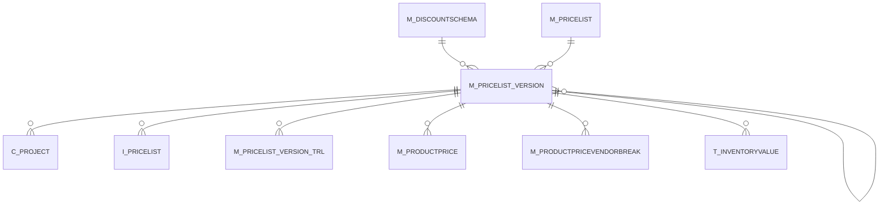

# M_PRICELIST_VERSION

Area [M](../../data-model/m/index.md) · class **business** (proposed) · read from database `idempiere-db` (owner `ADEMPIERE`) · 6 row(s) when profiled

Application model: `org.compiere.model.X_M_PriceList_Version`, access level 3 - Client - Org.

## Columns

| column | type | key | not null | business name | references (code) | nulls | distinct |
|---|---|---|---|---|---|---|---|
| `M_PRICELIST_VERSION_ID` | NUMBER(10,0) | PK | yes | Price List Version |  | 0 | 6 |
| `AD_CLIENT_ID` | NUMBER(10,0) |  | yes | Tenant |  | 0 | 1 |
| `AD_ORG_ID` | NUMBER(10,0) |  | yes | Organization |  | 0 | 2 |
| `ISACTIVE` | CHAR(1) |  | yes | Active |  | 0 | 2 |
| `CREATED` | DATE |  | yes | Created |  | 0 | 6 |
| `CREATEDBY` | NUMBER(10,0) |  | yes | Created By |  | 0 | 2 |
| `UPDATED` | DATE |  | yes | Updated |  | 0 | 6 |
| `UPDATEDBY` | NUMBER(10,0) |  | yes | Updated By |  | 0 | 1 |
| `NAME` | VARCHAR2(60 CHAR) |  | yes | Name |  | 0 | 6 |
| `DESCRIPTION` | VARCHAR2(255 CHAR) |  |  | Description |  | 2 | 4 |
| `M_PRICELIST_ID` | NUMBER(10,0) |  | yes | Price List | [M_PRICELIST](../../data-model/m/m_pricelist.md) | 0 | 4 |
| `M_DISCOUNTSCHEMA_ID` | NUMBER(10,0) |  | yes | Discount Schema | [M_DISCOUNTSCHEMA](../../data-model/m/m_discountschema.md) | 0 | 2 |
| `VALIDFROM` | DATE |  | yes | Valid from |  | 0 | 4 |
| `PROCCREATE` | CHAR(1) |  |  | Create |  | 1 | 1 |
| `M_PRICELIST_VERSION_BASE_ID` | NUMBER(10,0) |  |  | Base Price List | [M_PRICELIST_VERSION](../../data-model/m/m_pricelist_version.md) | 3 | 2 |
| `M_PRICELIST_VERSION_UU` | VARCHAR2(36 CHAR) |  |  | M_PriceList_Version_UU |  | 0 | 6 |

*references (code)* is the table the application model's code says a column points to; *Foreign keys* below are the constraints the database declares. Counts come from the profile; no value is ever shown.

## Check constraints

| name | expression |
|---|---|
| `SYS_C0020038` | `IsActive in ('Y','N')` |

## Foreign keys

**References**

| table | columns | on delete |
|---|---|---|
| [M_DISCOUNTSCHEMA](../../data-model/m/m_discountschema.md) | M_PRICELIST_VERSION.M_DISCOUNTSCHEMA_ID → M_DISCOUNTSCHEMA.M_DISCOUNTSCHEMA_ID | NO ACTION |
| [M_PRICELIST](../../data-model/m/m_pricelist.md) | M_PRICELIST_VERSION.M_PRICELIST_ID → M_PRICELIST.M_PRICELIST_ID | CASCADE |
| [M_PRICELIST_VERSION](../../data-model/m/m_pricelist_version.md) | M_PRICELIST_VERSION.M_PRICELIST_VERSION_BASE_ID → M_PRICELIST_VERSION.M_PRICELIST_VERSION_ID | NO ACTION |

**Referenced by**

| table | columns | on delete |
|---|---|---|
| [C_PROJECT](../../data-model/c/c_project.md) | C_PROJECT.M_PRICELIST_VERSION_ID → M_PRICELIST_VERSION.M_PRICELIST_VERSION_ID | NO ACTION |
| `I_PRICELIST` | I_PRICELIST.M_PRICELIST_VERSION_ID → M_PRICELIST_VERSION.M_PRICELIST_VERSION_ID | NO ACTION |
| [M_PRICELIST_VERSION](../../data-model/m/m_pricelist_version.md) | M_PRICELIST_VERSION.M_PRICELIST_VERSION_BASE_ID → M_PRICELIST_VERSION.M_PRICELIST_VERSION_ID | NO ACTION |
| [M_PRICELIST_VERSION_TRL](../../data-model/m/m_pricelist_version_trl.md) | M_PRICELIST_VERSION_TRL.M_PRICELIST_VERSION_ID → M_PRICELIST_VERSION.M_PRICELIST_VERSION_ID | CASCADE |
| [M_PRODUCTPRICE](../../data-model/m/m_productprice.md) | M_PRODUCTPRICE.M_PRICELIST_VERSION_ID → M_PRICELIST_VERSION.M_PRICELIST_VERSION_ID | CASCADE |
| [M_PRODUCTPRICEVENDORBREAK](../../data-model/m/m_productpricevendorbreak.md) | M_PRODUCTPRICEVENDORBREAK.M_PRICELIST_VERSION_ID → M_PRICELIST_VERSION.M_PRICELIST_VERSION_ID | NO ACTION |
| `T_INVENTORYVALUE` | T_INVENTORYVALUE.M_PRICELIST_VERSION_ID → M_PRICELIST_VERSION.M_PRICELIST_VERSION_ID | CASCADE |

## Write behaviour

- updates: **po_only**
- deletes: **deleted_by_users, deleted_by_cascade**
- change log: **recorded**
- evidence: 2 citation(s)

## Read by

| kind | name |
|---|---|
| Procedure | [M_PRICELIST_CREATE](../../logic/m_pricelist_create.md) |
| Procedure | [M_PriceList_Create](../../logic/m_pricelist_create.md) |
| View | `M_PRODUCT_SUBSTITUTERELATED_V` |
| View | `RV_M_FORECAST` |
| View | `m_product_substituterelated_v` |
| View | `rv_m_forecast` |

## Schema history

21 change(s); the latest:

| applied | release | operation | column | tickets |
|---|---|---|---|---|
| 2023-04-09T15:47 | iD11 | `add_constraint` |  | IDEMPIERE-5567 |
| 2023-04-09T15:47 | iD11 | `add_constraint` |  | IDEMPIERE-5567 |
| 2021-12-05T16:45 | i8.2z | `add_constraint` |  | IDEMPIERE-5075 |
| 2021-12-05T16:45 | i8.2z | `add_constraint` |  | IDEMPIERE-5075 |
| 2021-12-05T16:45 | i8.2z | `drop_constraint` |  | IDEMPIERE-5075 |
| 2021-12-05T16:45 | i8.2z | `add_constraint` |  | IDEMPIERE-5075 |
| 2021-12-05T16:45 | i8.2z | `drop_constraint` |  | IDEMPIERE-5075 |
| 2021-12-05T16:45 | i8.2z | `drop_constraint` |  | IDEMPIERE-5075 |
| 2020-08-04T01:00 | i7.1z | `add_column` | tmp_col_3_tmp | IDEMPIERE-3862 |
| 2020-08-04T01:00 | i7.1z | `modify_column` | M_PRICELIST_VERSION_UU | IDEMPIERE-3862 |
| 2020-08-04T01:00 | i7.1z | `add_column` | tmp_col_2_tmp | IDEMPIERE-3862 |
| 2020-08-04T01:00 | i7.1z | `modify_column` | NAME | IDEMPIERE-3862 |
| 2020-08-04T01:00 | i7.1z | `drop_column` | tmp_col_3_tmp | IDEMPIERE-3862 |
| 2020-08-04T01:00 | i7.1z | `modify_column` | NAME | IDEMPIERE-3862 |
| 2020-08-04T01:00 | i7.1z | `drop_column` | tmp_col_2_tmp | IDEMPIERE-3862 |

## Notes

<!-- ekos:manual id="table.m_pricelist_version.notes" -->
_Business notes about this table._
<!-- /ekos:manual -->
