# M_PRODUCT

Area [M](../../data-model/m/index.md) · class **business** (proposed) · read from database `idempiere-db` (owner `ADEMPIERE`) · 55 row(s) when profiled

Application model: `org.compiere.model.X_M_Product`, access level 3 - Client - Org.

## Columns

| column | type | key | not null | business name | references (code) | nulls | distinct |
|---|---|---|---|---|---|---|---|
| `M_PRODUCT_ID` | NUMBER(10,0) | PK | yes | Product |  | 0 | 55 |
| `AD_CLIENT_ID` | NUMBER(10,0) |  | yes | Tenant |  | 0 | 1 |
| `AD_ORG_ID` | NUMBER(10,0) |  | yes | Organization |  | 0 | 1 |
| `ISACTIVE` | CHAR(1) |  | yes | Active |  | 0 | 1 |
| `CREATED` | DATE |  | yes | Created |  | 0 | 45 |
| `CREATEDBY` | NUMBER(10,0) |  | yes | Created By |  | 0 | 2 |
| `UPDATED` | DATE |  | yes | Updated |  | 0 | 23 |
| `UPDATEDBY` | NUMBER(10,0) |  | yes | Updated By |  | 0 | 1 |
| `VALUE` | VARCHAR2(510 CHAR) |  | yes | Search Key |  | 0 | 55 |
| `NAME` | VARCHAR2(255 CHAR) |  | yes | Name |  | 0 | 55 |
| `DESCRIPTION` | VARCHAR2(255 CHAR) |  |  | Description |  | 39 | 16 |
| `DOCUMENTNOTE` | VARCHAR2(2000 CHAR) |  |  | Document Note |  | 53 | 2 |
| `HELP` | VARCHAR2(2000 CHAR) |  |  | Comment/Help |  | 55 | 0 |
| `UPC` | VARCHAR2(30 CHAR) |  |  | UPC/EAN |  | 54 | 1 |
| `SKU` | VARCHAR2(30 CHAR) |  |  | SKU |  | 54 | 1 |
| `C_UOM_ID` | NUMBER(10,0) |  | yes | UOM | [C_UOM](../../data-model/c/c_uom.md) | 0 | 6 |
| `SALESREP_ID` | NUMBER(10,0) |  |  | Sales Representative | [AD_USER](../../data-model/ad/ad_user.md) | 52 | 2 |
| `ISSUMMARY` | CHAR(1) |  | yes | Summary Level |  | 0 | 1 |
| `ISSTOCKED` | CHAR(1) |  | yes | Stocked |  | 0 | 2 |
| `ISPURCHASED` | CHAR(1) |  | yes | Purchased |  | 0 | 2 |
| `ISSOLD` | CHAR(1) |  | yes | Sold |  | 0 | 2 |
| `ISBOM` | CHAR(1) |  | yes | Bill of Materials |  | 0 | 2 |
| `ISINVOICEPRINTDETAILS` | CHAR(1) |  | yes | Print detail records on invoice |  | 0 | 2 |
| `ISPICKLISTPRINTDETAILS` | CHAR(1) |  | yes | Print detail records on pick list |  | 0 | 2 |
| `ISVERIFIED` | CHAR(1) |  | yes | Verified |  | 0 | 2 |
| `C_REVENUERECOGNITION_ID` | NUMBER(10,0) |  |  | Revenue Recognition | [C_REVENUERECOGNITION](../../data-model/c/c_revenuerecognition.md) | 55 | 0 |
| `M_PRODUCT_CATEGORY_ID` | NUMBER(10,0) |  | yes | Product Category | [M_PRODUCT_CATEGORY](../../data-model/m/m_product_category.md) | 0 | 13 |
| `CLASSIFICATION` | VARCHAR2(12 CHAR) |  |  | Classification |  | 55 | 0 |
| `VOLUME` | NUMBER |  |  | Volume |  | 0 | 1 |
| `WEIGHT` | NUMBER |  |  | Weight |  | 0 | 3 |
| `SHELFWIDTH` | NUMBER(10,0) |  |  | Shelf Width |  | 22 | 3 |
| `SHELFHEIGHT` | NUMBER |  |  | Shelf Height |  | 22 | 4 |
| `SHELFDEPTH` | NUMBER(10,0) |  |  | Shelf Depth |  | 22 | 4 |
| `UNITSPERPALLET` | NUMBER |  |  | Units Per Pallet |  | 23 | 1 |
| `C_TAXCATEGORY_ID` | NUMBER(10,0) |  | yes | Tax Category | [C_TAXCATEGORY](../../data-model/c/c_taxcategory.md) | 0 | 1 |
| `S_RESOURCE_ID` | NUMBER(10,0) |  |  | Resource | [S_RESOURCE](../../data-model/s/s_resource.md) | 44 | 11 |
| `DISCONTINUED` | CHAR(1) |  |  | Discontinued |  | 0 | 1 |
| `DISCONTINUEDBY` | DATE |  |  |  |  | 55 | 0 |
| `PROCESSING` | CHAR(1) |  |  | Process Now |  | 15 | 1 |
| `S_EXPENSETYPE_ID` | NUMBER(10,0) |  |  | Expense Type | [S_EXPENSETYPE](../../data-model/s/s_expensetype.md) | 54 | 1 |
| `PRODUCTTYPE` | CHAR(1) |  | yes | Product Type |  | 0 | 5 |
| `IMAGEURL` | VARCHAR2(120 CHAR) |  |  | Image URL |  | 53 | 1 |
| `DESCRIPTIONURL` | VARCHAR2(120 CHAR) |  |  | Description URL |  | 54 | 1 |
| `GUARANTEEDAYS` | NUMBER(10,0) |  |  | Guarantee Days |  | 33 | 3 |
| `R_MAILTEXT_ID` | NUMBER(10,0) |  |  | Mail Template | [R_MAILTEXT](../../data-model/r/r_mailtext.md) | 54 | 1 |
| `VERSIONNO` | VARCHAR2(20 CHAR) |  |  | Version No |  | 54 | 1 |
| `M_ATTRIBUTESET_ID` | NUMBER(10,0) |  |  | Attribute Set | [M_ATTRIBUTESET](../../data-model/m/m_attributeset.md) | 51 | 3 |
| `M_ATTRIBUTESETINSTANCE_ID` | NUMBER(10,0) |  |  | Attribute Set Instance | [M_ATTRIBUTESETINSTANCE](../../data-model/m/m_attributesetinstance.md) | 0 | 4 |
| `DOWNLOADURL` | VARCHAR2(120 CHAR) |  |  |  |  | 55 | 0 |
| `M_FREIGHTCATEGORY_ID` | NUMBER(10,0) |  |  | Freight Category | [M_FREIGHTCATEGORY](../../data-model/m/m_freightcategory.md) | 55 | 0 |
| `M_LOCATOR_ID` | NUMBER(10,0) |  |  | Locator | [M_LOCATOR](../../data-model/m/m_locator.md) | 40 | 3 |
| `GUARANTEEDAYSMIN` | NUMBER(10,0) |  |  | Min Guarantee Days |  | 36 | 2 |
| `ISWEBSTOREFEATURED` | CHAR(1) |  | yes | Featured in Web Store |  | 0 | 2 |
| `ISSELFSERVICE` | CHAR(1) |  | yes | Self-Service |  | 0 | 2 |
| `C_SUBSCRIPTIONTYPE_ID` | NUMBER(10,0) |  |  | Subscription Type | [C_SUBSCRIPTIONTYPE](../../data-model/c/c_subscriptiontype.md) | 55 | 0 |
| `ISDROPSHIP` | CHAR(1) |  | yes | Drop Shipment |  | 0 | 1 |
| `ISEXCLUDEAUTODELIVERY` | CHAR(1) |  | yes | Exclude Auto Delivery |  | 0 | 1 |
| `GROUP1` | VARCHAR2(255 CHAR) |  |  | Group1 |  | 55 | 0 |
| `GROUP2` | VARCHAR2(255 CHAR) |  |  | Group2 |  | 55 | 0 |
| `ISTOFORMULE` | CHAR(1) |  |  |  |  | 55 | 0 |
| `LOWLEVEL` | NUMBER(10,0) |  | yes | Low Level |  | 0 | 4 |
| `UNITSPERPACK` | NUMBER(10,0) |  | yes | Units Per Pack |  | 0 | 2 |
| `DISCONTINUEDAT` | DATE |  |  | Discontinued At |  | 55 | 0 |
| `COPYFROM` | CHAR(1) |  |  | Copy From |  | 53 | 1 |
| `M_PRODUCT_UU` | VARCHAR2(36 CHAR) |  |  | M_Product_UU |  | 0 | 55 |
| `M_PARTTYPE_ID` | NUMBER(10,0) |  |  | Part Type | [M_PARTTYPE](../../data-model/m/m_parttype.md) | 55 | 0 |
| `ISKANBAN` | CHAR(1) |  | yes | Kanban controlled |  | 0 | 1 |
| `ISMANUFACTURED` | CHAR(1) |  | yes | Manufactured |  | 0 | 1 |
| `ISPHANTOM` | CHAR(1) |  |  | Phantom |  | 0 | 2 |
| `ISOWNBOX` | CHAR(1) |  | yes | Own Box |  | 0 | 1 |
| `CUSTOMSTARIFFNUMBER` | VARCHAR2(20 CHAR) |  |  | Customs Tariff Number |  | 55 | 0 |
| `ISAUTOPRODUCE` | CHAR(1) |  | yes | Auto Produce |  | 0 | 1 |

*references (code)* is the table the application model's code says a column points to; *Foreign keys* below are the constraints the database declares. Counts come from the profile; no value is ever shown.

## Check constraints

| name | expression |
|---|---|
| `SYS_C0022524` | `IsManufactured IN ('Y','N')` |
| `SYS_C0022525` | `IsKanban IN ('Y','N')` |
| `SYS_C0022526` | `IsPurchased in ('Y','N')` |
| `SYS_C0022527` | `IsOwnBox IN ('Y','N')` |
| `SYS_C0022528` | `IsBOM in ('Y','N')` |
| `SYS_C0022529` | `Discontinued in ('Y','N')` |
| `SYS_C0022531` | `IsVerified in ('Y','N')` |
| `SYS_C0022532` | `IsAutoProduce IN ('Y','N')` |
| `SYS_C0022534` | `IsInvoicePrintDetails in ('Y','N')` |
| `SYS_C0022535` | `IsActive in ('Y','N')` |
| `SYS_C0022536` | `IsSold in ('Y','N')` |
| `SYS_C0022537` | `IsToFormule IN ('Y','N')` |
| `SYS_C0022538` | `IsPickListPrintDetails in ('Y','N')` |
| `SYS_C0022539` | `IsStocked in ('Y','N')` |

## Foreign keys

**References**

| table | columns | on delete |
|---|---|---|
| [AD_CLIENT](../../data-model/ad/ad_client.md) | M_PRODUCT.AD_CLIENT_ID → AD_CLIENT.AD_CLIENT_ID | NO ACTION |
| [AD_ORG](../../data-model/ad/ad_org.md) | M_PRODUCT.AD_ORG_ID → AD_ORG.AD_ORG_ID | NO ACTION |
| [AD_USER](../../data-model/ad/ad_user.md) | M_PRODUCT.SALESREP_ID → AD_USER.AD_USER_ID | NO ACTION |
| [C_REVENUERECOGNITION](../../data-model/c/c_revenuerecognition.md) | M_PRODUCT.C_REVENUERECOGNITION_ID → C_REVENUERECOGNITION.C_REVENUERECOGNITION_ID | NO ACTION |
| [C_SUBSCRIPTIONTYPE](../../data-model/c/c_subscriptiontype.md) | M_PRODUCT.C_SUBSCRIPTIONTYPE_ID → C_SUBSCRIPTIONTYPE.C_SUBSCRIPTIONTYPE_ID | NO ACTION |
| [C_TAXCATEGORY](../../data-model/c/c_taxcategory.md) | M_PRODUCT.C_TAXCATEGORY_ID → C_TAXCATEGORY.C_TAXCATEGORY_ID | NO ACTION |
| [C_UOM](../../data-model/c/c_uom.md) | M_PRODUCT.C_UOM_ID → C_UOM.C_UOM_ID | NO ACTION |
| [M_ATTRIBUTESET](../../data-model/m/m_attributeset.md) | M_PRODUCT.M_ATTRIBUTESET_ID → M_ATTRIBUTESET.M_ATTRIBUTESET_ID | CASCADE |
| [M_ATTRIBUTESETINSTANCE](../../data-model/m/m_attributesetinstance.md) | M_PRODUCT.M_ATTRIBUTESETINSTANCE_ID → M_ATTRIBUTESETINSTANCE.M_ATTRIBUTESETINSTANCE_ID | NO ACTION |
| [M_FREIGHTCATEGORY](../../data-model/m/m_freightcategory.md) | M_PRODUCT.M_FREIGHTCATEGORY_ID → M_FREIGHTCATEGORY.M_FREIGHTCATEGORY_ID | NO ACTION |
| [M_LOCATOR](../../data-model/m/m_locator.md) | M_PRODUCT.M_LOCATOR_ID → M_LOCATOR.M_LOCATOR_ID | NO ACTION |
| [M_PARTTYPE](../../data-model/m/m_parttype.md) | M_PRODUCT.M_PARTTYPE_ID → M_PARTTYPE.M_PARTTYPE_ID | NO ACTION |
| [M_PRODUCT_CATEGORY](../../data-model/m/m_product_category.md) | M_PRODUCT.M_PRODUCT_CATEGORY_ID → M_PRODUCT_CATEGORY.M_PRODUCT_CATEGORY_ID | NO ACTION |
| [R_MAILTEXT](../../data-model/r/r_mailtext.md) | M_PRODUCT.R_MAILTEXT_ID → R_MAILTEXT.R_MAILTEXT_ID | NO ACTION |
| [S_EXPENSETYPE](../../data-model/s/s_expensetype.md) | M_PRODUCT.S_EXPENSETYPE_ID → S_EXPENSETYPE.S_EXPENSETYPE_ID | NO ACTION |
| [S_RESOURCE](../../data-model/s/s_resource.md) | M_PRODUCT.S_RESOURCE_ID → S_RESOURCE.S_RESOURCE_ID | NO ACTION |

**Referenced by**

| table | columns | on delete |
|---|---|---|
| [AD_CLIENTINFO](../../data-model/ad/ad_clientinfo.md) | AD_CLIENTINFO.M_PRODUCTFREIGHT_ID → M_PRODUCT.M_PRODUCT_ID | NO ACTION |
| [A_ASSET](../../data-model/a/a_asset.md) | A_ASSET.M_PRODUCT_ID → M_PRODUCT.M_PRODUCT_ID | NO ACTION |
| [A_ASSET_ADDITION](../../data-model/a/a_asset_addition.md) | A_ASSET_ADDITION.M_PRODUCT_ID → M_PRODUCT.M_PRODUCT_ID | NO ACTION |
| [A_ASSET_PRODUCT](../../data-model/a/a_asset_product.md) | A_ASSET_PRODUCT.M_PRODUCT_ID → M_PRODUCT.M_PRODUCT_ID | NO ACTION |
| [A_REGISTRATION](../../data-model/a/a_registration.md) | A_REGISTRATION.M_PRODUCT_ID → M_PRODUCT.M_PRODUCT_ID | NO ACTION |
| [A_REGISTRATIONPRODUCT](../../data-model/a/a_registrationproduct.md) | A_REGISTRATIONPRODUCT.M_PRODUCT_ID → M_PRODUCT.M_PRODUCT_ID | NO ACTION |
| [B_TOPICTYPE](../../data-model/b/b_topictype.md) | B_TOPICTYPE.M_PRODUCT_ID → M_PRODUCT.M_PRODUCT_ID | NO ACTION |
| [C_ACCTSCHEMA_ELEMENT](../../data-model/c/c_acctschema_element.md) | C_ACCTSCHEMA_ELEMENT.M_PRODUCT_ID → M_PRODUCT.M_PRODUCT_ID | NO ACTION |
| [C_BPARTNER_PRODUCT](../../data-model/c/c_bpartner_product.md) | C_BPARTNER_PRODUCT.M_PRODUCT_ID → M_PRODUCT.M_PRODUCT_ID | CASCADE |
| [C_CASHPLANLINE](../../data-model/c/c_cashplanline.md) | C_CASHPLANLINE.M_PRODUCT_ID → M_PRODUCT.M_PRODUCT_ID | NO ACTION |
| [C_COMMISSION](../../data-model/c/c_commission.md) | C_COMMISSION.M_PRODUCT_ID → M_PRODUCT.M_PRODUCT_ID | NO ACTION |
| [C_COMMISSIONLINE](../../data-model/c/c_commissionline.md) | C_COMMISSIONLINE.M_PRODUCT_ID → M_PRODUCT.M_PRODUCT_ID | NO ACTION |
| [C_INVOICELINE](../../data-model/c/c_invoiceline.md) | C_INVOICELINE.M_PRODUCT_ID → M_PRODUCT.M_PRODUCT_ID | NO ACTION |
| [C_LANDEDCOST](../../data-model/c/c_landedcost.md) | C_LANDEDCOST.M_PRODUCT_ID → M_PRODUCT.M_PRODUCT_ID | NO ACTION |
| [C_LANDEDCOSTALLOCATION](../../data-model/c/c_landedcostallocation.md) | C_LANDEDCOSTALLOCATION.M_PRODUCT_ID → M_PRODUCT.M_PRODUCT_ID | NO ACTION |
| [C_ORDERLINE](../../data-model/c/c_orderline.md) | C_ORDERLINE.M_PRODUCT_ID → M_PRODUCT.M_PRODUCT_ID | NO ACTION |
| [C_PHASE](../../data-model/c/c_phase.md) | C_PHASE.M_PRODUCT_ID → M_PRODUCT.M_PRODUCT_ID | NO ACTION |
| [C_POSKEY](../../data-model/c/c_poskey.md) | C_POSKEY.M_PRODUCT_ID → M_PRODUCT.M_PRODUCT_ID | NO ACTION |
| [C_PROJECTISSUE](../../data-model/c/c_projectissue.md) | C_PROJECTISSUE.M_PRODUCT_ID → M_PRODUCT.M_PRODUCT_ID | NO ACTION |
| [C_PROJECTLINE](../../data-model/c/c_projectline.md) | C_PROJECTLINE.M_PRODUCT_ID → M_PRODUCT.M_PRODUCT_ID | NO ACTION |
| [C_PROJECTPHASE](../../data-model/c/c_projectphase.md) | C_PROJECTPHASE.M_PRODUCT_ID → M_PRODUCT.M_PRODUCT_ID | NO ACTION |
| [C_PROJECTTASK](../../data-model/c/c_projecttask.md) | C_PROJECTTASK.M_PRODUCT_ID → M_PRODUCT.M_PRODUCT_ID | NO ACTION |
| [C_RFQLINE](../../data-model/c/c_rfqline.md) | C_RFQLINE.M_PRODUCT_ID → M_PRODUCT.M_PRODUCT_ID | NO ACTION |
| [C_RFQ_TOPICSUBSCRIBERONLY](../../data-model/c/c_rfq_topicsubscriberonly.md) | C_RFQ_TOPICSUBSCRIBERONLY.M_PRODUCT_ID → M_PRODUCT.M_PRODUCT_ID | NO ACTION |
| [C_SERVICELEVEL](../../data-model/c/c_servicelevel.md) | C_SERVICELEVEL.M_PRODUCT_ID → M_PRODUCT.M_PRODUCT_ID | NO ACTION |
| [C_SUBSCRIPTION](../../data-model/c/c_subscription.md) | C_SUBSCRIPTION.M_PRODUCT_ID → M_PRODUCT.M_PRODUCT_ID | NO ACTION |
| [C_TASK](../../data-model/c/c_task.md) | C_TASK.M_PRODUCT_ID → M_PRODUCT.M_PRODUCT_ID | NO ACTION |
| [C_TAXDEFINITION](../../data-model/c/c_taxdefinition.md) | C_TAXDEFINITION.M_PRODUCT_ID → M_PRODUCT.M_PRODUCT_ID | NO ACTION |
| [C_UOM_CONVERSION](../../data-model/c/c_uom_conversion.md) | C_UOM_CONVERSION.M_PRODUCT_ID → M_PRODUCT.M_PRODUCT_ID | NO ACTION |
| [C_VALIDCOMBINATION](../../data-model/c/c_validcombination.md) | C_VALIDCOMBINATION.M_PRODUCT_ID → M_PRODUCT.M_PRODUCT_ID | NO ACTION |
| [DD_ORDERLINE](../../data-model/dd/dd_orderline.md) | DD_ORDERLINE.M_PRODUCT_ID → M_PRODUCT.M_PRODUCT_ID | NO ACTION |
| [FACT_ACCT](../../data-model/fact/fact_acct.md) | FACT_ACCT.M_PRODUCT_ID → M_PRODUCT.M_PRODUCT_ID | NO ACTION |
| [FACT_ACCT_SUMMARY](../../data-model/fact/fact_acct_summary.md) | FACT_ACCT_SUMMARY.M_PRODUCT_ID → M_PRODUCT.M_PRODUCT_ID | NO ACTION |
| [GL_DISTRIBUTION](../../data-model/gl/gl_distribution.md) | GL_DISTRIBUTION.M_PRODUCT_ID → M_PRODUCT.M_PRODUCT_ID | NO ACTION |
| [GL_DISTRIBUTIONLINE](../../data-model/gl/gl_distributionline.md) | GL_DISTRIBUTIONLINE.M_PRODUCT_ID → M_PRODUCT.M_PRODUCT_ID | NO ACTION |
| [GL_JOURNALLINE](../../data-model/gl/gl_journalline.md) | GL_JOURNALLINE.M_PRODUCT_ID → M_PRODUCT.M_PRODUCT_ID | NO ACTION |
| `I_ASSET` | I_ASSET.M_PRODUCT_ID → M_PRODUCT.M_PRODUCT_ID | NO ACTION |
| `I_FAJOURNAL` | I_FAJOURNAL.M_PRODUCT_ID → M_PRODUCT.M_PRODUCT_ID | NO ACTION |
| `I_FIXEDASSET` | I_FIXEDASSET.M_PRODUCT_ID → M_PRODUCT.M_PRODUCT_ID | NO ACTION |
| `I_GLJOURNAL` | I_GLJOURNAL.M_PRODUCT_ID → M_PRODUCT.M_PRODUCT_ID | SET NULL |
| `I_INVENTORY` | I_INVENTORY.M_PRODUCT_ID → M_PRODUCT.M_PRODUCT_ID | SET NULL |
| `I_INVOICE` | I_INVOICE.M_PRODUCT_ID → M_PRODUCT.M_PRODUCT_ID | SET NULL |
| `I_MOVEMENT` | I_MOVEMENT.M_PRODUCT_ID → M_PRODUCT.M_PRODUCT_ID | NO ACTION |
| `I_ORDER` | I_ORDER.M_PRODUCT_ID → M_PRODUCT.M_PRODUCT_ID | SET NULL |
| `I_PRICELIST` | I_PRICELIST.M_PRODUCT_ID → M_PRODUCT.M_PRODUCT_ID | NO ACTION |
| `I_PRODUCT` | I_PRODUCT.M_PRODUCT_ID → M_PRODUCT.M_PRODUCT_ID | SET NULL |
| `I_PRODUCTPLANNING` | I_PRODUCTPLANNING.M_PRODUCT_ID → M_PRODUCT.M_PRODUCT_ID | NO ACTION |
| [M_BOM](../../data-model/m/m_bom.md) | M_BOM.M_PRODUCT_ID → M_PRODUCT.M_PRODUCT_ID | CASCADE |
| [M_BOMALTERNATIVE](../../data-model/m/m_bomalternative.md) | M_BOMALTERNATIVE.M_PRODUCT_ID → M_PRODUCT.M_PRODUCT_ID | CASCADE |
| [M_BOMPRODUCT](../../data-model/m/m_bomproduct.md) | M_BOMPRODUCT.M_PRODUCTBOM_ID → M_PRODUCT.M_PRODUCT_ID | NO ACTION |
| [M_BP_PRICE](../../data-model/m/m_bp_price.md) | M_BP_PRICE.M_PRODUCT_ID → M_PRODUCT.M_PRODUCT_ID | NO ACTION |
| [M_COMMODITYSHIPMENT](../../data-model/m/m_commodityshipment.md) | M_COMMODITYSHIPMENT.M_PRODUCT_ID → M_PRODUCT.M_PRODUCT_ID | NO ACTION |
| [M_COST](../../data-model/m/m_cost.md) | M_COST.M_PRODUCT_ID → M_PRODUCT.M_PRODUCT_ID | NO ACTION |
| [M_COSTDETAIL](../../data-model/m/m_costdetail.md) | M_COSTDETAIL.M_PRODUCT_ID → M_PRODUCT.M_PRODUCT_ID | NO ACTION |
| [M_COSTHISTORY](../../data-model/m/m_costhistory.md) | M_COSTHISTORY.M_PRODUCT_ID → M_PRODUCT.M_PRODUCT_ID | NO ACTION |
| [M_COSTQUEUE](../../data-model/m/m_costqueue.md) | M_COSTQUEUE.M_PRODUCT_ID → M_PRODUCT.M_PRODUCT_ID | NO ACTION |
| [M_DEMANDLINE](../../data-model/m/m_demandline.md) | M_DEMANDLINE.M_PRODUCT_ID → M_PRODUCT.M_PRODUCT_ID | CASCADE |
| [M_DISCOUNTSCHEMABREAK](../../data-model/m/m_discountschemabreak.md) | M_DISCOUNTSCHEMABREAK.M_PRODUCT_ID → M_PRODUCT.M_PRODUCT_ID | NO ACTION |
| [M_DISCOUNTSCHEMALINE](../../data-model/m/m_discountschemaline.md) | M_DISCOUNTSCHEMALINE.M_PRODUCT_ID → M_PRODUCT.M_PRODUCT_ID | SET NULL |
| [M_DISTRIBUTIONRUNLINE](../../data-model/m/m_distributionrunline.md) | M_DISTRIBUTIONRUNLINE.M_PRODUCT_ID → M_PRODUCT.M_PRODUCT_ID | NO ACTION |
| [M_EDI](../../data-model/m/m_edi.md) | M_EDI.M_PRODUCT_ID → M_PRODUCT.M_PRODUCT_ID | NO ACTION |
| [M_FORECASTLINE](../../data-model/m/m_forecastline.md) | M_FORECASTLINE.M_PRODUCT_ID → M_PRODUCT.M_PRODUCT_ID | CASCADE |
| [M_INOUTLINE](../../data-model/m/m_inoutline.md) | M_INOUTLINE.M_PRODUCT_ID → M_PRODUCT.M_PRODUCT_ID | NO ACTION |
| [M_INVENTORYLINE](../../data-model/m/m_inventoryline.md) | M_INVENTORYLINE.M_PRODUCT_ID → M_PRODUCT.M_PRODUCT_ID | NO ACTION |
| [M_LOT](../../data-model/m/m_lot.md) | M_LOT.M_PRODUCT_ID → M_PRODUCT.M_PRODUCT_ID | NO ACTION |
| [M_MATCHINV](../../data-model/m/m_matchinv.md) | M_MATCHINV.M_PRODUCT_ID → M_PRODUCT.M_PRODUCT_ID | NO ACTION |
| [M_MATCHPO](../../data-model/m/m_matchpo.md) | M_MATCHPO.M_PRODUCT_ID → M_PRODUCT.M_PRODUCT_ID | NO ACTION |
| [M_MOVEMENTLINE](../../data-model/m/m_movementline.md) | M_MOVEMENTLINE.M_PRODUCT_ID → M_PRODUCT.M_PRODUCT_ID | NO ACTION |
| [M_PACKAGELINE](../../data-model/m/m_packageline.md) | M_PACKAGELINE.M_PRODUCT_ID → M_PRODUCT.M_PRODUCT_ID | NO ACTION |
| [M_PRODUCTDOWNLOAD](../../data-model/m/m_productdownload.md) | M_PRODUCTDOWNLOAD.M_PRODUCT_ID → M_PRODUCT.M_PRODUCT_ID | NO ACTION |
| [M_PRODUCTION](../../data-model/m/m_production.md) | M_PRODUCTION.M_PRODUCT_ID → M_PRODUCT.M_PRODUCT_ID | NO ACTION |
| [M_PRODUCTIONLINE](../../data-model/m/m_productionline.md) | M_PRODUCTIONLINE.M_PRODUCT_ID → M_PRODUCT.M_PRODUCT_ID | NO ACTION |
| [M_PRODUCTIONPLAN](../../data-model/m/m_productionplan.md) | M_PRODUCTIONPLAN.M_PRODUCT_ID → M_PRODUCT.M_PRODUCT_ID | NO ACTION |
| [M_PRODUCTOPERATION](../../data-model/m/m_productoperation.md) | M_PRODUCTOPERATION.M_PRODUCT_ID → M_PRODUCT.M_PRODUCT_ID | CASCADE |
| [M_PRODUCTPRICE](../../data-model/m/m_productprice.md) | M_PRODUCTPRICE.M_PRODUCT_ID → M_PRODUCT.M_PRODUCT_ID | CASCADE |
| [M_PRODUCTPRICEVENDORBREAK](../../data-model/m/m_productpricevendorbreak.md) | M_PRODUCTPRICEVENDORBREAK.M_PRODUCT_ID → M_PRODUCT.M_PRODUCT_ID | NO ACTION |
| [M_PRODUCT_ACCT](../../data-model/m/m_product_acct.md) | M_PRODUCT_ACCT.M_PRODUCT_ID → M_PRODUCT.M_PRODUCT_ID | CASCADE |
| [M_PRODUCT_BOM_OLD](../../data-model/m/m_product_bom_old.md) | M_PRODUCT_BOM_OLD.M_PRODUCTBOM_ID → M_PRODUCT.M_PRODUCT_ID | NO ACTION |
| [M_PRODUCT_PO](../../data-model/m/m_product_po.md) | M_PRODUCT_PO.M_PRODUCT_ID → M_PRODUCT.M_PRODUCT_ID | CASCADE |
| [M_PRODUCT_QUALITYTEST](../../data-model/m/m_product_qualitytest.md) | M_PRODUCT_QUALITYTEST.M_PRODUCT_ID → M_PRODUCT.M_PRODUCT_ID | NO ACTION |
| [M_PRODUCT_TRL](../../data-model/m/m_product_trl.md) | M_PRODUCT_TRL.M_PRODUCT_ID → M_PRODUCT.M_PRODUCT_ID | CASCADE |
| [M_PROMOTIONGROUPLINE](../../data-model/m/m_promotiongroupline.md) | M_PROMOTIONGROUPLINE.M_PRODUCT_ID → M_PRODUCT.M_PRODUCT_ID | NO ACTION |
| [M_RELATEDPRODUCT](../../data-model/m/m_relatedproduct.md) | M_RELATEDPRODUCT.RELATEDPRODUCT_ID → M_PRODUCT.M_PRODUCT_ID | CASCADE |
| [M_REPLENISH](../../data-model/m/m_replenish.md) | M_REPLENISH.M_PRODUCT_ID → M_PRODUCT.M_PRODUCT_ID | CASCADE |
| [M_REQUISITIONLINE](../../data-model/m/m_requisitionline.md) | M_REQUISITIONLINE.M_PRODUCT_ID → M_PRODUCT.M_PRODUCT_ID | NO ACTION |
| [M_RMALINE](../../data-model/m/m_rmaline.md) | M_RMALINE.M_PRODUCT_ID → M_PRODUCT.M_PRODUCT_ID | NO ACTION |
| [M_STORAGEONHAND](../../data-model/m/m_storageonhand.md) | M_STORAGEONHAND.M_PRODUCT_ID → M_PRODUCT.M_PRODUCT_ID | NO ACTION |
| [M_STORAGERESERVATION](../../data-model/m/m_storagereservation.md) | M_STORAGERESERVATION.M_PRODUCT_ID → M_PRODUCT.M_PRODUCT_ID | NO ACTION |
| `M_STORAGERESERVATIONLOG` | M_STORAGERESERVATIONLOG.M_PRODUCT_ID → M_PRODUCT.M_PRODUCT_ID | NO ACTION |
| [M_SUBSTITUTE](../../data-model/m/m_substitute.md) | M_SUBSTITUTE.M_PRODUCT_ID → M_PRODUCT.M_PRODUCT_ID | CASCADE |
| [M_TRANSACTION](../../data-model/m/m_transaction.md) | M_TRANSACTION.M_PRODUCT_ID → M_PRODUCT.M_PRODUCT_ID | NO ACTION |
| [M_TRANSACTIONALLOCATION](../../data-model/m/m_transactionallocation.md) | M_TRANSACTIONALLOCATION.M_PRODUCT_ID → M_PRODUCT.M_PRODUCT_ID | NO ACTION |
| [PA_GOALRESTRICTION](../../data-model/pa/pa_goalrestriction.md) | PA_GOALRESTRICTION.M_PRODUCT_ID → M_PRODUCT.M_PRODUCT_ID | NO ACTION |
| [PA_REPORTCOLUMN](../../data-model/pa/pa_reportcolumn.md) | PA_REPORTCOLUMN.M_PRODUCT_ID → M_PRODUCT.M_PRODUCT_ID | NO ACTION |
| [PA_REPORTSOURCE](../../data-model/pa/pa_reportsource.md) | PA_REPORTSOURCE.M_PRODUCT_ID → M_PRODUCT.M_PRODUCT_ID | NO ACTION |
| [PP_COST_COLLECTOR](../../data-model/pp/pp_cost_collector.md) | PP_COST_COLLECTOR.M_PRODUCT_ID → M_PRODUCT.M_PRODUCT_ID | NO ACTION |
| [PP_MRP](../../data-model/pp/pp_mrp.md) | PP_MRP.M_PRODUCT_ID → M_PRODUCT.M_PRODUCT_ID | NO ACTION |
| [PP_ORDER](../../data-model/pp/pp_order.md) | PP_ORDER.M_PRODUCT_ID → M_PRODUCT.M_PRODUCT_ID | NO ACTION |
| [PP_ORDER_BOM](../../data-model/pp/pp_order_bom.md) | PP_ORDER_BOM.M_PRODUCT_ID → M_PRODUCT.M_PRODUCT_ID | NO ACTION |
| [PP_ORDER_BOMLINE](../../data-model/pp/pp_order_bomline.md) | PP_ORDER_BOMLINE.M_PRODUCT_ID → M_PRODUCT.M_PRODUCT_ID | NO ACTION |
| [PP_ORDER_COST](../../data-model/pp/pp_order_cost.md) | PP_ORDER_COST.M_PRODUCT_ID → M_PRODUCT.M_PRODUCT_ID | NO ACTION |
| [PP_ORDER_NODE_PRODUCT](../../data-model/pp/pp_order_node_product.md) | PP_ORDER_NODE_PRODUCT.M_PRODUCT_ID → M_PRODUCT.M_PRODUCT_ID | NO ACTION |
| [PP_PRODUCT_BOM](../../data-model/pp/pp_product_bom.md) | PP_PRODUCT_BOM.M_PRODUCT_ID → M_PRODUCT.M_PRODUCT_ID | NO ACTION |
| [PP_PRODUCT_BOMLINE](../../data-model/pp/pp_product_bomline.md) | PP_PRODUCT_BOMLINE.M_PRODUCT_ID → M_PRODUCT.M_PRODUCT_ID | NO ACTION |
| [PP_PRODUCT_PLANNING](../../data-model/pp/pp_product_planning.md) | PP_PRODUCT_PLANNING.M_PRODUCT_ID → M_PRODUCT.M_PRODUCT_ID | NO ACTION |
| [PP_WF_NODE_PRODUCT](../../data-model/pp/pp_wf_node_product.md) | PP_WF_NODE_PRODUCT.M_PRODUCT_ID → M_PRODUCT.M_PRODUCT_ID | NO ACTION |
| [QM_SPECIFICATION](../../data-model/qm/qm_specification.md) | QM_SPECIFICATION.M_PRODUCT_ID → M_PRODUCT.M_PRODUCT_ID | NO ACTION |
| [R_CATEGORY](../../data-model/r/r_category.md) | R_CATEGORY.M_PRODUCT_ID → M_PRODUCT.M_PRODUCT_ID | NO ACTION |
| [R_REQUEST](../../data-model/r/r_request.md) | R_REQUEST.M_PRODUCTSPENT_ID → M_PRODUCT.M_PRODUCT_ID | NO ACTION |
| [R_REQUESTACTION](../../data-model/r/r_requestaction.md) | R_REQUESTACTION.M_PRODUCTSPENT_ID → M_PRODUCT.M_PRODUCT_ID | NO ACTION |
| [R_REQUESTUPDATE](../../data-model/r/r_requestupdate.md) | R_REQUESTUPDATE.M_PRODUCTSPENT_ID → M_PRODUCT.M_PRODUCT_ID | NO ACTION |
| [S_TIMEEXPENSELINE](../../data-model/s/s_timeexpenseline.md) | S_TIMEEXPENSELINE.M_PRODUCT_ID → M_PRODUCT.M_PRODUCT_ID | NO ACTION |
| [S_TRAINING_CLASS](../../data-model/s/s_training_class.md) | S_TRAINING_CLASS.M_PRODUCT_ID → M_PRODUCT.M_PRODUCT_ID | NO ACTION |
| `T_DISTRIBUTIONRUNDETAIL` | T_DISTRIBUTIONRUNDETAIL.M_PRODUCT_ID → M_PRODUCT.M_PRODUCT_ID | CASCADE |
| `T_INVENTORYVALUE` | T_INVENTORYVALUE.M_PRODUCT_ID → M_PRODUCT.M_PRODUCT_ID | CASCADE |
| `T_REPLENISH` | T_REPLENISH.M_PRODUCT_ID → M_PRODUCT.M_PRODUCT_ID | CASCADE |
| `T_TRANSACTION` | T_TRANSACTION.M_PRODUCT_ID → M_PRODUCT.M_PRODUCT_ID | CASCADE |
| [W_BASKETLINE](../../data-model/w/w_basketline.md) | W_BASKETLINE.M_PRODUCT_ID → M_PRODUCT.M_PRODUCT_ID | NO ACTION |

```mermaid
erDiagram
  AD_CLIENT ||--o{ M_PRODUCT : ""
  AD_ORG ||--o{ M_PRODUCT : ""
  AD_USER ||--o{ M_PRODUCT : ""
  C_REVENUERECOGNITION ||--o{ M_PRODUCT : ""
  M_PRODUCT ||--o{ AD_CLIENTINFO : ""
  M_PRODUCT ||--o{ A_ASSET : ""
  M_PRODUCT ||--o{ A_ASSET_ADDITION : ""
  M_PRODUCT ||--o{ A_ASSET_PRODUCT : ""
  M_PRODUCT ||--o{ A_REGISTRATION : ""
  M_PRODUCT ||--o{ A_REGISTRATIONPRODUCT : ""
  M_PRODUCT ||--o{ B_TOPICTYPE : ""
  M_PRODUCT ||--o{ C_ACCTSCHEMA_ELEMENT : ""
  M_PRODUCT ||--o{ C_BPARTNER_PRODUCT : ""
  M_PRODUCT ||--o{ C_CASHPLANLINE : ""
  M_PRODUCT ||--o{ C_COMMISSION : ""
  M_PRODUCT ||--o{ C_COMMISSIONLINE : ""
  M_PRODUCT ||--o{ C_INVOICELINE : ""
  M_PRODUCT ||--o{ C_LANDEDCOST : ""
  M_PRODUCT ||--o{ C_LANDEDCOSTALLOCATION : ""
  M_PRODUCT ||--o{ C_ORDERLINE : ""
  M_PRODUCT ||--o{ C_PHASE : ""
  M_PRODUCT ||--o{ C_POSKEY : ""
  M_PRODUCT ||--o{ C_PROJECTISSUE : ""
  M_PRODUCT ||--o{ C_PROJECTLINE : ""
  M_PRODUCT ||--o{ C_PROJECTPHASE : ""
  M_PRODUCT ||--o{ C_PROJECTTASK : ""
  M_PRODUCT ||--o{ C_RFQLINE : ""
  M_PRODUCT ||--o{ C_RFQ_TOPICSUBSCRIBERONLY : ""
  M_PRODUCT ||--o{ C_SERVICELEVEL : ""
```

105 more neighbour(s) not drawn.

## Write behaviour

- updates: **raw_sql_skips_updated**
- deletes: **deleted_by_app, deleted_by_users, deleted_by_cascade**
- change log: **recorded**
- evidence: 7 citation(s)

## Read by

| kind | name |
|---|---|
| Procedure | [BOMPRICELIMIT](../../logic/bompricelimit.md) |
| Procedure | [BOMPRICELIST](../../logic/bompricelist.md) |
| Procedure | [BOMPRICESTD](../../logic/bompricestd.md) |
| Procedure | [BOMQTYONHAND](../../logic/bomqtyonhand.md) |
| Procedure | [BOMQTYONHANDFORRESERVATION](../../logic/bomqtyonhandforreservation.md) |
| Procedure | [BOMQTYORDERED](../../logic/bomqtyordered.md) |
| Procedure | [BOMQTYRESERVED](../../logic/bomqtyreserved.md) |
| Procedure | [BOMQtyOnHand](../../logic/bomqtyonhand.md) |
| Procedure | [BOMQtyOnHandForReservation](../../logic/bomqtyonhandforreservation.md) |
| Procedure | [Bomqtyonhand](../../logic/bomqtyonhand.md) |
| Procedure | [BomqtyonhandASI](../../logic/bomqtyonhandasi.md) |
| Procedure | [Bomqtyordered](../../logic/bomqtyordered.md) |
| Procedure | [BomqtyorderedASI](../../logic/bomqtyorderedasi.md) |
| Procedure | [Bomqtyreserved](../../logic/bomqtyreserved.md) |
| Procedure | [BomqtyreservedASI](../../logic/bomqtyreservedasi.md) |
| Procedure | [M_PriceList_Create](../../logic/m_pricelist_create.md) |
| Procedure | [M_Product_BOM_Check](../../logic/m_product_bom_check.md) |
| Procedure | [M_Product_Category_Acct_Copy](../../logic/m_product_category_acct_copy.md) |
| Procedure | [M_Product_Delete](../../logic/m_product_delete.md) |
| Procedure | [bompricelimit](../../logic/bompricelimit.md) |
| Procedure | [bompricelist](../../logic/bompricelist.md) |
| Procedure | [bompricestd](../../logic/bompricestd.md) |
| Procedure | [bomqtyonhand](../../logic/bomqtyonhand.md) |
| Procedure | [bomqtyordered](../../logic/bomqtyordered.md) |
| Procedure | [bomqtyreserved](../../logic/bomqtyreserved.md) |
| Procedure | [prodqtyordered](../../logic/prodqtyordered.md) |
| Procedure | [prodqtyreserved](../../logic/prodqtyreserved.md) |
| View | `C_INVOICE_CREATEFROM_V` |
| View | `C_INVOICE_LINETAX_V` |
| View | `C_INVOICE_LINETAX_VT` |
| View | `C_ORDER_LINETAX_V` |
| View | `C_ORDER_LINETAX_VT` |
| View | `C_PROJECT_DETAILS_V` |
| View | `C_PROJECT_DETAILS_VT` |
| View | `C_RFQRESPONSELINE_V` |
| View | `C_RFQRESPONSELINE_VT` |
| View | `M_INOUT_CANDIDATE_V` |
| View | `M_INOUT_CREATEFROM_V` |
| View | `M_INOUT_LINECONFIRM_V` |
| View | `M_INOUT_LINECONFIRM_VT` |
| View | `M_INOUT_LINE_V` |
| View | `M_INOUT_LINE_VT` |
| View | `M_MOVEMENT_CANDIDATE_V` |
| View | `M_PACKAGELINES_AVAIL_V` |
| View | `M_PRODUCT_STOCK_V` |
| View | `M_PRODUCT_SUBSTITUTERELATED_V` |
| View | `RV_COST` |
| View | `RV_COSTDETAIL` |
| View | `RV_COSTSUMMARY` |
| View | `RV_C_INVOICELINE` |
| View | `RV_FACT_ACCT` |
| View | `RV_FACT_ADAXA` |
| View | `RV_M_FORECAST` |
| View | `RV_M_PRODUCT_WHEREUSED_V` |
| View | `RV_M_TRANSACTION` |
| View | `RV_PP_MRP` |
| View | `RV_PP_ORDER` |
| View | `RV_PP_ORDER_RECEIPT_ISSUE` |
| View | `RV_PP_ORDER_STORAGE` |
| View | `RV_STORAGE` |
| View | `RV_STORAGE_PER_PRODUCT` |
| View | `RV_TRANSACTION` |
| View | `RV_WAREHOUSEPRICE` |
| View | `X_PACKAGELINEWEIGHT` |
| View | `c_invoice_createfrom_v` |
| View | `c_invoice_linetax_v` |
| View | `c_invoice_linetax_vt` |
| View | `c_order_linetax_v` |
| View | `c_order_linetax_vt` |
| View | `c_project_details_v` |
| View | `c_project_details_vt` |
| View | `c_rfqresponseline_v` |
| View | `c_rfqresponseline_vt` |
| View | `m_inout_candidate_v` |
| View | `m_inout_createfrom_v` |
| View | `m_inout_line_v` |
| View | `m_inout_line_vt` |
| View | `m_inout_lineconfirm_v` |
| View | `m_inout_lineconfirm_vt` |
| View | `m_movement_candidate_v` |
| View | `m_packagelines_avail_v` |
| View | `m_product_stock_v` |
| View | `m_product_substituterelated_v` |
| View | `rv_c_invoiceline` |
| View | `rv_cost` |
| View | `rv_costdetail` |
| View | `rv_costsummary` |
| View | `rv_fact_acct` |
| View | `rv_fact_adaxa` |
| View | `rv_m_forecast` |
| View | `rv_m_product_whereused_v` |
| View | `rv_m_transaction` |
| View | `rv_pp_mrp` |
| View | `rv_pp_order` |
| View | `rv_pp_order_receipt_issue` |
| View | `rv_pp_order_storage` |
| View | `rv_storage` |
| View | `rv_storage_per_product` |
| View | `rv_transaction` |
| View | `rv_warehouseprice` |
| View | `x_packagelineweight` |

## Written by

| kind | name |
|---|---|
| Procedure | [M_Product_BOM_Check](../../logic/m_product_bom_check.md) |

## Schema history

94 change(s); the latest:

| applied | release | operation | column | tickets |
|---|---|---|---|---|
| 2026-02-10T14:28 | iD12 | `add_column` | IsBOMPriceOverride | IDEMPIERE-6845 |
| 2026-02-10T14:28 | iD12 | `add_column` | IsBOMPriceOverride | IDEMPIERE-6845 |
| 2023-04-09T15:47 | iD11 | `add_constraint` |  | IDEMPIERE-5567 |
| 2023-04-09T15:47 | iD11 | `add_constraint` |  | IDEMPIERE-5567 |
| 2022-03-26T18:37 | iD10 | `modify_column` | Value | IDEMPIERE-4550 |
| 2022-03-26T18:37 | iD10 | `modify_column` | Value | IDEMPIERE-4550 |
| 2021-12-05T16:45 | i8.2z | `add_constraint` |  | IDEMPIERE-5075 |
| 2021-12-05T16:45 | i8.2z | `add_constraint` |  | IDEMPIERE-5075 |
| 2021-12-05T16:45 | i8.2z | `drop_constraint` |  | IDEMPIERE-5075 |
| 2021-12-05T16:45 | i8.2z | `drop_constraint` |  | IDEMPIERE-5075 |
| 2021-12-05T16:45 | i8.2z | `drop_constraint` |  | IDEMPIERE-5075 |
| 2021-12-05T16:45 | i8.2z | `add_constraint` |  | IDEMPIERE-5075 |
| 2021-12-05T16:45 | i8.2z | `drop_constraint` |  | IDEMPIERE-5075 |
| 2021-12-05T16:45 | i8.2z | `drop_constraint` |  | IDEMPIERE-5075 |
| 2021-12-05T16:45 | i8.2z | `add_constraint` |  | IDEMPIERE-5075 |

## Open conflicts

| type | attribute | explanation |
|---|---|---|
| `model_column_missing` | `columns.IsBOMPriceOverride` | unexplained |
| `mandatory_but_nullable` | `columns.IsPhantom.nullable` | unexplained |
| `mandatory_but_nullable` | `columns.M_AttributeSetInstance_ID.nullable` | unexplained |

## Notes

<!-- ekos:manual id="table.m_product.notes" -->
_Business notes about this table._
<!-- /ekos:manual -->
