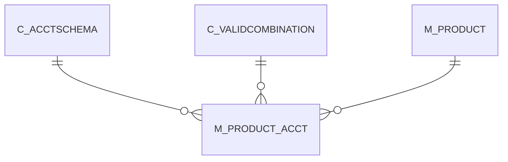

# M_PRODUCT_ACCT

Area [M](../../data-model/m/index.md) · class **business** (proposed) · read from database `idempiere-db` (owner `ADEMPIERE`) · 110 row(s) when profiled

Application model: `org.compiere.model.X_M_Product_Acct`, access level 3 - Client - Org.

## Columns

| column | type | key | not null | business name | references (code) | nulls | distinct |
|---|---|---|---|---|---|---|---|
| `M_PRODUCT_ID` | NUMBER(10,0) | PK | yes | Product | [M_PRODUCT](../../data-model/m/m_product.md) | 0 | 55 |
| `C_ACCTSCHEMA_ID` | NUMBER(10,0) | PK | yes | Accounting Schema | [C_ACCTSCHEMA](../../data-model/c/c_acctschema.md) | 0 | 2 |
| `AD_CLIENT_ID` | NUMBER(10,0) |  | yes | Tenant |  | 0 | 1 |
| `AD_ORG_ID` | NUMBER(10,0) |  | yes | Organization |  | 0 | 1 |
| `ISACTIVE` | CHAR(1) |  | yes | Active |  | 0 | 1 |
| `CREATED` | DATE |  | yes | Created |  | 0 | 24 |
| `CREATEDBY` | NUMBER(10,0) |  | yes | Created By |  | 0 | 2 |
| `UPDATED` | DATE |  | yes | Updated |  | 0 | 3 |
| `UPDATEDBY` | NUMBER(10,0) |  | yes | Updated By |  | 0 | 2 |
| `P_REVENUE_ACCT` | NUMBER(10,0) |  | yes | Product Revenue |  | 0 | 2 |
| `P_EXPENSE_ACCT` | NUMBER(10,0) |  | yes | Product Expense |  | 0 | 2 |
| `P_ASSET_ACCT` | NUMBER(10,0) |  | yes | Product Asset |  | 0 | 2 |
| `P_PURCHASEPRICEVARIANCE_ACCT` | NUMBER(10,0) |  | yes | Purchase Price Variance |  | 0 | 2 |
| `P_INVOICEPRICEVARIANCE_ACCT` | NUMBER(10,0) |  | yes | Invoice Price Variance |  | 0 | 2 |
| `P_COGS_ACCT` | NUMBER(10,0) |  | yes | Product COGS |  | 0 | 2 |
| `P_TRADEDISCOUNTREC_ACCT` | NUMBER(10,0) |  | yes | Trade Discount Received |  | 0 | 2 |
| `P_TRADEDISCOUNTGRANT_ACCT` | NUMBER(10,0) |  | yes | Trade Discount Granted |  | 0 | 2 |
| `P_INVENTORYCLEARING_ACCT` | NUMBER(10,0) |  |  | Inventory Clearing |  | 0 | 2 |
| `P_COSTADJUSTMENT_ACCT` | NUMBER(10,0) |  |  | Cost Adjustment |  | 0 | 2 |
| `P_WIP_ACCT` | NUMBER(10,0) |  |  |  |  | 57 | 1 |
| `P_METHODCHANGEVARIANCE_ACCT` | NUMBER(10,0) |  |  |  |  | 57 | 1 |
| `P_USAGEVARIANCE_ACCT` | NUMBER(10,0) |  |  |  |  | 57 | 1 |
| `P_RATEVARIANCE_ACCT` | NUMBER(10,0) |  |  | Rate Variance |  | 0 | 2 |
| `P_MIXVARIANCE_ACCT` | NUMBER(10,0) |  |  |  |  | 57 | 1 |
| `P_FLOORSTOCK_ACCT` | NUMBER(10,0) |  |  |  |  | 57 | 1 |
| `P_COSTOFPRODUCTION_ACCT` | NUMBER(10,0) |  |  |  |  | 57 | 1 |
| `P_LABOR_ACCT` | NUMBER(10,0) |  |  |  |  | 57 | 1 |
| `P_BURDEN_ACCT` | NUMBER(10,0) |  |  |  |  | 57 | 1 |
| `P_OUTSIDEPROCESSING_ACCT` | NUMBER(10,0) |  |  |  |  | 57 | 1 |
| `P_OVERHEAD_ACCT` | NUMBER(10,0) |  |  |  |  | 57 | 1 |
| `P_SCRAP_ACCT` | NUMBER(10,0) |  |  |  |  | 57 | 1 |
| `P_AVERAGECOSTVARIANCE_ACCT` | NUMBER(10,0) |  |  | Average Cost Variance |  | 0 | 2 |
| `M_PRODUCT_ACCT_UU` | VARCHAR2(36 CHAR) |  |  | M_Product_Acct_UU |  | 0 | 110 |
| `P_LANDEDCOSTCLEARING_ACCT` | NUMBER(10,0) |  |  | Landed Cost Clearing |  | 0 | 2 |

*references (code)* is the table the application model's code says a column points to; *Foreign keys* below are the constraints the database declares. Counts come from the profile; no value is ever shown.

## Check constraints

| name | expression |
|---|---|
| `SYS_C0020255` | `IsActive in ('Y','N')` |

## Foreign keys

**References**

| table | columns | on delete |
|---|---|---|
| [C_ACCTSCHEMA](../../data-model/c/c_acctschema.md) | M_PRODUCT_ACCT.C_ACCTSCHEMA_ID → C_ACCTSCHEMA.C_ACCTSCHEMA_ID | CASCADE |
| [C_VALIDCOMBINATION](../../data-model/c/c_validcombination.md) | M_PRODUCT_ACCT.P_AVERAGECOSTVARIANCE_ACCT → C_VALIDCOMBINATION.C_VALIDCOMBINATION_ID | NO ACTION |
| [M_PRODUCT](../../data-model/m/m_product.md) | M_PRODUCT_ACCT.M_PRODUCT_ID → M_PRODUCT.M_PRODUCT_ID | CASCADE |

**Referenced by**

_None._

## Write behaviour

- updates: **raw_sql_skips_updated**
- deletes: **deleted_by_cascade**
- change log: **recorded**
- evidence: 6 citation(s)

## Read by

| kind | name |
|---|---|
| Procedure | [M_Product_Category_Acct_Copy](../../logic/m_product_category_acct_copy.md) |

## Written by

| kind | name |
|---|---|
| Procedure | [M_Product_Category_Acct_Copy](../../logic/m_product_category_acct_copy.md) |

## Schema history

59 change(s); the latest:

| applied | release | operation | column | tickets |
|---|---|---|---|---|
| 2023-04-09T15:47 | iD11 | `add_constraint` |  | IDEMPIERE-5567 |
| 2023-04-09T15:47 | iD11 | `add_constraint` |  | IDEMPIERE-5567 |
| 2021-12-05T16:45 | i8.2z | `drop_constraint` |  | IDEMPIERE-5075 |
| 2021-12-05T16:45 | i8.2z | `drop_constraint` |  | IDEMPIERE-5075 |
| 2021-12-05T16:45 | i8.2z | `add_constraint` |  | IDEMPIERE-5075 |
| 2021-12-05T16:45 | i8.2z | `add_constraint` |  | IDEMPIERE-5075 |
| 2021-12-05T16:45 | i8.2z | `add_constraint` |  | IDEMPIERE-5075 |
| 2021-12-05T16:45 | i8.2z | `drop_constraint` |  | IDEMPIERE-5075 |
| 2021-12-05T16:45 | i8.2z | `drop_constraint` |  | IDEMPIERE-5075 |
| 2021-12-05T16:45 | i8.2z | `drop_constraint` |  | IDEMPIERE-5075 |
| 2021-12-05T16:45 | i8.2z | `add_constraint` |  | IDEMPIERE-5075 |
| 2021-12-05T16:45 | i8.2z | `add_constraint` |  | IDEMPIERE-5075 |
| 2021-12-05T16:45 | i8.2z | `drop_constraint` |  | IDEMPIERE-5075 |
| 2021-12-05T16:45 | i8.2z | `drop_constraint` |  | IDEMPIERE-5075 |
| 2021-12-05T16:45 | i8.2z | `add_constraint` |  | IDEMPIERE-5075 |

## Open conflicts

| type | attribute | explanation |
|---|---|---|
| `mandatory_but_nullable` | `columns.P_CostAdjustment_Acct.nullable` | unexplained |
| `mandatory_but_nullable` | `columns.P_InventoryClearing_Acct.nullable` | unexplained |
| `mandatory_but_nullable` | `columns.P_RateVariance_Acct.nullable` | unexplained |

## Notes

<!-- ekos:manual id="table.m_product_acct.notes" -->
_Business notes about this table._
<!-- /ekos:manual -->
